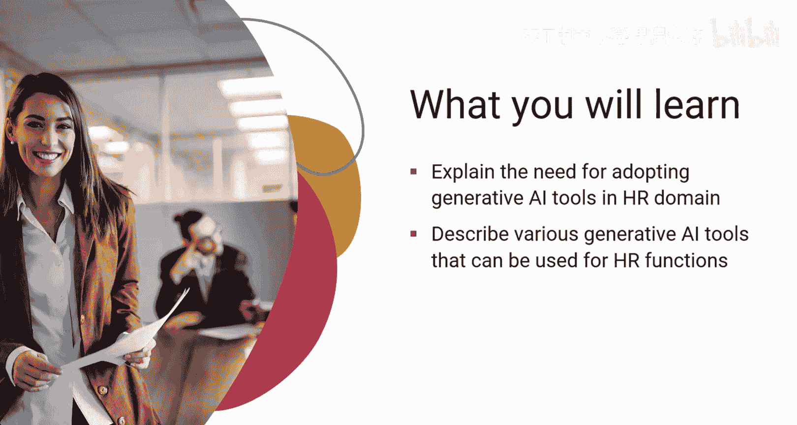
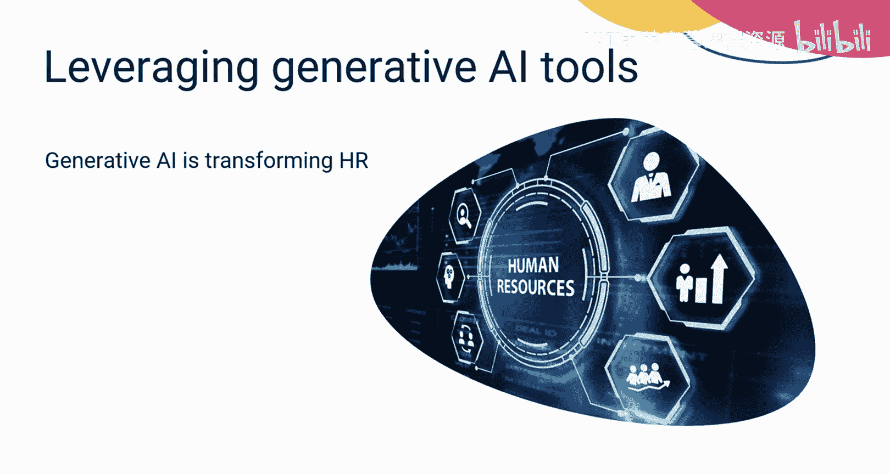
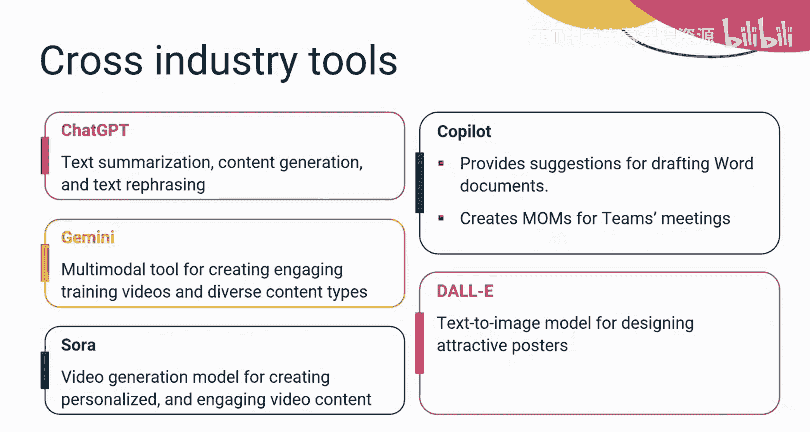
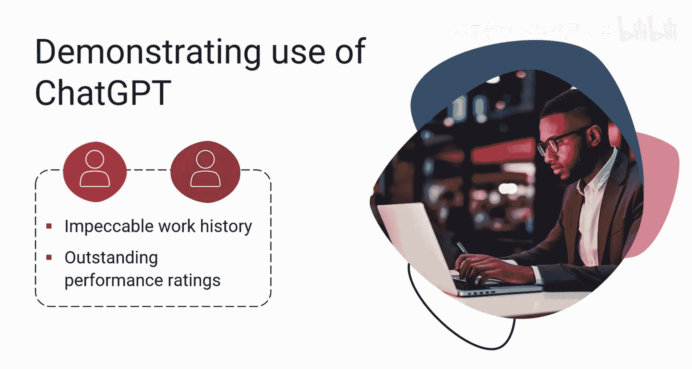
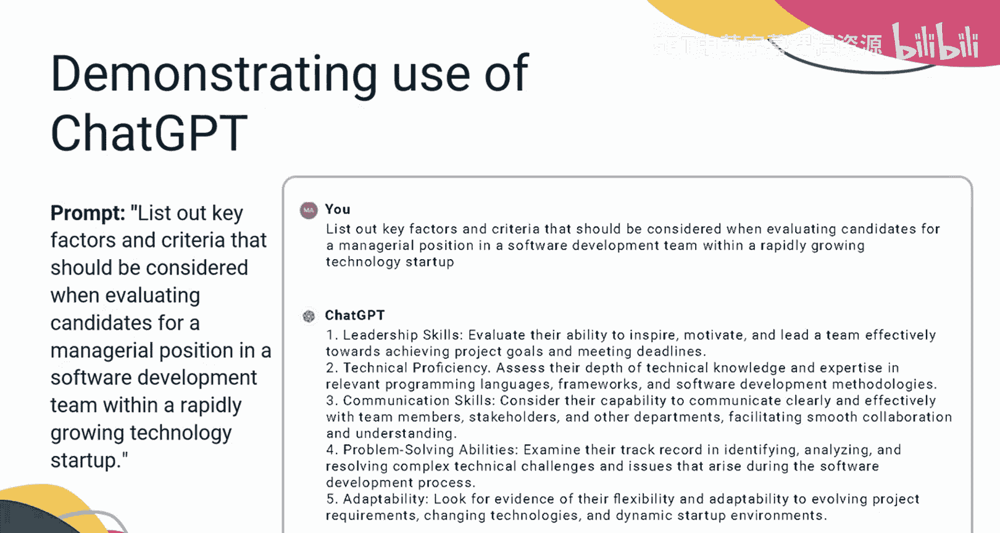
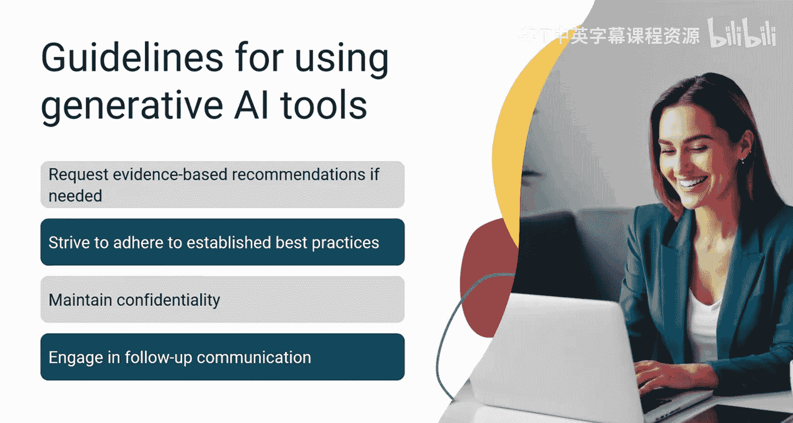
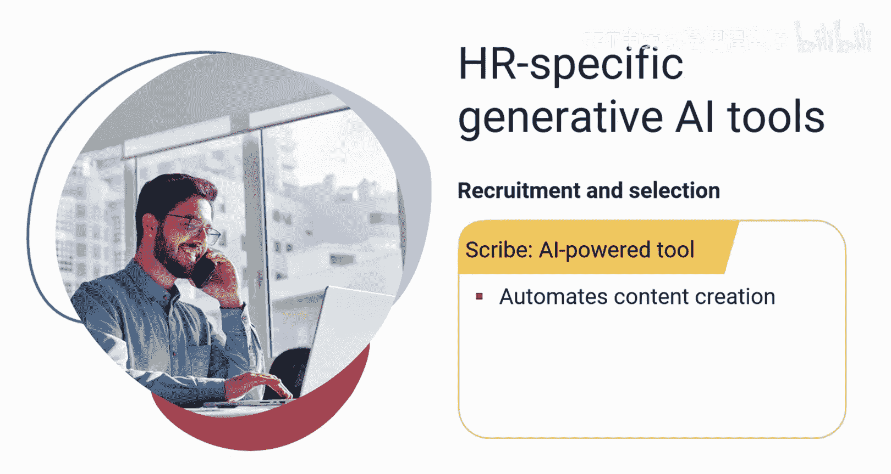
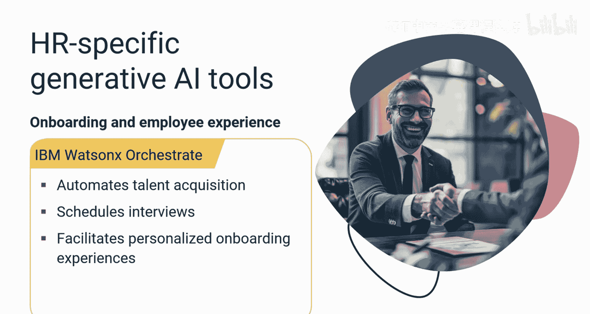
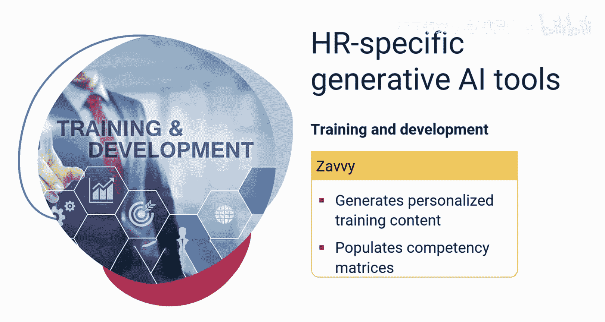
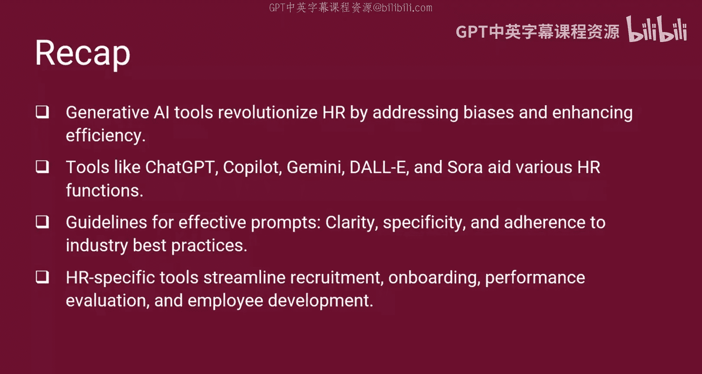

# IBM《生成式AI用于人力资源｜Generative AI for Human Resources (HR) Professionals》中英字幕 - P35：4_面向人力资源的生成式AI工具.zh_en - GPT中英字幕课程资源 - BV1Ese3zvEf4

Welcome to Generative AI Tools for HR。After watching this video。

 you will be able to explain the need for adopting generative AI tools in the HR domain and describe various generative AI tools that can be used for HR functions。

Generative AI is transforming the HR domain， making it efficient， data driven and personalized。

 the rapid advancement in the development of generative AI tools is encouraging companies to incorporate generative AI capabilities across different functions。

 including HR。

Advanced generative AI tools are highly sophisticated and can be utilized for features such as sentiment and predictive analysis。

 offering a wide range of applications across HR functions。

These tools are user friendly and affordable， making it easier for organizations of all sizes to adopt and integrate them into their HR workflows。

Multinational corporations are increasingly turning to generative AI tools within their HR departments to manage the overwhelming volume of job applications。

By utilizing this technology， they can identify and address biases present in job descriptions。

 ultimately resulting in a more diverse pool of candidates。

Startups are rapidly installing AI powered chatbots for onboarding purposes reducing the burden of administrative tasks on HR personnel。

In addition， Fortune 500 companies are capitalizing on generative AI tools for performance reviews。

 trying to eliminate subjective biases， inherent in traditional review processes。

The generative AI tools that can be used in the HR domain are divided into two broad categories。

The generic cross industry tools and HR specific Gen AI tools。

Cross industrydu tools can be utilized by HR professionals for general purposes。

 such as crafting detailed job descriptions， summarizing employee feedback for performance evaluations。

 and producing captivating training videos。Let's explore some of these tools。

ChatGT from Open AI can help HR professionals create meaningful job descriptions and summarize employee feedback during performance appraisals。

Coilt from Microsoft can be integrated across all Microsoft products。

 providing suggestions for drafting Word documents and creating minutes of meetings or MOMs from recordings on teams。

Google Gemini， a powerful multimodal tool can be used to create engaging training videos and diverse content materials to enhance employee learning experiences。

Dli from Open AI can be useful in designing attractive posters for employee engagement events and visual communication within the organization。

SoOA， a video generation tool from Open AI can be used to create personalized and engaging video content for various HR initiatives and internal communications。

Let's try to demonstrate the use of a generic tool like chat GPT to generate relevant output for the following scenario。

As an HR professional at a fast growing technology startup。

 your task is to select the next manager for the software development team。

This task is challenging as two outstanding candidates have been nominated for the same position。

 each with remarkable work histories and performance ratings from their superiors to ensure you make the best choice you should consider additional parameters for a thorough evaluation。

To augment your assessment， you can craft the following prompt。

 asking for suggestions on relevant parameters。List out key factors and criteria that should be considered when evaluating candidates for a managerial position in a software development team within a rapidly growing technology startup。

In response to the prompt， you can see the following output on the screen。

To get the desired response from the generative AI tools， it is important to craft effective prompts。

Let's have a look at the guidelines for creating effective prompts for generative AI tools to assist with various tasks across the HR functions。

Clearly， define the specific area of human resource management you're addressing。

 such as recruitment， diversity， or performance management。Include details about your industry。

 company size， region， or any specific policies that are relevant。

Avoid ambiguity by using precise and standard terminologies。

Clearly state what you hope to achieve or the recommendation you're seeking。

If you require substantiated information， ask for supporting evidence， research or citations。

Whenever possible， adhere to establish best practices in the industry。

Avoid sharing sensitive or personal information about employees or the organization。If necessary。

 ask follow up questions for clarification or additional information。

The HR specific generative AI tools cater to distinct HR functions。Let's explore a few such tools。

TexO employs AI to scrutinize job descriptions， identifying and rectifying biases。

 thus making them more inclusive Scri is an AI powered tool designed to automate content creation for recruitment purposes。

It generates job descriptions， competency guides， and learning outlines LISer helps develop AI powered chatbots customized for guiding new hires through the onboarding process。

IBM Watson X Orcheste Strelines， HR processes， automating tasks such as talent acquisition。

 from scheduling interviews to following up with candidates。Additionally。

 it facilitates personalized onboarding experiences for employees。

 including customized notes and training content。

FE offers a comprehensive solution for performance reviews。

 providing 360 degree feedback to assess employee performance from multiple perspectives。

Coherre Generate is a platform that empowers HR teams to create custom language models tailored to specific tasks such as resume screening or sentiment analysis。

Zavi specializes in generating personalized training content and populating competency matrices。

You have reached the end of this video。In this video。

 you learned that human resources face subjectivity and bias and decision making processes。

Generative AI tools are revolutionizing the HR domain by addressing biases and enhancing efficiency。

Tools like chat GPT， Copilot， Gemini， Dolly， and SOA。

 eight various HR functions guidelines for writing effective prompts include clarity， specificity。

 and adherence to best practices in the industry。HR specific tools help streamline recruitment。

 onboarding， performance evaluation， and employee development。These tools foster fairness。

 efficiency， and personalized experiences in HR。

