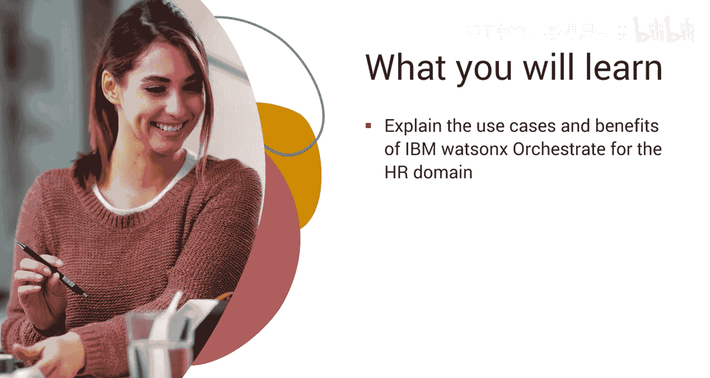
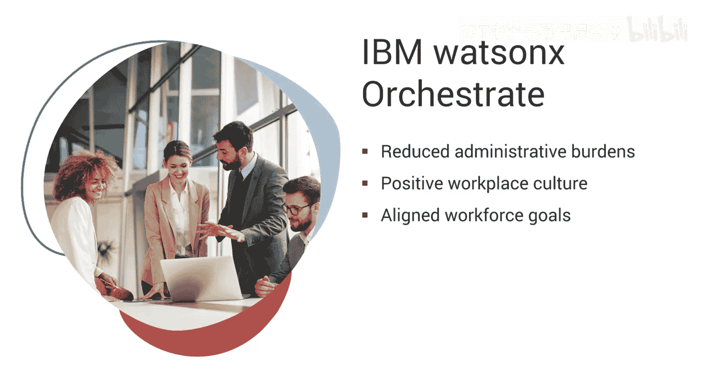
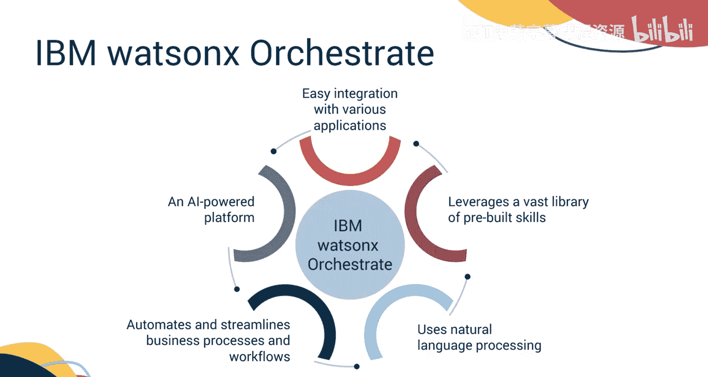
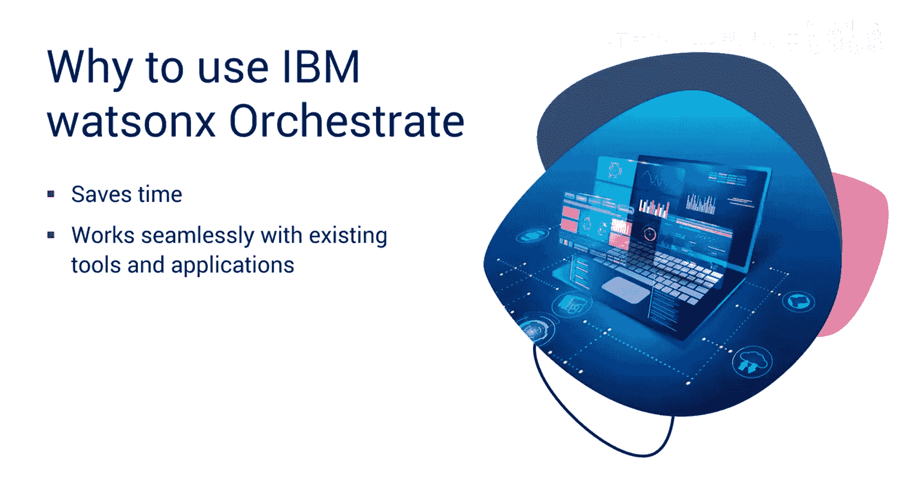
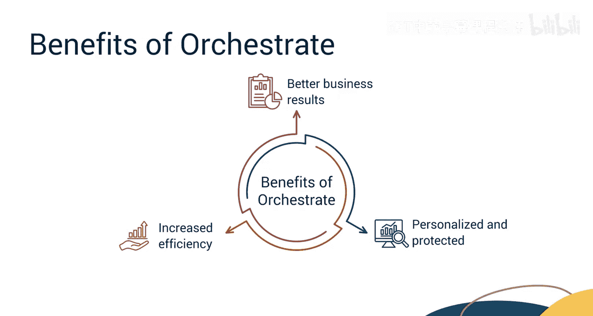
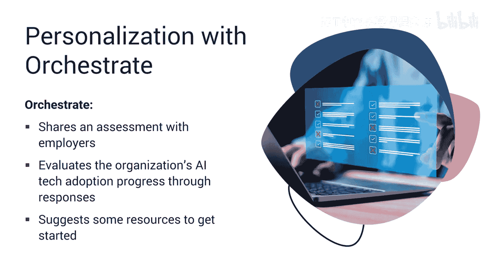
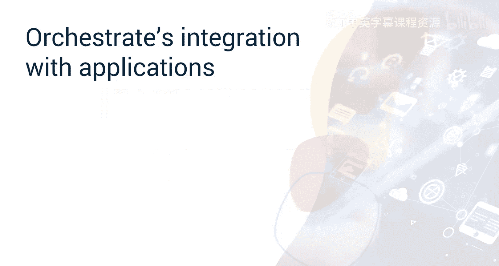
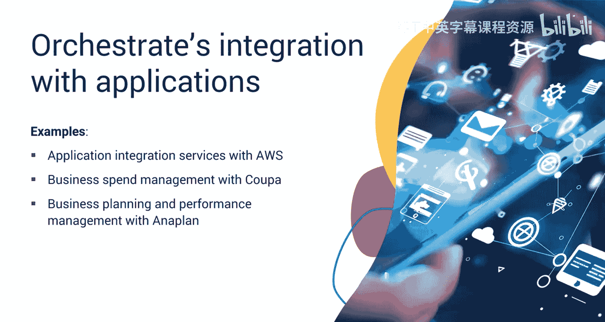
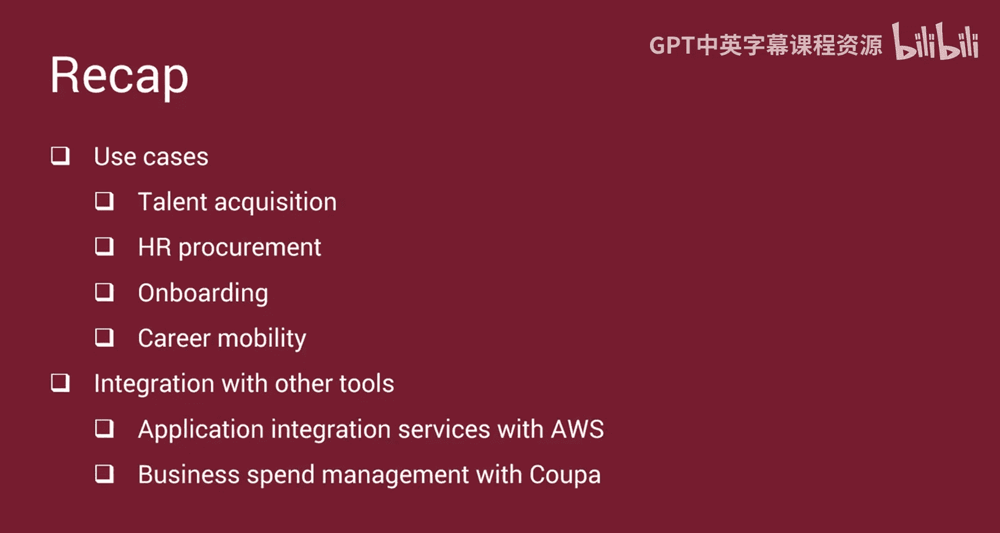

# IBM《生成式AI用于人力资源｜Generative AI for Human Resources (HR) Professionals》中英字幕 - P36：5_IBM WatsonX Orchestrate工具.zh_en - GPT中英字幕课程资源 - BV1Ese3zvEf4

Welcome to the IBM WatsonX Orcheste。

After watching this video， you'll be able to explain the use cases and benefits of IBM WatsonX Orte for the HR domain。

You'll also analyze examples of orchestra's integration with other applications and tools。

Do you feel overwhelmed by the increasing complexity and volume of HR tasks？

Does this lead to inefficiencies and reduced productivity？

What if your routine administrative burdens were lifted。

 and your team could dedicate its time to nurturing talent， fostering a positive workplace culture。

 and aligning workforce goals with organizational vision？Sounds impossible。

 it is actually not as we now have IBM WatsonX Orcheste。But what is it。Let's see。

IBM Watson X Orcheste is an AI powered platform designed to automate and streamline business processes and workflows。

It utilizes generative AI and automation technology to free up HR time by automating complex repetitive tasks。

It uses natural language processing to understand the requests and leverages a vast library of prebuilt skills to complete them。

Orcheste can be integrated with various applications like Salesforce and Gmail to automate tasks across different tools。

 freeing up HR's time for more strategic work。

Now you must be thinking about why to use the IBM WatsonX Orcheste。

It is because with IBM Watson X Orchestra， you can save so much of your time。

Work they used to take hours now takes minutes。Simply assign the tasks that you want orchestrate to tackle。

 like sending emails， scheduling meetings or interviews， or expediting requests。

 and it'll do the rest。Also， it will work seamlessly with the tools and apps that you already use like Outlook。

 LinkedIn， SAP success Factor， and more。The more you work together， the smarter it becomes。

 and the more personalized your experience gets。😊。

Using orchestrate for your HR functions has several benefits， such as increased efficiency。

Orchestrate automates complex， repetitive tasks， allowing HR to focus on strategic initiatives。

Orchestrate gives better business results。It employs natural language to interact with people and streamline workflows by creating intelligent assistance to complete tasks orchestrate is personalized and protected。

It can be customized as per the organization's needs within a highly secured environment。

You must be wondering how orchestra can be personalized to your organization's needs。To do that。

 orchestrate shares an assessment。Employers who have subscribed to orchestrate will receive a set of questions。

 including technical and non technical ones。The assessment is done to check an organization's progress in adopting the latest AI technologies。

Based on the response to the questionnaire， orchestrate will suggest some resources to get started on the journey。

Let us now look at some of the use cases where orchestrate can be applied successfully。

Beginning with talent acquisition， orchestrate can handle interview scheduling and follow up communications。

 working tirelessly to ensure that the talent acquisition process runs smoothly。

 want to know how orchestrate does this。Let's look at this video that illustrates the hiring process。

 getting easier with Digi， a digital employee， which is a software driven entity designed to handle end to end work processes autonomously。

With Watson Orcheste， didgie handle the monotony of the hiring process for you。

 alleviating the stress of your job？You can ask your Digi to do lots of things。

 let's start by asking your Diy to create a job posting。Your digi can， copy。

 and share the job description template with the hiring manager you'll automatically get reminders for when it's updated and approved and eliminate unnecessary back and forth Ds will also alert you when there's a need to create new ones。

Okay so we've created the posting now let's get it noticed creating a social media post can be just as easy and to be honest。

 lots of fun for example， your Di can quickly post and advertise the job opening for you and you can even share the job opening with the sample message with the hiring team so they can help you reach great candidates in their networks too it's that easy。

Now that you're done creating the post and socializing it， we're on the most important part。

 connecting with candidates， your Dgi can work with lots of different systems and pull a list of potential candidates for your job posting the candidate's contact information is all in one place so you can easily reach out and encourage them to apply。

Watch how your Digi helps you identify the candidates in the job postings location。

 and that's just the beginning。Orcheste can automate manual procurement tasks based on changing business priorities Orcheste can also aid with onboarding。

It can set up accounts， standardize the experience for each new employee。

 ensure that each new hire receives the same level of attention and information and schedule training sessions and welcome emails。

 saving you time to engage the new team member Orcheste can help with career mobility too。

It simplifies the busy work of analyzing mobility opportunities and employees who would benefit most from advancement。

What's more， you can easily integrate IBM WatsonX Orcheste with your current tools for a seamless experience。

Let's look at an example where this way Global and IBM Watsonex Orcheste combine the value of DJs with an engine that can help you increase the diversity of your talent pool and identify qualified candidates。

IBM Watson Orcheste and this way Global combine the power of your Watson Orcheste Digital employee or Digi with this way Global's diversity sourcing and matching engine。

 so you can find qualified candidates from a diverse talent pool。 Here's how it works。 First。

 let's find qualified candidates for the job。In this case， the job descriptions reside in box。

 Just select the job you need to hire for and your dii connects with this way Global's candidate sourcing technology to provide you with potentially hundreds of matches。

 You can also filter for specific locations here， we're pulling candidates from Denver。

 Colorado through this way Globals discover service。 Once you have your list。

 you can easily save the file for future reference。😊，Now。

 you can contact the candidates you selected using the save data。

 Let's encourage them to apply for the opportunity。

 Note that the email comes from your email address。

 so the message is less likely to be flagged by spam filters。

 You can even use custom templates and personalize for your audience。

Your diit curates and sends the email to your selected candidates， including a link to apply。

Other examples where IBM Watson X orchestrate synergizes with your day to day applications are。

Application integrationeg Services with AWS。Business spend management with Cooper。

Business planningning and performanceance management with Annaplant。

 data Viualization with Microsoft Power BI。

In this video， you learned about an AI powered platform， IBM WatsonX Orcheste。

 designed to automate and streamline business processes and workflows。

You learn that it uses natural language processing to understand the requests。

You also explored some of its benefits， like increased efficiency， better business results。

 and personalized and protected service。You further explored its use cases in talent acquisition。

 HR procurement， onboarding and career mobility。You also explored some applications that can easily be integrated with orchestrate。

 like application integrationration Services with AWS， business Ben Management with Co， etc。

