# IBM《生成式AI用于人力资源｜Generative AI for Human Resources (HR) Professionals》中英字幕 - P37：6_人力资源领域的AI智能体.zh_en - GPT中英字幕课程资源 - BV1Ese3zvEf4

Welcome to AI Ages for Human Resources。

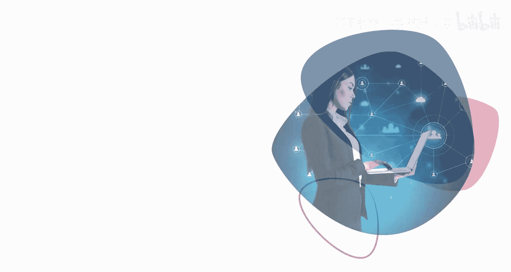

After watching this video， you will be able to explain the use cases and benefits of using AI agents or virtual assistant in human resources or HR。

Additionally， you will explore examples of autonomous AI agents designed specifically for HR functions。

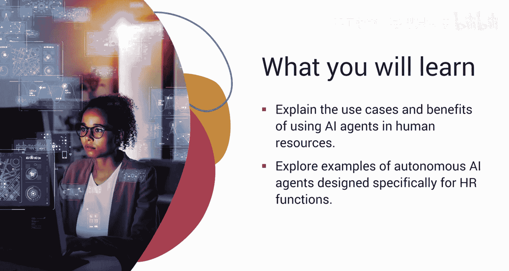

Furthermore， you will be able to identify how AI agents act as allies to professionals。

 emphasizing the human in the loop approach。Imagine being an HR professional and juggling100 tasks from screening candidates to answering their never ending queries。

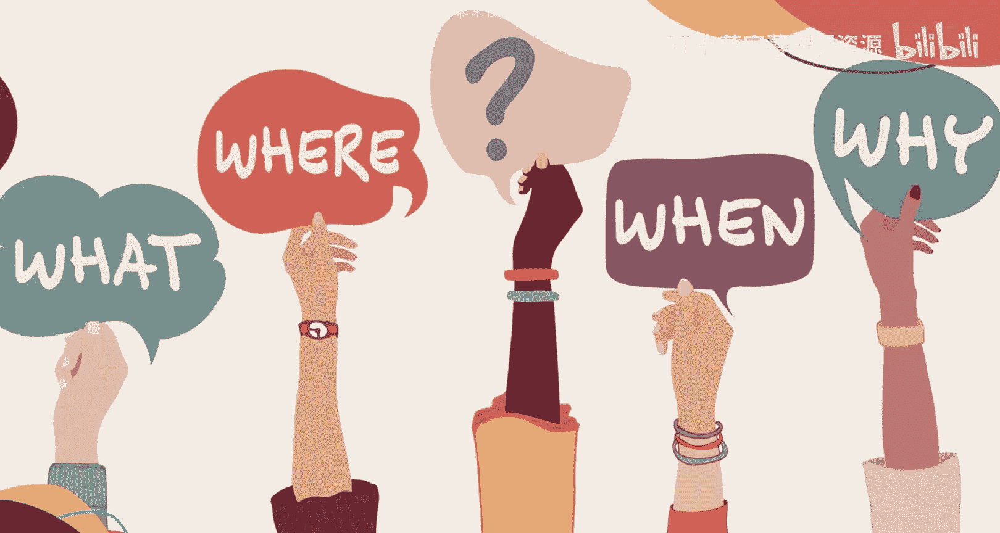

Now imagine around the clock assistant who can work tirelessly 24 by7。

 answering candidates questions while efficiently finishing the onboarding paperwork。

 that is the power of AI agents in HR， but who are these AI agents Well think of them as your virtual assistants。

 which are created by generative AI with a mission to automate the never ending loop of HR tasks。

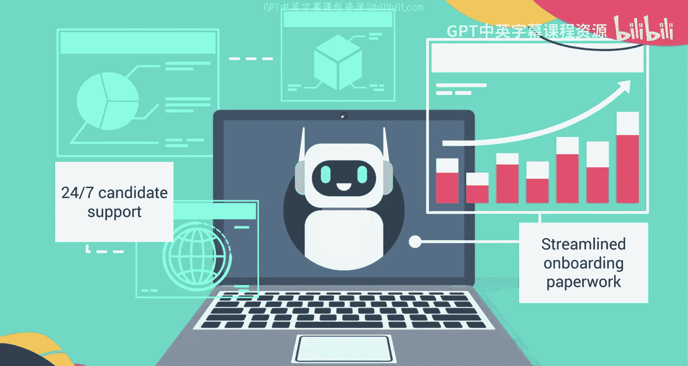

Whether it is to screen resumes， schedule interviews。

 or draft the onboarding paperwork for a new hire， AI agents use natural language processing or NLP and deep learning to streamline all your HR processes。

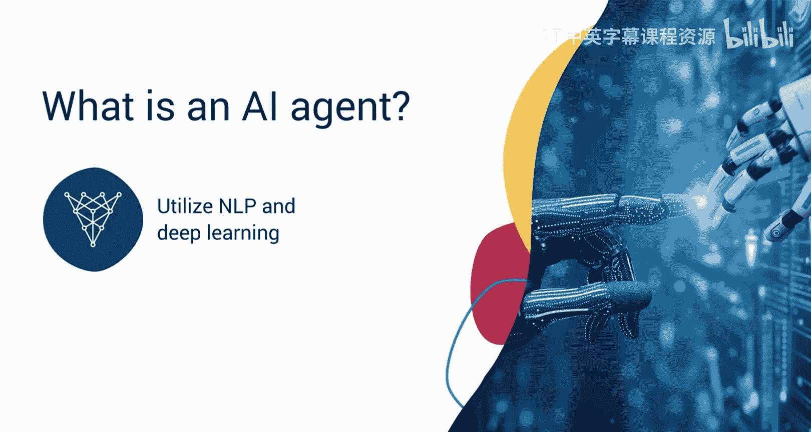

AI agents are not just your taskmasters， but also wired to prioritize and delegate。

They break down complex instructions into well defined。

 clear ones to help you achieve the projected deadlines efficiently。

 they use advanced AI algorithms to optimize resource allocation and prioritize tasks based on urgency and importance。

Additionally， AI agents have the expertise to personalize and provide every candidate with a tailored experience to support and assist them throughout their onboarding journey。

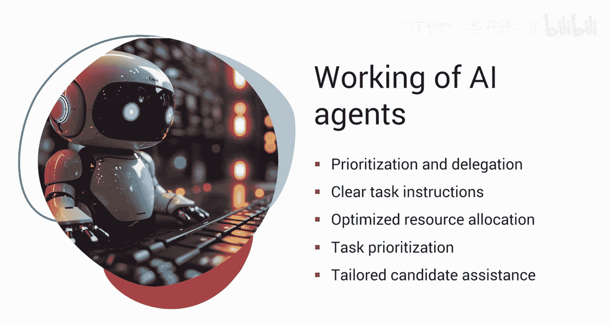

AI agents are designed to work in some specific scenarios as well。For example。

 recruitment chatbots are the most in demand as virtual assistance。

They manage the inquiries put up by the applicant and schedule interviews based on the necessary information collected。

Virtual interview assistants are AI power tools that assess the candidate skills and evaluate whether they are a cultural fit for the organization。

This is done by organizing video interviews with the applicant。

 which streamlines the hiring process largely。Next。

 there are employee onboarding tools that guide new hires through the onboarding process and provide them with necessary resources and assistance whenever needed。

These tools address the numerous questions， new hires usually have to ensure a smooth transition。

 another example is HR help desks that act as virtual HR managers and attend to employees queries about benefits。

 policies and company culture。This takes a big load off the HR team members。

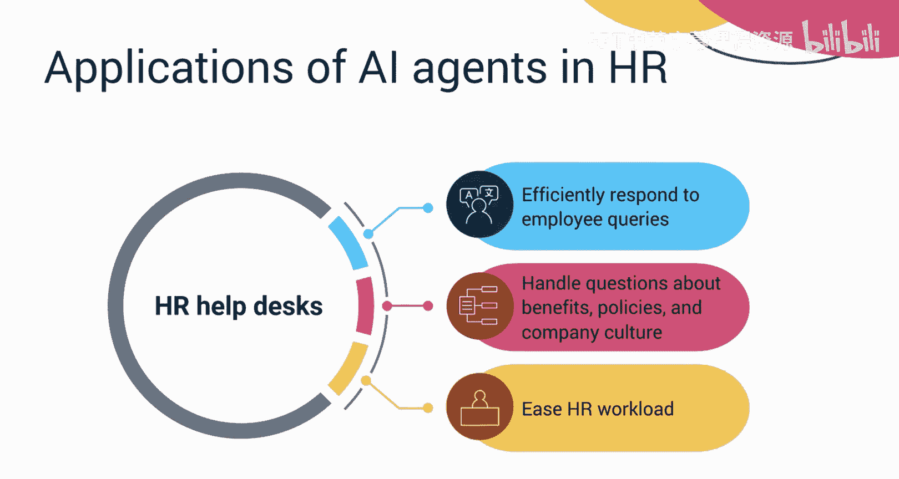

Let's get acquainted with some of these AI superheroes now。Meet Sc。

 the recruitment powerhouse who sifts through other quickly。

It analyses candidates based on their skills， experience。

 and keywords to shortlist the qualified ones sufficiently。

 thereby saving HR professionals quite a lot of time， then there is Willow。

 your onboarding buddy that makes the transition of every new hire as smooth as possible by being available 24 by7 and answering all the questions a new joiner might have Sage is the performance whisperer that not only helps HR by performance analysis of employees。

 but also aids the employees by recommending relevant training programs and identifying trends and areas of improvement。

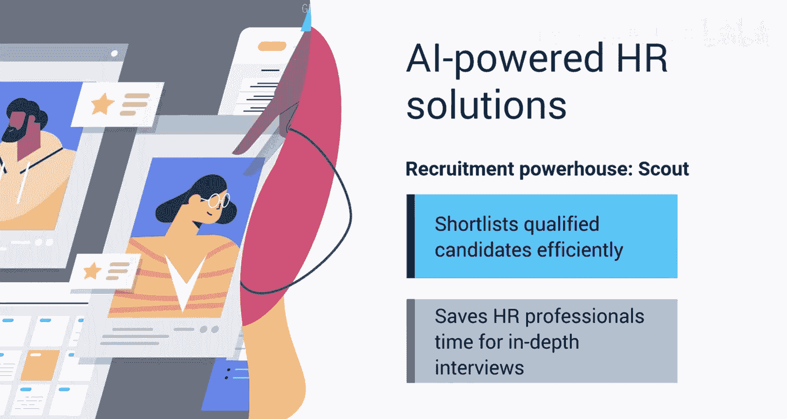

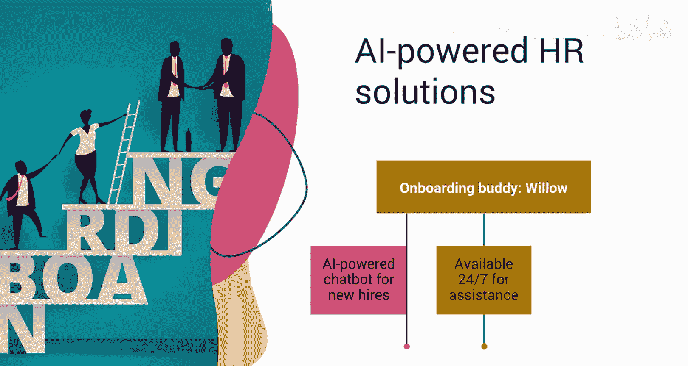

Then there is retain， the AI retention agent that vigilantly monitors employee sentiment to prevent turnover。

It also proactively addresses concerns to ensure employee satisfaction。

With these AI agents at your disposal， it's not just about handling the HR tasks better。

 but also about creating a happier and more productive workforce。

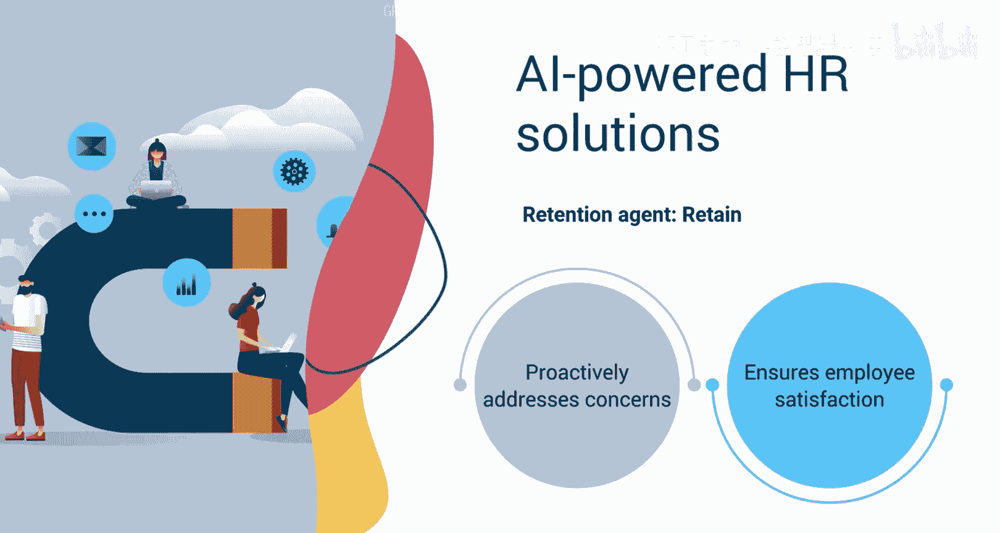

But an often asked question is， what about the human touch？While these agents are not a replacement。

 but rather an enhancement that elevates efficiency and reduces the workload of HR professionals。

 these agents are like trusted superheroes that enable HR professionals to devote more of their time towards strategic initiatives and create a work environment built on empathy。

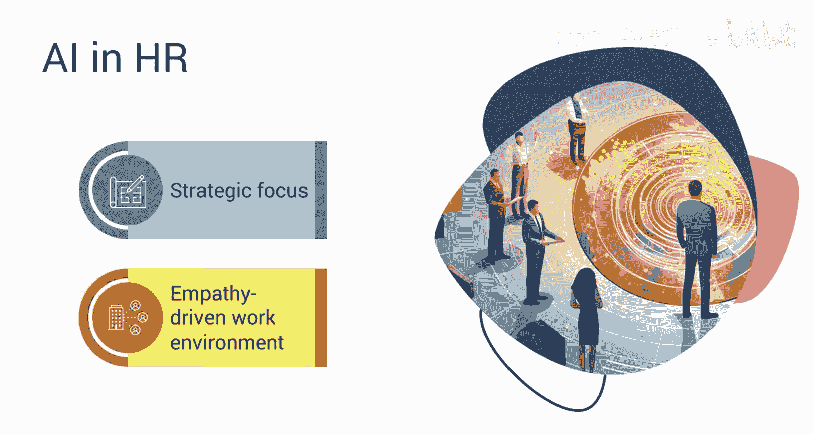

In this video， you learned how the rise of AI agents has transformed the world of HR。

You also learn that these AI agents streamline HR processes such as screening resumes。

 scheduling interviews， and creating onboarding paperwork through NLP and deep learning。Additionally。

 you explored specific examples of AI agents such as recruitment chatbots。

 virtual interview assistance， employee onboarding tools， and HR help desks。Furthermore。

 you are introduced to AI agents like Scout for Recruitment， Willow for onboarding。

 Sage for performanceance Ana， and retain for retention。Finally。

 you learned about the human in the loop process and the importance of ethical AI development in HR practices。

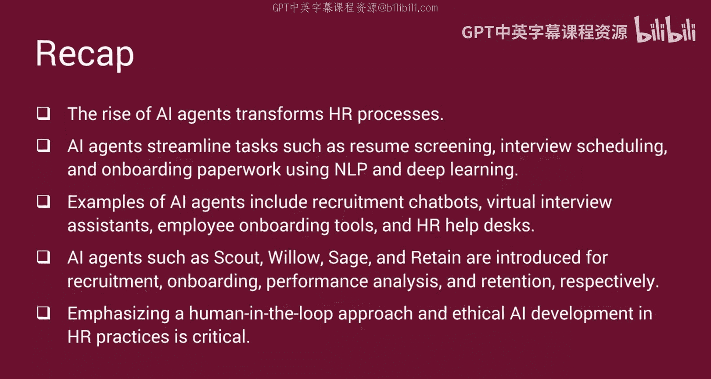

