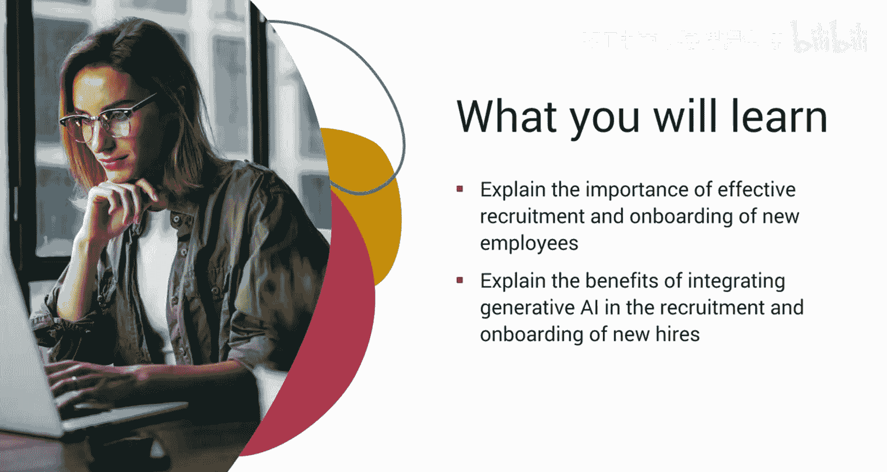
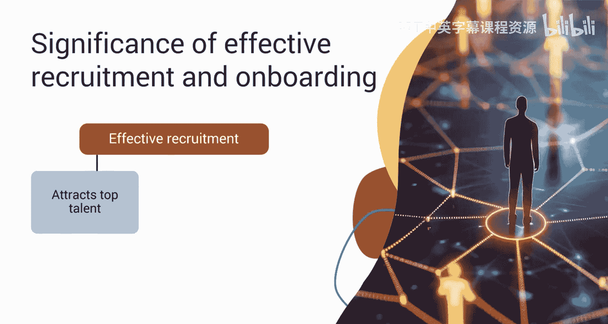
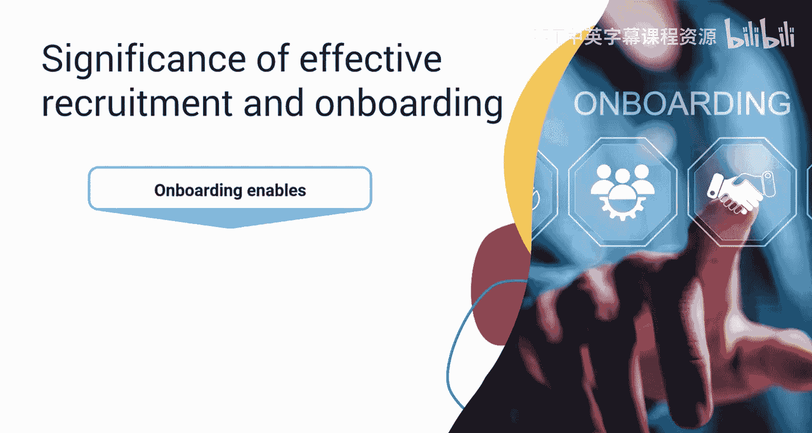
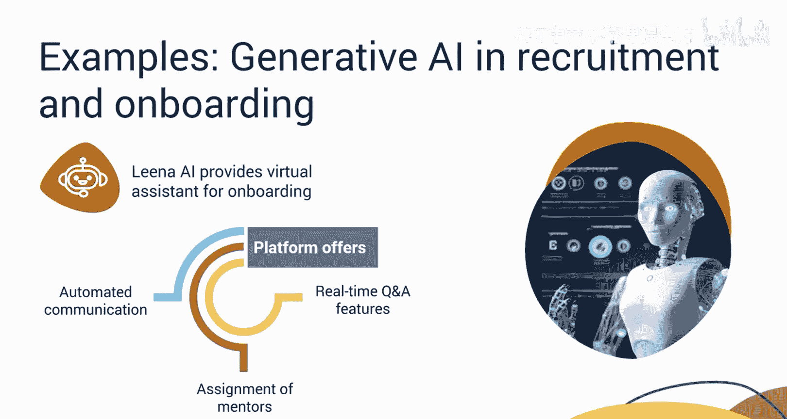
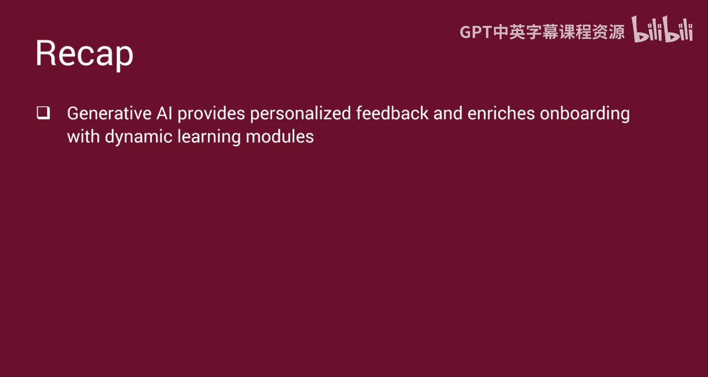

# IBM《生成式AI用于人力资源｜Generative AI for Human Resources (HR) Professionals》中英字幕 - P39：8_新员工招聘与入职管理.zh_en - GPT中英字幕课程资源 - BV1Ese3zvEf4

Welcome to the video， Rerument， and onboarding of new hires。

After watching this video， you will be able to explain the importance of effective recruitment and onboarding of new employees Ex the benefits of integrating generative AI in the recruitment and onboarding of new hires describe the steps involved in integrating generative AI into the recruitment and onboarding process In today's competitive business environment。

 effective recruitment is crucial as it helps attract the top talent in the market It gives the organization a competitive edge over its rivals by ensuring access to a pool of qualified and skilled candidates。

 The next step is employee onboarding， which is an extensive process that facilitates the transition of new hires into their roles within the organization but why is onboarding crucial for new hires onboarding enables them to adapt to the work environment assimilate into the company culture and become productive members of the team According to a gallup poll study。

 70% of employees who had a positive onboarding experience considered their job as the best possible。

😊。

However， only 12% felt their company effectively onboarded the new team members。 Therefore。

 companies must try to make their process of onboarding as smooth and effective as possible。

 generative AI is transforming the recruitment and onboarding experience， ensuring efficiency。

 engagement and immediate adaptability。 Let's explore the various activities or tasks involved in the recruitment and onboarding process and understand how generative AI can be integrated into these tasks。

 The first step is to create precise job descriptions before posting a job opening。

 the HR collaborates with the hiring team to understand the requirements of the roles。

 both technical and soft skills。 This information can be put into tools like chat GT Gemini and copilos。

Seeking the assistance of large language models， the HR team can generate detailed job descriptions。

 these descriptions offer a brief overview of the company and outline the required experience skillet and excitations from the candidates。

 evaluating candidates from a vast pool of applications can be both tedious and timecon to streamline this process HR departments can utilize talentsoururcing tools like seedling which leverages generative AI technology these tools automatically screen resumes from the database and analyze the social media profiles of the candidates including platforms like LinkedIn。

 Qa stack overflow and Gitthub using predefined criteria based on the job descriptions these tools assess the technical proficiency and collaborative skills of the candidates and then assign scores to profiles that closely match the required qualifications After the initial screening。

 the HR team can evaluate the top candidates for further rounds After identifying the suitable candidates。

😊，Next step involves assessing them using AI agents like LizR these agents can post technical questions that are related to surgeon use cases to evaluate the problem solving abilities。

 analytical thinking， and stress management skills of the candidates。

HR can also use generative AI tools like Wordtune to send personalized emails to selected candidates。

 delivering interview feedback and outlining the selection process Additionally。

 these tools can also generate personalized feedback for candidates who are not moving forward to the next rounds。

 ensuring clear communication and a positive experience throughout the recruitment process。

During the orientation program， newly hired employees can be provided access to a selfservice portal。

 these portals are equipped with question answering chatbots that offer information on various aspects such as company policies。

 organizational structure， compensation， benefits， and team members。

HR can employ text to audio and text to video generative tools like GPT and SoOA。

 from open AI to craft dynamic and personalized learning modules for onboarding。

 these modules integrate simulations， virtual reality experiences。

 and gamified elements tailored to the skill sets， learning preferences。

 and job needs of the employees。Moving further， new employees can be seamlessly unified with their teams through engaging in virtual team building activities Finally。

 generative AI can also be leveraged to examine performance data to detect patterns and areas that need improvement by establishing clear goals。

 feedback mechanisms and continuous monitoring systems HR can propose adjustments to the onboarding program here are some examples of generative AI platforms being used in various phases of the recruitment process and onboarding of new hires the talent acquisition team at Ex group has developed an AI powered platform that enables personalized email communication with candidates who have applied for a job vacancy。

😊，Incorporates AI driven features such as F scoring。

 candidate matching and one-way interviews offers automated AI scheduling。

 eliminating the need for time consuming back and forth communication when arranging interviews since the implementation of this comprehensive AI powered platform Electrolex has observed significant improvements in various recruitment metrics。

 for example， the application conversion rate has increased by 84% time to hire has reduced by 9% and 20% of recruitment time has been saved by conducting one way interviews Ael Global has introduced Aelia and AI powered chat assistant designed to handle employee inquiries Aelia is proficient in managing various processes including employee onboarding and training Lena AI specializes in providing virtual assistance specifically for onboarding processes the platform offers automated communication assignment of mentors and Realtime Q and A features facilitating a seamless。

😊，For both in person and remote hiresIn this video you learn that effective recruitment is crucial for organizational success attracting top talent from the market onboarding plays a vital role in employee adaptation and productivity yet many companies struggle to provide a positive experience generative AI streamlines recruitment and onboarding processes。

 enhancing efficiency and engagement it assists in crafting precise job descriptions。

 screening candidates conducting interviews and providing personalized feedback Additionally。

 it enriches the onboarding experience with dynamic learning modules and virtual team building activities。

