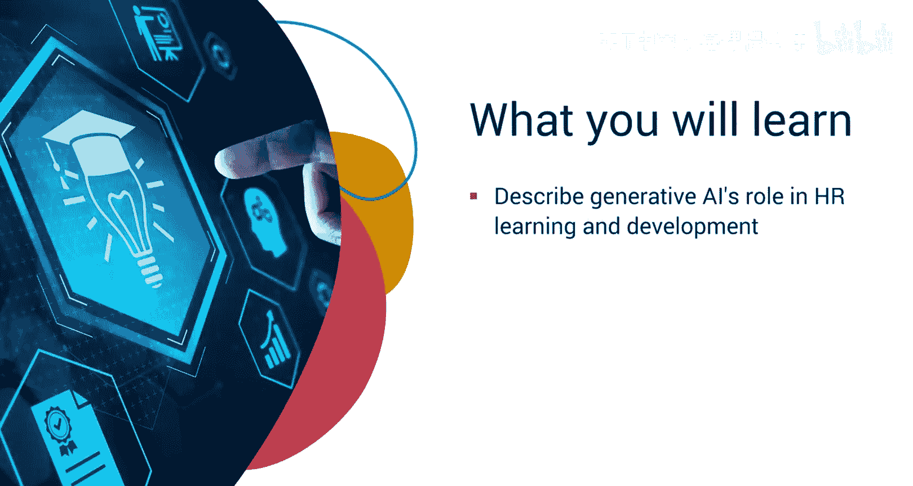
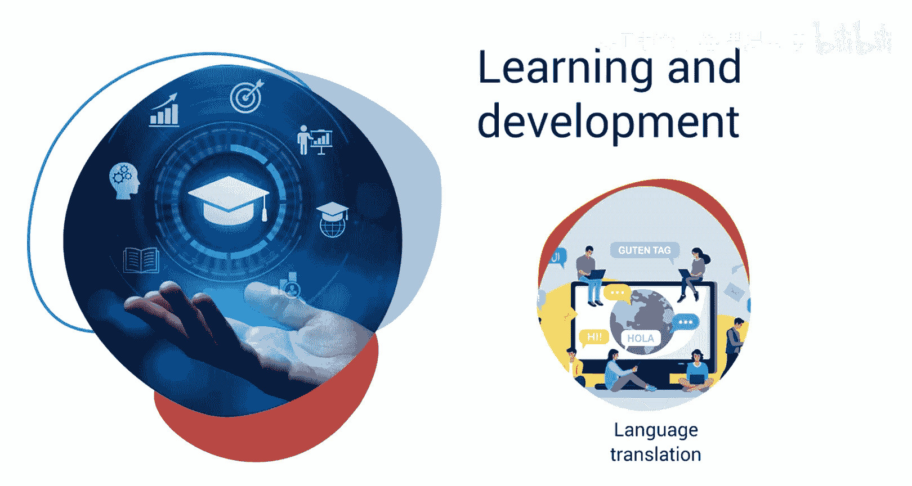
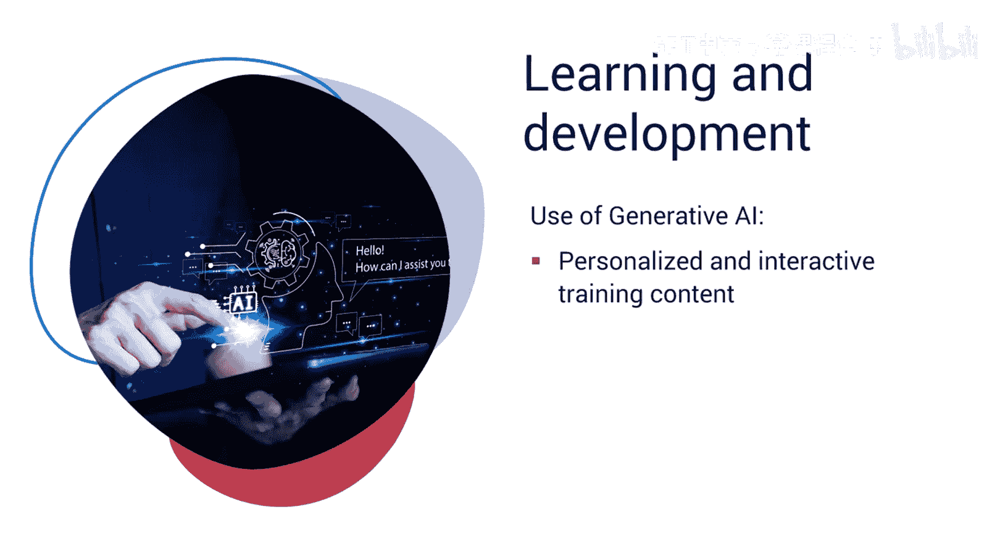
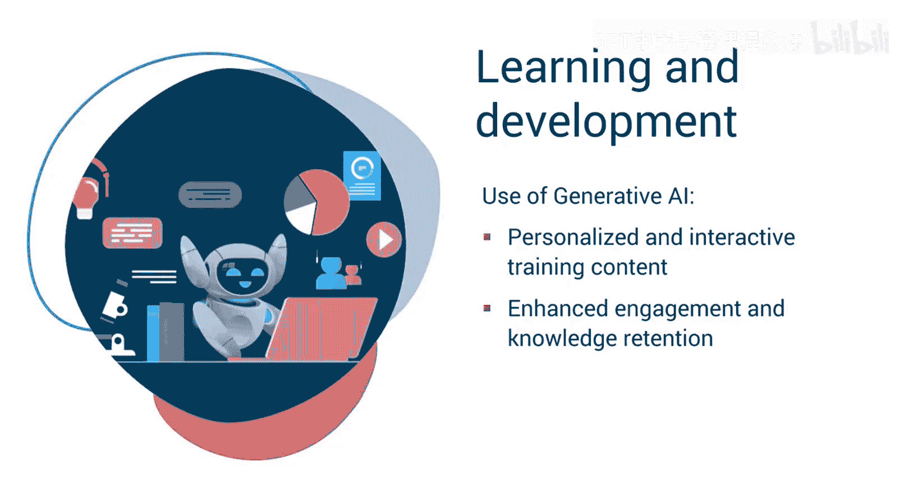
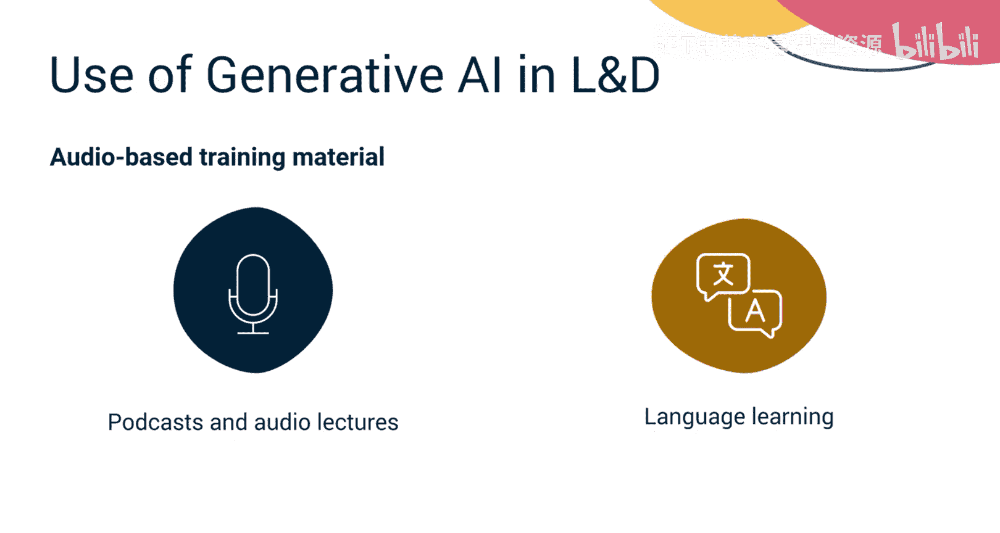
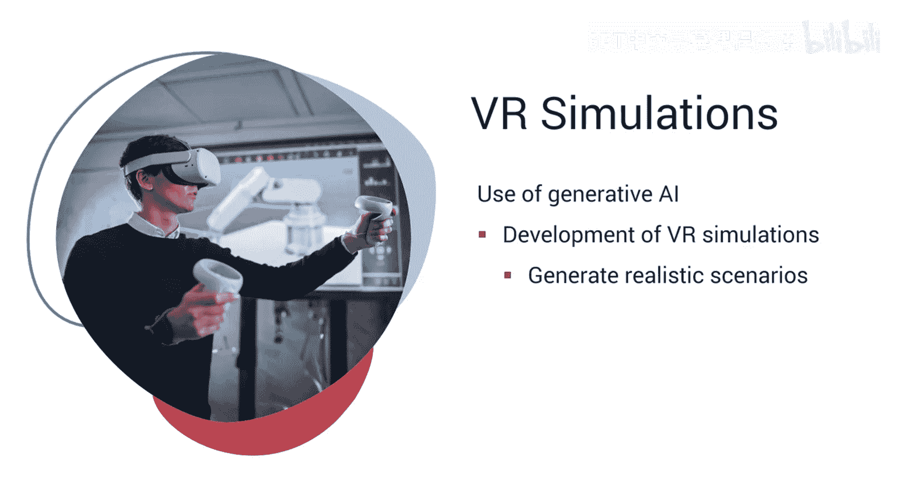
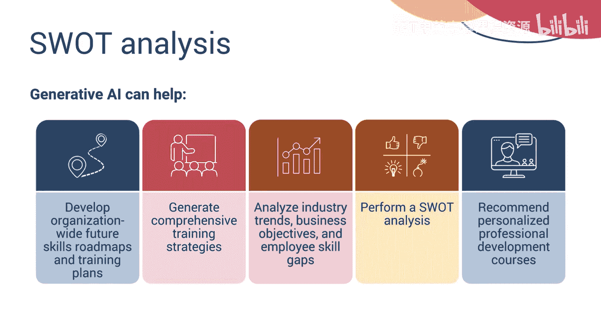
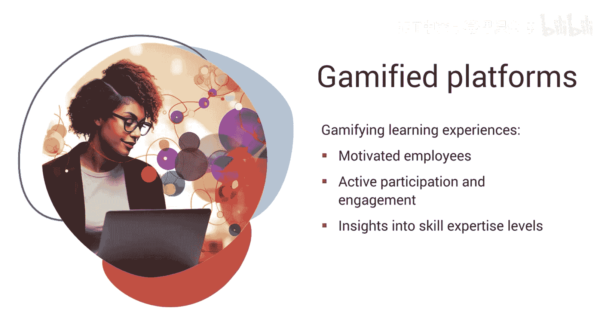
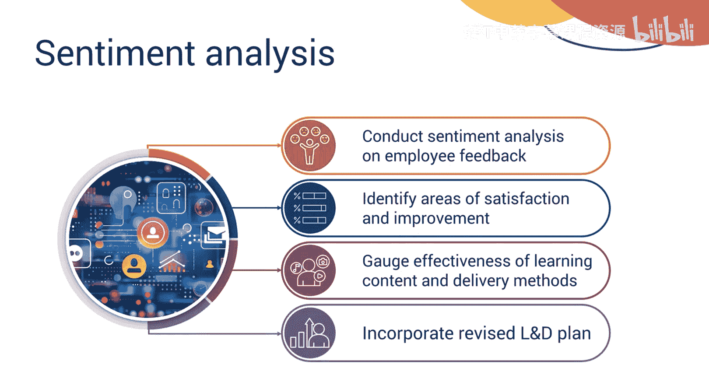
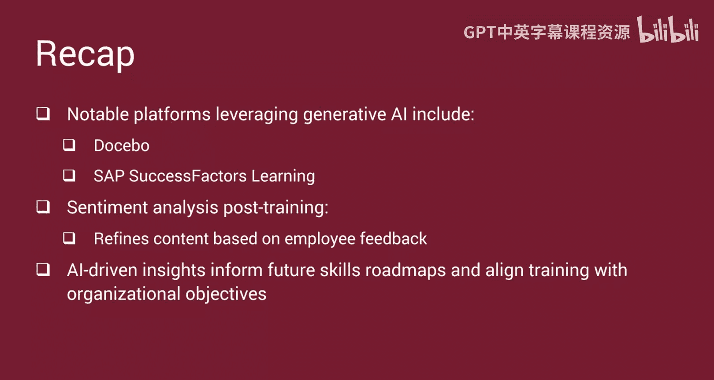

# IBM《生成式AI用于人力资源｜Generative AI for Human Resources (HR) Professionals》中英字幕 - P40：9_促进学习与发展.zh_en - GPT中英字幕课程资源 - BV1Ese3zvEf4

Welcome to enabling learning and development After watching this video you will be able to describe generative AI's role in HR learning and development you'll also be able to explain generative AI's use in enabling learning and development in today's dynamic workplace D ahead of the curve is very crucial the learning and development or L&D function is the secret weapon for developing a skilled and adaptable workforce but what if we could supercharge L&D with cutting edge AI Imagine if training content is personalized as per your learning style and you could get responses to your questions with a virtual coach or translate into your native language on the fly Fortunatelyly all this is a reality and an exciting potential for leveraging generative AI in the learning and development function generative AI has reshaped how you can enable your employees to learn and grow in the workplace as it enables the creation of personalized and interactive training content tailored to individual needs and preferences fostering enhanced engagement。

😊。

And knowledge retention。 Let us now dive deeper into this。

Generative AI enables the creation of engaging and effective training material across various formats。

 such as text， images， and audio。The textgen capability of generative AI can be utilized to generate textbased e- learningarning content。

 including instructional materials， quizzes and assessments it can also be utilized for technical skills training or generative AI can create manuals。

 tutorials and different types of documentation you can also leverage generative AI to create scenarios and case studies for developing soft skills or domainspec training such as sales and customer service training here。

 generative AI can help generate scripts simulating customer interactions allowing sales and customer service teams to practice handling various situations effectively That's not all it can also create scenarios tailored to specific customers and train employees on objection handling and product knowledge Apart from text generation。

 you can use the imagegeneration capability of generative AI to generate visual aids such as infographics。

 diagrams and product illustrations to explain new features and specific。😊。

In product training if you need realistic simulations and scenarios to provide handson training experiences to your learners。

 leveraging generative AI is the best solution Audbased training materials such as podcasts and audio lectures or language learning can also be created utilizing the audio generation capabilities of geneative AI not only for training content of diverse forms geneative AI can also help design virtual reality or Vr an augmented reality or AR simulations to develop training modules For example。

 a manufacturing company uses generative AI to develop VR simulations to train employees on equipment operation and safety protocols These simulations accurately replicate factory environments and generate realistic scenarios for handson learning geneative AI also analyzes employee data such as performance reviews skills assessments and career goals to recommend personalized learning paths for each employee for instance。

Marketing manager wants to upskill in digital marketing using generative AI she completes an initial assessment that identifies her preference for visual learning and hands on practice The AI then curates a personalized learning plan。

 recommending video tutorials， interactive simulations and case studies It schedule short daily modules and integrates real-time feedback and adaptive quizzes to ensure comprehension Her progress is continuously monitored and the AI adjusts the difficulty and type of content dynamically。

 providing a tailored and efficient learning experience aligned with her unique style and goals。😊。

As an HR professional， generative AI provides personalized career recommendations for your employees while also assisting you in developing organizationwide future skills roadmaps and training plans。

 AI algorithms can generate comprehensive training strategies to ensure that the organization remains competitive and future ready by analyzing industry trends。

 business objectives and employee skill gaps This is done by the automated strengths， weaknesses。

 opportunities， threats or SWD analysis of each employee identifying areas for improvement and growth opportunities based on the analysis。

 AI algorithms also chart out personalized professional development courses to address identify gaps and capitalize on strengths now imagine a learning platform that can craft learning solutions tailored to your needs adjust issues in real time and generate personalized rewards generative AI is introducing gamification into L&D helping transform dull content into engaging and interactive challenges thus。

Lning an exciting adventure I gamified platforms for skill assessment and evaluation enhances active participation from learners。

 while HR gains valuable insights into individual and collective skill expertise levels。

To encourage an employee to complete the assigned courses。

 generative AI enables you to automate nudges and reminders。

 AI algorithms can send timely reminders and messages by analyzing employee engagement patterns and learning progress。

😊，Increasing course completion rates and overall learning effectiveness。

Various platforms use generative AI to create personalized learning paths。

 recommend relevant courses and track employee progress a few of them are。Docibo。

Cornerstone Learning Experience platformform。Dereed。

SAP Succs Factor Learning and Workday learninging。After the trainings are completed。

 you can use generative AI to conduct sentiment analysis on employee feedback regarding completed courses and identify areas of satisfaction and areas for improvement by analyzing sentiment you can gauge the effectiveness of the learning content and delivery methods based on the feedback AI algorithms can suggest revisions to the L&D plan aligning it more closely with employees revised goals and preferences this iterative process ensures that the L&D initiatives remain relevant and impactful in meeting the organization objectives In this video you learned how generative AI revolutionizes training content creation。

 spanning text， I， audio and immersive experiences。

 text generation crafts e-learning materials technical documentation and soft skills scenarios such as sales simulations。

 I generation aids with infographics and product illustrations while audio generation support podcasts and language learning Moreoverover it designs VR and AR。

😊。

Such as factory environments for handson training， analyzing employee data。

 it tailorors personalized learning paths and career recommendations。

 fostering skill development gamification enhances engagement with AI automating nudges for course completion notable platforms include Dochibo and SAP success factors learning。

 posttrain， sentiment analysis refines content based on feedback。

 ensuring ongoing relevance and effectiveness AI drivenriven insights also inform future skills roadmaps。

 aligning training with organizational objectives。

