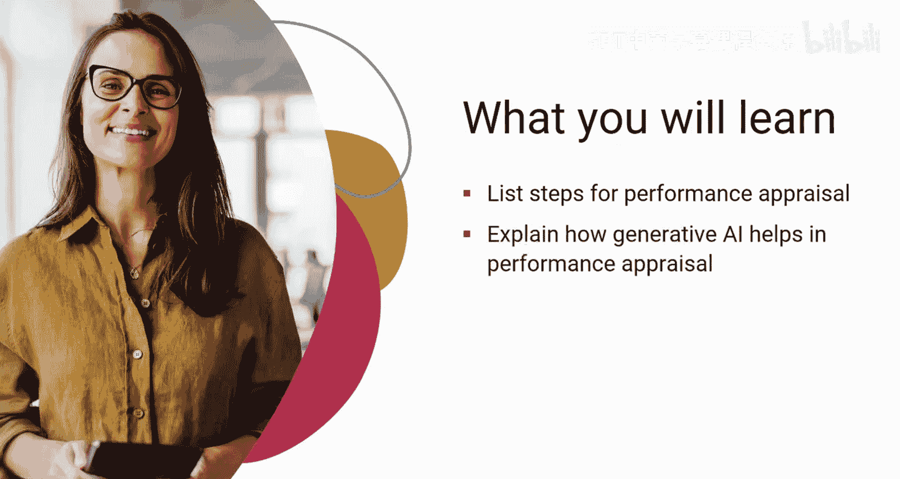
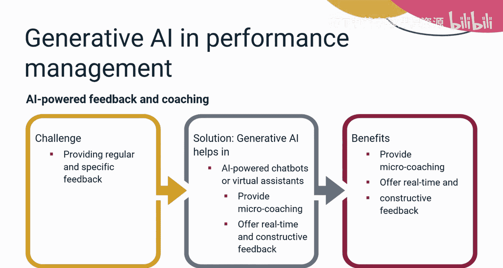
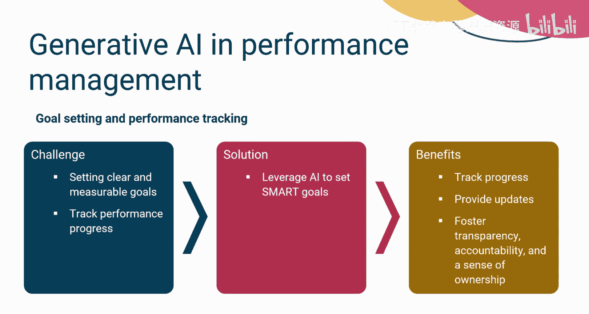
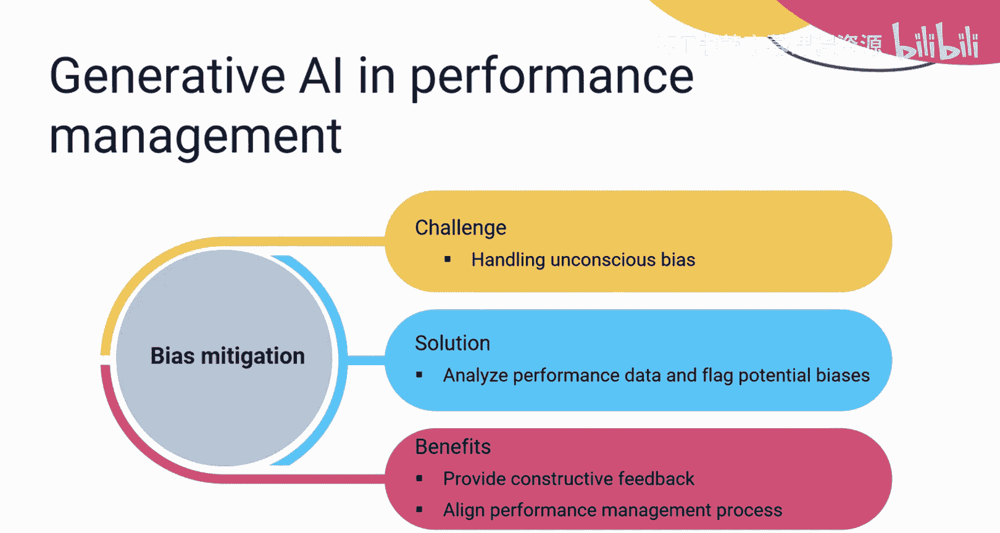
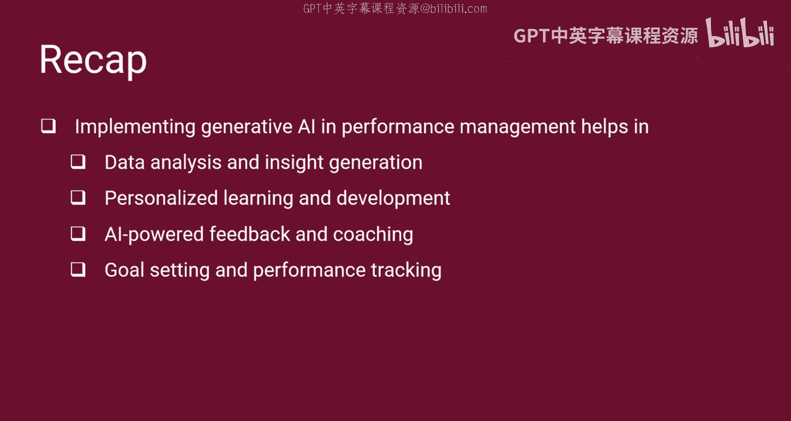

# IBM《生成式AI用于人力资源｜Generative AI for Human Resources (HR) Professionals》中英字幕 - P41：10_绩效评估实施.zh_en - GPT中英字幕课程资源 - BV1Ese3zvEf4

Welcome to Implementing Performance appraisal。

After watching this video， you will be able to list activities for performance appraisal。

You'll also be able to explain how generative AI helps in performance appraisal。

Studies have found that managers spend approximately 17 hours per employee preparing their performance appraisal reports。

That's humongous。How can you decrease this various organizations have started implementing generative AI to support human resources or HR departments。

Using generative AI for performance appraisal saves managers time and helps create clearer。

 actionable feedback for employees。Let's first explore the activities that HR professionals perform in performance review functions。

The first step is defining and communicating performance standards， measuring performance progress。

 comparing it with the benchmark performance standards， and then discussing the performance feedback。

These activities set clear expectations and professional development for the employees。

Let's review each of them。Performance standards are vital in ensuring the employee's performance fulfills the business requirements。

 For example， being a team player， possessing technical and soft skills， accountability。

 attention to detail， time management， and adherence to project deadlines。

It's important that performance standards are clear and measurable。

 well defined performance standards help HR professionals identify the employees's capabilities and improvement areas to achieve desired outcomes。

😊，Further， HR should communicate performance standards to the employees to ensure they understand the business requirements。

However， this provides opportunities for employees to discuss their key performance indicators or KPIs and approaches to achieving them。

After communicating the performance standards to the employees。

 it is important to regularly analyze their performance by reviewing their goals。Next。

 compare performance progress with performance standards to identify employees performance roadblocks and pinpoint areas for improvement Now it's time to discuss performance feedback。

HR professionals provide constructive feedback and reward employees for their achievements。

They also guide them to leverage various learning and development opportunities by upskilling themselves。

So what is the role of generative AI in these activities？Let's find out。

Generative AI helps achieve benefits such as data analysis and insight generation。

 personalized learning and development， AI powered feedback and coaching。

 goal setting and performance tracking， and bias mitigation。Let's review each of them。

 analyzing large data sets， their patterns， and employee strengths and weaknesses can be time consuming if done manually。

However， generative AI helps analyze large data sets， including performance reviews， project metrics。

 and employee feedback to uncover hidden patterns and predict potential challenges。

This helps managers focus on specific areas for improvement and tailor development plans for each employee。

 moreover， creating one type of training program may not suit the requirements of each department to meet this challenge。

 generative AI helps perform training needs analysis or TNA analyze employee performance data。

 identify skill gaps and help aspirants by recommending personalized training programs。

These training programs also recommend the best courses and learning materials and provide mentorship。

This results in increasing employee engagement and allowing them to work to their full potential。

Moreover， managers may face challenges in providing regular and specific feedback to employees。

In this case too， AI proves to be a game changer， leveraging AI powered feedback and coaching。

 such as AI powered chatbots or virtual assistants that offer micro coachaching， real time。

 and consistent feedback improves employee motivation and performance。

When it comes to goal setting and performance tracking。

 setting clear and measurable goals and tracking performance progress can be quite challenging for managers。

Generative AI can help in setting smart or specific， measurable， achievable。

 relevant and time bound goals。Such goals are aligned with individual roles and business objectives。

This further enables project managers and employees to track progress， provide updates。

 and foster transparency， accountability， and a sense of ownership to achieve goals。

AI can also help mitigate bias。

Unconscious bias impacts the fairness and accuracy of performance evaluations。

Using generative AI to analyze performance data and flag potential biases helps provide constructive feedback and align the performance management process for employees。

Now you've reached the end of this video。

Let's recap。In this video， you've learned that industries across the globe have started adopting generative AI for various tasks。

 one of which is performance appraisal。Organizations perform several performance appraisal activities。

 such as setting and communicating performance standards to the employees。

 measuring performance progress， and comparing it with performance standards。

 and then discussing feedback。Implementing generative AI and performance appraisal can help achieve several benefits。

For example， data analysis and Insight generation， personalized learning and development。

 AI powered feedback and coaching， goal setting and performance tracking and bias mitigation。

