# IBM《生成式AI用于人力资源｜Generative AI for Human Resources (HR) Professionals》中英字幕 - P42：11_生成式AI助力人力资源向战略转型.zh_en - GPT中英字幕课程资源 - BV1Ese3zvEf4

Welcome to Generative AI enables HR shift to strategy。

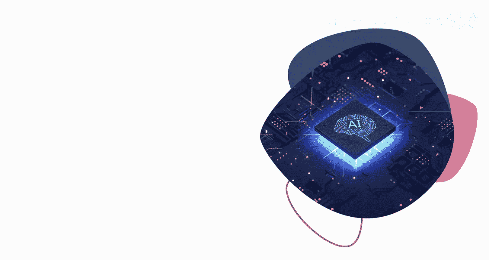

After watching this video， you'll be able to explain how generative AI enables the transition of HR from administrative tasks to strategic functions。

You'll be able to explore how generative AI facilitates workforce planning and succession planning in HR。

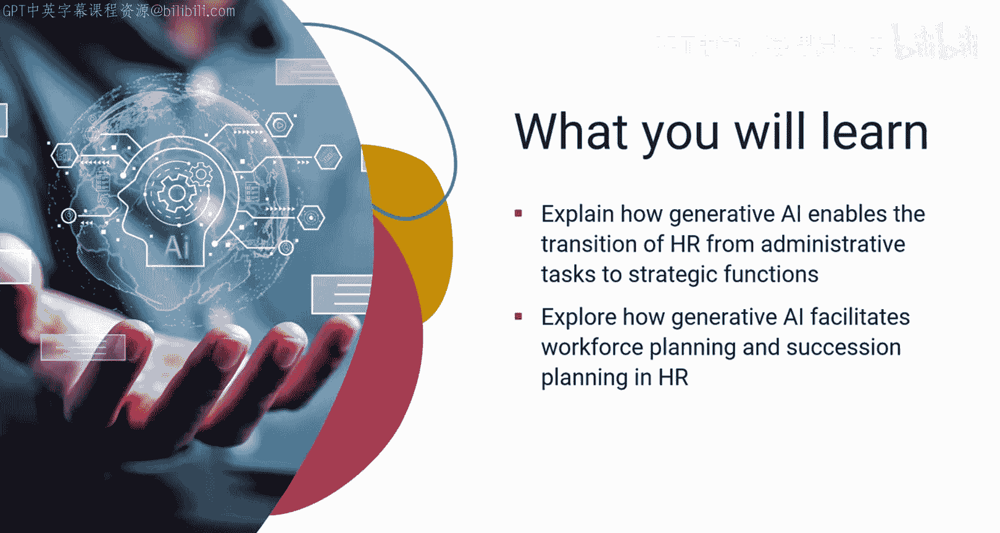

You'll also be able to explain the collaborative implementation of generative AI across departments to optimize HR processes and foster organizational alignment。

What if human Resource HR didn't have to schedule interviews and send repetitive emails all day？

Imagine generative AI managing those tasks for you while you could focus on creating HR strategies on how to hire the top talent with personalized outreach designed by AI using relevant data sounds impossible。

Generative AI empowers HR to shift from routine， administrative tasks towards more strategic data- drivenn initiatives that drive organizational performance。

 innovation and growth with the power of generative AI HR can now be a strategic partner in the smooth functioning of the business。

It can take on more productive roles that aim to boost the business revenue and help retain employees。

So let's look at how generative AI makes HR functions more valuable to the company。

 Imagine being buried under piles of data that takes a long time to analyze and interpret。

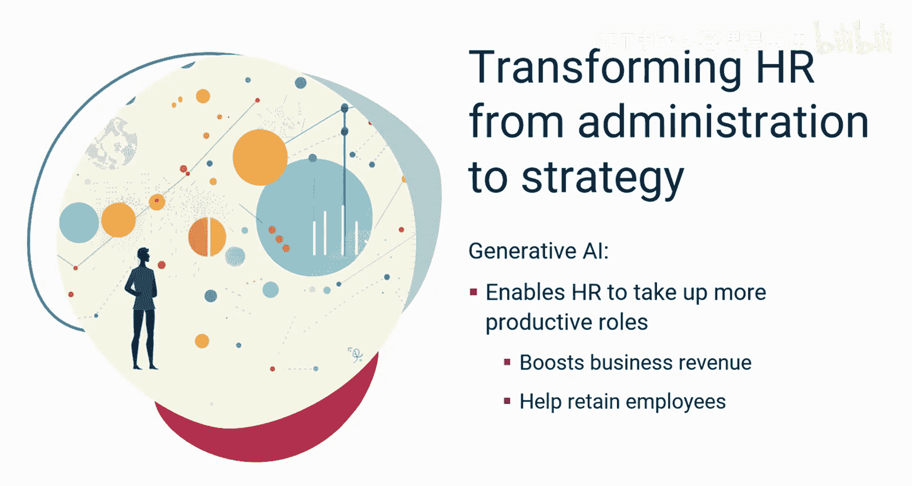

Generative AI can analyze HR data to identify trends and insights related to employee performance。

 retention， and satisfaction。This helps HR to make informed decisions and develop strategic initiatives to address challenges and opportunities related to various strategic aspects。

 including workforce planning， talent management， and succession planning。

Another key responsibility of HR is workforce planning， which includes future skills forecasting。

 workforce optimization， and improved resource allocation。

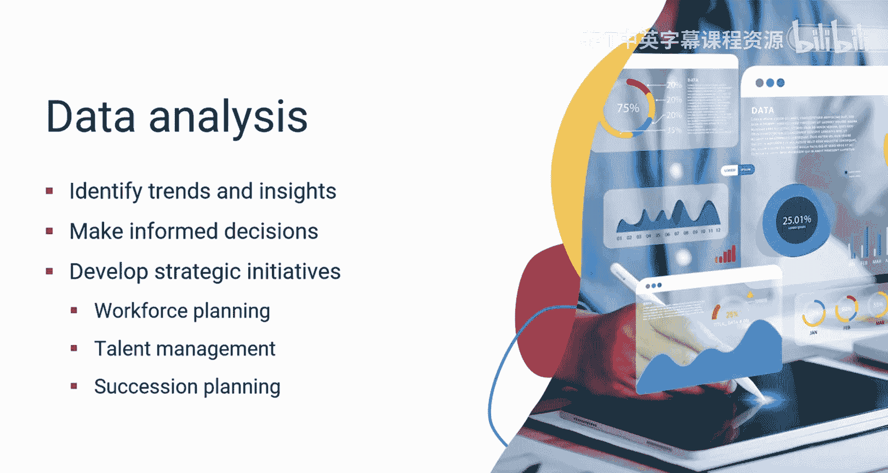

Generative AI can take care of this too it not only improves future skills forecasting。

 but can also analyze vast amounts of data， including industry reports， job postings。

 and social media trends to identify the skills that will be in demand in the future。

This allows you to anticipate the changing needs of the workplace and proactively develop or acquire the necessary skills within the workforce。

Additionally， generative AI can also compare the workforce's current skill set with the predicted future needs。

This helps identify potential skill gaps and allows you to develop targeted training programs and upskilling initiatives to bridge them before they become critical issues。

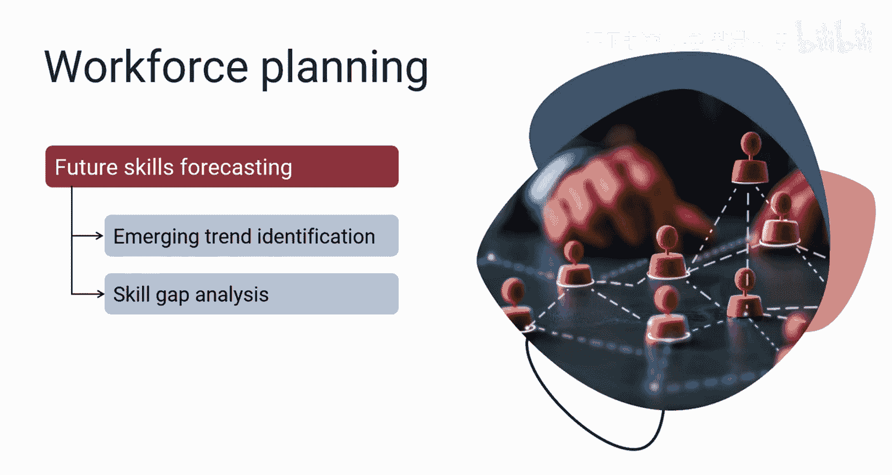

If you want to simulate different workforce scenarios based on factors like market fluctuations。

 mergers and acquisitions， or changes in company strategy， explore generative AI。

This allows you to test the impact of these scenarios on the workforce and develop contingency plans to ensure that the organization remains adaptable and competitive。

 it can also analyze employee performance， workload and automation potential data to identify opportunities for streamlining the workforce。

This doesn't necessarily mean layoffs， but rather strategically redeploying talent to areas of greatest need。

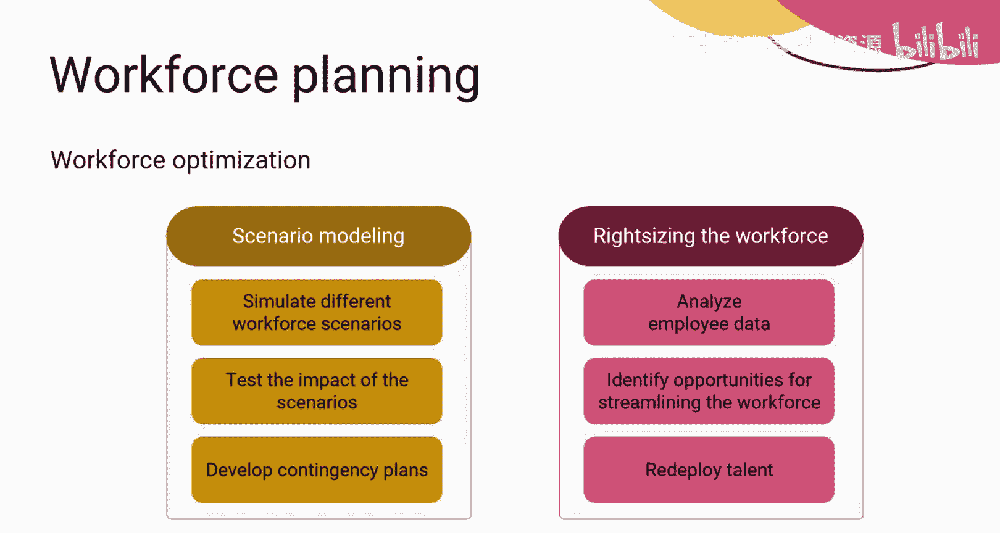

In project management， resource allocation is always a difficult task。

 finding the right resources for the right tasks or projects。

 and checking their availability and competencies before allocating is not easy。

Generative AI can analyze data on past recruitment efforts to identify the most effective channels for attracting talent with the desired skill sets。

This allows you to optimize your recruitment strategies and resource allocation。

 leading to a more efficient hiring process。Generative AI can also be used to analyze the costs and benefits associated with different workforce planning decisions。

 such as hiring new employees， outsourcing specific tasks， or investing in training programs。

This allows you to make data driven decisions that maximize return on investment。

Generative AI enables a shift from reactive to proactive workforce planning。

This means you can anticipate future needs and make strategic decisions。

 ensuring that your organization has the right talent in place to achieve its goals。

Data driven insights help remove the guesswork from workforce planning。

 thus enabling informed decisions aligning with the overall business strategy。

Generative AI also helps you adapt quickly to changing market conditions and workforce demands。

Succession planning in HR can also benefit from generative AI。

It can capture comprehensive data and easily predict positions at risk of becoming vacant in the next few months。

Due to the power of generative AI models， you can easily find potential candidates to fill the position internally within a few days of the vacancy as generative AI tools allow you to perform analytics on employee skills。

 key trait。Rrappper with cross function teams and consistent performance over the years。

The results from these analyses help you find the most suitable candidate to succeed in leadership roles。

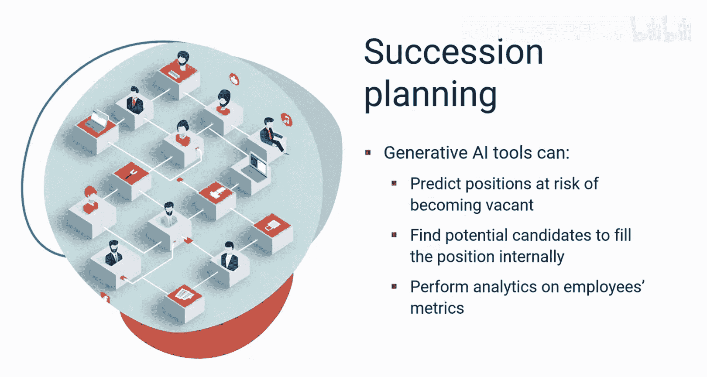

What's more， generative AI tools allow you to look into the candidate's past performance。

These can raise a signal when there is a dip in the employee's performance。

The signal can be based on the delay in project completion。

 not completing the assigned courses on time， negative employee feedback or irregular work attendance。

HR can then create intervention strategies to resolve any personal or professional issues。

Another area where generative AI can be a game changer is strategic partnerships with other departments。

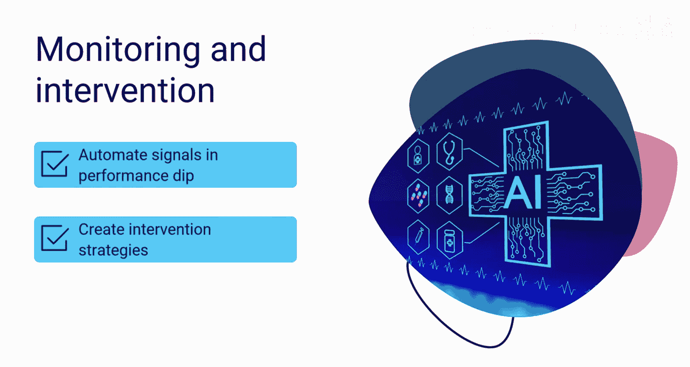

Generative AI can provide insights into the metrics and goals of other departments and the organization and help HR align its initiatives with those of other departments and broader organizational objectives。

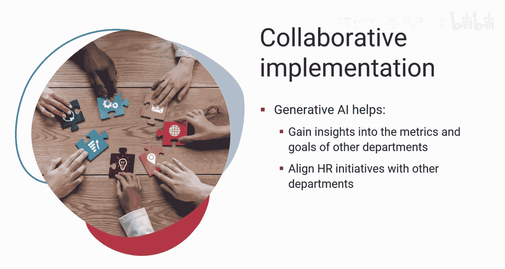

For instance， if HR professionals want to personalize learning based on individual needs。

 they would need to connect with different departments like marketing and finance to understand their goals and performance indicators。

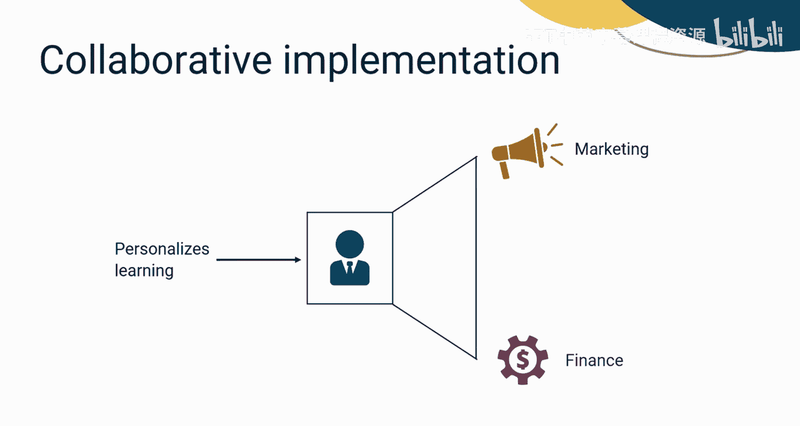

In this video， you learned that generative AI enables HR to shift from administrative tasks to strategic functions。

 you also explored how generative AI facilitates data analysis。

 enabling informed decision making in areas such as workforce planning， future skills forecasting。

 and resource allocation。Additionally， it supports succession planning by predicting vacancies and identifying internal candidates for leadership roles。

Collaboration with other departments ensures alignment of HR initiatives with organizational goals。

 while AI enabled monitoring detects performance issues for timely intervention。Overall。

 generative AI enhances HR's value by optimizing processes， fostering collaboration。

 and driving organizational success。

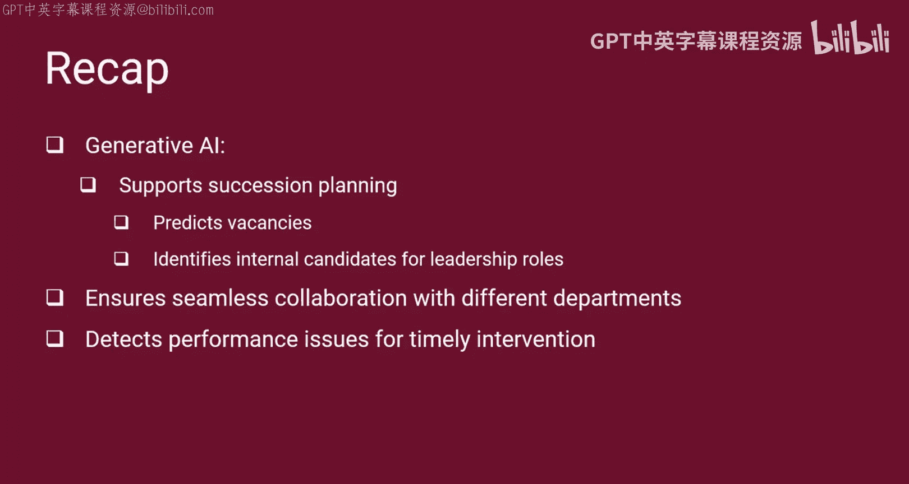

