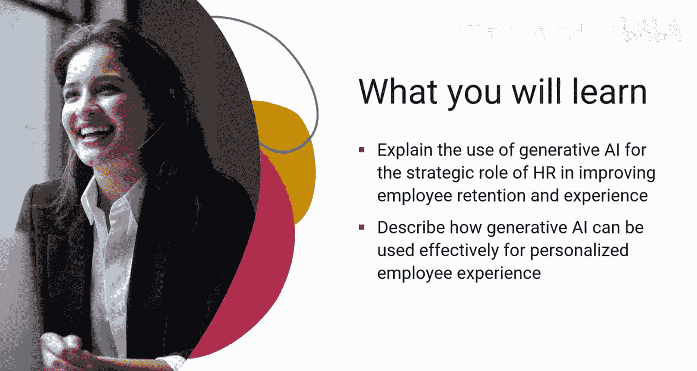
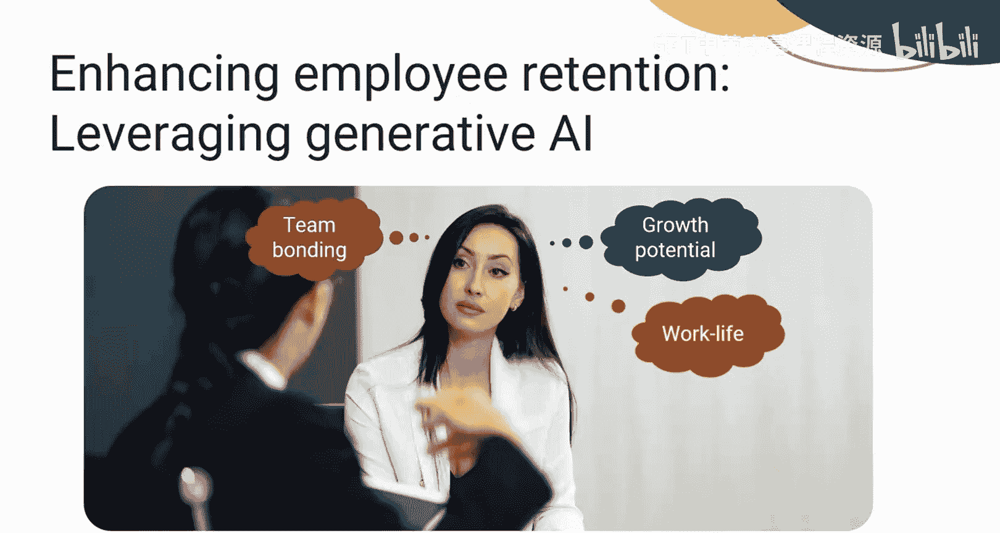
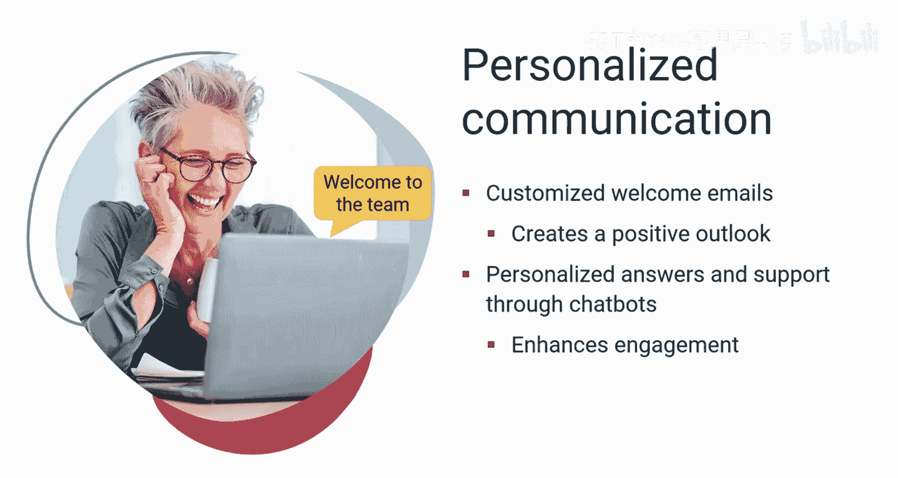
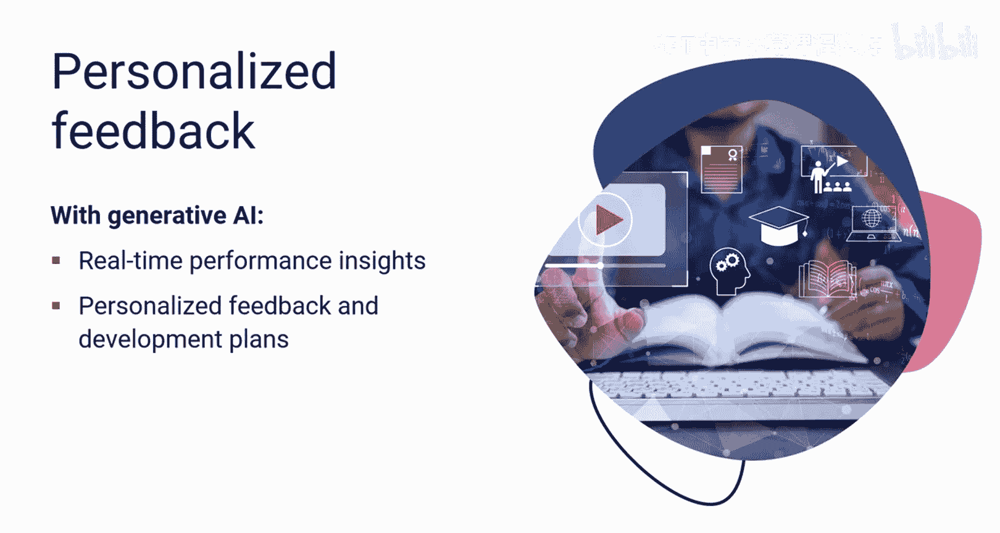
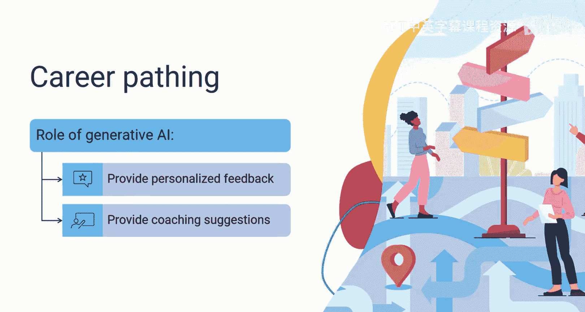
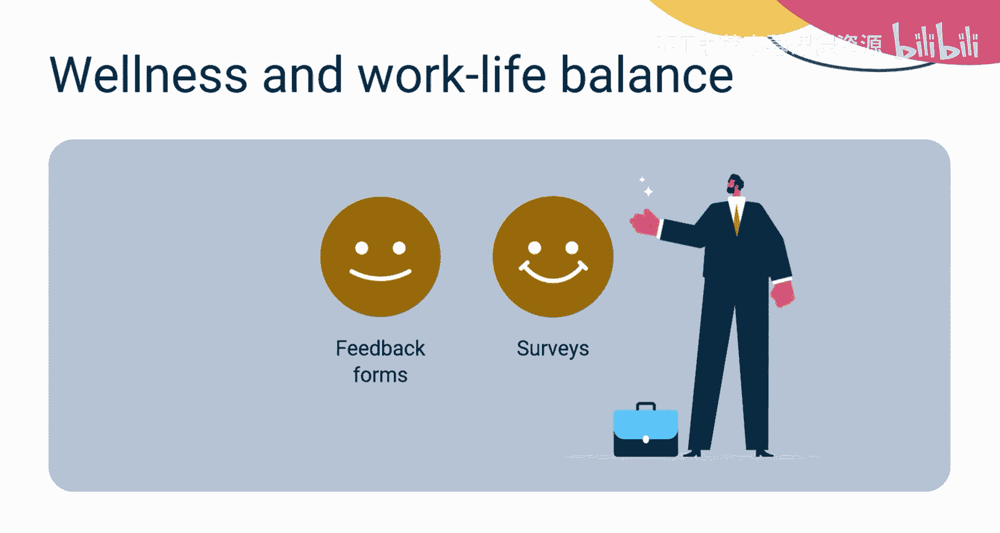
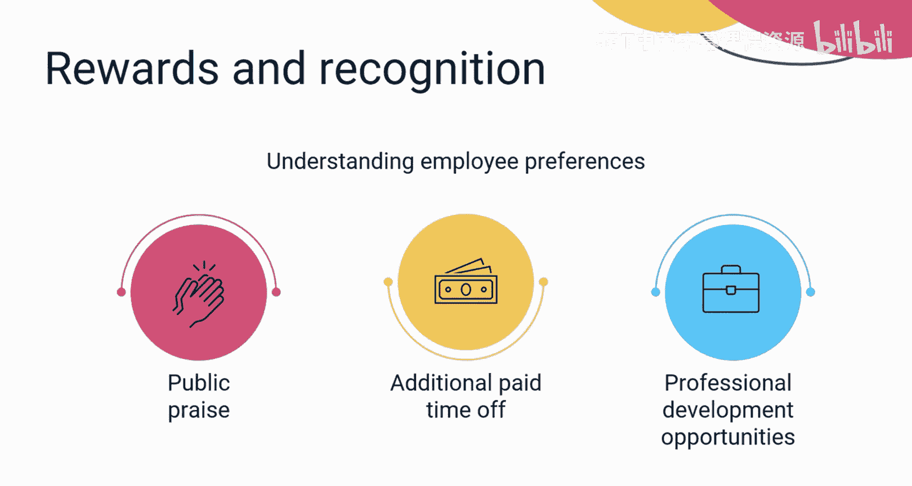
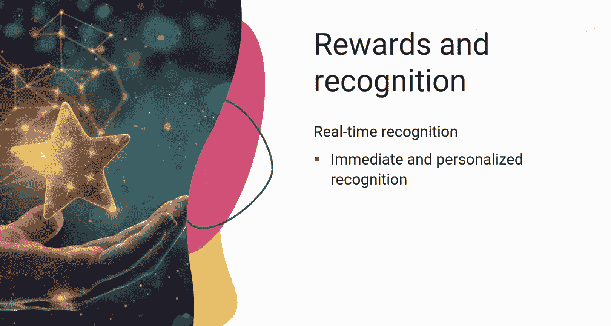
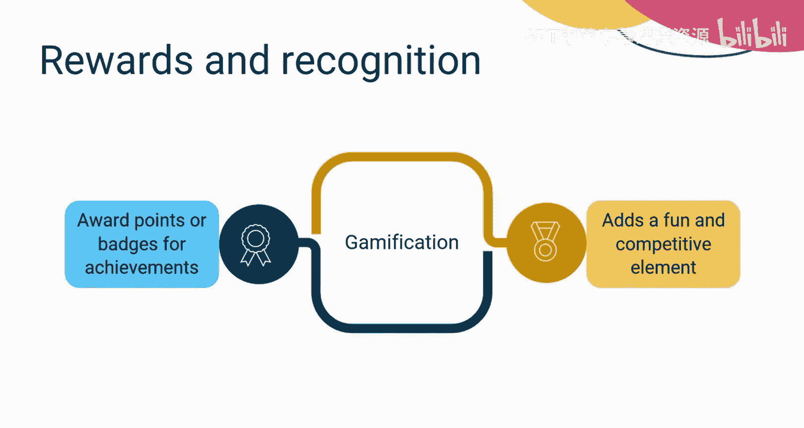
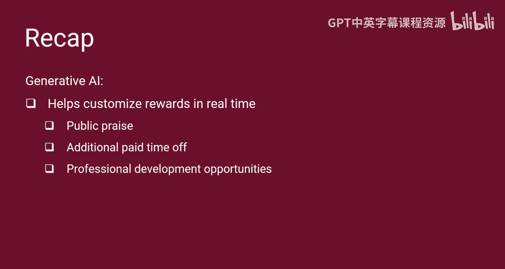

# IBM《生成式AI用于人力资源｜Generative AI for Human Resources (HR) Professionals》中英字幕 - P43：12_员工参与度与个性化管理.zh_en - GPT中英字幕课程资源 - BV1Ese3zvEf4

Welcome to the employeeee engagementng and Personalization。

After watching this video， you'll be able to explain the use of generative AI for the strategic role of HR in improving employee retention and experience。

You will also be able to describe how generative AI can be used effectively for personalized employee experience Have you ever felt stuck retaining your employees or are you looking for ways to nurture your organization's talent？

Retention is closely related to the overall employee experience。

Reasons for moving on might be associated with a thought on their growth potential。

 work life balance， or challenges while bonding with the team。

All of this can be tackled and improved with the help of generative AI。

Let's dive deeper to understand how you can use generative AI to increase employee engagement and create a more personalized employee experience。

 starting from the employee's onboarding process， selection and welcome。

 communication can be personalized with generative AI。

With the help of generative AI， emails can be customized to include the employee's positive attributes that got them selected for the organization。

Even the smallest of these changes can create a positive outlook on the organization for your new employee。

Generative AI powered chatbots can deliver personalized answers and support to employees。

 streamlining communication and keeping them engaged。

Do you have tons of data to analyze？Generrative AI can generate detailed objective performance reports by analyzing project outcomes。

 peer reviews， and productivity metrics。Additionally。

 generative AI driven feedback mechanisms can provide real time performance insights。

 it can also analyze employee interactions and performance data to provide personalized feedback and development plans。

Wouldn't it be amazing if you could plan and curate personalized learning paths for your employees based on their career aspirations and company goals。

 generative AI helps create customized nudges to remind employees to complete the assigned courses on time？

That's not all； it then analyzes data on employee performance and provides personalized feedback and coaching suggestions。

This can help employees understand their strengths and areas for improvement。

 leading to a more fulfilling work experience。

Generrative AI offers the capability of predictive analytics for retention by analyzing employee sentiment through surveys。

 feedback forms， and even social media activity。

AI algorithms can analyze historical data to check employee workload， productivity， engagement。

 and performance metrics to identify potential work related stress or burnout sources。

You can use this insight to proactively adjust workload distribution。

 implement flexible scheduling options， or provide additional support to employees who may be at risk of experiencing work life imbalance。

You can also use AI powered tools to deliver targeted resources， activities。

 and support services that address specific employee needs and preferences。

 thereby fostering a healthier work life balance for all employees。

As rewards and recognition are essential for creating a positive work environment and motivating your employees。

 generative AI can analyze employee data， including past recognition programs and feedback surveys to understand individual preferences for rewards and recognition。

This allows you to tailor rewards to each employee's motivations， whether it's public recognition。

 additional paid time off， or professional development opportunities， and that too， in real time。

Generative AI can also monitor employee performance data and identify achievements in real time。

This enables immediate and personalized recognition。

 which can be more impactful than delayed recognition。Imagine a salesperson exceeding their quota。

Generrative AI can trigger an automated notification to the manager。

 prompting them to send a personalized message of congratulations。

Moreover， generative AI can be used to create gamified recognition programs that award points or badges for achievements。

This can add a fun and competitive element to recognition， further motivating employees to excel。

In this video， you learned how generative AI transforms and personalizes employees on boarding and communication processes。

Generative AI can also generate detailed objective performance reports by analyzing project outcomes。

 peer reviews， and productivity metrics。Additionally。

 generative AI driven feedback mechanisms can provide real time performance insights。

You also learned how generative AI helps in maintaining work life balance for your employees by analyzing relevant data that help you adjust workload distribution。

 implement flexible scheduling options， or provide additional support to employees。

Generrative AI also helps you tailor rewards in real time as per your employee's motivation。

 be it public praise， additional paid time off， or professional development opportunities by analyzing performance data。

。

