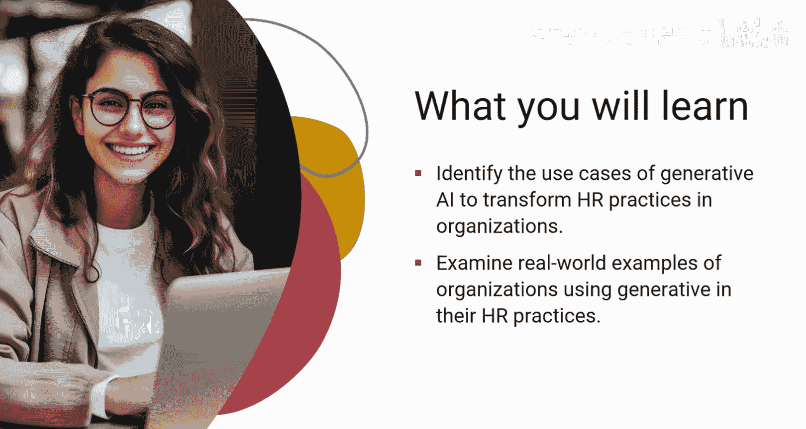
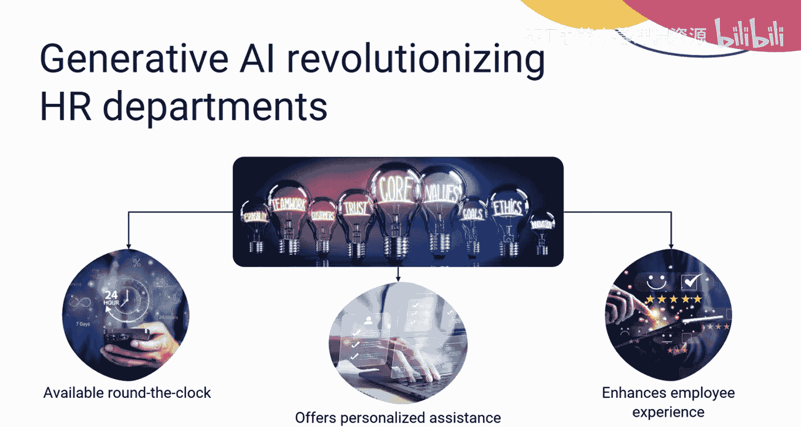
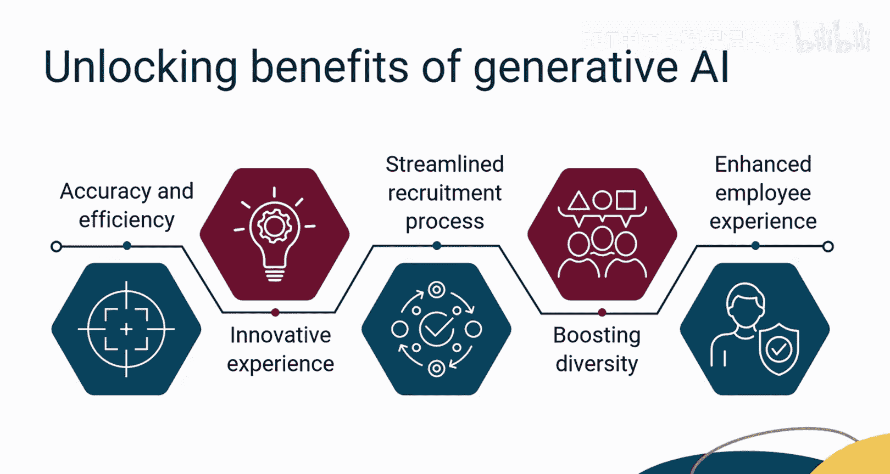
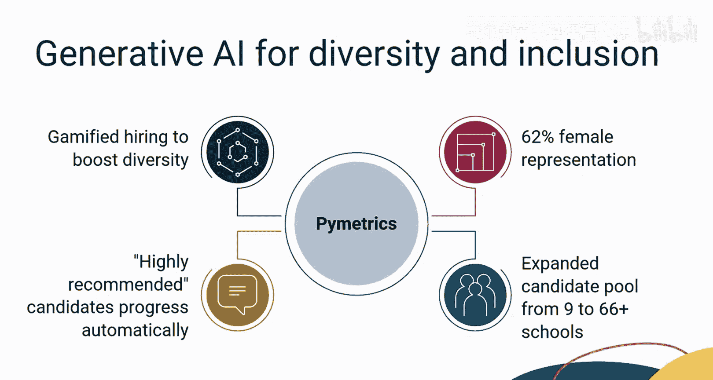
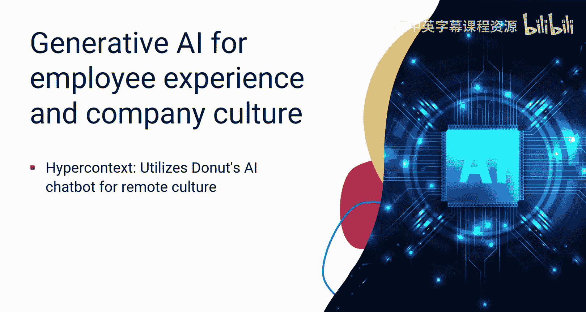
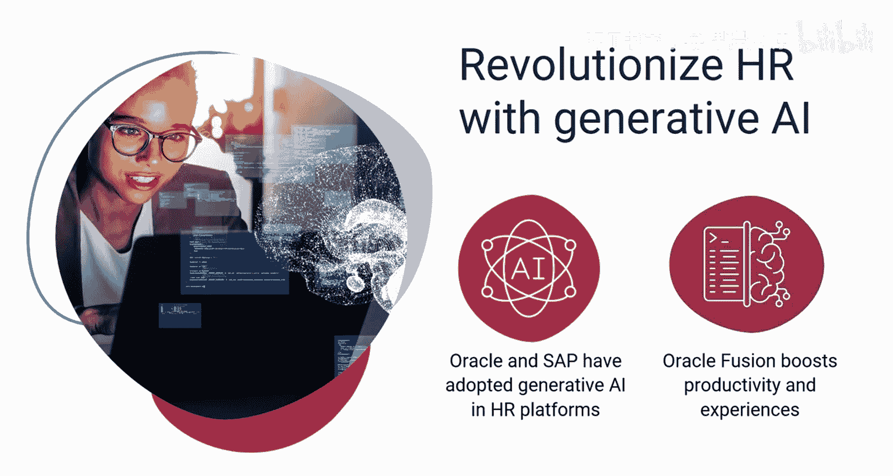
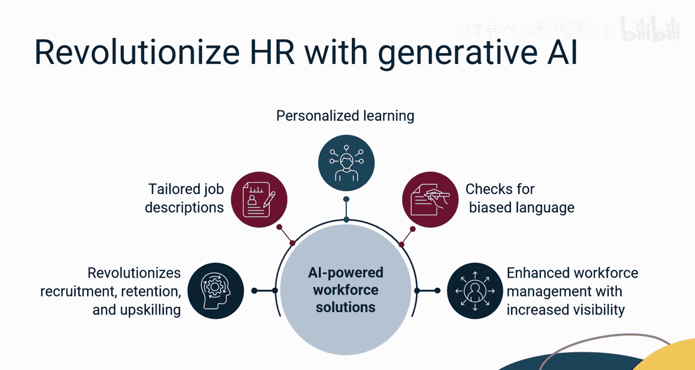
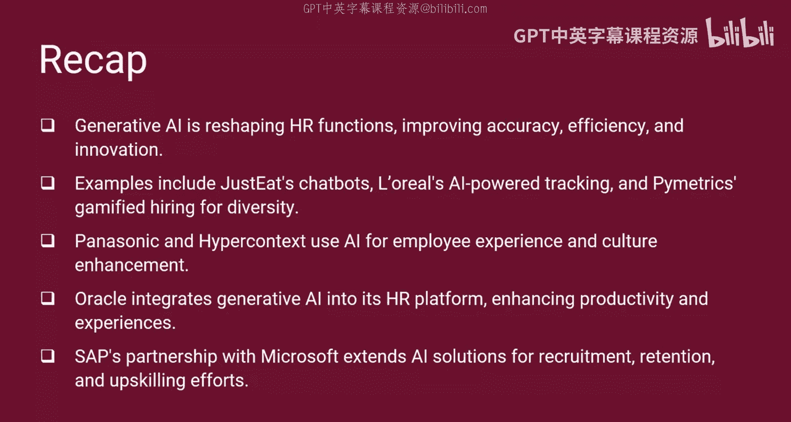

# IBM《生成式AI用于人力资源｜Generative AI for Human Resources (HR) Professionals》中英字幕 - P44：13_人力资源中应用生成式AI的组织实践.zh_en - GPT中英字幕课程资源 - BV1Ese3zvEf4

Welcome to organizations using Generative AI and HR。

After watching this video， you will be able to analyze how and why organizations use generative AI and HR。

You will also be able to evaluate the impact of using generative AI for recruitment and talent acquisition。

 diversity， inclusion， employee experience， and company culture。Additionally。

 you will be able to understand the importance of integrating generative AI into HR platforms of organizations like Oracle and SAP。

What if an HR department functions 24 by7， offering personalized assistance and playing a key role in enhancing employee experience and company culture？

Sounds impossible。With the use of generative AI， this is exactly how HR is reshaping in organizations worldwide。

Organizations nowadays have been turning to generative AI in HR for several reasons。

From accuracy to efficiency， innovative experiences to streamlining the recruitment process and boosting diversity to enhancing employee experience generative AI can do it all for you。

Let's look into some examples of organizations leveraging generative AI for recruitment and talent acquisition。

Did you know that Just eat， the renowned fast food giant。

 has bid farewell to traditional resume screening methods and embraced the use of Gen AI powered chatbots to engage candidates in meaningful conversations？

This initiative reduced its recruitment time by a whopping 50%。

Then there are examples of industry giants such as Laurreal。

Pitch gradeade and FIG loans who have leaned toward implementing AI powered application tracking systems to scan resumes and identify the most suitable candidates for the open positions。

However， sometimes it's not just about finding the right candidate。

 but building diverse and inclusive teams。Take the example of pmetrics。

 an AI platform that gamified the hiring process for a leading investment firm to boost its female representation by 62%。

 candidates grouped into highly recommended and recommended categories automatically progress to the next stage as per the evaluation tool。

Before using Pmetrics， the company mainly sourced talent from nine universities。Still。

 after adopting the AI based solution， the  investment firm extended offers to candidates from 66 plus schools。

This approach also increased minority representation by 9%。

Now let's explore organizations using generative AI to enhance employee experience and company culture。

 Panasonic North America implemented the Visziier People Inight platform an AI powered solution。

 this platform analyzes data to provide HR with valuable insights for shaping employee experience strategies。

On the other hand， Hypercontext uses Donut's AI backed chatbot tool to foster a remote culture。

The company had been gradually moving toward working from home before the pandemic and is now 100% remote。

Donut relies on setting up one to one coffee chats between new pairings every two weeks。

 enabling team members to forge strong bonds， and reinforce the culture of connection。

Even renowned organizations like Oracle and SAP have adopted generative AI by integrating it into their HR platforms。

Orracle's generative AI capabilities embedded in Oracle Fusion and cloud human capital management offer improved productivity。

 enhanced candidate and employee experiences， and streamlined HR processes。

 reducing friction in essential HR functions。

Similarly， SAP's expanded partnership with Microsoft has brought generative AI into the workplace。

 integrating SAP success factors， solutions with Microsoft 365 Copilot。

 and Copilot and Viva Learn is revolutionizing how organizations recruit。

 retain and upskill their workforce to address skills gaps。

This collaboration allows employees to access tailored job descriptions， interview preparations。

 and personalized learning courses， all with embedded checks for bias language。Moreover。

 SAP's talentent Intelligence Hub leverages AI to create and maintain a skills portfolio for each employee。

 providing personalized recommendations for learning courses， mentors。

 and internal job opportunities。Enhanced total workforce management functionality combines SAP success factors。

 SAP field glassss and SAPPS4 Hannah Cloudud for increased visibility across employees and external workers you have reached the end of this video。

Let's recap。In this video， you learned how generative AI has been reshaping the functionalities of the HR department by improving accuracy and efficiency and innovating better methods to perform mundane day to day tasks。

You looked into examples of organizations like JustEat， Moal。

 and Pymetrics that have integrated generative AI as chatbots， recruitment trackers。

 and gamified hiring respectively。Additionally， you learned how Panasonic and hypercontext use AI to enhance employee experience and corporate culture by integrating the Viziier People Insight platform and Donuts AI back to chatbot。

Finally， you learned how established organizations like Oracle and SAP have integrated generative AI into their HR platform to enhance productivity and employee experience。

Oracles's， AI capabilities and Oracle Fusion， and cloud human capital management streamline HR processes。

At the same time， SAP's partnership with Microsoft integrates AI and SAP success factors with Microsoft 365 Copilot to revolutionize workforce management。

 recruitment， and skills development。

