# IBM《生成式AI用于人力资源｜Generative AI for Human Resources (HR) Professionals》中英字幕 - P45：14_制定人力资源AI采用路线图.zh_en - GPT中英字幕课程资源 - BV1Ese3zvEf4

Welcome toDevelop an AI adoption Roadmap for HR。

After watching this video， you will be able to。Explain the benefits and importance of AI adoption Roadnap。

Describe the steps involved in the AI adoption Roadmap。

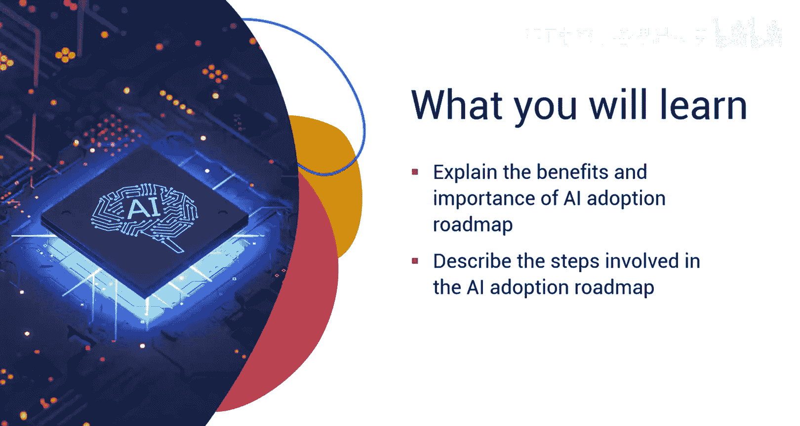

Generative AI for HR is here， and organizations that are embracing it early are obtaining maximum benefits。

 but how can your organization effectively integrate generative AI into HR functions and unlock its full potential？

Developing a comprehensive roadmap can guide you through the adoption process and address the challenges that arise。

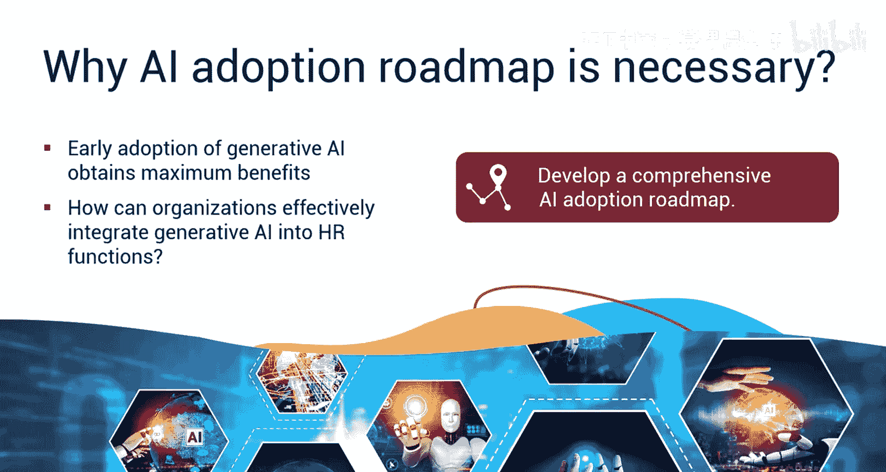

This roadmap serves as a blueprint， highlighting the key steps from assessing the organization's readiness and stakeholder engagement to pilot testing。

 integration， and continuous monitoring。By following the roadmap。

 your organization can smoothly transition to a generative AI powered， efficient。

 and data driven HR operation。

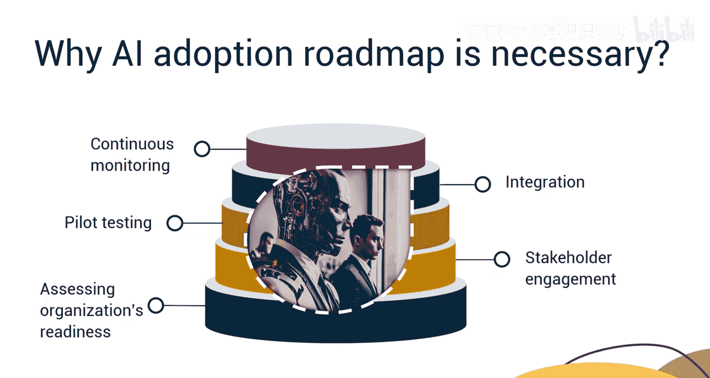

Developing an AI adoption roadmap for HR involves strategic planning。

 alignment with organizational goals and a structured approach。

 let's explore the key steps to create an effective AI adoption roadmap。

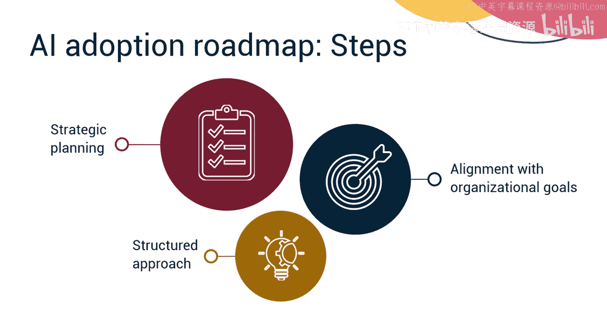

Before adopting AI， HR leaders need a thorough understanding of the AI landscape。

AI adoption isn't just about technology， it's about people and change management。

Employees may fear that AI will replace their jobs。

HR professionals must address these concerns with clear communication and training to help employees acquire skills to effectively collaborate with AI tools。

They must emphasize that AI is meant to augment， not replace human capabilities。

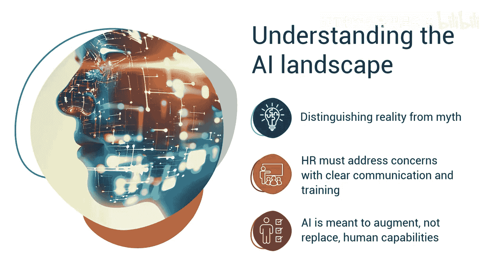

HR teams must collaborate with experts， including。Data science teamss for model Tra。

DeevOs teams for scaling applications in production。

Legal teams to ensure ethical and responsible AIUs compliance teams to ensure applications comply with local laws like GDPR。

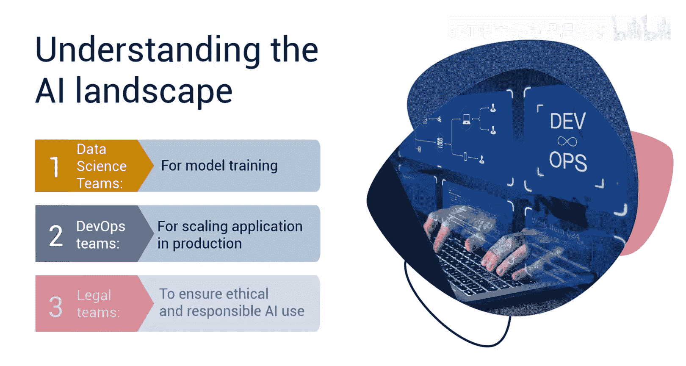

And industry experts to evaluate the true potential of AI technologies。

The next step is to assess the readiness of your organization。

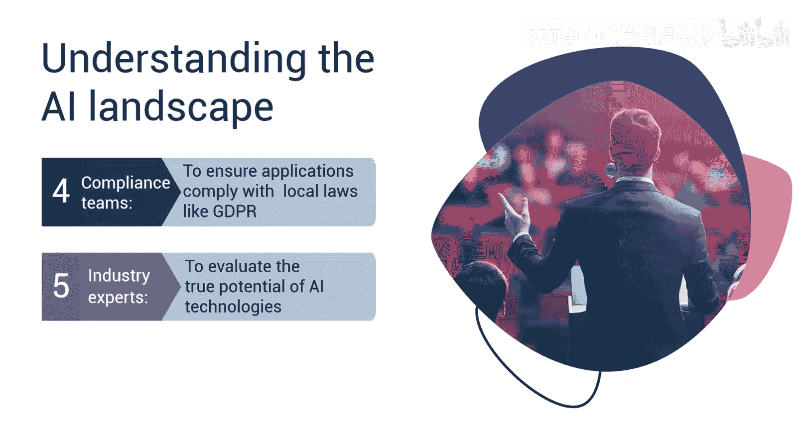

This can be done by evaluating the following key areas。

Leadership buy in ensure that executives support AI initiatives and that these projects align with overall business objectives。

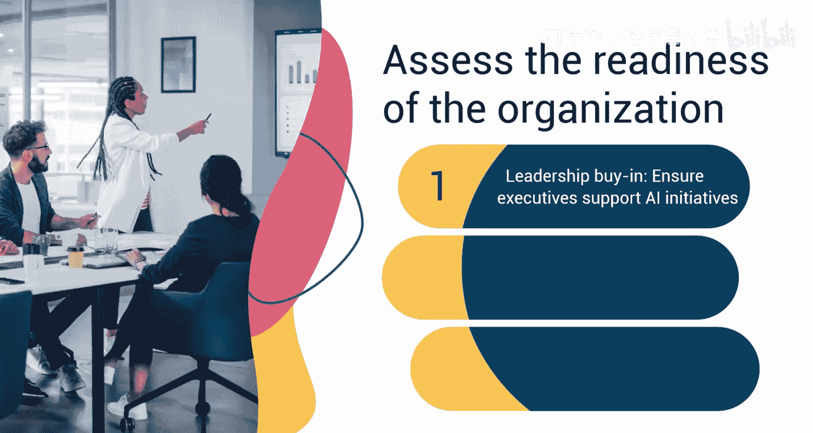

Data infrastructure assess the quality， availability。

 and security of your data from its source to its use in the development of AI models。

Robust data is crucial for generating reliable AI results。

Skills and training identify skill gaps across business units and plan comprehensive AI related training programs tailored to employee roles。

After assessing the readiness of your organization。

 you must set specific goals for AI adoption in HR。

Identify the target areas where AI can streamline repetitive tasks。

 highlight activities that will enhance employee engagement such as using AI drivenri chatbots。

 or providing personalized recommendations and outline the use cases of predictive analytics for workforce planning or assessment of attrition risks。

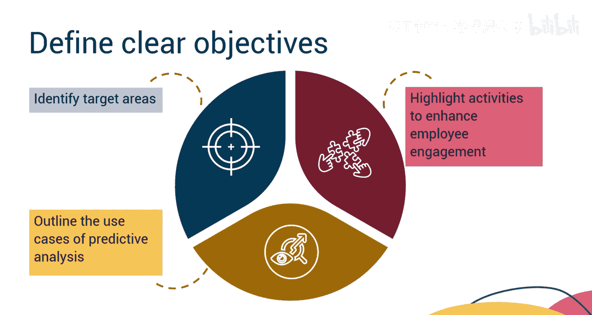

Not all AI applications offer the same level of impact。Therefore。

 it is important to prioritize the use cases of generative AI based on the following criteria。

Assess the potential benefits and return on investment for each use case to check the impact on business。

Evaluate technical feasibility， data availability， and the complexity of implementation。

 and check the urgency and focus on addressing the critical pain points first。

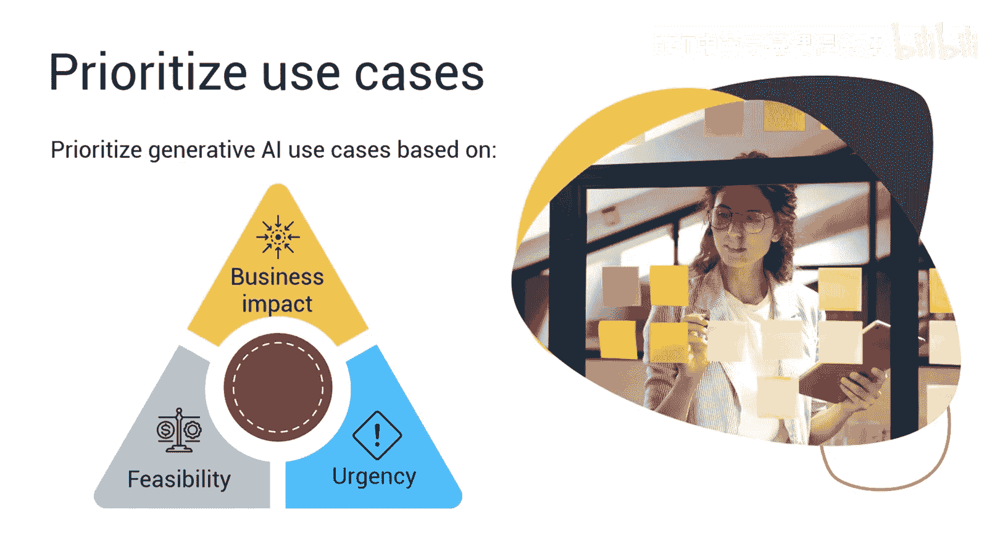

It is crucial to identify the stages and develop a plan that can be implemented in phases。

Begin working on easily achievable projects to gain quick success and build momentum。

Gradually implement more complex AI solutions as the employees gain comfort in working with AI technologies and have a long-ter vision and ensure that the strategic vision of the organization for AI is aligned in the right direction。

 setting the foundation for future advancements。

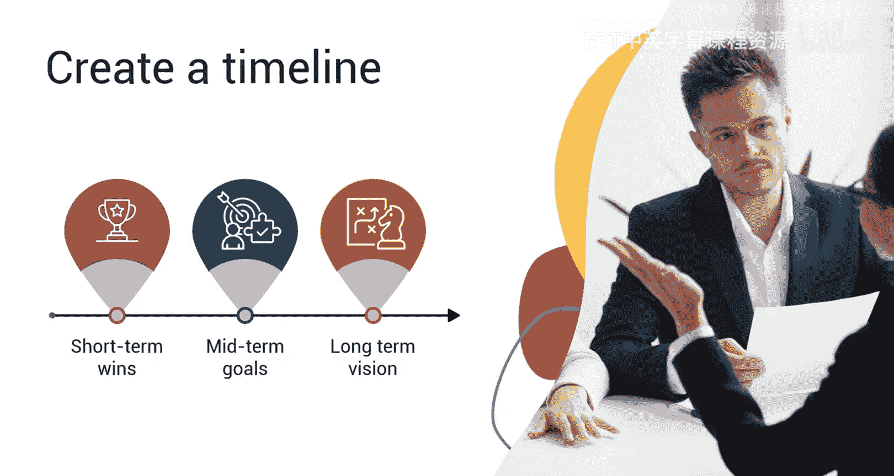

It is very important to choose the right AI tools and platforms。

Consider the following aspects to help yourself in the selection process。

Decide whether to build custom solutions or use existing AI products。

Custom solutions take longer to develop， but are beneficial for long term strategy。

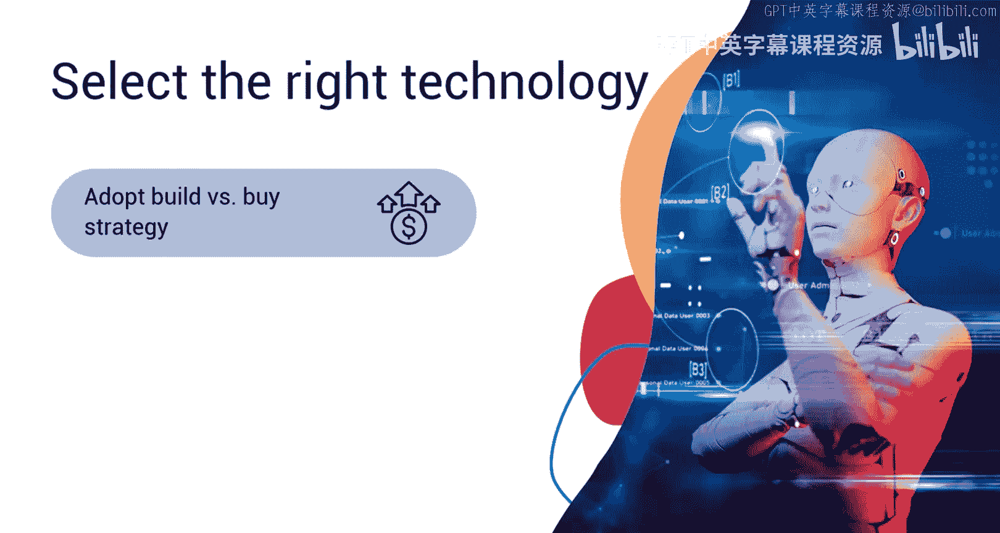

Collaborating with vendors can accelerate progress and reduce efforts。Therefore。

 evaluate the vendors based on functionality， scalability and support。

 and ensure that the selected AI tools integrate seamlessly with your existing HR systems。

Begin with small scale pilot projects to refine your AI solutions。

This can be done in the following manner。Test AI solutions in a controlled environment to validate their effectiveness。

Collect user feedback and make improvements based on real world usage and develop a plan to scale successful pilot projects across the organization。

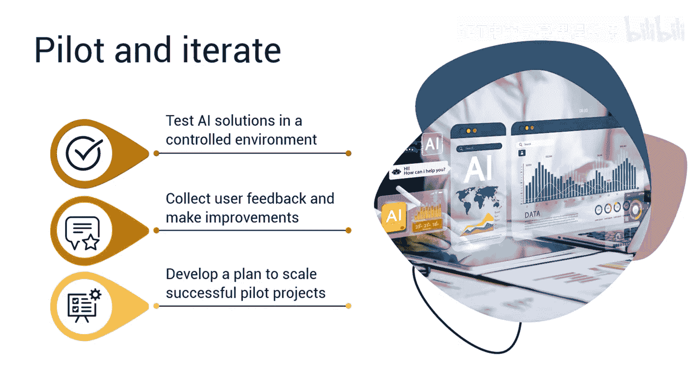

Once the pilot projects are successful， prepare the employees for AI adoption by employing effective strategies。

Offer comprehensive training on the adoption of AI tools and their implications on different employee roles。

Identify and empower advocates who can drive and promote AI adoption within the organization and openly address the concerns of the employees and emphasize the benefits of AI adoption to foster understanding and acceptance among them。

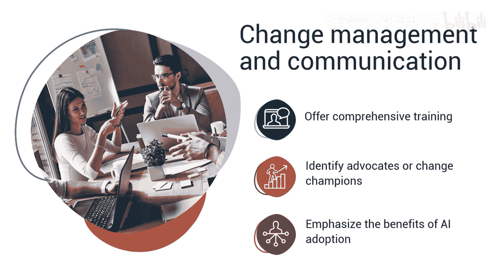

And finally， check the effectiveness of AI adoption through systematic monitoring。

Establish key performance indicators such as efficiency gains and user satisfaction to gauge the impact of AI implementation。

Follow Agile methodology and adjust the implementation roadmap as necessary。

 based on the results and feedback from continuous monitoring and regularly evaluate biases。

 fairness， and privacy concerns to uphold ethical standards in AI usage。

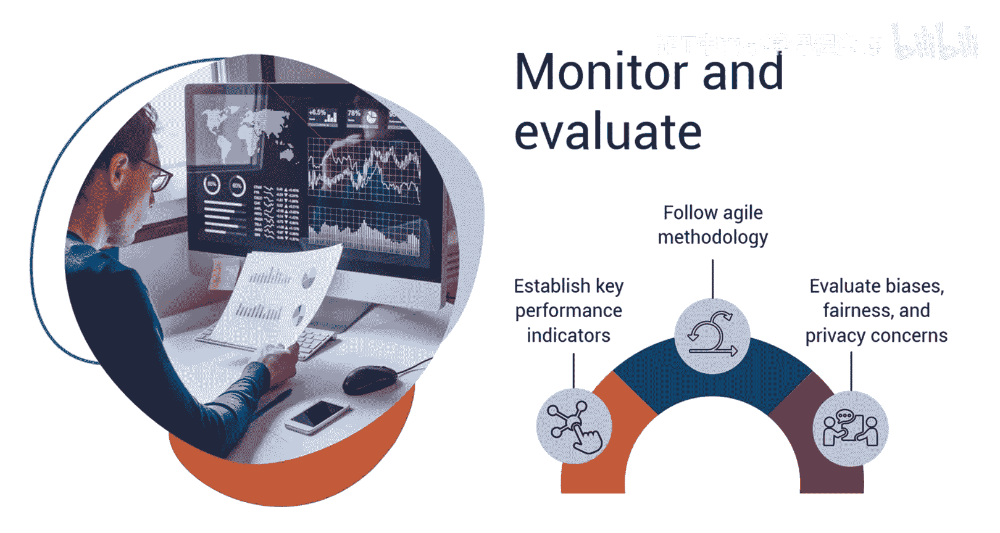

You have reached the end of this video。In this video。

 youll learn the key steps involved in developing an AI adoption roadmap for HR。

Outlining practical strategies and considerations for successful implementation。Overall。

 an AI adoption roadmap in HR paves the way for a successful integration of AI。

Maximizing its benefits while minimizing disruption and building trust with employees。

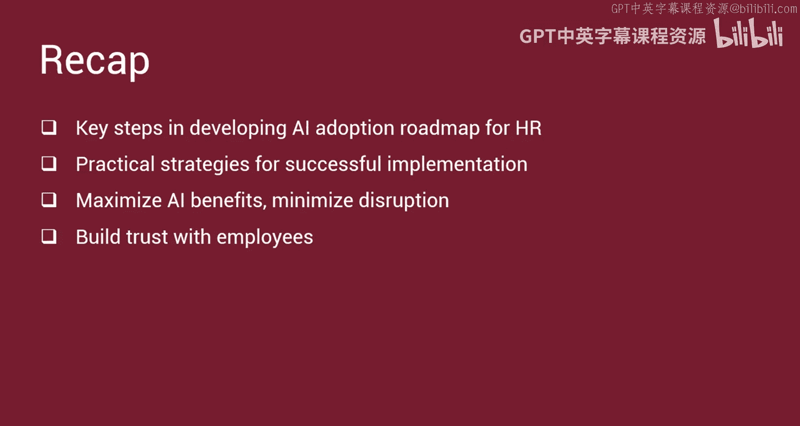

