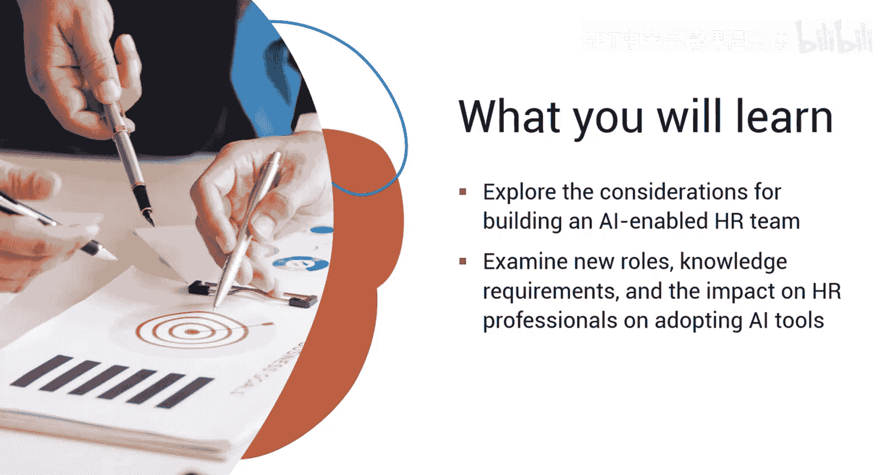
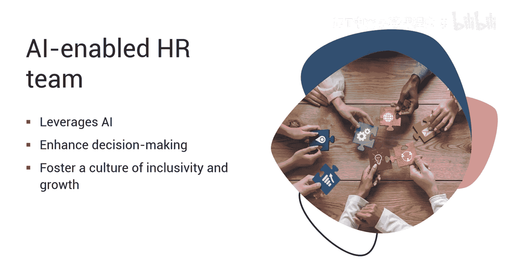
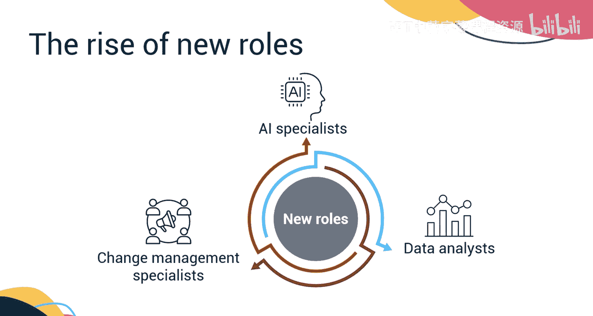
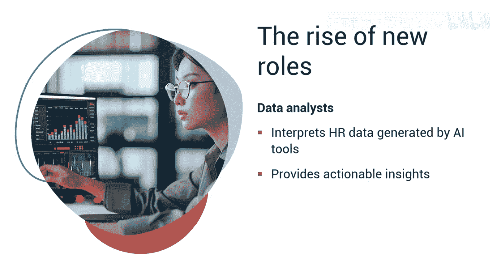
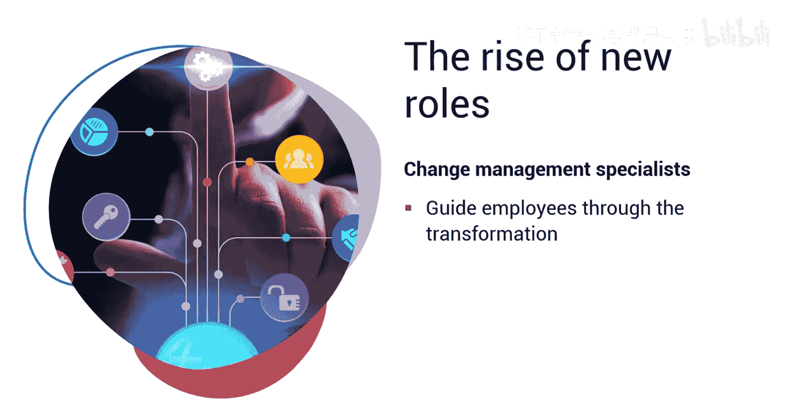
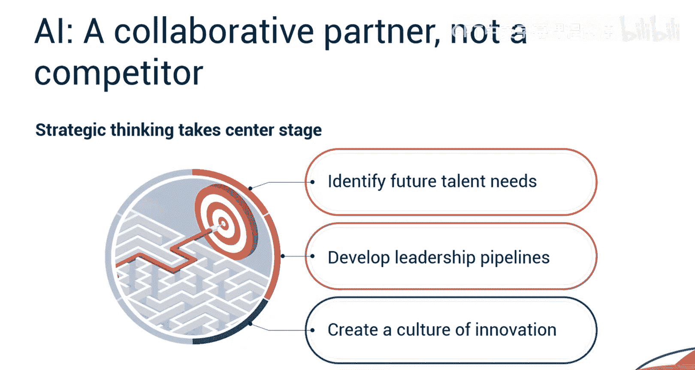
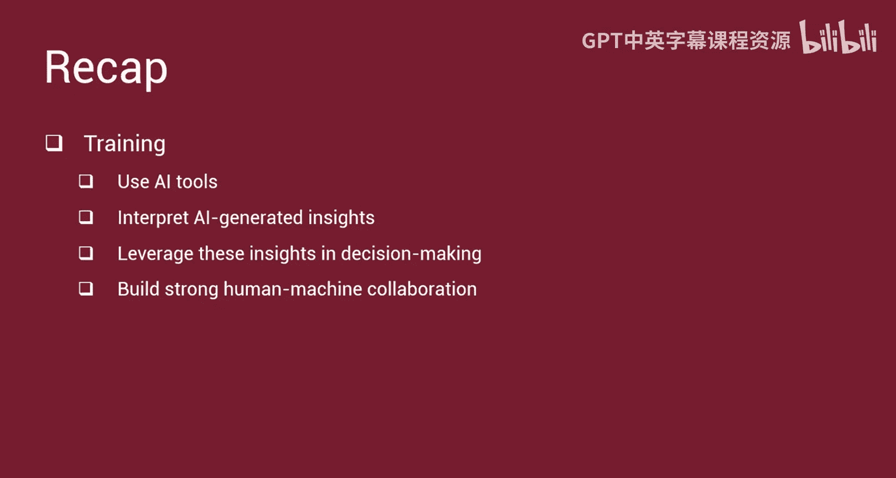

# IBM《生成式AI用于人力资源｜Generative AI for Human Resources (HR) Professionals》中英字幕 - P46：15_建设AI赋能的人力资源团队.zh_en - GPT中英字幕课程资源 - BV1Ese3zvEf4

Welcome to the Building AI enabledd Human Resource Team。

After watching this video， you'll be able to explore the considerations for building an AI enabled HR team。

You'll also be able to examine new rules， knowledge requirements。

 and the impact on HR professionals on adopting AI tools。

Imagine a human resource team that leverages AI to streamline processes， enhance decision making。

 and foster a culture of inclusivity and growth。Establishing an AI enabled HR team requires a thoughtful strategy。

This involves adopting technology， developing skills， managing change。

 and considering ethical implications。It's not just about implementing AI tools。

 it's also about cultivating a culture of innovation， teamwork。

 and continuous learning within the HR department。Let's understand how to build an HR team where every individual can thrive and contribute their best using AI。

Traditionally， HR teams rely on manual processes and subjective evaluations。

AI is streamlining tasks and bringing objectivity to HR functions。

As per a recent survey conducted by Gartner， 38% of HR leaders are either in the process of piloting。

 planning implementation， or have already deployed generative AI。While some roles diminish。

 AI creates opportunities for new expertise within the HR team， such as AI specialist， data analyst。

 and change management specialists。

AI specialists will be responsible for selecting， implementing， and managing AI tools within HR。

They need a solid understanding of both HR practices and AI capabilities。

As the HR teams will increasingly rely on data to make informed decisions。

 data analysts are crucial for interpreting HR data generated by AI tools and providing actionable insights。

However， implementing AI requires a smooth transition。

Change management specialists will guide employees through the transformation。

 fostering understanding and maximizing benefits。

Acquiring new knowledge and skills is the key to success in an AI powered HR team。

Let's explore what HR professionals need to embrace to attain this success。

The first step is to understand AI。HR professionals must have a basic grasp of AI concepts like machine learning and natural language processing。

 this knowledge helps evaluate AI tools and make informed decisions about their implementation。Next。

 data analysis is becoming central to HR decision making。

 and learning to interpret data and translate it into actionable insights will be crucial for HR professionals。

Additionally， adopting a human centered design is of utmost importance。

HR professionals should focus on building strong relationships with employees and ensure AI tools are used ethically and transparently。

A very crucial requirement for building an AI enabled HR team is upskilling and training。

Training the HR team on using AI tools and interpreting AI generated insights is crucial。

This includes equipping them to leverage these insights in decision making and build strong human machine collaboration。

To do this， it is important to identify the specific skills needed for an AI powered HR team and create training programs to bridge any gaps。

Next， it's also important to educate employees about how AI is used in HR。

 address potential concerns， promote transparency， and build trust in AI driven processes。

Many times it might happen that the team members are concerned about their position getting replaced by AI。

However， a more accurate perspective views AI as a powerful tool that can augment and enhance the capabilities of HR professionals。

Here's why AI won't replace HR professionals。The human touch remains invaluable。

AI excels at automation and data analysis， but it lacks the human ability to understand employee emotions。

 build trust， and foster a positive work environment。

Skilled HR professionals will continue to play a critical role in employee engagement。

 performance management， and conflict resolution。With AI handling routine tasks。

 HR professionals can dedicate more time to strategic thinking， identifying future talent needs。

 developing leadership pipelines， and creating a culture of innovation。

In this video， you learned about the considerations of building an AI enabled HR team。

You explore that AI integration into HR processes can lead to streamline tasks and objective evaluation。

It also creates new job opportunities for AI specialists。

 data analysts or change management specialists。You also learned that building an AI power team would need training of the HR staff on how to use AI tools。

 interpret AI generated insights， leverage these insights in decision making。

 and build a strong human machine collaboration Additionally you gained insights into how the integration of AI into HR is not about replacing human expertise。

 but rather about creating a more powerful and productive HR ecosystem。

