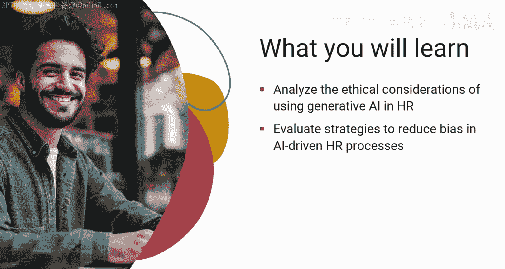
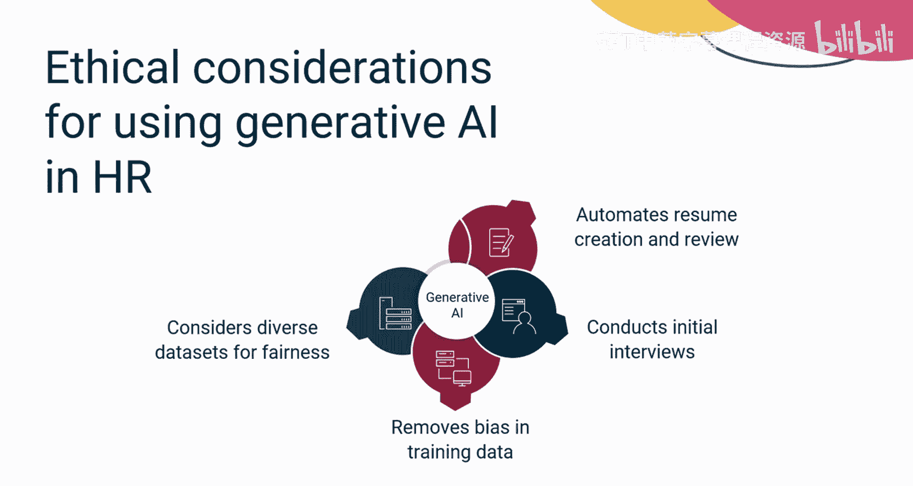
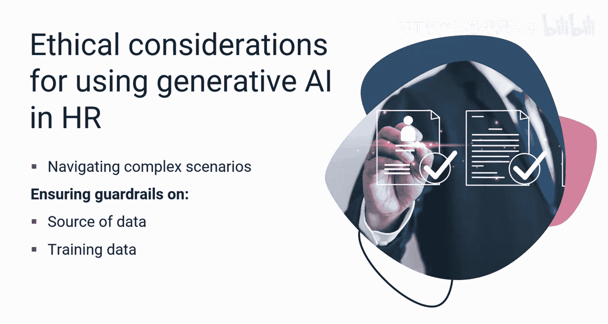
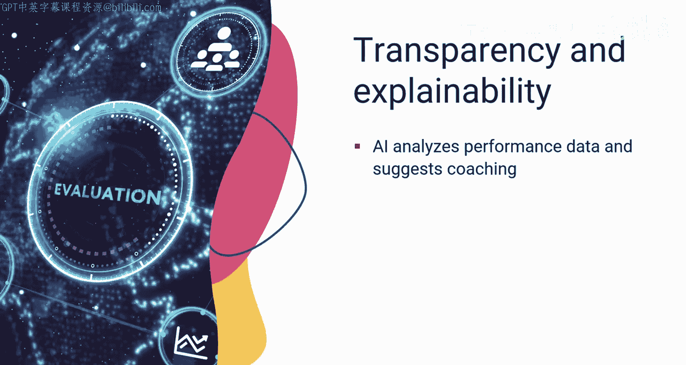
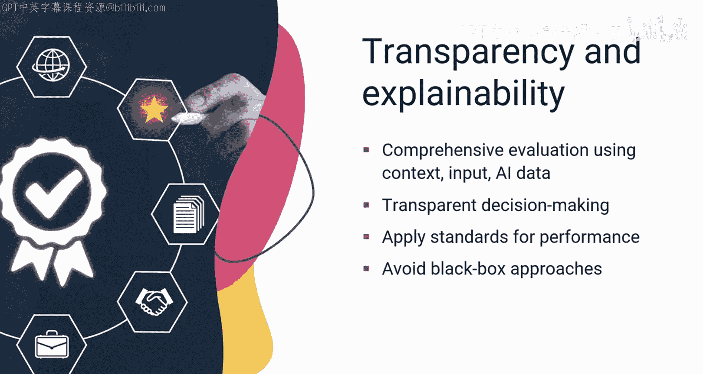
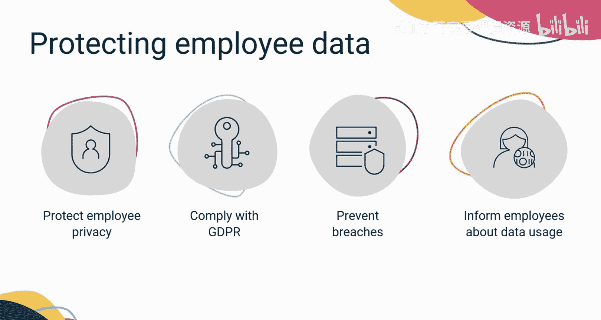
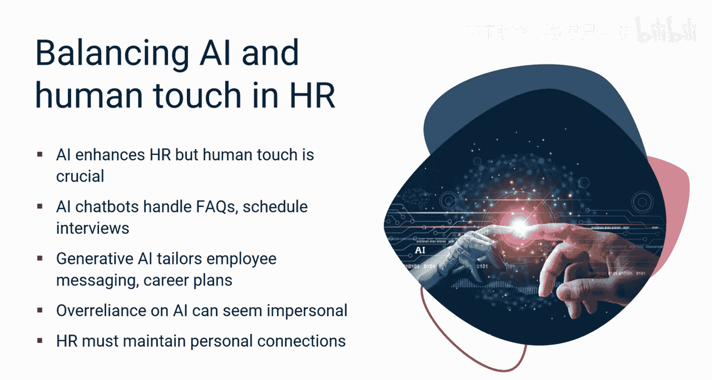
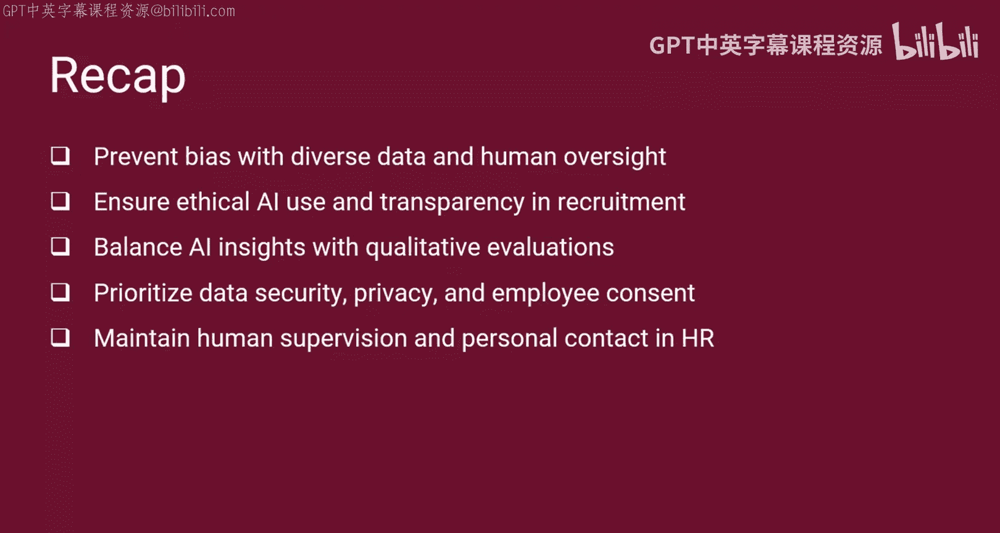

# IBM《生成式AI用于人力资源｜Generative AI for Human Resources (HR) Professionals》中英字幕 - P47：16_人力资源中应用生成式AI的伦理考量.zh_en - GPT中英字幕课程资源 - BV1Ese3zvEf4

Welcome to Eical Considerations for using generative AI and HR。

After watching this video， you will be able to analyze the ethical considerations that might arise with using generative AI in HR。

 you will also be able to evaluate strategies that help reduce bias in AI drivenrin HR processes。

Additionally， you will be able to apply data privacy and security principles in AI models Finally。

 you will be able to develop a balanced approach to integrate AI and humans into the HR system。

Imagine yourself racing through the day in the fast paced world of HR。

Your inbox is flooded with potentially good resumes and AI generated recommendations。

But is there a way to ensure that these recommendations are fair and accurate？

Generative AI can automate tasks like creating resumes tailored to the job description and reviewing them based on specific skills needed and filtering them out。

The AI assistants conduct the preliminary round of interviews so that the HR executives can focus on more strategic duties。

 however， bias in training data can lead to discriminatory filtering。

 favoring resumes for particular skills with specific keywords。

 gender and race used by a certain demographic。HR must ensure diverse data sets and AI augmented decisions and the final selection process to mitigate this HR ethics and AI is an evolving field with many complex scenarios。

 ranging from bias free recruitment to fair performance reviews to responsible use of employee data。

Effective guardrails on the source of data and the data used for training the model go a long way in establishing the credibility of the generative AI models used for HR practices。

Now let's consider the transparency and explainability aspects。

Generative AI can analyze vast amounts of data for different use cases。

 including identifying performance trends and suggesting personalized coaching or training programs。

This data driven approach can offer valuable insights。However。

 solely relying on AI metrics might overlook qualitative aspects of performance。

So what's the mental path here HR must ensure that the evaluation is comprehensive and considers context。

 employee input and AI generated data。Consider using generative AI models that explain the decisions taken。

HR should also be transparent and clearly communicate how AI systems are leveraged in HR processes。

They should be able to explain to candidates and team members how AI models make various decisions。

For example， how are resumes vetted or promotion decisions made？

Black box approaches where the internal workings of the AI system are not transparent or understandable。

 can cause issues and foster mistrust between the HR staff and employees。Now。

 imagine the massive volumes of employee data， including personal data that are needed for generative AI systems being at risk。

How can you protect this data？HR is responsible for managing this data to protect employees privacy and comply with privacy rules like the general Data Protection Regulation or GDPR。

HR must also ensure strong data security procedures are in place to stop any breaches。Furthermore。

 employees also have a right to know how their information is utilized， therefore。

 their consent and clear data privacy practices are essential。

While you explore the opportunity of AI powered assistance。

 remember that humans are still the heart and soul of the HR world。While AI can automate work。

 human supervision and planning is the foundation。So how can these two collaborate effectively AI powered chatbots can respond to frequently requested questions and schedule interviews？

Generative AI can also tailor employee messaging， collect appropriate learning material。

 and create individualized career development plans， however。

 over reliance on AI communication might appear impersonal and create a sense of detachment。

 HR must maintain personal contact throughout the process。

 particularly during critical stages such as interview confirmation or rejection。

HR should also maintain regular interactions and feedback sessions with employees。

 open communication channels， and opportunities for employees to express their issues directly。

Additionally， HR professionals must monitor AI systems， intervene when needed。

 and accept responsibility for their outcomes； however， AI can supplement HR processes。

 not completely replace HR tasks。You have now reached the end of this video。

Let's recap。In this video， you learned that bias and training data can lead to discriminatory filtering in AI generated recommendations。

 making the use of diverse data sets and human oversight necessary in the final selection process。

You also learned that the field of HR ethics and AI involves ensuring fair recruitment。

 performance reviews， and responsible data usage， which can be achieved through effective guardrails on data sources and transparency in AI decisions。

Additionally， you learn the importance of balancing data driven insights from AI with qualitative performance evaluations and the need for HR to communicate clearly how AI systems are utilized to foster trust。

Furthermore， you learned about the necessity of strong data security measures。

 compliance with privacy regulations to protect employee data。

 and the importance of obtaining employee consent and maintaining clear data privacy practices。

 Finally， you learned that while AI can enhance HR processes， human supervision， personal contact。

 and regular interaction are essential to maintain a balanced and effective HR environment。

