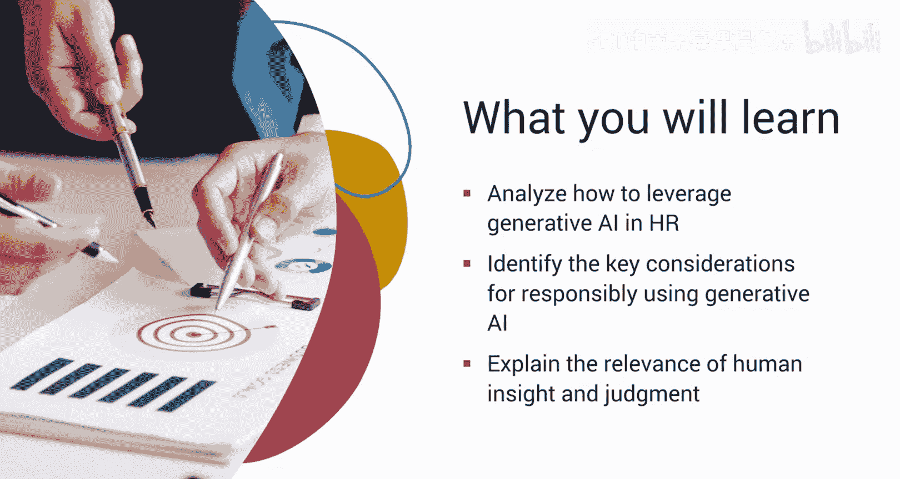
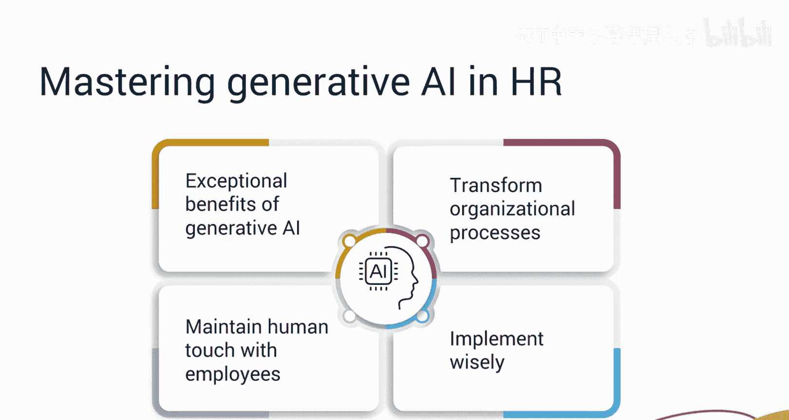
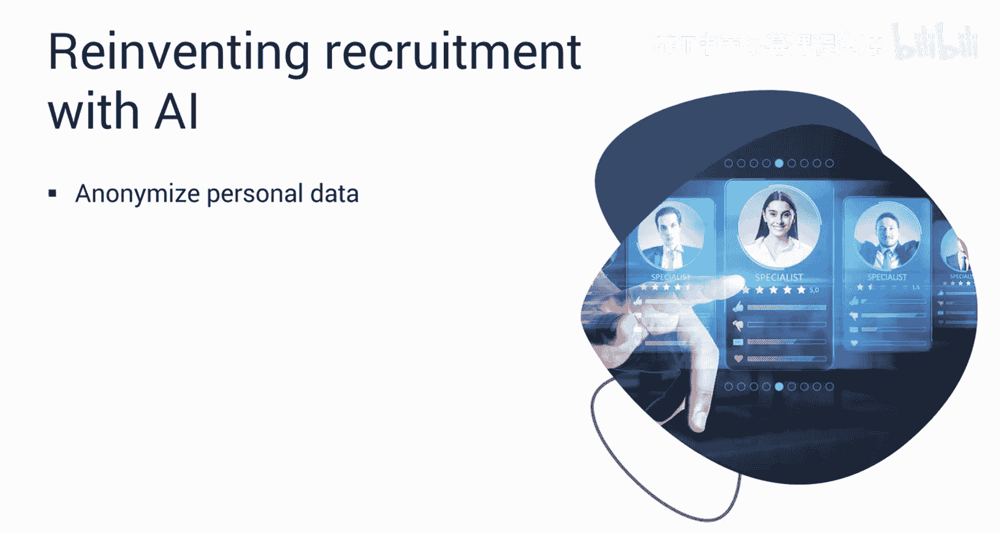
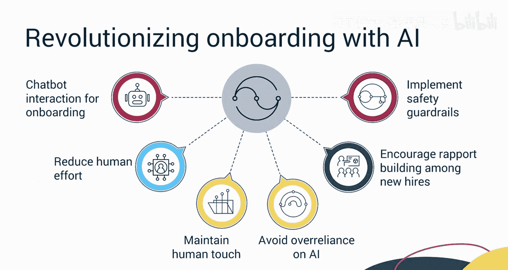
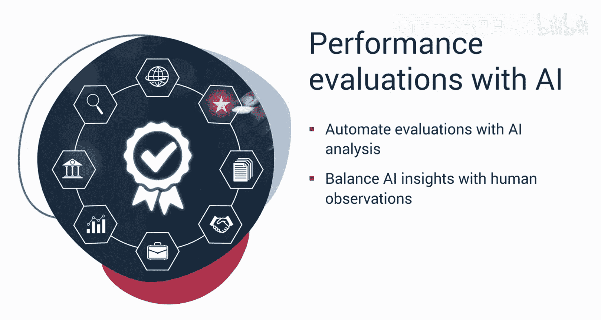
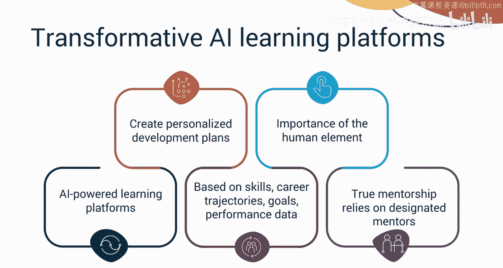
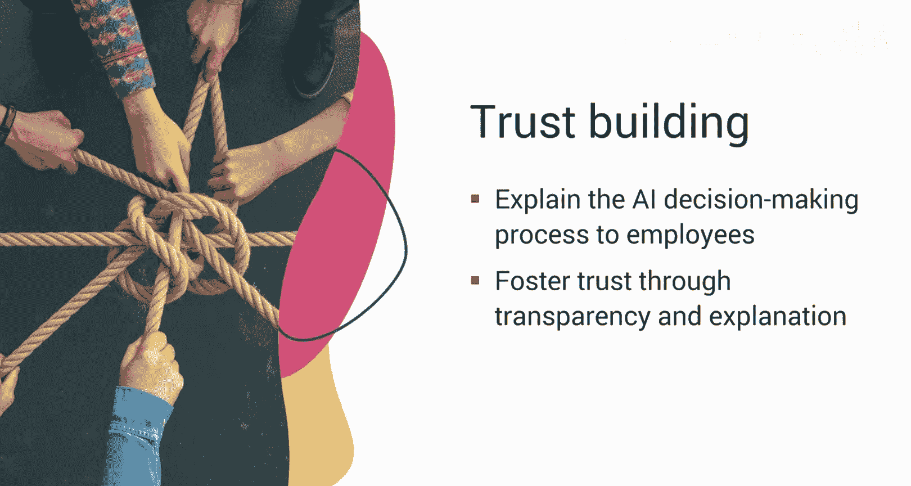
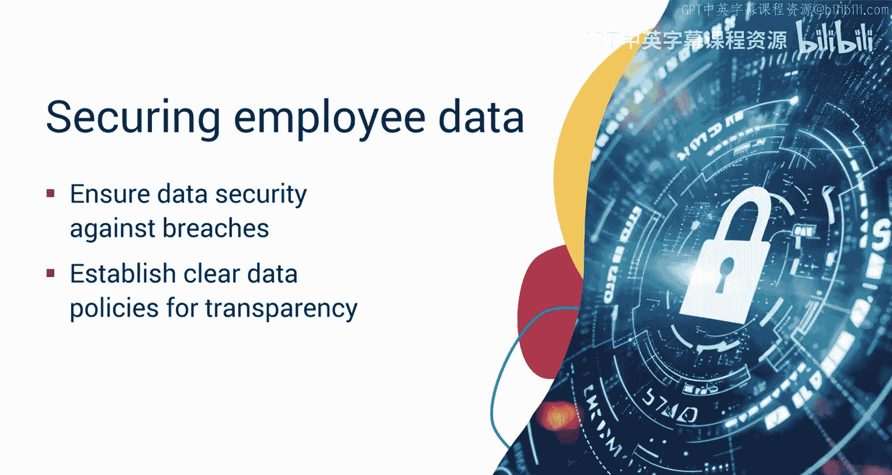
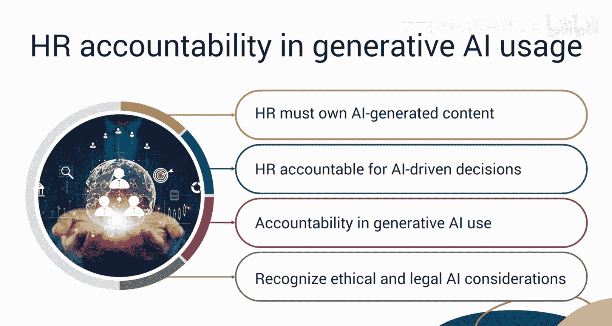
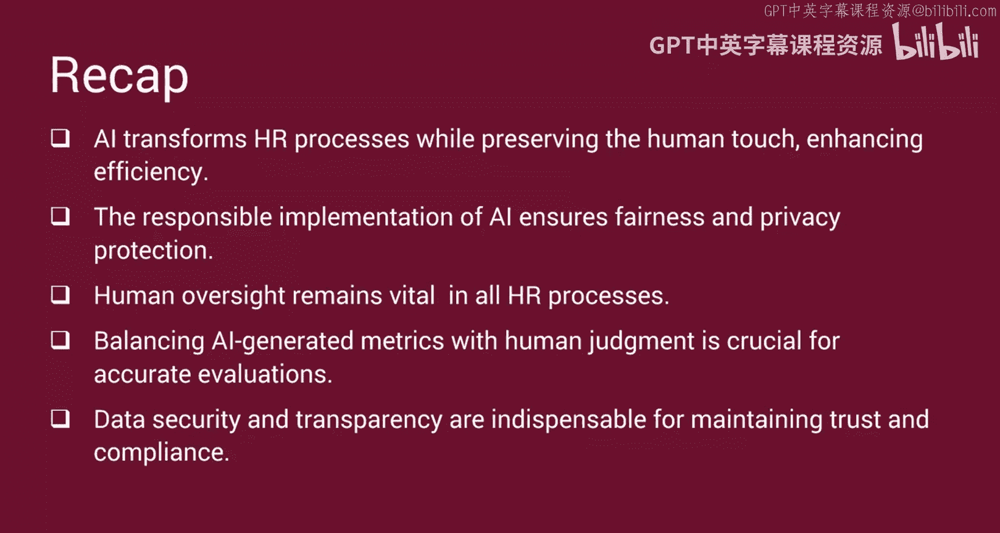

# IBM《生成式AI用于人力资源｜Generative AI for Human Resources (HR) Professionals》中英字幕 - P48：17_生成式AI在人力资源中的负责任使用.zh_en - GPT中英字幕课程资源 - BV1Ese3zvEf4

Welcome to Responsible Use of generative AI in HR。After watching this video。

 you will be able to analyze how to leverage generative AI and HR responsibly。

You will identify the key considerations for responsibly using generative AI and HR functions。

You will also identify the relevance of human insight and judgment in generative AI driven human resources。

Generative AI offers exceptional and unmatched benefits that can transform any organization。

 but its implementation needs to be done wisely so as not to eliminate the human touch with the employees。

Now picture this， you and HR professional wish to craft a job description that attracts various talent pools。

How would you implement AI to do it？Generative AI can be trained to identify keywords and craft descriptions。

 tailored to resonate with an ideal candidate based on successful hires from the past。However。

 to ensure fairness and eliminate bias， the training data needs to be audited and reviewed by humans。

It goes without saying that it is always best practice for HR to provide feedback to the candidates who are not selected。

Additionally， privacy must be maintained by anonymizing personal data wherever possible to protect employee privacy。

Now let's talk about screening。Generative AI can sift your resumes and select the best candidates based on predetermined criteria。

This enables HR professionals to redirect their energy to conducting in depth interviews with top tier prospects。

However， one should not just rely on matching the keywords to screen candidates。Still。

 as an HR professional， one should also create processes that examine the application of relevant experience and talents。

Now， let's take a step further toward the onboarding process。

 it's fun to interact with a chatbot which can significantly reduce the human effort required during onboarding。

But the human touch should not be lost altogether。An over reliance on AI can also block new hires from building rap with their colleagues。

It is important to implement safety guardrails such as access controls to ensure the secure use of AI during onboarding。

Generative AI can analyze performance data and provide recommendations for areas of improvement。

 as well as personalized training programs。The analysis backed by a metric evaluation does help a manager offer targeted feedback。

 but is statistical data the only basis for performance evaluations？

It is HR's responsibility to balance AI generated performance analysis with manager observations and self assessments made by employees。

They should consider creating forums where employees can have appraisal discussions and supervisor performance analysis。

 which can sometimes be sentiment driven。Let's talk about AI powered learning platforms。

They are game changers， able to create personalized development plans based on an individual skills。

 career trajectories， goals， and performance data。However。

 the human element is crucial in this area as well。

The true feeling of mentorship often depends on having a designated mentor to whom you can look for guidance and mentorship。

But what if your employee does not believe you have made the correct decision？

This is why trust building is crucial。HR personnel must explain to the employee how generative AI has been trained to perform certain decision making processes。

Transparency often fosters a sense of trust and acceptance within the organization。

Finally， let's shift gears to move on to data security。

HR must ensure that the employee data that the AI is using remains free of any data breaches。

Clear data policies should be put together to outline how data is collected， used， and stored。

It is the right of an employee to inquire if their data is being stored responsibly or not。

Regardless of Generative AI's role， HR professionals must own and be accountable for the content generated and decisions made using the generated output。

Accountability in generative AI demands that HR professionals recognize their ownership and consider the ethical and legal considerations surrounding its use。

 You have reached the end of this video After watching this video。

 you learned about the transformative potential of generative AI in HR。😊。

Emphasizing the importance of maintaining the human touch alongside technological advancements。

You also learned how AI can revolutionize job descriptions， resume screening。

 and onboarding processes while ensuring fairness and privacy。Additionally。

 you gained insights into the necessity of human oversight and screening candidates and fostering rapport during onboarding。

Moreover， you learned the significance of balancing AI driven performance analysis with human judgment and accountability for ethical and legal consequences。

Finally， you learned the critical aspect of data security。

 highlighting the importance of clear policies and transparency and handling employee data and AI applications。

