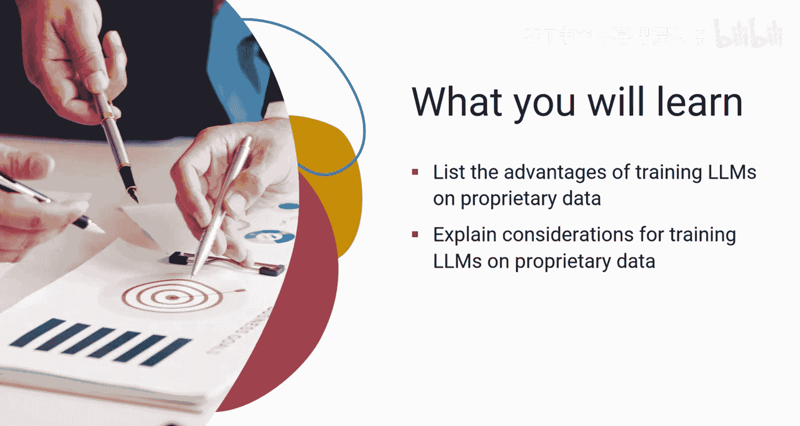
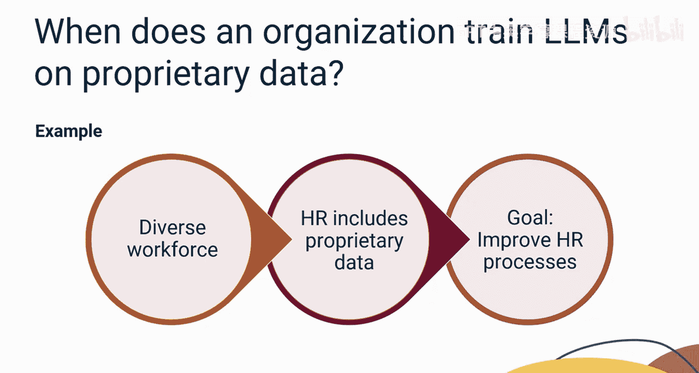
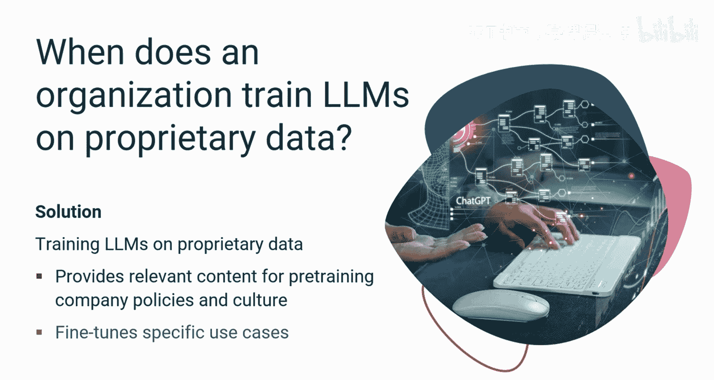
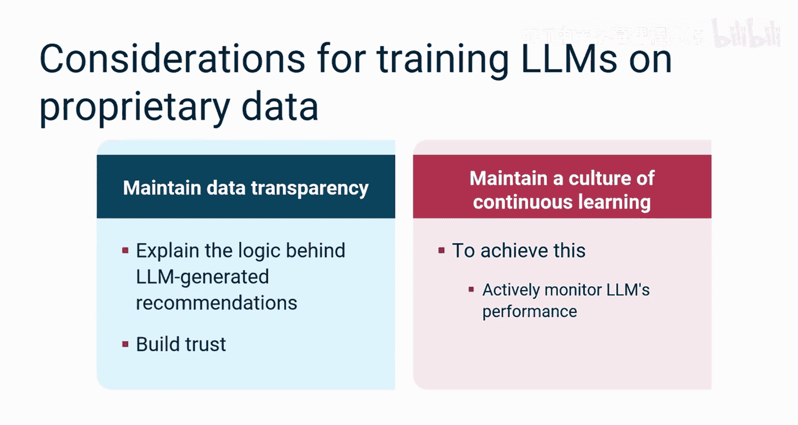
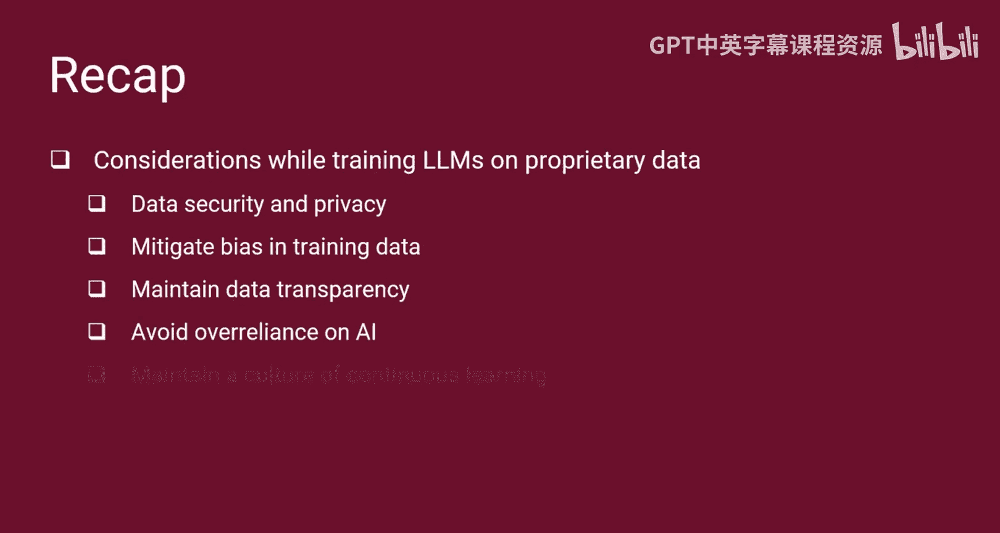

# IBM《生成式AI用于人力资源｜Generative AI for Human Resources (HR) Professionals》中英字幕 - P49：18_为组织定制的生成式AI模型.zh_en - GPT中英字幕课程资源 - BV1Ese3zvEf4

Welcome to Custom Generative AI models for your organization。

After watching this video， you'll be able to explain how training large language models or LLMs on proprietary data enhances domain specific knowledge。

You'll also be able to describe the process of building the LLM training pipeline and list the benefits of training LLMs on proprietary data。

Additionally， you'll be able to explain considerations for training LLMs on proprietary data。

Consider an organization that manages a diverse workforce at multiple locations。

Its human resource or HR department includes proprietary HR data。

 such as employee performance reviews， internal communications and training records。

 the organization aims to improve its HR processes。

 such as employee onboarding performance evaluations and personalized training plans。

To do so， they consider training LLMs on proprietary data to enable data confidentiality。

 enhance data security pipelines， provide relevant content for pertaining company policies and culture。

 and fine-t specific use cases such as resume screening。

These parameters help organizations achieve high levels of efficiency。For example。

 organizations have their own resume screening strategies for similar roles。

 which differ from one role to another。However， fine tuning LLMs based on business requirements helps HR customize the HR related processes。

Let's dive deep into understanding how to build an LLM training pipeline in an organization。

 the LLM training pipeline starts with data collection and its curation。

Then the data gets pre processed， followed by model selection。 Finally。

 the model is fine tuned and evaluated with multiple iterations， Let's review each of them in detail。

LLM collects relevant proprietary text data from various resources， such as internal documents。

 emails， chat logs， performance reviews， and policies to curate the data。

 LLM removes personal information and retain sensitive information， however。

 using anonymous data enables it to remain in compliance with privacy laws。Next， LLLM removes noise。

 special characters， and irrelevant content to pre processcess these data。Further。

 the data analyst selects either a new or a pre traineded LLM model。

Then they fine tune the data model using proprietary data。Lastly。

 the data analyst evaluates and reviews the LLM model and its capabilities to leverage seamless usage for HR professionals。

Retrieval augmented Generation or RAG is a technology useful for enabling an LLM to fetch relevant data from an organization specific database RAG has capabilities for fine tuning data models to train LLMs on the specific data。

RyG excels as an LLM to provide the latest information by avoiding biases that hinder the fine tuning。

However， RAG requires good access to external knowledge sources to run it faster。

 so how does training LLMs on proprietary data benefit organizations？

Training LLMs on proprietary data enhances domain specific knowledge and enables LLMs to understand an organization's unique culture。

It also helps combat bias through tailored training。

This means that organizations can curate data sets that reflect their diverse workforces。Hence。

 it helps to identify and mitigate potential biases within LLMs and promotes fairness and inclusivity in organizations。

Training LLMs on proprietary data also helps personalize employee experiences such as the onboarding journey。

It also analyzes internal communication channels to identify employee concerns and suggests training programs It also unlocks hidden insights from internal data HR departments often possess valuable data from performance reviews internal surveys and employee feedback training LLMs on this data can extract useful insights and hidden patterns to identify skill gaps and recommend employee learning materials。

Lastly， LLMs help HR streamline repetitive tasks such as resume screening。

 conducting screening interviews， and generating personalized job descriptions。

 this allows HR to focus on other strategic tasks， including talent management and employee relations。

Until now， you've learned about the benefits of training LLMs on proprietary data。However。

 several considerations must be addressed to ensure the successful implementation of LLM on proprietary data。

These considerations are data security and privacy， mitigating bias in training data。

 maintaining transparency。And maintaining a culture of continuous learning。

Let's review each of these considerations。The first important consideration is data security and privacy。

While implementing LLMs and training data， organizations should take robust measures by building anonymous data techniques and adhering to data privacy regulations。

The next consideration is mitigating bias in training data。However， even with unbiased data sets。

 subtle biases may exist； therefore， HR must conduct thorough data audits to identify and minimize those biases in the training data。

HR professionals should properly explain the data and maintain transparency for the LLM generated recommendations to build trust。

Lastly， organizations should maintain a culture of continuous learning to stay updated with the latest developments in LLM training and its use to achieve this。

 they can collaborate with AI experts， attend LLM training related conferences。

 and actively monitor LLM's performance。Now， you've reached the end of this video。

Let's recap。In this video， you've learned how LLMs help HR professionals make data driven decisions。

To build an LLM training pipeline， data analysts curate and preprocess data。

 select and fine tunena model， and then evaluate and refine it。

 using the LLM RaG is a technology useful for enabling an LLM to fetch relevant data from an organization's specific database。

 training LLM's on proprietary data has several benefits。It helps enhance domain specific knowledge。

 combat bias through tailor training， personalized employee experiences。

 unlock hidden insights from internal data， and streamline repetitive tasks。However。

 while implementing LLMs on proprietary data， certain considerations regarding data security。

 privacy and bias mitigation， and maintaining data transparency should be followed to leverage the full potential of LLMs。

 you should avoid overreliance on AI generated data， and maintain a culture of continuous learning。

