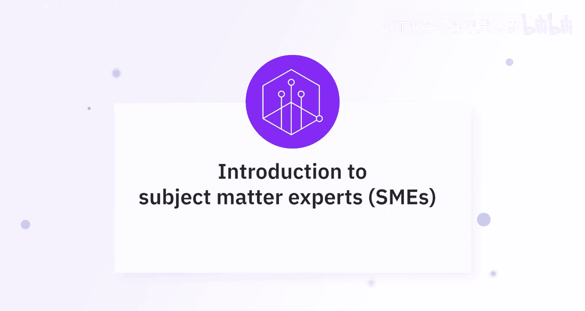
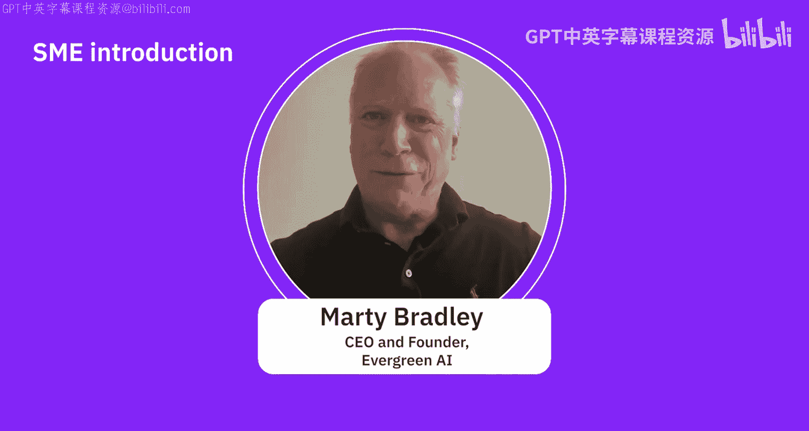
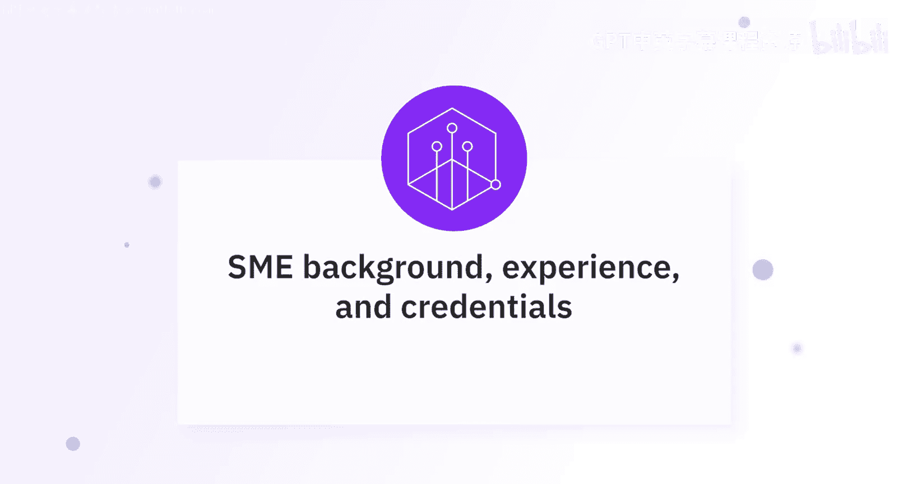
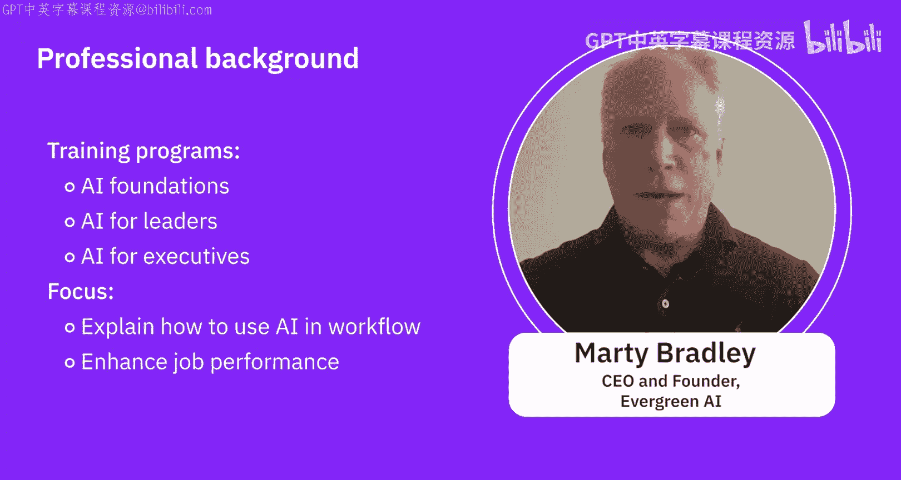
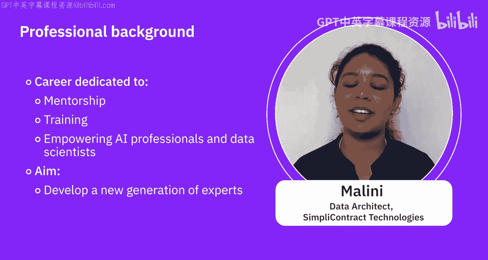
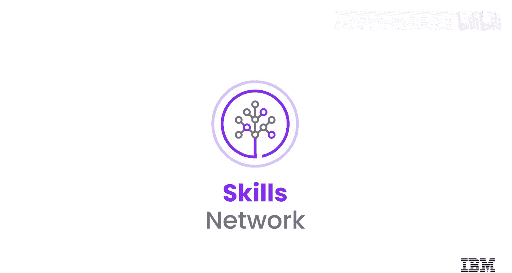

# IBM《生成式AI用于人力资源｜Generative AI for Human Resources (HR) Professionals》中英字幕 - P4：3_专家观点与领域专家介绍.zh_en - GPT中英字幕课程资源 - BV1Ese3zvEf4

Hello and welcome to this video where we meet the experts。

 Let's hear from the experts as they introduce themselves， stating their name。

 job title and the organization they work for。😊。

Hello， my name is Abyi Goneja， I'm a subject matter expert for artificial intelligence and an artificial intelligence researcher with IID。

Hello， my name is Sapida Sazader， I'm AI Engine in a K engineering team in IBM。😊。

And I'm so excited to be here and talk to you about Generative AI。😊，My name is Bradley Steinfeld。

 I am a senior software architect with IBM。Hello， I am Mali。

 with over 12 years of experience in artificial intelligence and data engineering。

 I currently serve as a data architect with simply contract technologies。Hi， I'm Marty Briley。

 I'm the CEO and founder of Evergreen AI。

Moving on， let's see what experts have to say about their background。

 including years of experience and credentials。

。A little bit about my background， I've done my PhD in the field of AI at University of Waterloo in Canada。

 and before that I was pursuing my master's in robotic。

And since I finished my education I started to work in the field。

 working with big data analytics and after that when I moved to US I still continue to work in the same field and recently with this new trend of large language model geneative AI。

 I've been working to implementing and using this technology in different use cases for our customers。

I've been at IBM for over 10 years working with Skills Network in the educational space for most of the time。

We do a number of things that evergr A by AI， but we're focused on generative AI。

 so we do generative AI training， We do generative AI strategy consulting so we'll help you understand where Gen AI fits in your organization and we also have a small development arm where we can help integrate。

 do some of the integration for you， but I pride myself in some of the training programs that we have their sessions that train everybody in your organization and AI foundations。

 AI for leaders and AI for executives and it shows you how to use the current tools you have and to do your job。

 So this is for people that want to understand how can they use AI in their workflow today to make them better at their job then put 100 x improvement。

I have worked in banking， finance， e-commerce， manufacturing and pharmaceutical sectors。

 Each of these industries with its unique challenges has enred my expertise and perspective on the tangible we make a part of data and artificial intelligence beyond just navigating through data and algorithms。

 I have dedicated and significant part of my career to mentorship training。

 aspiring AI professionals and datata scientists I have aimed to cultivate a new generation of experts ready to tackle the evolving challenges of our digital world and excited to collaborate learn and make meaningful contributions with all of you thank you for welcoming me about and am looking forward to embarking on this exciting journey together。

😊。

Yeah。

