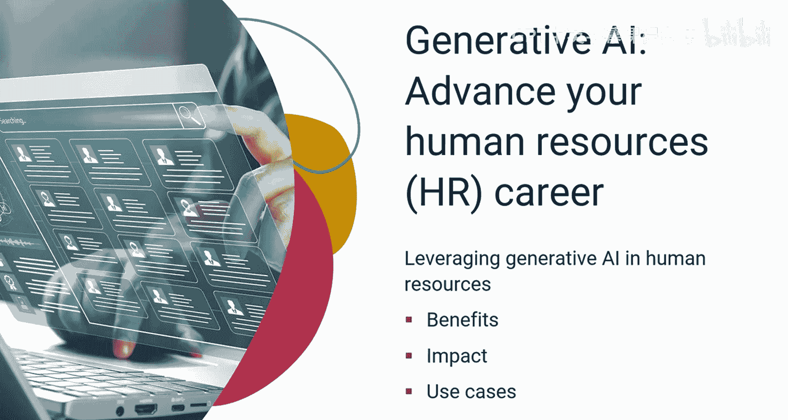
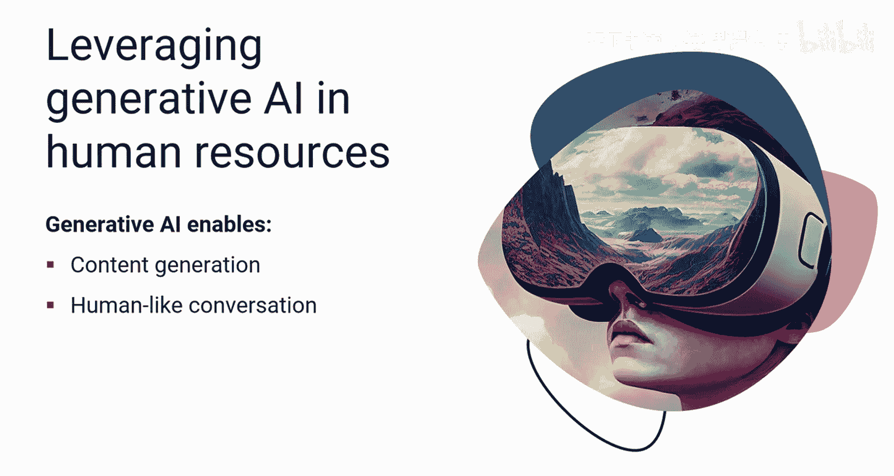
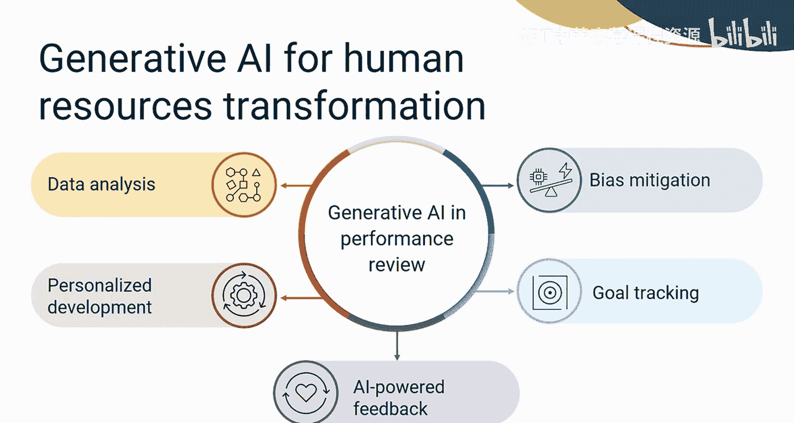
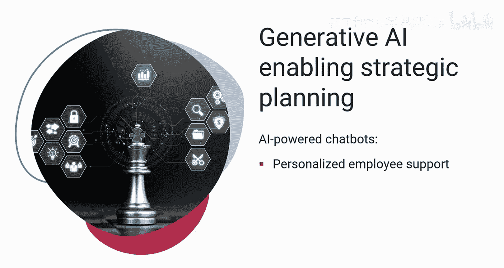
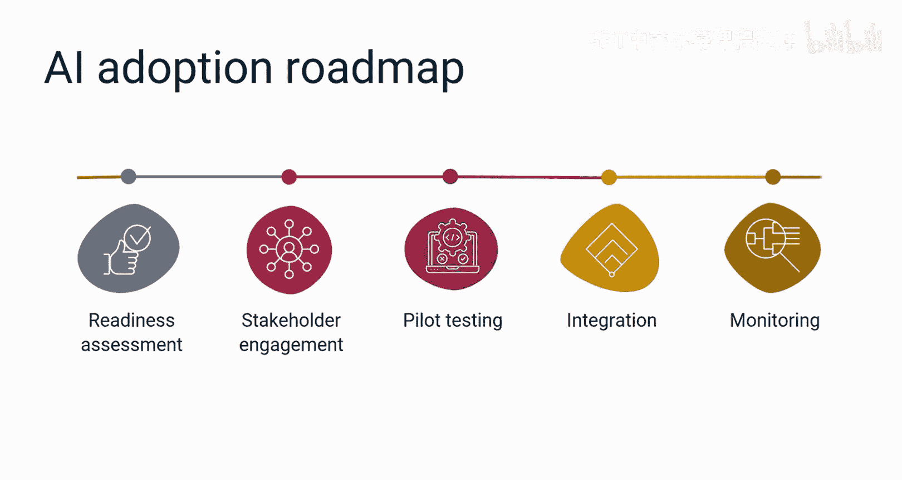
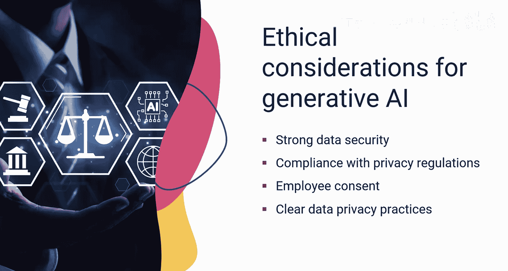
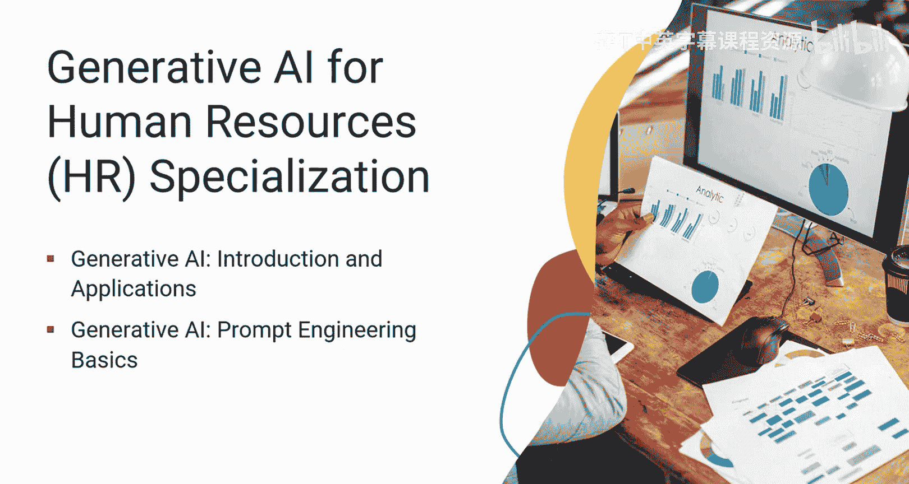

# IBM《生成式AI用于人力资源｜Generative AI for Human Resources (HR) Professionals》中英字幕 - P50：19_课程总结.zh_en - GPT中英字幕课程资源 - BV1Ese3zvEf4

Congratulations on completing this course now that you have learned the fundamentals of using generative AI in the human resources or HR domain。

 you can apply your skills to boost your career。

Let's take a moment to reflect on our journey， where you gain some essential knowledge on the benefits。

 impact， and use cases of leveraging generative AI in human resources。

Generative AI can help you streamline various HR functions， automate repetitive tasks。

 and make data driven， inform decisions to ensure fair outcomes and recruitment， promotion。

 and performance management。Generative AI enables a range of capabilities。

 including content generation， human like conversation， sentiment analysis， and predictive analysis。

Tools like chat GPT， Copilot， Gemini， Doli， SoOA， and IBM Watson X Orcheste 8 HR functions。

 automating workflows and integrating easily。AI agent Scout， Willow。Sage。

And retain handle recruitment onboarding， performance analysis and retention。

Digital employees autonomously manage end to end work processes。

Generrative AI assists in crafting precise job descriptions， screening candidates。

 conducting interviews， and providing personalized feedback to streamline recruitment and onboarding processes。

You can leverage generative AI to create personalized and interactive training content。

 tailored to individual needs and preferences， fostering enhanced engagement and knowledge retention。

Implementing generative AI in performance appraisal offers benefits like data analysis。

 personalized development， AI powered feedback， goal tracking， and bias mitigation。

Generative AI AIDS data analysis， workforce planning， skills forecasting， and resource allocation。

It powers chatbots for personalized employee support， real time rewards and engagement。

Adopting AI in an organization requires drafting a roadmap that covers readiness assessment。

 stakeholder engagement， pilot testing， integration。And monitoring。

Training HR staff on AI tools and insights fosters effective human machine collaboration。

Incorporating generative AI requires strong data security， compliance with privacy regulations。

 employee consent， and clear data privacy practices。

Balancing AI driven performance analysis with human judgment and accountability for ethical and legal consequences is crucial。

Now like you've reviewed some of the fundamental ideas presented in this course。

 remember to use the coursese glossary and the cheat sheet for generative AI tool prompts related to common HR use cases。

You can use these assets to quickly reference much of what you learned。

You can demonstrate your skills in applying generative AI to HR use cases through the final project。

We encourage you to enroll in the generative AI for HR professional specialization。

 of which this course is a part。Apart from this course。

 the specialization includes the following two courses。

Generative AI introductionuction and applications and generative AI Pro Engineering Bas。

Each of these courses requires four to six hours to complete。

Congratulations on completing this course and thank you for being a part of this learning journey。

As a next step， we recommend you continue your learning journey and keep applying your new skills。

Here is wishing you all the best。

