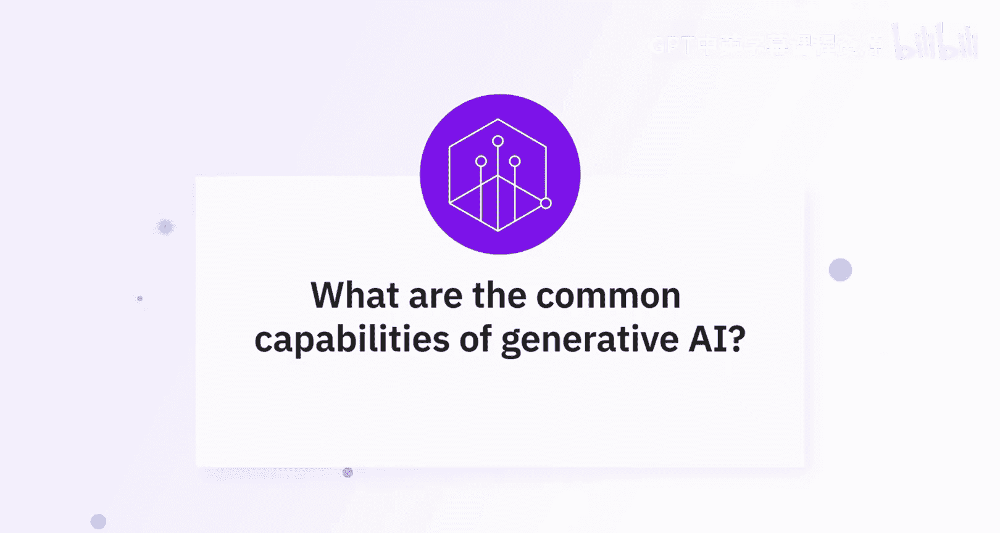
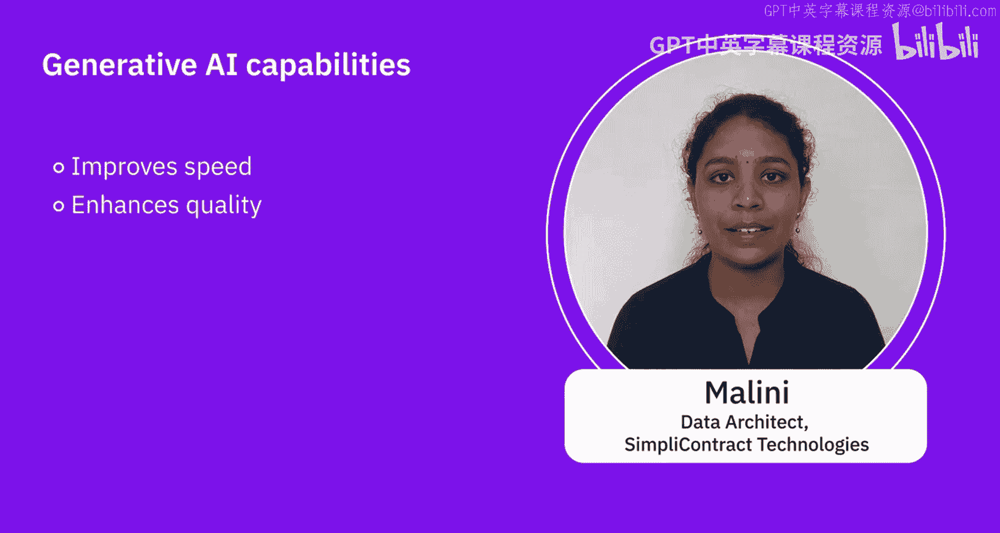
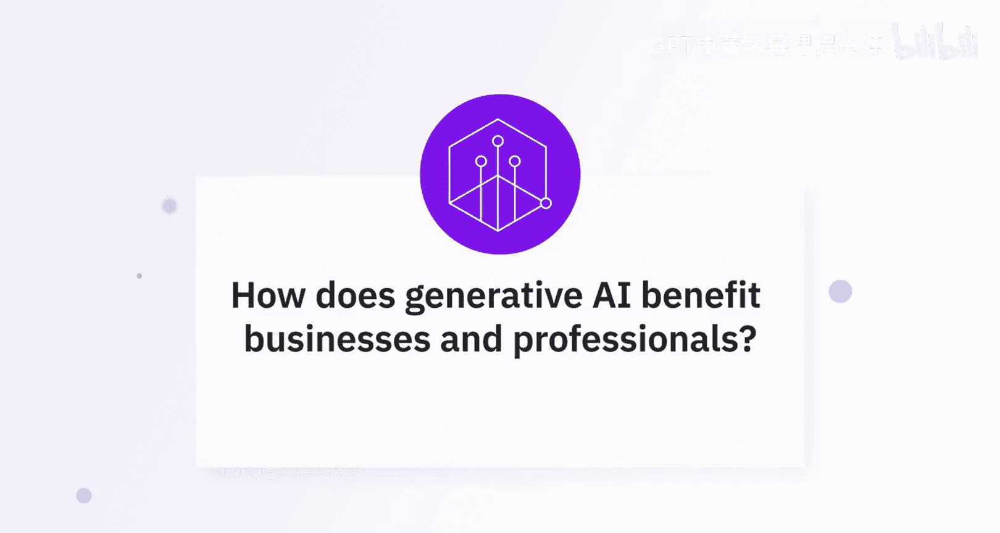
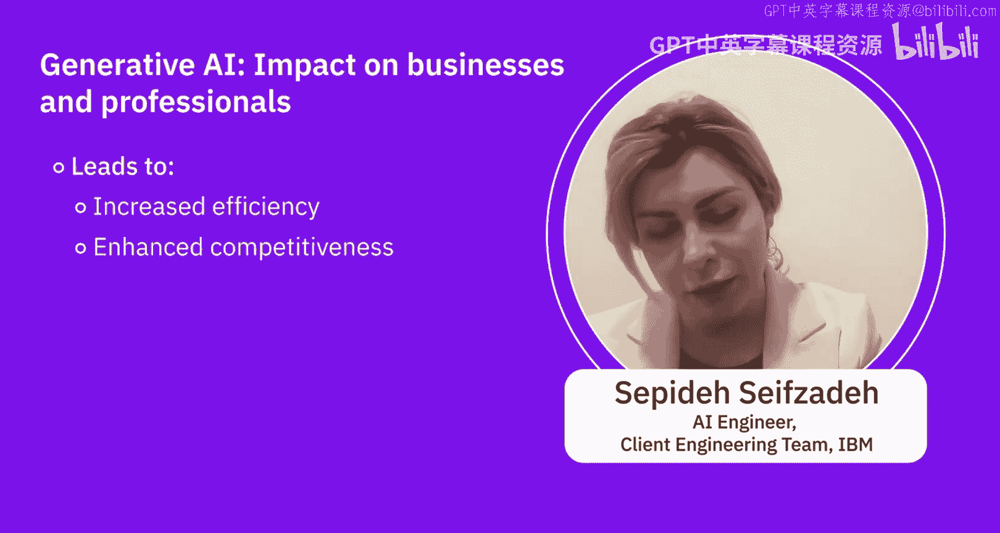

# IBM《生成式AI用于人力资源｜Generative AI for Human Resources (HR) Professionals》中英字幕 - P7：6_专家观点：生成式AI能力解析.zh_en - GPT中英字幕课程资源 - BV1Ese3zvEf4

Hello and welcome to this expert viewpoint video。😊。

Let's listen to what AI experts have to say about the common capabilities of generative AI。

Yeah。

Geneervai offers various capabilities that benefit businesses and professionals。

 It excels in content creation， such as generating text， generating images， music， and even video。

 which streamlines marketinging and creative processes。

Some of the common use cases using large language models are summarization， extraction。

 generation and classification， it can be a co generation。😊。

Generrative artificial intelligence basically has not only applications in generating raw data but also generating patterns。

 generating configurations， generating settings and many other way so specifically when talking about industry。

 there are plenty of ways in which synthetic data can help any kind of industry。

A very common use case that we see working with customer is called a Ra use case。

 retrieval augmented generation， actually it's very popular and common use case these days because our customers has many private documents that they do not want to expose into public cloud or publicly they are not publicly available。

 but they are interested to retrieve the information in a fast manner from those documents。😊。

Well generative AI is not just a fancy though it's a game changer imagine having a digital sidekick that unlocks your creativity understands your needs and save you time that's exactly what generative AI does so forget guess what and embrace the future generative AI is here to make things faster better and more personalized。

Moving on to the next question， how does generative AI benefit businesses and professionals。

。Geneerative AI can help us by text generation， for example。

 GPT models can help generate some text that they can use for marketing material。

 it can help with image generation， for example Gs can create images and videos which are very very close to the realistic images and videos。

 it can help with music and audio generation， it can help with data synthesis and augmentation。

AI driven content generation Sa time reduces costs by automating tasks like writing reports。

 creating social media posts and designing graphics。 Additionally。

 generative AI enhances customer experiences through personalized recommendations and interactive chatbots。

 This improves the engagement satisfaction in design and product development aids in rapid prototyping and exploring innovative solutions by generating multiple design variations very quickly。

For example， if you talk about healthcare industry there are operations with regard to synthetic data generation synthetic image generation which kind of protect human privacy that is people who have certain medical conditions their privacy is protected generative AI can also be used for fraud detection in financial analysis it has been known to be used in pharmaceutical industries for creating more medicine patterns so this is a very wide scale obligation structure and geneative AI is constantly helping a lot。

It paints stunning pictures， write captivating stories and even translate languages like a probe personalized recommendations。

 no problem This AI body finds exactly what you want。

 whether it's a moving a product or even a career path in scenes like healthcare and aviation It creates a realistic simulations for training。

 making learning safe an effort to， but it does not stop that generative AI automates task freeing you up to focus on what matters most。

So all these tasks help us to enhance the creativity， personalize the experience。

 and make the data driven decisions， which leads to increasing their efficiency。

 competitiveness and customer satisfaction， which is our end goal。😊。

。

