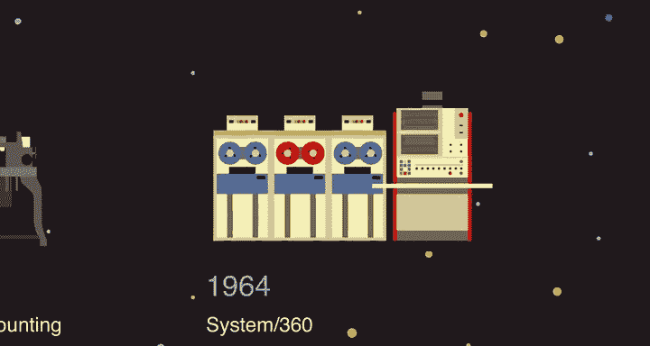
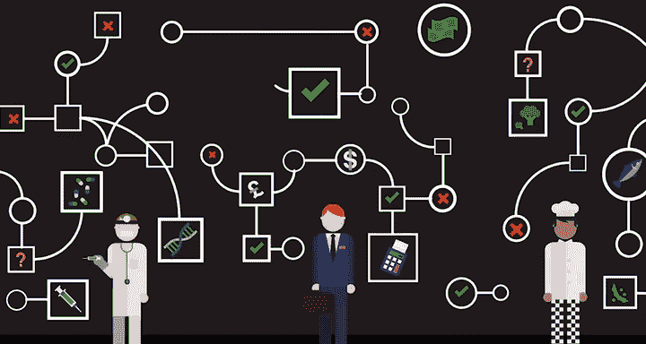
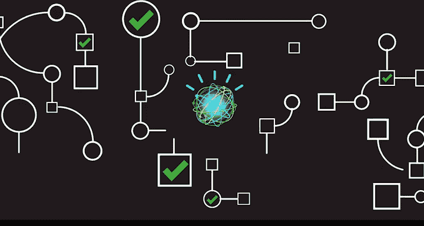
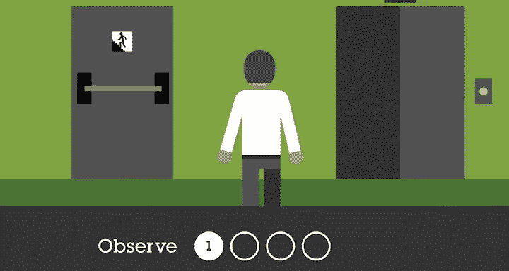
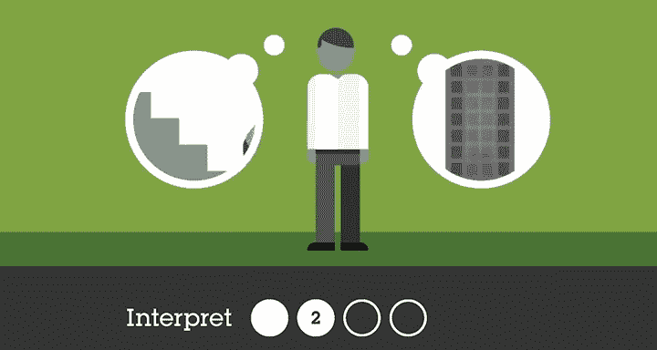
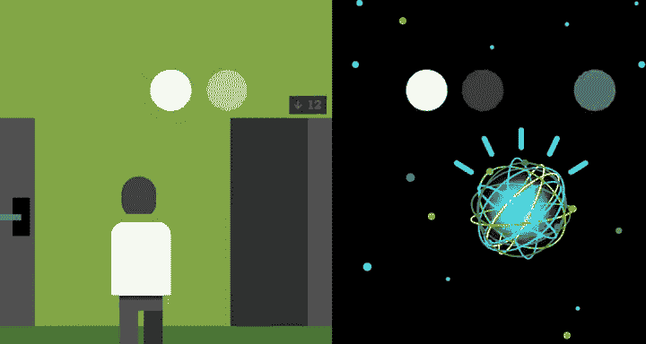
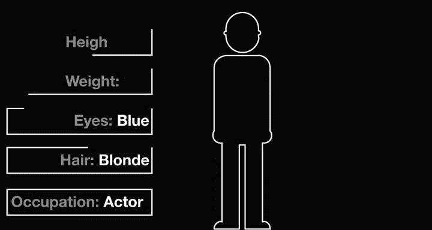
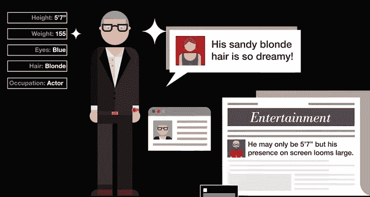
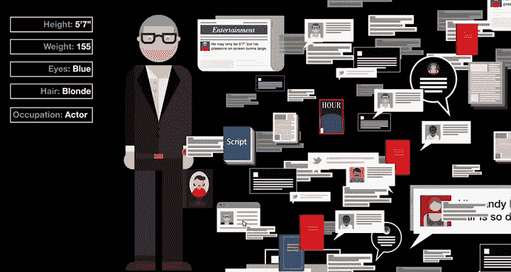
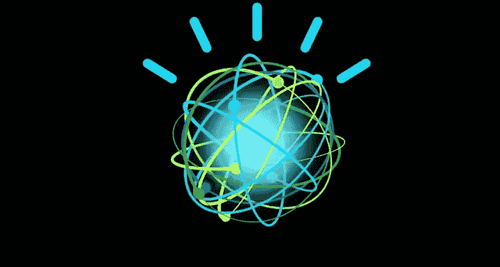

# IBM《生成式人工智能工程（AI入门、生成式AI入门、提示工程、Python）｜IBM Generative AI Engineering》中英字幕 - P11：10_认知计算：感知、学习、推理.zh_en - GPT中英字幕课程资源 - BV1MfqzY4Eyg

AI is at the forefront of a new era of computing， cognitive computing。

It's a radically new kind of computing， very different from the programmable systems that preceded it as different as those systems were from the tabulating machines of a century ago。

 conventional computing solutions based on the mathematical principles that emanate from the 1940s are programmed based on rules and logic intended to derive mathematically precise answers often following a rigid decision tree approach。

But with today's wealth of big data and the need for more complex evidence based decisions。

 such a rigid approach often breaks or fails to keep up with available information。

Cognitive computing enables people to create a profoundly new kind of value。

 finding answers and insights locked away in volumes of data。

 whether we consider a doctor diagnosing a patient。

 a wealth manager advising a client on their retirement portfolio or even a chef creating a new recipe。

 they need new approaches to put into context the volume of information they deal with on a daily basis in order to derive value from it。

These processes serve to enhance human expertise。🎼Cognitive computing mirrors some of the key cognitive elements of human expertise。

 systems that reason about problems like a human does。

 when we as humans seek to understand something and to make a decision， we go through four key steps。

 First， we observe visible phenomena and bodies of evidence。 Second。

 we draw what we know to interpret what we are seen to generate hypotheses about what it means。

Third， we evaluate which hypotheses are right or wrong。

Finally， we decide choosing the option that seems best in acting accordingly。

 just as humans become experts by going through the process of observation。

 evaluation and decision making， cognitive systems use similar processes to reason about the information they read and they can do this at massive speed and scale。

 unlike conventional computing solutions which can only handle neatly organized structured data。

 such as what is stored in a database， cognitive computing solutions can understand unstructured data which is 80% of data today all of the information that is produced primarily by humans for other humans to consume this includes everything from literature。

 articles， research reports to blogs， posts and tweets。

While structured data is governed by well defined fields that contain well specified information。

 cognitive systems rely on natural language， which is governed by rules of grammar， context。

 and culture。It is implicit， ambiguous， complex， and a challenge to process。

 while all human language is difficult to parse， certain idioms can be particularly challenging in English。

 for instance we can feel blue because it's raining cats and dogs while we're filling in a form someone asked us to fill out。

Cognitive systems read and interpret texts like a person。

 they do this by breaking down a sentence grammatically， relationally and structurally。

 discerning meaning from the semantics of the written material。Cognitive systems understand context。

 this is very different from simple speech recognition。

 which is how a computer translates human speech into a set of words。

 cognitive systems try to understand the real intent of the user's language and use that understanding to draw inferences through a broad array of linguistic models and algorithms。

Cognitive systems learn， adapt and keep getting smarter。

 they do this by learning from their interactions with us and from their own successes and failures。

 just like humans do。

