# IBM《生成式人工智能工程（AI入门、生成式AI入门、提示工程、Python）｜IBM Generative AI Engineering》中英字幕 - P12：11_AI的术语和相关概念.zh_en - GPT中英字幕课程资源 - BV1MfqzY4Eyg

Welcome to the terminologies and related concepts of AI After watching this video。

 you will be able to explore the key terms associated with artificial intelligence。

 you will also be able to explain the various key concepts of artificial intelligence。😊。

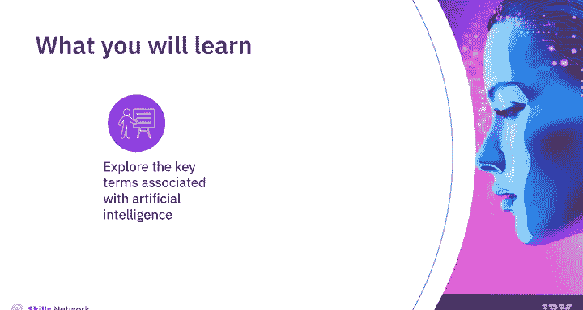

AI enables a world where machines can not only understand human language， but also predict our needs。

 recognize our faces， and provide safety against threats。

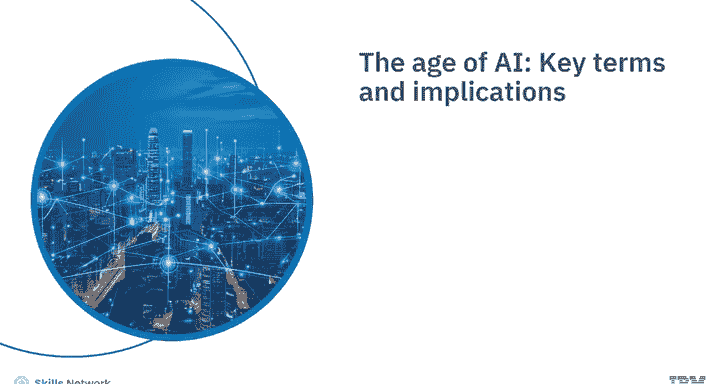

In this age of AI， understanding the language， key terms and related concepts of AI becomes crucial。

 These will not only enhance your knowledge， but also enable you to leverage AI's full potential。

 drive innovation and stay ahead in your field， for instance。

 autonomous vehicles or self driving cars， rely heavily on AI technologies， such as machine learning。

 deep learning， natural language processing and computer vision to navigate and make real time decisions。

😊，Understanding these key terms can provide valuable insights into how these vehicles operate。

 their benefits， and their challenges。Before discussing various terminologies and key concepts of AI。

 let's begin with understanding AI。

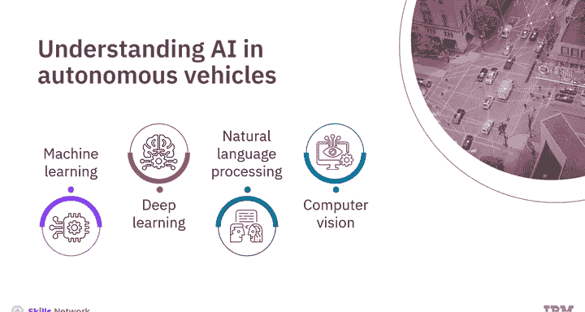

Artificial intelligence is a branch of computer science that focuses on creating systems capable of performing tasks that typically require human intelligence。

AI systems will typically demonstrate behaviors associated with human intelligence， such as planning。

 learning， reasoning， problem solving， knowledge representation， perception， motion， manipulation。

 social intelligence and creativity。😊，AI is categorized into narrow AI， General AI and super AI。

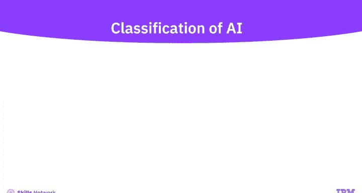

Narrow AI or weak AI perform specific tasks。 General AI， also known as strong AI。

 possesses humanlike cognitive skills and is capable of learning and adapting across various tasks。

 whereas super AI or conscious AI aims to surpass human intelligence and is currently theoretical and not yet realized。

😊。

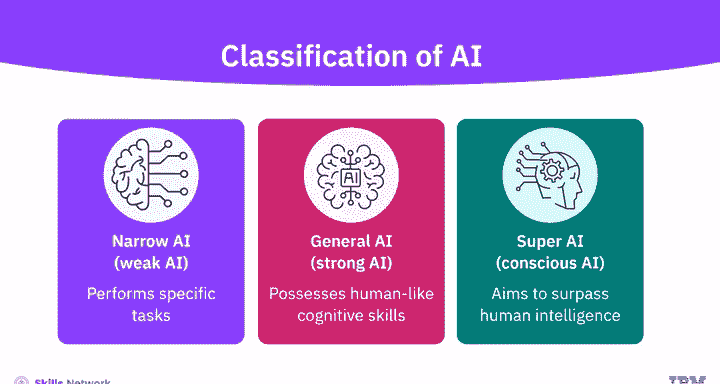

Now that you have understood what AI is， let's dive into the concept of machine learning。

Machine learning is a subset of AI that uses computer algorithms to analyze data and make intelligent decisions based on what it has learned without being explicitly programmed。

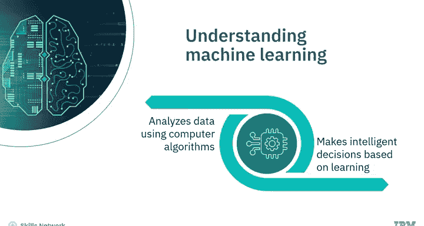

Machine learning algorithms are trained with large data sets and learn from examples。

 They do not follow rule based algorithms。 Machine learning enables machines to solve problems on their own and make accurate predictions using the provided data。

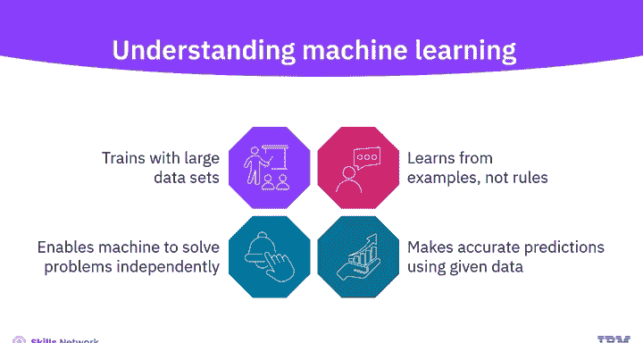

Moving on， let's discuss deep learning。😊，Deep learning is an important concept and a specialized subset of machine learning。

 It uses multi layered neural networks known as deep neural networks to analyze complex data and simulate human decision making。

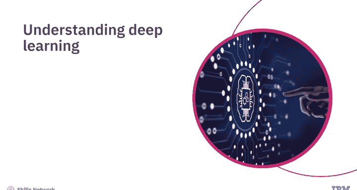

Deep learning algorithms can label and categorize information and identify complex patterns in data。

 It enables AI systems to learn continuously and improve the quality and accuracy of results by evaluating the correctness of decisions。

😊。

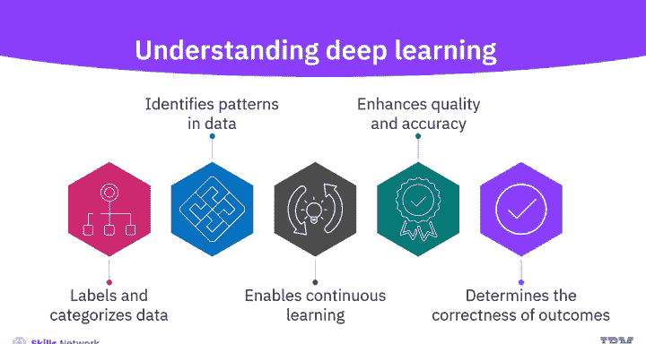

Another important concept is neural networks， a computation model inspired by the human brain's neural structure。

 neuralural networks consist of interconnected nodes or neurons， and have three layers。😊。

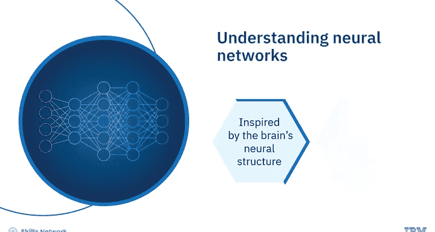

While the input layer receives and processes raw data。

 hidden layers perform complex computations and transform data。

 the output layer converts process data into output format， producing the result。

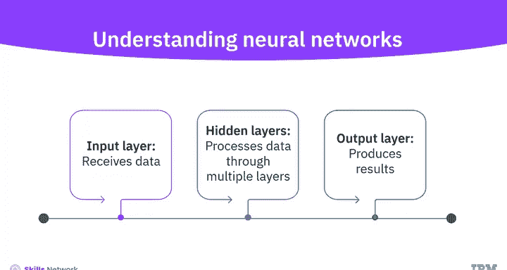

In this video， you learned how AI simulates human intelligence in machines and how it can be divided into three categories。

 weak AI for specific tasks， strong AI with human like cognitive abilities and super AI。

 which aims to surpass human intelligence。You also learned how machine learning， a subset of AI。

 uses algorithms to analyze data， make decisions without explicit programming。

 and enables autonomous problem solving。Additionally。

 you learn that deep learning uses neural networks with multiple layers to analyze complex data。

Finally， you learned about neural networks， a computational model consisting of interconnected nodes with three layers。

😊。

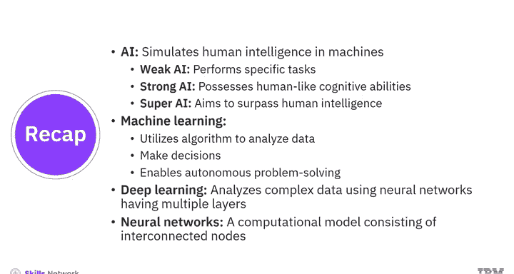