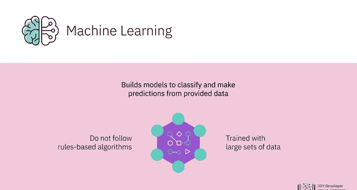
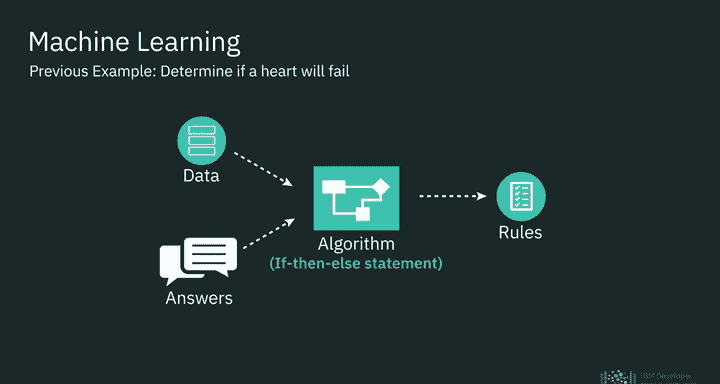
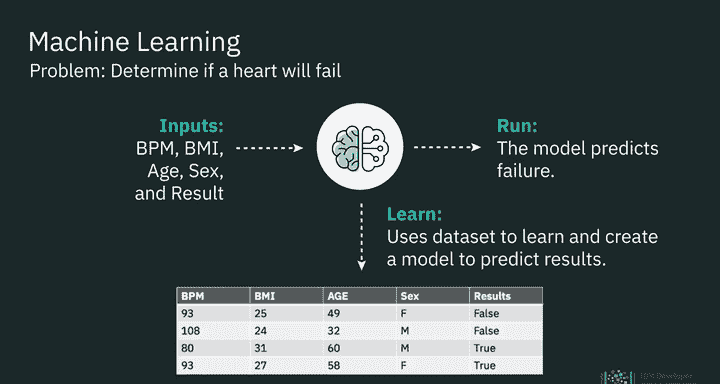
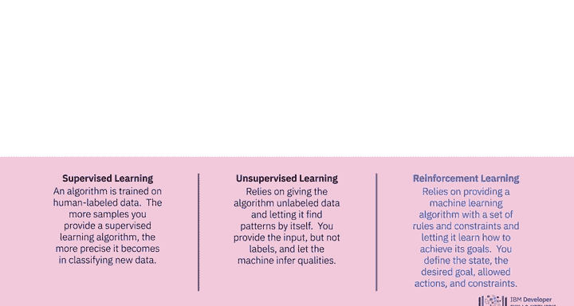
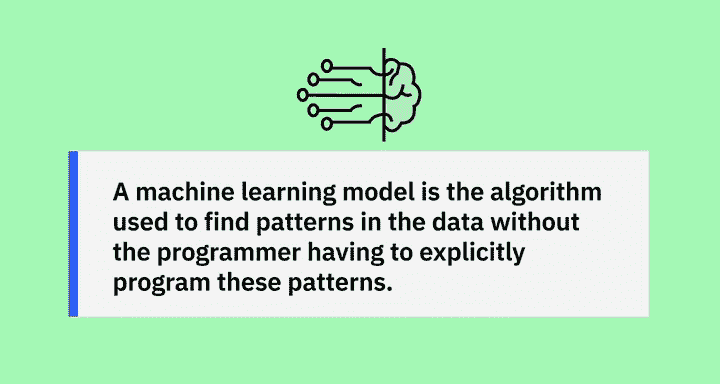

# IBM《生成式人工智能工程（AI入门、生成式AI入门、提示工程、Python）｜IBM Generative AI Engineering》中英字幕 - P14：13_机器学习.zh_en - GPT中英字幕课程资源 - BV1MfqzY4Eyg

Machine learning， a subset of AI uses computer algorithms to analyze data and make intelligent decisions based on what it has learned instead of following rules-based algorithms。

 machine learning builds models to classify and make predictions from data Let's understand this by exploring a problem we may be able to tackle with machine learning。

What if we wanted to determine whether a heart can fail。

 is this something we can solve with machine learning。

 the answer is yes let's say we are given data such as beats per minute， body mass index， age， sex。

 and the result， whether the heart has failed or not。With machine learning。

 given this data we are able to learn and create a model that given inputs will predict results。

 so what is the difference between this and using a statistical analysis to create an algorithm an algorithm is a mathematical technique with traditional programming we take data and rules and use these to develop an algorithm that will give us an answer。

In the previous example， if we were using a traditional algorithm。

 we would take the data such as beats per minute and BMI and use this data to create an algorithm that will determine whether the heart will fail or not。

 essentially it would be an if then else statement When we submit inputs we get answers based on what the algorithm we determined is and this algorithm will not change。

🎼Machine learning， on the other hand， takes data and answers and creates the algorithm。

 Instead of getting answers in the end， we already have the answers。

 What we get is a set of rules that determine what the machine learning model will be。

 the model determines the rules and the if then else statement when it gets the inputs。Essential。

 what the model does， is determine what the parameters are in a traditional algorithm and instead of deciding arbitrarily that beats per minute plus Bmi equals a certain result。

 we use the model to determine what the logic will be。 This model。

 unlike a traditional algorithm can be continuously trained and be used in the future to predict values。

 Ma learning relies on defining behavioral rules by examining and comparing large data sets to find common patterns。

 For instance， we can provide a machine learning program with a large volume of pictures of birds and train the model to return the label bird。

 whenever it is provided a picture of a bird， we can also create a label for。

And provide pictures of cats to train on When the machine model is shown a picture of a cat or a bird it will label the picture with some level of confidence This type of machine learning is called superupvised learning。

 where an algorithm is trained on human labelbeled data。

 the more samples you provide a supervised learning algorithm。

 the more precise it becomes in classifying new data。

🎼Unsupervised learning another type of machine language relies on giving the algorithm unlabeled data and letting it find patterns by itself。

 You provide the input but not labels and let the machine infer qualities。

 the algorithm ingests unlabeled data draws inferences and finds patterns This type of learning can be useful for clustering data where data is grouped according to how similar it is to its neighbors and dissimilar to everything else Once the data is clustered Different techniques can be used to explore that data and look for patterns For instance。

 you provide a machine learning algorithm with a constant stream of network traffic and let it independently learn the baseline normal network activity as well as the outlier and possibly malicious behavior happening on the network。

The third type of machine learning algorithm reinforcement learning relies on providing a machine learning algorithm with a set of rules and constraints and letting it learn how to achieve its goals you define the state the desired goal。

 allowed actions and constraints The algorithm figures out how to achieve the goal by trying different combinations of allowed actions and is rewarded or punished depending on whether the decision was a good one The algorithm tries its best to maximize its rewards within the constraints provided you could use reinforcement learning to teach a machine to play chess or navigate an obstacle course a machine learning model is the algorithm used to find patterns in the data without the programmer having to explicitly program these patterns。

