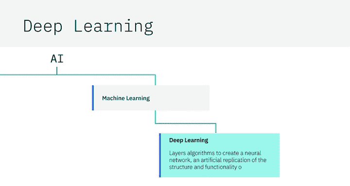
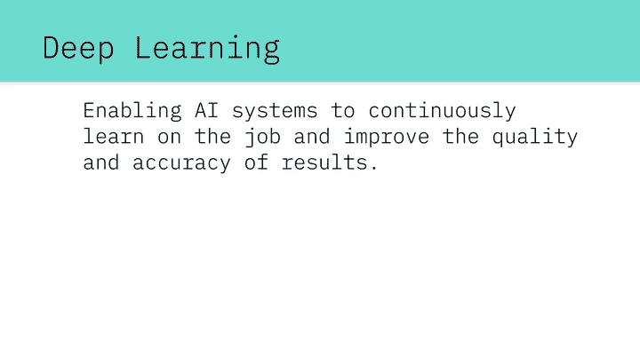
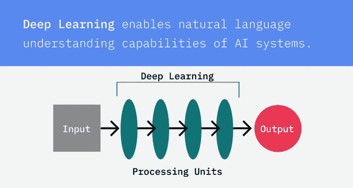
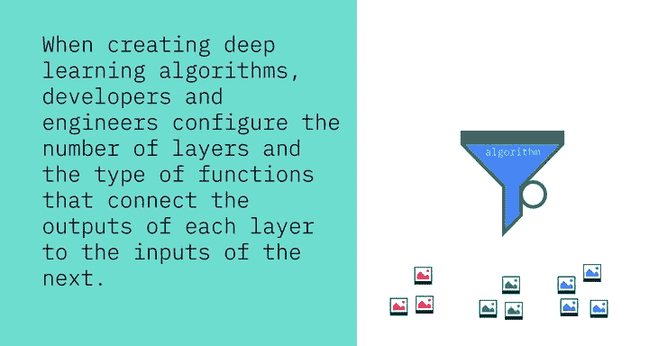
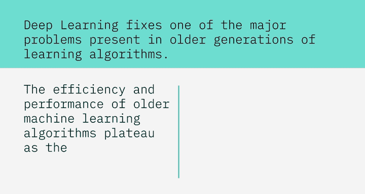
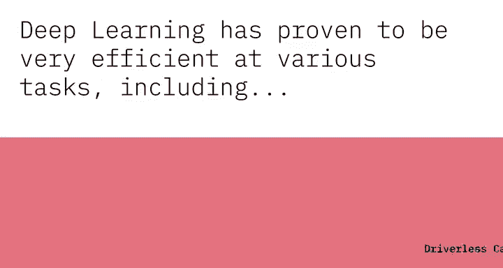

# IBM《生成式人工智能工程（AI入门、生成式AI入门、提示工程、Python）｜IBM Generative AI Engineering》中英字幕 - P16：15_深度学习.zh_en - GPT中英字幕课程资源 - BV1MfqzY4Eyg

🎼While machine learning is a subset of artificial intelligence。

 deep learning is a specialized subset of machine learning。

 Deep learning layers algorithms to create a neural network and artificial replication of the structure and functionality of the brain。

 enabling AI systems to continuously learn on the job and improve the quality and accuracy of results。

 This is what enables these systems to learn from unstructured data such as photos。

 videos and audio files。 Deep learning， for example。

 enables natural language understanding capabilities of AI systems and allows them to work out the context and intent of what is being conveyed。

 Deep learning algorithms do not directly map input to output。 Instead。

 they rely on several layers of processing units。 Each layer passes its output to the next layer。

 which processes it and passes it to the next。 The many layers is why it's called deep learning。

 When creating deep learning algorithms。Develop and engineers configure the number of layers and the type of function。

😊。

🎼That connect the outputs of each layer to the inputs of the next Then they train the model by providing it with lots of annotated examples。

 For instance， you give a deep learning algorithm， thousands of images and labels that correspond to the content of each image The algorithm will run those examples through its layered neural network and adjust the weights of the variables in each layer of the neural network to be able to detect the common patterns that define the images with similar labels。

Deep learning fixes one of the major problems present in older generations of learning algorithms。

 while the efficiency and performance of machine learning algorithms plateau as the data sets grow。

 deep learning algorithms continue to improve as they are fed more data。

Deep learning has proven to be very efficient at various tasks， including image captioning。

 voice recognition and transcription， facial recognition， medical imaging and language translation。

 deep learning is also one of the main components of driverless cars。

