# IBM《生成式人工智能工程（AI入门、生成式AI入门、提示工程、Python）｜IBM Generative AI Engineering》中英字幕 - P17：16_神经网络.zh_en - GPT中英字幕课程资源 - BV1MfqzY4Eyg

Welcome to neural networkss After watching this video。

 you will be able to describe neural networks and their functionality。

 You will also be able to recognize various types of neural networks。😊。

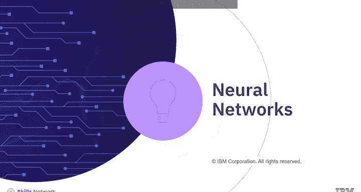

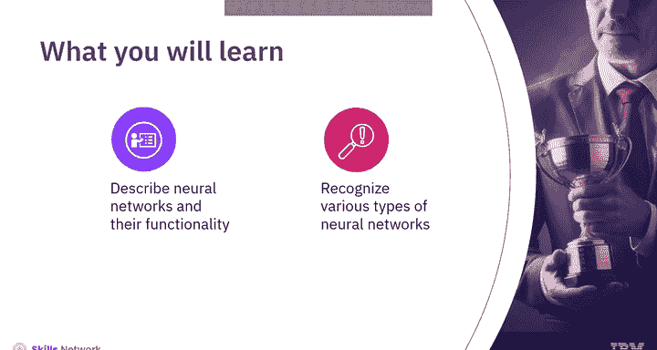

Imagine teaching a machine to learn in a manner like a human brain。

 like recognizing faces and images or driving cars independently。😊。

The mechanism behind such remarkable capabilities lies within neural networks。

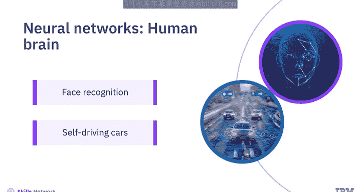

Neural networks are computational models influenced by the human brain's neural structure。

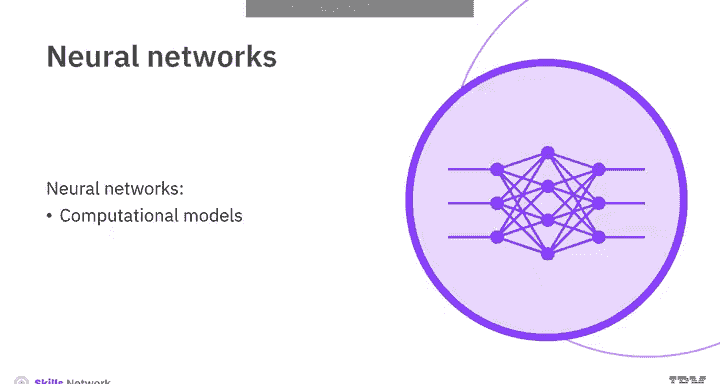

An artificial neural network consists of interconnected nodes known as neurons。

The neurons take incoming data like the human brain's neurological network and learn to make decisions over time。

By providing the network with data， such as images of cats and dogs。

 it can learn to recognize patterns and form connections。 The more data it is exposed to。

 the more effectively it learns。

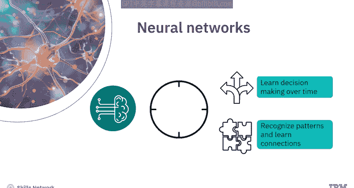

A neural network consists of one input layer and one output layer；

 it can also have one or more hidden layers。The input layer receives the data for example。

 in an image recognition task， the input layer would take in the image's pixel values。

Hidden layers process the data。 Each hidden layer transforms the input data by applying an activation function。

Actation functions are mathematical functions that allow the network to learn complex patterns。

Finally， the output layer of a neural network produces the final result of the network's processing。

Note that as a network includes more hidden layers， it becomes deeper。

 which is why the term deep learning is used。Neurural networks learn through a process called training。

 Let's understand the steps of this process。Firstly。

 as part of the forward pass or forward propagation step。

 the data passes through the layers of the neural network。In this step。

 the network computes an output。

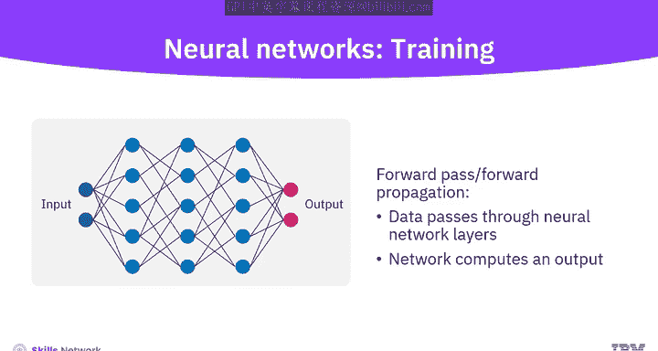

This output is compared to the actual answer to calculate the difference called the error or loss。

This step shows how well the network's predictions match the actual results。

 Then in the backward pass or back propagation step。

 this error is sent back through the network to adjust the internal parameters。

 such as weights and biases。 This adjustment aims to reduce the error for future predictions。😊。

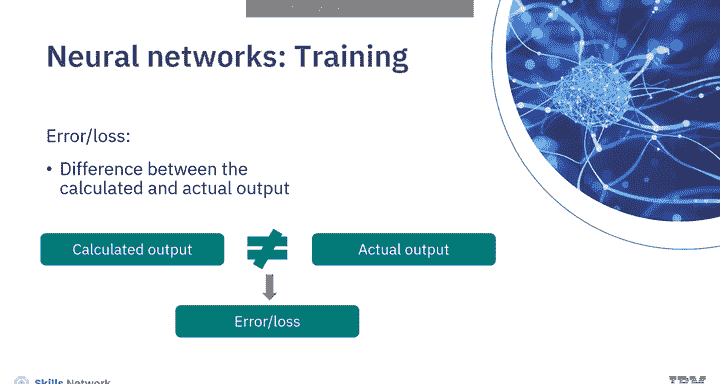

The forward pass， error calculation， and backward pass are repeated many times with different sets of data until the neural network consistently makes accurate predictions。

There are various types of neural networks。 Let's look at some， including perceptron neural networks。

 feed forward neural networks， deep feed forward neural networks， modular neural networks。

 convolutional neural networks and recurrent neural networks。😊。

The perceptron neural networks are the simplest type of artificial neural network。

 consisting of only input and output layers。In a feed forward neural network。

 information flows in one direction。 That is forward。

Each neuron in a layer receives input from neurons in the previous layer and then passes its output to neurons in the next layer。

A deep feed forward neural network is similar to feed forward network with just more than one hidden layer。

The modular neural network combines two or more neural networks to arrive at the output。

 a convolutional neural network or CNN is a type of neural network that is particularly well suited for analyzing visual data。

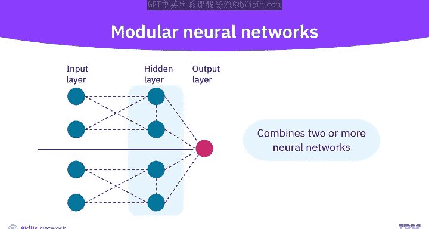

The term convolutional refers to a mathematical operation where a function is applied to another function。

 and the result is a mixture of the two functions。😊，In CNNNs。

 this process takes place through multiple layers， with each layer performing a convolutional on the output from the previous layer in recurrent neural networks or RNNs。

 each of the neurons in hidden layers receives an input with a specific delay in time。

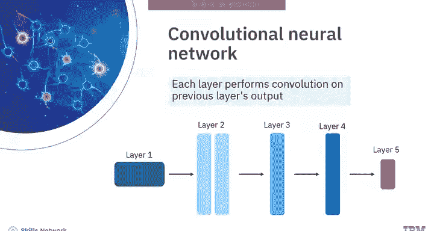

This allows the R and N to consider the context of the input。

You can use this type of neural network where you need to access previous information in current iterations。

 For example， it's useful in predicting the next word in a sentence as it considers the context and flow of a conversation。

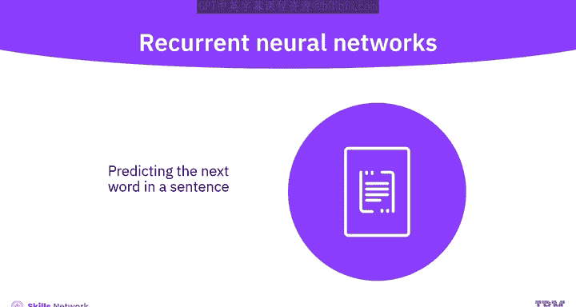

In this video， you learned that neural networks are building blocks of AI systems inspired by the structure of the human brain。

Neural networks consist of layers， including an input layer， one or more hidden layers。

 and an output layer。Neural networks rely on forward propagation to process data from input to output layers。

Back propagation adjusts internal parameters based on the loss calculated during forward propagation。

Various types of neural networks include perceptron neural network feed forward， deep feed forward。

 modular， convolutional neural network and recurrent neural network。

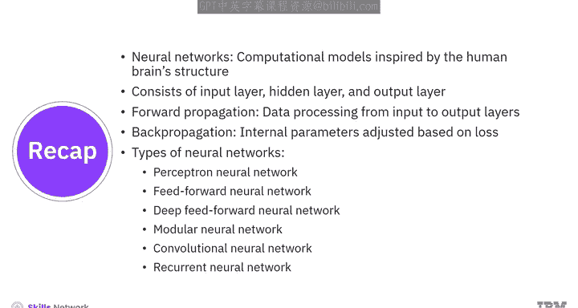