# IBM《生成式人工智能工程（AI入门、生成式AI入门、提示工程、Python）｜IBM Generative AI Engineering》中英字幕 - P1：0_介绍AI.zh_en - GPT中英字幕课程资源 - BV1MfqzY4Eyg

Welcome to introducing AI After watching this video。

 you will be able to define AI as augmented intelligence。

 You will also be able to discuss the types of AI based on their strengths。😊。

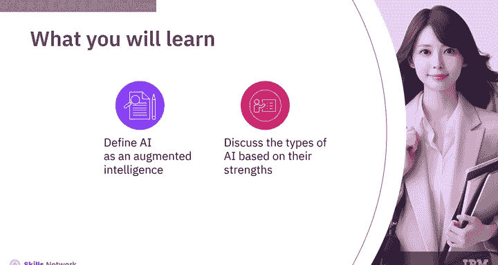

AIs history can be traced back to the very origins of computing Since the days of the apiccus and early calculators。

 humans have strived to automate mental tasks。The formal journey began in the 1950s when Alan Tring proposed the Tring test for machine intelligence。

 and John McCarthy coined the term artificialial intelligence。

Progress from early programs like Eliza and Shirlo in the 1960s to the rise of expert systems in the 1970s。

 the 1980s witnessed a surge in machine learning， setting up the stage for further progress。

 The 1990s introduced neural networks， and the 2000s marked the ascent of deep learning。😊。

From 2010 to 2020， AI applications spread across industries with applications like natural language processing。

 NLP and computer visionion， AI has continued its rapid expansion in the present decade。

 including advancements in deep learning models， autonomous systems and healthcare applications。

But what exactly is AI， artificial intelligence or AI refers to the simulation of human intelligence processes by computer systems。

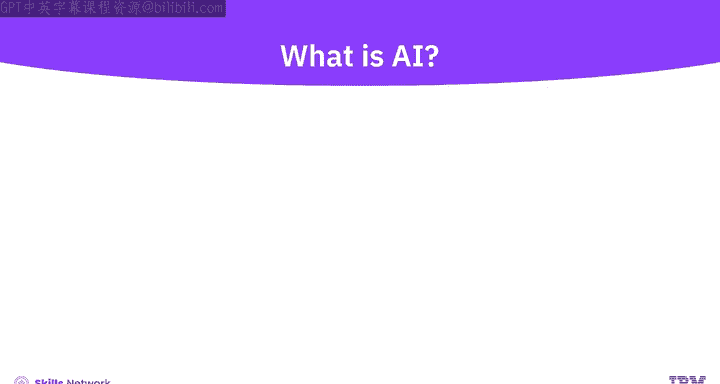

It involves using algorithms and data to enable machines to perform tasks that typically require human intelligence。

 such as learning， reasoning， problem solving and decision making。

AI can range from simple automation to complex deep learning and neural networks。

The internet has revolutionized connectivity and given us faster access to more information。

Distributed computing scales， data processing， enabling efficiency。

 IoT proliferates connected devices， generating massive amounts of data。

 Social networking has encouraged most of us that data to be unstructured。 Together。

 they reshape our digital landscape， accelerating information access and innovation。😊。

With augmented intelligence， information that subject matter experts need is placed at their fingertips and backed with evidence。

 enabling them to make informed decisions。 Expts are encouraged to scale their capabilities and let the machines handle the time consuming work。

😊，How do we define innate intelligence。Human beings have innate intelligence。

 which is defined as the intelligence that governs every activity in our body。

 This intelligence is what causes an oak tree to grow out of a little seed and a complex organism like an elephant to evolve from a single celled organism。

😊。

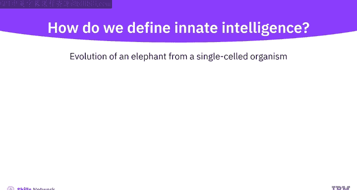

How does AI learn？The only innate intelligence machines have is what we give them。

 We provide machines with the ability to examine examples and create machine learning models based on the inputs and desired outputs。

 We do this in different ways， such as with supervised learning。

 unsupervised learning and reinforcement learning， about which you will learn in more detail later。

 AI can be divided into categories based on strength， breadth and application。😊。

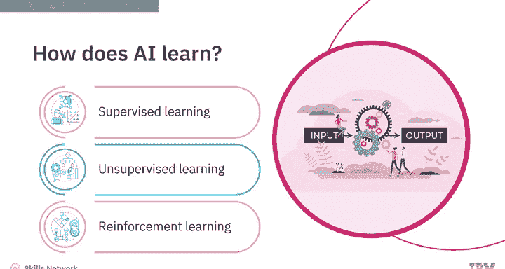

Considering the strength of AI， it can be of three types， weak AI or narrow AI。

 strong AI or generalized AI， and super AI or conscious AI。

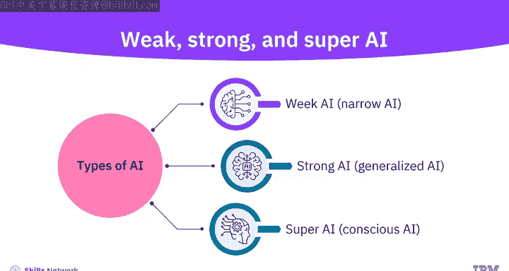

Weak or narrow AI is AI that is applied to a specific domain。 Applied AI can perform specific tasks。

 but not learn new ones， making decisions based on programmed algorithms and training data。

 For example， language translators， virtual assistants， AI powered web searches。

 recommendation engines and intelligent spam filters。

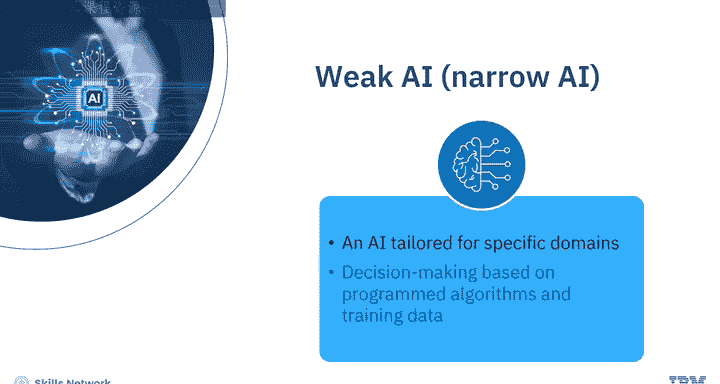

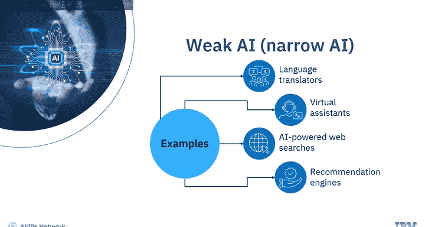

Strong AI or generalized AI refers to artificial intelligence capable of engaging in and performing a diverse array of distinct and unrelated tasks。

It possesses the ability to acquire new skills to tackle novel challenges。

 achieving this by autonomously learning fresh approaches。

Generalized AI is the combination of many AI strategies that learn from experience and can perform at a human level of intelligence。

Its use cases include finance， human resources， information technology， research and development。

 and supply chain。

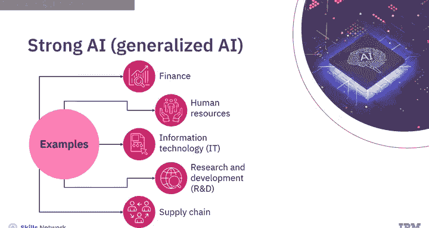

Super AI or conscious AI extends the concept of generative AI to a more advanced level。

 It is an AI with human level consciousness， which would require it to be self aware。

 showing advanced cognitive abilities and developing its own thinking skills。😊。

Because we are not yet able to adequately define what consciousness is。

 it is unlikely that we will be able to create a conscious AI in the near future。

Super AI could demonstrate capabilities beyond human intelligence in areas like healthcare。

 autonomous vehicles， robotics， natural language understanding， and environmental conservation。

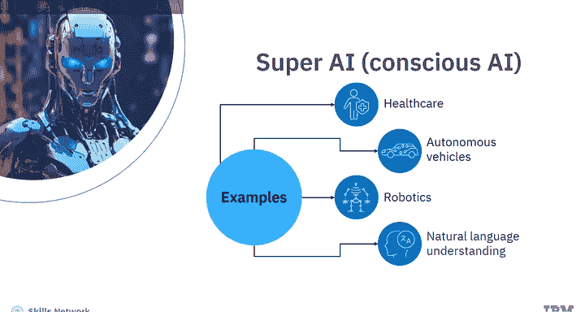

AI is the fusion of many fields of study。 Computer science and electrical engineering determine how AI is implemented in software and hardware。

 mathematics and statistics determine viable models and measure performance。😊。

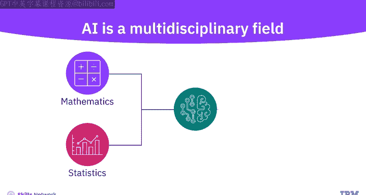

Because AI is modeled on how we believe the brain works。

 psychology and linguistics play an essential role in understanding how AI might work。

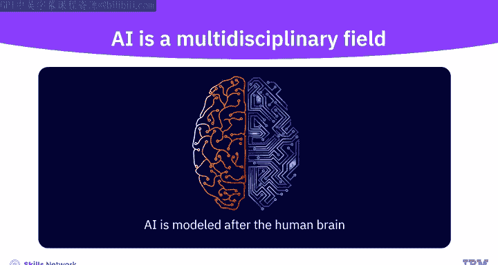

Philosophy， on the other hand， provides guidance on intelligence and ethical considerations。

While the science fiction version of AI may be a distant possibility。

 we already see more and more AI involved in the decisions we make every day。 over the years。

 AI has proven to be useful in different domains， impacting our society in meaningful ways。

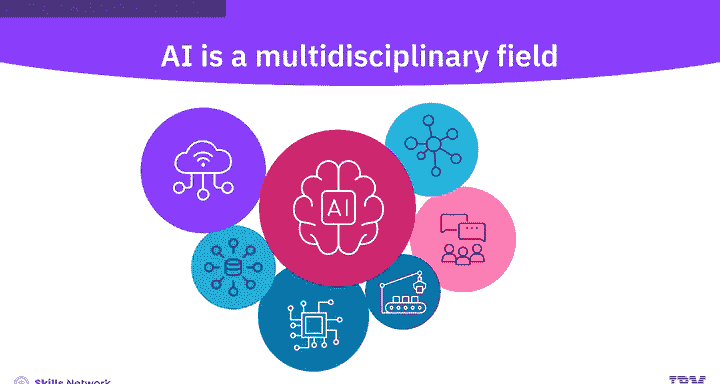

In this video， you learned how AI is defined as augmented intelligence。

 aiming to extend human capabilities， and tackle tasks beyond human and machine capabilities。

You also learn that machine learning models are developed through supervised learning。

 unsupervised learning， and reinforcement learning。Finally。

 you learned how AI can be divided based on its strengths。 You learned about weak or narrow AI。

 an AI tailored for specific domains， strong or generalized AI。

 an AI with diverse capabilities across unrelated tasks， super or conscious AI。

 an AI having human level consciousness。😊。

