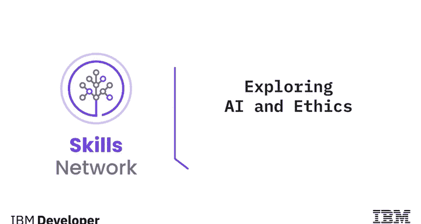
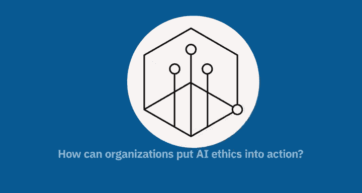
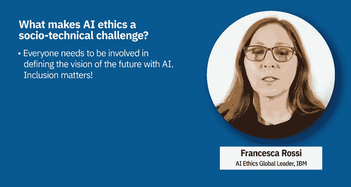
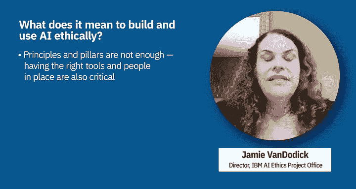
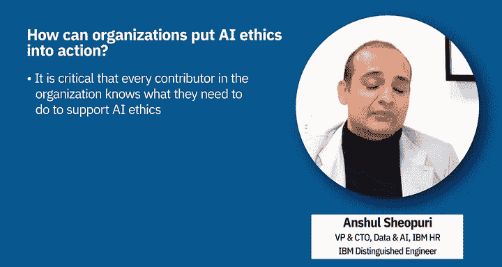

# IBM《生成式人工智能工程（AI入门、生成式AI入门、提示工程、Python）｜IBM Generative AI Engineering》中英字幕 - P22：21_探索AI和伦理.zh_en - GPT中英字幕课程资源 - BV1MfqzY4Eyg

。

Welcome to exploringing AI and Es In this video you will learn about what AI ethics is and why it matters。

 you will find out what makes AI ethics a sociootechnical challenge。

 what it means to build and use AI ethically， and how organizations can put AI ethics into action。

AI artificial intelligence is very pervasive in everybody's life。

 even if often we don't realize it we use it when we use a credit card to buy something online when we search something on a web when we post or like or follow somebody on a social platform and even when we drive with the navigation support and the driver assistance capabilities on the card based on AI this pervasiveness generates very fast significant transformations in our life and also in the structure and equilib of our society this is why AI besides being a technical and scientific discipline as also a very significant social impact this raises a lot of ethical questions about how AI should be designed。

 developed， deployed， used and also regulated。The social technical dimensions of AI requires efforts to identify all stakeholders that go well beyond technical experts and include also sociologists。

 philosophers， economists， policymakers and all the community that are impacted by the deployment of this technology。

 inclusiveness is necessary in defining the ecosystem。

 in all the phases of the AI development and deployment and also in the impact of AI in the deployment scenario without it。

 we risk of creating AI only for some and leave many others behind in a disadvantaged position。

 everybody needs to be involved in defining the vision of the future that we want to build using the AI and other technology as a means and not as an end。

To achieve these appropriate guidelines are necessary to drive the creation and use of AI in the right direction。

 technical tools are and useful， but they should be complemented by principles。

 guard rates well definedfin processes and effective governance。

 we should not think that all these slows down innovation。😊。

Think about traffic rolls it may seem that traffic lights。

 precedes and stop signals and speed limits are slowing us down however without them we would not drive faster。

 but actually we would drive much slower because we would be always in a complete state of uncertainty about other vehicles and pedestrians。

AI ethics identifies and addresses the social technical issues raised by this technology and makes sure that the right kind of innovation is supported and facilitated so that the path to the future we want is faster。

As our CEO at IBM states， trust is our license to operate。

 we've earned this trust through our policies， programs， partnerships。

 and advocacy of the responsible use of technology。For over 100 years。

 IBM has been at the forefront of innovation that brings benefits to our clients and society。

This approach most definitely applies to the development use and deployment of AI； therefore。

 ethics should be embedded into the life cycle of the design and development process。

Ethical decision making is not just a technical problem solving approach。Rather， an ethical。

 sociological， technical， and human centered approach should be embarked upon based on principles。

 values， standards， laws， and benefits to society。So having this foundation is important。

 even necessary， but where to start。A good place to start is with a set of guiding principles at IBM。

 we call our principles the principlesles of trust and transparency， of which there are three。

The purpose of AI is to augment， not replace human intelligence。

 data and insights belong to their creator and new technology， including AI systems。

 must be transparent and explainable。 This last principle is built upon our pillars。

 of which there are five。We just mentioned transparency。

 which reinforces trust by sharing the what and the how the AI is being used for。

It must be explainable and also fair， so when it's properly calibrated。

 it can assist in making better choices， should be robust， which means it should be secure。

And as well as privacy preserving， safeguarding privacy and rights。

We know having principles and pillars are not enough。

We have an extensive set of tools and talented practitioners that can help diagnose， monitor。

 promote all of our pillars and continuous monitoring to mitigate against strength and unintended consequences。

The first step to putting AI ethics into action， just with anything else。

 is about building understanding and awareness。This is about equipping your teams。

To think about AI ethics， what it means to put it into action。

Whatever solution you're building and deploying， let's take an example if you're building a learning solution and deploying that within a company。

Your HRT leader who is doing that should be thinking about。Does this。

Is this solution designed with users in mind， have we coreated the solution with users。

 how does it enable equal access to opportunity to all the employees across diverse groups？

A keen understanding of AI ethics。And reflecting on these issues continuously is critical as a foundation。

To putting AI ethics into action。The second step。In putting AI ethics into action。

 once you build that understanding and awareness and everybody is reflecting on this topic。

Is to put in place a governance structure。And the critical point here is it's a governance structure to scale AI ethics in action。

 It's not about doing it in one isolated instance in a market or in a business unit。

 it's about a governance structure that works at scale。

So we talked about understanding and awareness as a foundation， second governance。

 which is the responsibility of leaders to put it structures。Once you've got these two elements。

 the third step is operationalizing。How do you make sure a developer or a data scientist or a vendor who's in Malaysia or Poland？

Knows how to put AI ethics into action and what does it mean for them？

Right it's one thing to put structures in place at the global level。

 but how do you make sure it's operationalized at scale in the markets and every user。

 every data scientist， every developer knows what they need to do。

This is all about having clarity of the pillars of trustworth AI for IBM。

It is transparency let's go back to a learning example。

 Are you designing it with users Think about what we think of as best in class transparent recommendation systems。

 your favorite movie streaming service or your cab hailing service It's transparent Is it explainable I it telling you what recommendations are and why they're being made but also telling you as a user it's your choice to make the final decision。

Fairness isn in giving equal access to opportunity to everyone by ensuring adoption。

 not just of the process， but also the outcome across different groups。Robustness， privacy。

 every data scientist and developer and every vendor needs to know what we mean by these in a very operational manner。

