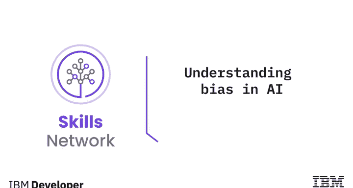
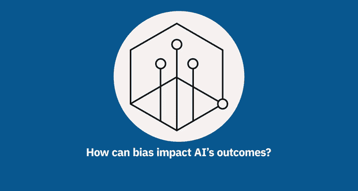
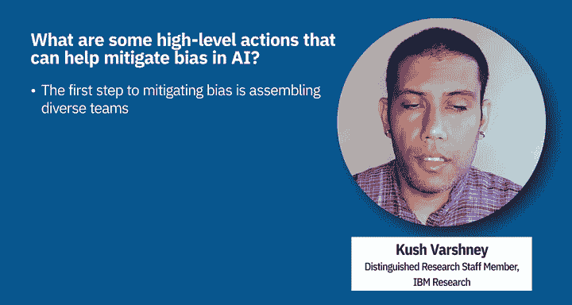
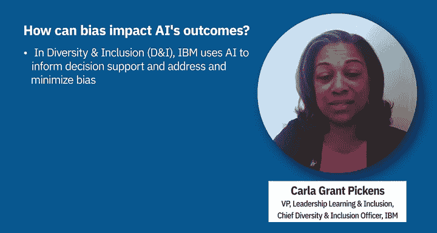
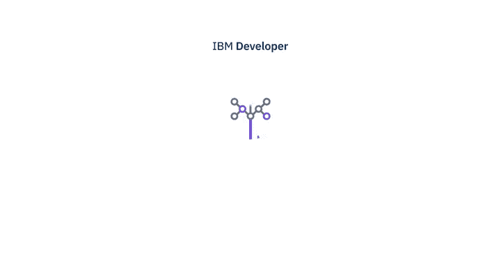

# IBM《生成式人工智能工程（AI入门、生成式AI入门、提示工程、Python）｜IBM Generative AI Engineering》中英字幕 - P24：23_理解偏见和AI.zh_en - GPT中英字幕课程资源 - BV1MfqzY4Eyg

Welcome to Understanding bias in AI。In this video， you will learn about bias in the context of AI。

You will find out how bias can emerge in AI， how bias can impact AI's outcomes。

 and how to begin mitigating potential bias in AI。

So bias in artificial intelligence is all about unwanted behaviors where。

AI systems that are used in consequential decision making tasks， whether it's in lending， hiring。

 even in criminal justice。Gives systematic disadvantages to certain groups and individuals。

 so an example would be an AI system that's helping make decisions on who should receive extra preventative health care。

And it gives more of that to white people than black people。

Or another example is hiring algorithm where the AI system actually gives more qualified men a chance to interview than qualified women。

There's actually many sources of this happening。So when we talk about AI or machine learning systems。

 they're trained on historical decisions that human decision makers have made in the past。

So because of that， there is actually the possibility that。

The human decision makers in the past were implicitly or explicitly biased themselves。

 and so that's reflected in the training data through prejudice。

A second is through the sampling of the data。So， it's possible that。

Certain groups are overrepresented or underrepresented in a particular data set。

Another aspect that's sometimes overlooked is in the data processing or data preparation phase in the data science project。

So even the fact that I do some feature engineering。

Can lead to additional biases that might not have been there before。

So an example of that is coming back to our healthcare example。

So if I look at healthcare costs separately as a feature， so inpatient， outpatient or emergency room。

 then there's much less bias that's introduced against African Americans。

Whereas if I combine all of those into a single feature。

 it's actually much more biased against African Americans。And then there's also the question of。

How am I even posing the problem itself？So maybe I'm predicting the wrong thing。

So if I'm trying to predict。Criminality or future crimes。

 then arrests is not a good way to look at that because。The police alert arrest people more often。

Where they're more active in certain neighborhoods and being arrested is not the same as being guilty。

So as we talked about， there's many sources of those biases and so we need to take actions that help undo those sources。

So one important aspect of it is even recognizing that there are biases。

 so having a team of people who have diverse lived experiences is one way to recognize those harms and。

Other sort of biases that might be in play。Another thing is to search for data sets that actually have fewer fewer biases themselves。

 So that's another way to。

counterteract biases and then finally， there's technical approaches。

So if we have a machine learning model that we're training on data that is bias。

 we can actually introduce extra constraints or other。Sort of。

statistical measures in order to mitigate biases。So we've developed several such algorithms and many of them are available in the open source toolkit and AI fairness easy。

Our goal is to ensure technology makes a positive impact on society。

I am proud to be a member of the IBM AI Ethics Board to focus on conscious inclusion through Good tech。

Our AI ethics board represents a cross section of diverse ABM who address in research eliminating bias while establishing standards in this space。

A few ways in which IBMrs use AI and data skills is by leveraging our technology to develop assets to address bias。

Also to address inclusive language and tech terminology。

This is around our languagenguage Matters initiative。

And to ensure testing of our solutions to decrease the probability and minimize the potential for bias。

In DNI， we use AI and data analytics and insights to inform decision support and address as well as minimize the potential for bias。

In HR， this means enhancing decision support that can inform pay and retention。

 hiring and promotion decisions。Using AI and data insights plays an important role to assist in our compliance requirements and proactive actions that we take around the globe。

