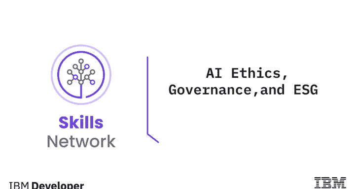
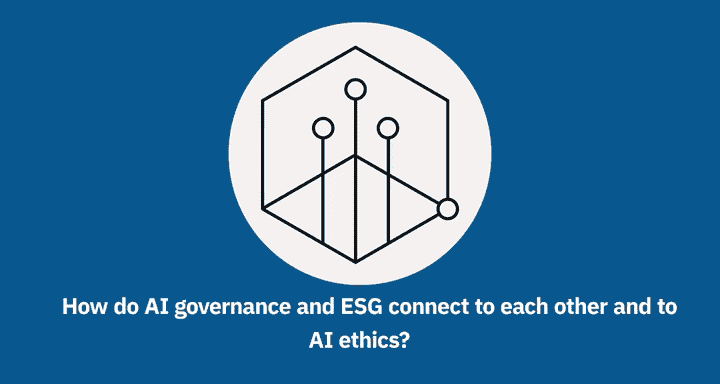
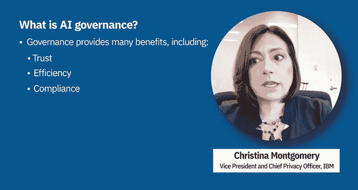
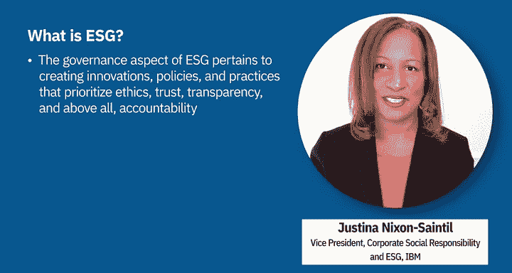
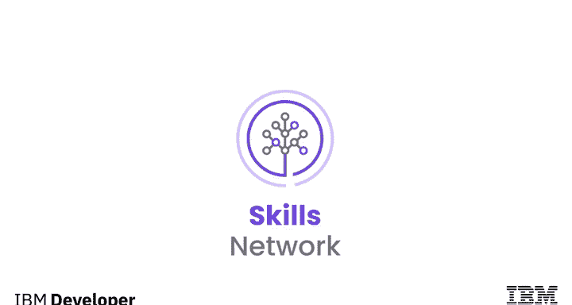

# IBM《生成式人工智能工程（AI入门、生成式AI入门、提示工程、Python）｜IBM Generative AI Engineering》中英字幕 - P26：25_AI伦理治理和ESG.zh_en - GPT中英字幕课程资源 - BV1MfqzY4Eyg

嗯。

Welcome to AIFs， Governance and ESG。In this video， you will learn about what AI governance is and what it accomplishes。

 what ESG is and what it accomplishes， and how governance and ESG connect to AI ethics。

Governance is the organization's act of governing through its corporate instructions， staff。

 its processes and its systems to direct， evaluate and monitor and to take corrective action throughout the AI lifecycle to provide assurance that an AI system is operating as an organization intends it to。

 and as its stakeholders expect it to and as may be required by relevant regulation。

The objective of governance is to deliver trustworthy AI by establishing requirements for accountability。

 responsibility， and oversight。Governance provides many benefits， including， for example， trust。

 when AI activities are aligned with values， organizations can build systems that are transparent。

 fair and trustworthy， boosting client satisfaction and brand reputation。

Another benefit is efficiency。When AI activities are standardized and optimized。

 development can happen with greater efficiency， accelerating time to market。And compliance。

When AI activities already managed and monitored， adjusting them to align with new and forthcoming industry regulations and legal requirements is really less cumbersome。

The successful governance program takes into account people， processes， and tools。

It clearly defines the roles and responsibilities of people in building and managing trustworthy AI。

 including leaders who will set policies and establish accountability。

It establishes processes for building， managing， monitoring， and communicating about AI。

 and it leverages tools to gain greater visibility and consistency into AI system performance throughout the AI lifecycle。

ESG stands for Environmental Social Governance， and these are factors that are used to measure all non financial risks and opportunities at companies。

At IBM， that translates into IBM impact， our strategy and philosophy on ESG。

IBM Impact is comprised of three pillars that we believe will create a more sustainable future。

These pillars are environmental impact， equitable impact， and ethical impact。

And we accomplish this by making a lasting positive impact in the world， in business ethics。

 our environment， and in the communities in which we work and live。

The governances aspect of ESG pertains to creating innovations。

 policies and practices that prioritize ethics， trust， transparency， and above all accountability。

And AI ethics is a significant aspect of our governance initiatives for example。

 in 2022 we're aiming to reach a thousand ecosystem partners trained in tech ethics this goal matters because we believe the benefits of AI should touch the many and not just the few and developing a culture of trustworthy AI must happen everywhere not just within IBM。

We're leading the way in AI ethics as we aspire to create a more ethical future。

