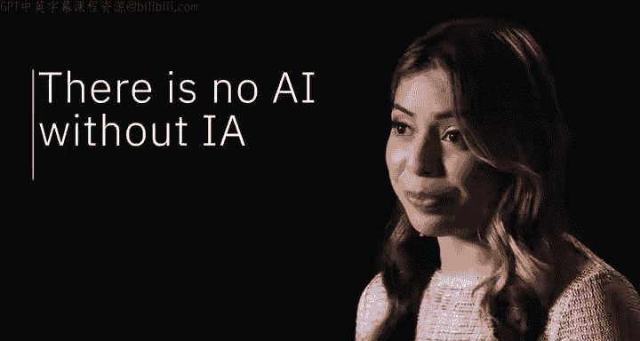
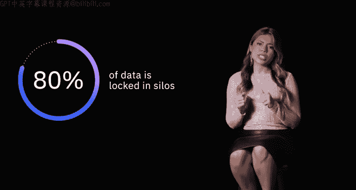
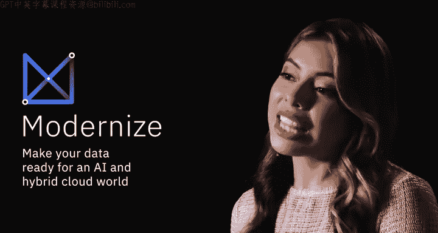
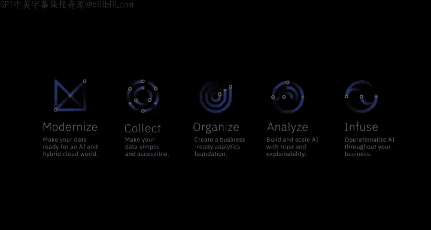

# IBM《生成式人工智能工程（AI入门、生成式AI入门、提示工程、Python）｜IBM Generative AI Engineering》中英字幕 - P29：28_AI阶梯：成功采用AI的旅程.zh_en - GPT中英字幕课程资源 - BV1MfqzY4Eyg

In a world of dramatic digital transformation， companies are looking to AI to really help them shape the future of work。

AI can predict and inform future outcomes， it enables people to do higher value work in businesses to imagine new models。

It can automate decisions， processes， experiences， but AI is not magic。

The truth is there is no AI without IA or information architecture。

But many organizations can't start because 80% of their data is locked in silos and not business ready。

So how do you turn your aspirations into outcomes？

Through a prescriptive set of steps， we call the latter AI。

And it starts with modernizing all of your data on a single platform that runs on any cloud。

Then on the ladder itself， there are four steps。

First， collect the data， to make it simple and accessible。

Really think about the models you need to train。Second。

Organize your data to create a business ready analytics foundation for those AI models。Third。

 analyze your data， both with trust and transparency。

Because there's no use in applying and scaling AI if you can explain the outcome。

 protect bias or prove its accuracy。

Fourth， once you can really trust your data and the AI that you deploy。

 then you can realize it's full value inside of the apps and processes that control your everyday work。

In other words， the last step is infused。Or you begin to operationalize AI throughout your entire business。

We help thousands of enterprises put AI to work by unlocking the value of their data in this AI and multicloud world。

By delivering the right set of skills for their people。

And by building trust and transparency into AI。

That's the latterte in a nutshell， let's start climbing。

