# IBM《生成式人工智能工程（AI入门、生成式AI入门、提示工程、Python）｜IBM Generative AI Engineering》中英字幕 - P39：5_生成式AI的应用.zh_en - GPT中英字幕课程资源 - BV1MfqzY4Eyg

Welcome to applications of generative AI After watching this video。

 you'll be able to identify some of the applications of generative AI in different domains。

 specifically the domains of I and Devops， En， education， banking and finance， health care。

 human resources and on working professionals in general in I and Devops。

 generative AI helps improve software delivery processes and infrastructure management。

 The codegen capabilities of generative AI reduce manual coding effort and time spent on repetitive tasks。

 generative AI powered code review tools such as Gitthub copit and sync deep code Ex code repositories and coding standards to enhance code quality and maintainability。

 generative models generate synthetic test cases and test data that simulate user behavior。

 Vaations in test cases impact software efficiency。

 reliability and robustness To such as App tools and Testim guarantee adequate testing coverage by。😊。

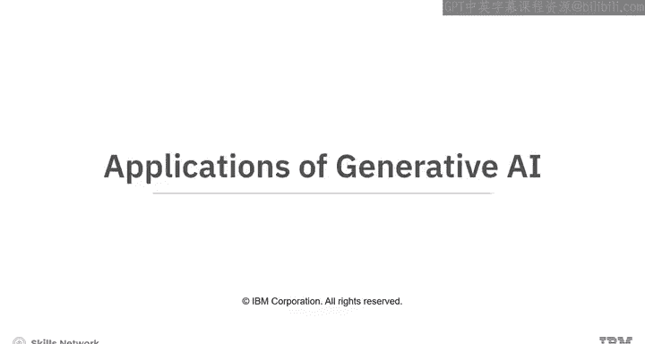

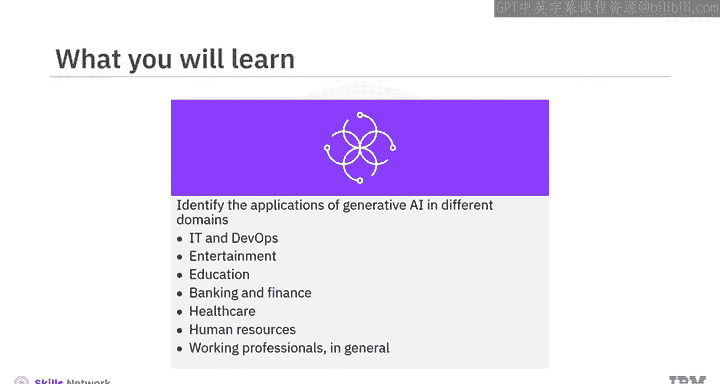

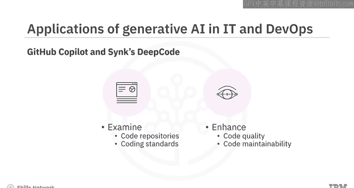

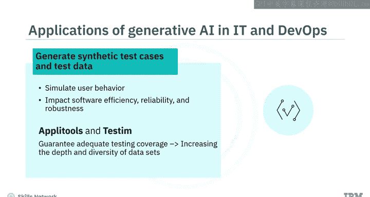

re the depth and diversity of data to monitor and detect anomalies and code tools such as IBM's Watson AI ops and Mugooft AI ops。

 analyze system logs， metrics and other data This helps with proactive maintenance and troubleshooting。

 reducing downtime and preventing critical failures。

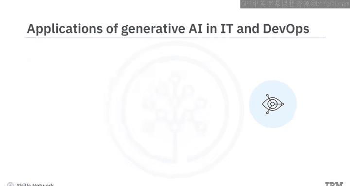

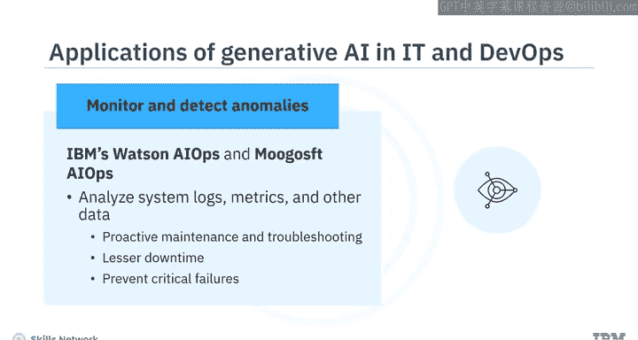

Gitlab Duo supports the continuous integration and deployment or CicCD pipelines by automatically creating release notes。

 changing logs and updating deployment templates and scripts。

 Other applications in I and devops include natural language interfaces。

 automated infrastructure management and predictive maintenance。 Now。

 let's look at the entertainment domain。 generative AI tools can generate a variety of synthetic content。

 such as music scripts， stories， videos， movies and video games They can also translate localized and personalizedized content。

 Game development tools such as Houdini by side effectsx leverage the power of generative AI to create games。

 animations， augmented in virtual reality experiences and unique characters with unique behavior。

Recently generative AI powered virtual influencers and avatars have also gained popularity that interact with users creating engaging experiences。

 Another next big area of impact of generative AI is education from content generation。😊。

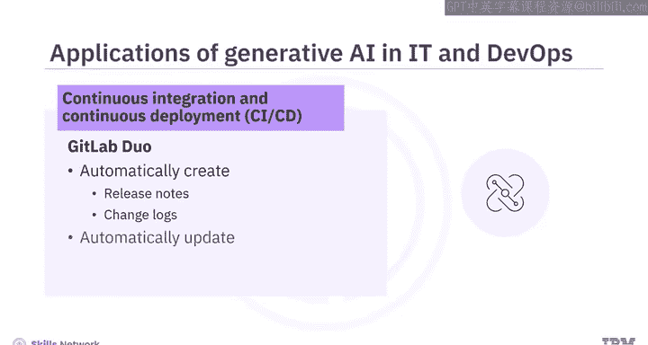

to personalized and adaptive learning experiences and simulated experiential learning。

 the impact of generative AI is huge， with their language capabilities。

 they can provide language translations， making content accessible in different languages。

 they can great assignments to provide instant feedback and create learning journeys and assessment strategies that support the pace and strengths of individual learners。

Taxonomies can be generated based on learner performance and preferences。

 generative algorithms can detect special needs and learning disabilities to help learners and educators create specific lesson plans。

 generative algorithms are also being used to track learner progress over time known as knowledge tracing this helps provide the right pacing and content for individual needs。

 Tutoring support。 virtual and simulated environments and inclusive education are also benefited。

 Noll J， for example， offers an AI generated elear within minutes， including interactive videos。

 glossary practice questions and summary for the targeted topic。

 Duoingo is a language learning platform that uses G3 to correct French grammar and create test items for English Banking and financial institutions' greatly benefit from generative AI's capability to auto detect risks generate insights and make financially literate recommendations。

 K AI G is the first banking industry specific LLM that helps banking。

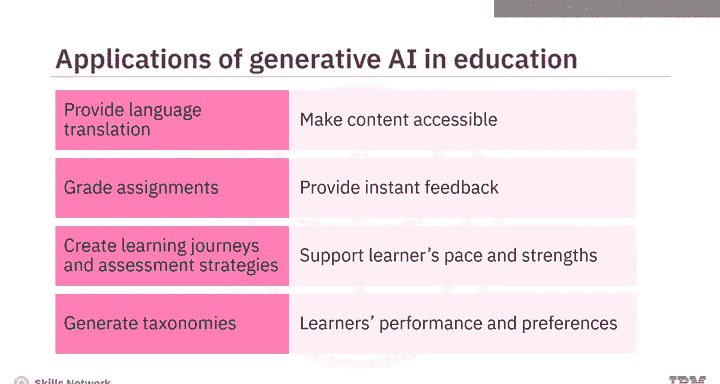

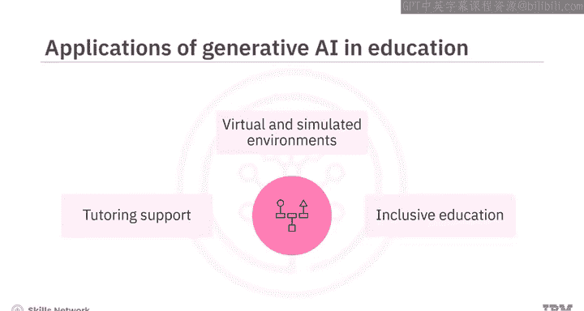

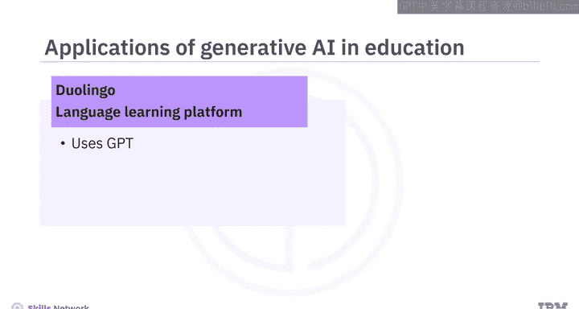

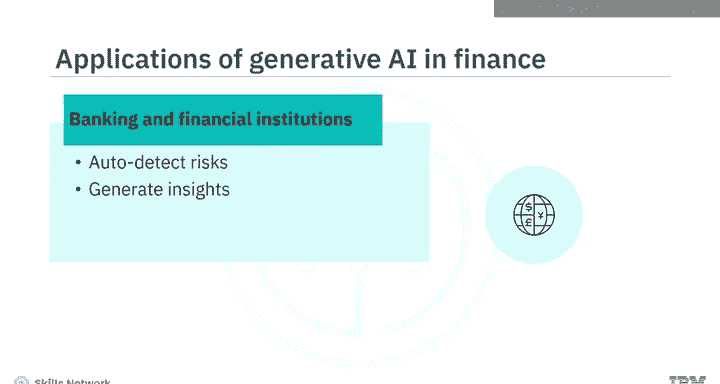

Applications provide humanlike financially literate responses in risk assessment data robot。

 for example， can generate synthetic use cases by simulating potential fraud scenarios to detect credit risk fraud risk and market volatility for credit scoring。

 persontics and AIO logic， leverage generative models to detect risks determine rates and structured custom loans they automate the assessment of customer creditworthiness and set credit limits or insurance premiums andP power generative AI such as Bloomberg G can analyze news articles。

 social media and other classified textual data to perform market sentiment analysis and manage investment portfolios more effectively and customer services。

 generative AI tools of established conversational systems and assist financial planning using roboadviss。

 chatbots and virtual assistance regulatory compliance and reporting financial forecasting and prediction。

 portfolio optimization。

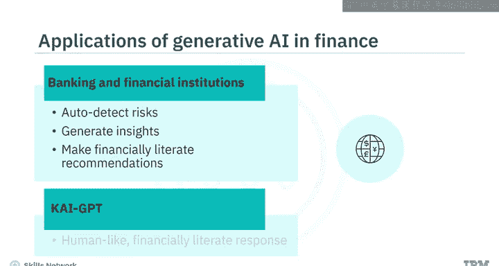

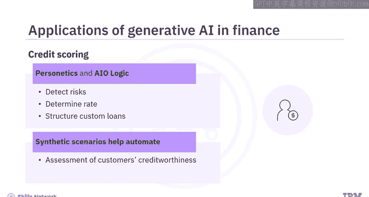

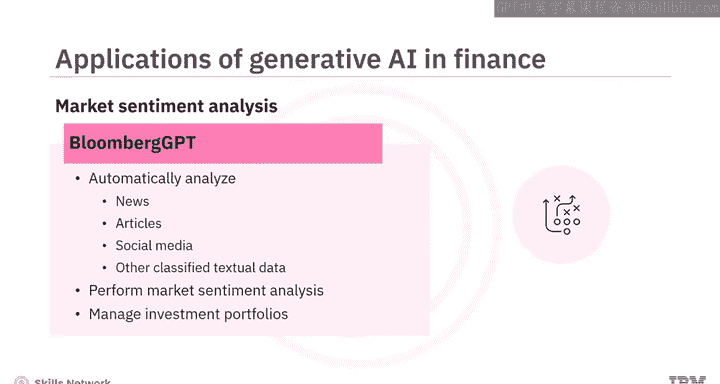

TimeMo laundering and algorithmic trading are some of the areas that are greatly benefited it's important to note that some of these applications and tools harness both generative and discriminative AI models now let's discuss some of the applications in medicine and healthcare research。

 drug discovery diagnostics and patient care。

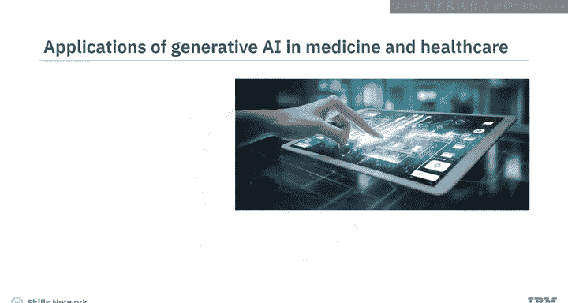

With their ability to generate synthetic images that resemble patient data。

 generative models improve the robustness of deep learning models used for medical image analysis These models can synthesize data for rare medical conditions for which very limited data is available This helps facilitate research train AI models and develop new diagnostic tools for rare cases In drug discovery these models help by generating new molecules and speeding up the drug discovery process and lowering the development cost telemedicine and telemonitoring are also benefited from generative AI drivenn conversational tools RaSA。

 for example， can establish a medically literate conversation with patients to provide immediate medical device health related support and personalized treatment plans Other areas in this domain include electronic health record or EH management health care fraud detection and medical simulation and training Let's look at how generative AI can empower human resources or HR to automate repetitive tasks。

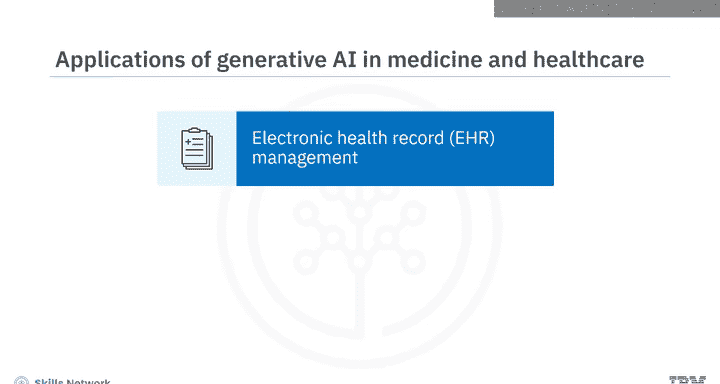

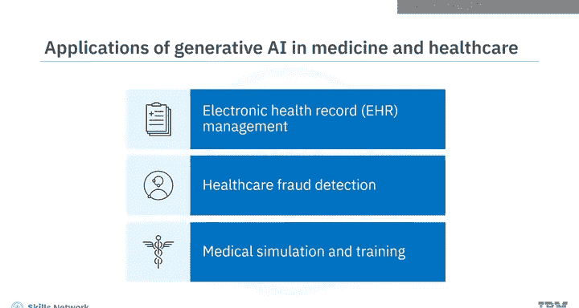

Provide valuable insights and streamline HR processes Watson X Orte， for example。

 helps automate HR tasks such as creating job requisitions。

 screening and shortlisting relevant profiles， scheduling interviews， candidate onboarding and more。

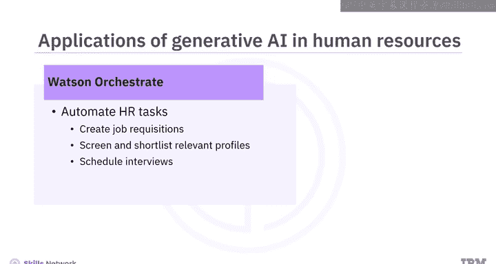

Talent areaia focuses on talent acquisition Lina AI uses conversational AI systems to automate HR tasks and employee engagement Mcorva focuses on workplace and performance management by automatically generating performance documents and reviews。

 other applications of generative AI and HR include training and development。

 analytics and decision making and compliance and policy implementation。

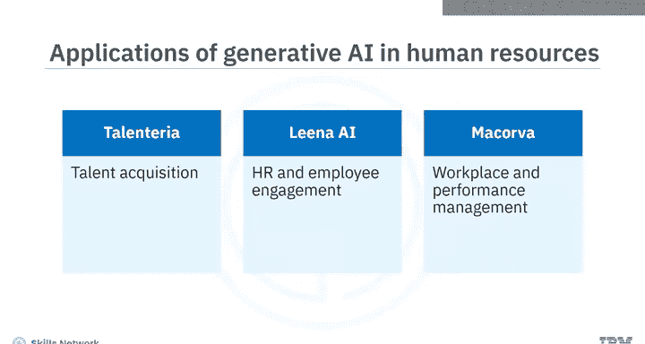

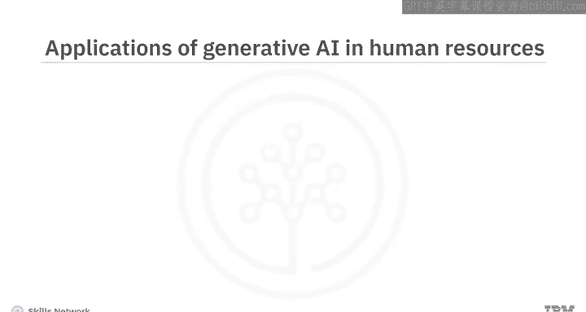

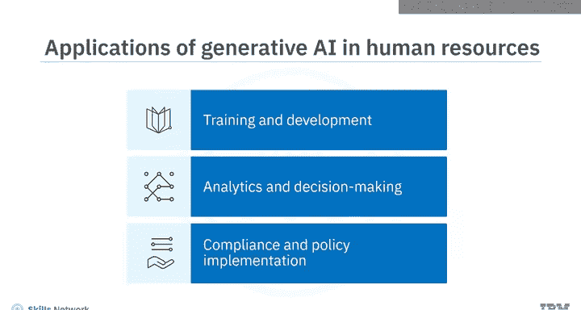

While we have spoken of just a couple of domains today。

 generative AI is ultimately believed to have a significant impact on all industries。

 another big area of impact is on how we work， as per the McKinsey report on the economic potential of generative AI current generative AI and other technologies have the potential to automate work activities that absorb 60 to 70% of employees time today。

 Ha of today's work activities could be automated between 2030 and 2060 generative AI's increasing ability to understand natural language will ultimately impact even knowledge based work typicallyyp associated with higher education and acquired skills In this video you learned about some of the popular applications of generative AI across domains。

 however， it's important to note that the potential applications of generative AI are virtually limitless across all industries in all walks of life in IT and DevOs。

 applications include codegeneration， code reviews， automated testing。

 monitoring and anomaly detection。Automated documentation and the continuous integration and deployment process in entertainment。

 generative AI offers exciting possibilities by generating a variety of synthetic content and translating Localizing and personalizing content In education。

 generative AI transforms the reach and quality of education affecting learners。

 educators and education technologies in finance areas of application include risk assessment。

 credit scoring， Sen analysis， Port management， compliance， forecasting。

 Tra and customer care In medicine and health care， we see application， medical research。

 diagnostics， Medi， medical training and patient care In HR applications are in the areas of talent acquisition。

 employee engagement， performance management， training and development。

 HR analytics and policy implementation。😊。

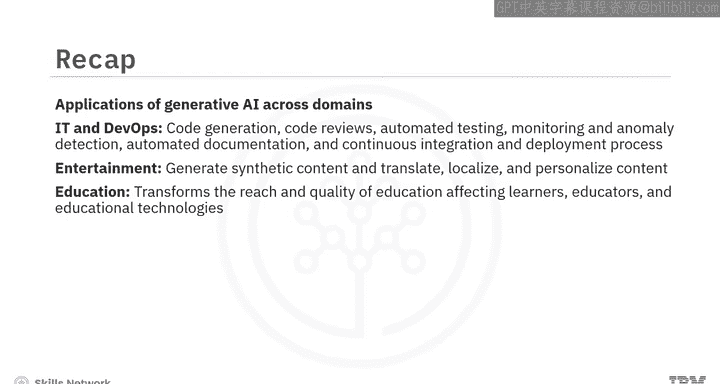

And in the workplace， the application of generative AI is changing how we work。

 making us more efficient and successful。