# IBM《生成式人工智能工程（AI入门、生成式AI入门、提示工程、Python）｜IBM Generative AI Engineering》中英字幕 - P4：3_生成式AI概述和用例.zh_en - GPT中英字幕课程资源 - BV1MfqzY4Eyg

嗯。

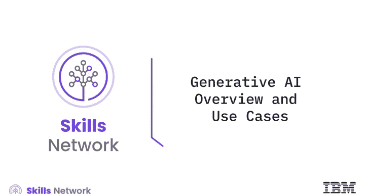

Welcome to generative AI overviewview and Use cases After watching this video。

 you'll be able to define generative AI and describe its significance and explain different use cases of generative AI。

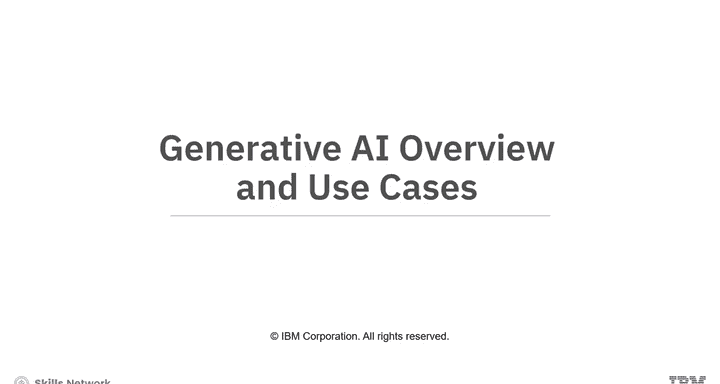

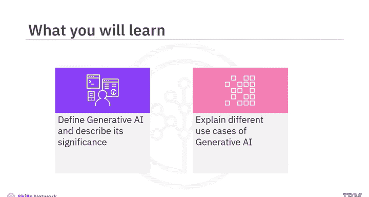

Artificial intelligence AI is defined as augmented intelligence that enables experts to scale their capabilities while machines handle time consuming tasks like recognizing speech。

 playing games and making decisions。 On the other hand。

 generative artificial intelligence or Gen AI is an AI technique capable of creating new and unique data。

 ranging from images in music to text and entire virtual worlds。

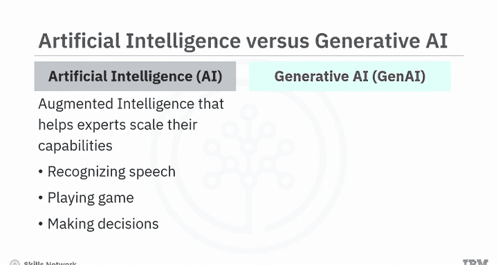

Unlike conventional AI models that rely on predefined rules and patterns。

 generative AI models use deep learning techniques and rely on vast data sets to generate entirely new data with various applications。

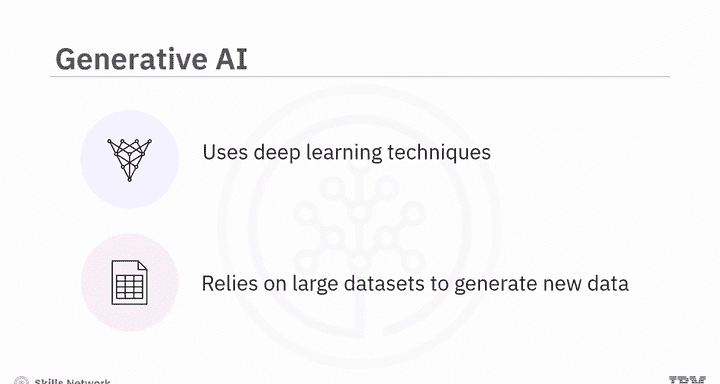

A generative AI model can also use LLM， large language model。

 a type of artificial intelligence based on deep learning techniques designed to process and generate natural language。

 For instance， generative AI can develop new and more powerful LLM algorithms and architectures。

 resulting in more accurate or efficient natural language processing and generation capabilities。

Alternatively， a generative AI can design and incorporate LLM into a larger。

 more advanced AI system to perform various advanced tasks such as decision- making problem solving and creative work。

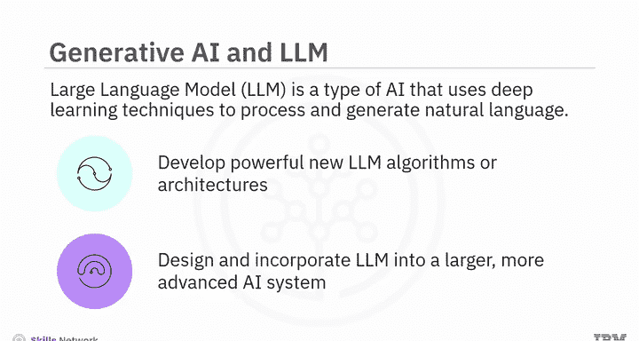

Generative AI encompasses various AI technologies and the idea of developing AI systems。

 although more about generative AI will soon unfold。

 the following benefits already make generative AI a strategic technology。

 one creativity and innovation，2 cost in time savings，3， personalization，4。

 scalability 5 robustness and6， exploration of new possibilities。

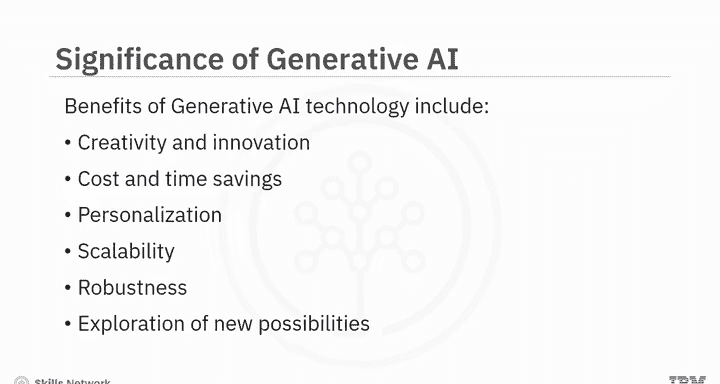

Let's look at some diverse use cases of generative AI1 in the field of healthcare care and precision medicine。

 generative AI can support physicians in identifying genetic mutations responsible for patients' illnesses and providing tailored treatments。

 it can also produce medical images， S surgeries and predict new drug properties to aid doctors in practicing procedures and developing treatments。

2 in agriculture， generative AI can optimize crop yields and create more robust plant varieties that can withstand environmental stressors。

 pests and diseases，3， in biotechnology， generative AI can aid in the development of new therapies and drugs by identifying potential drug targets。

 simulating drug interactions and forecasting drug efficacy，4 in forensics。

 generative AI can help solve crimes by analyzing DNA evidence and identifying suspects5。

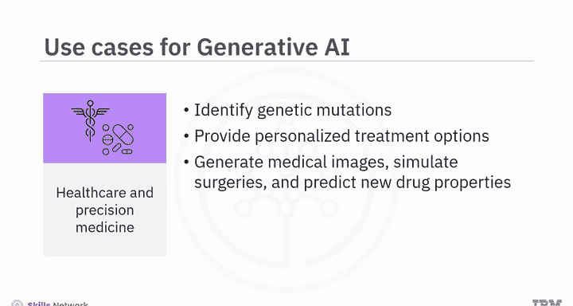

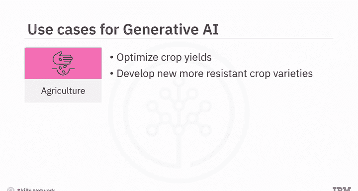

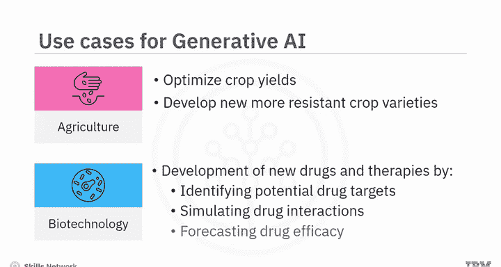

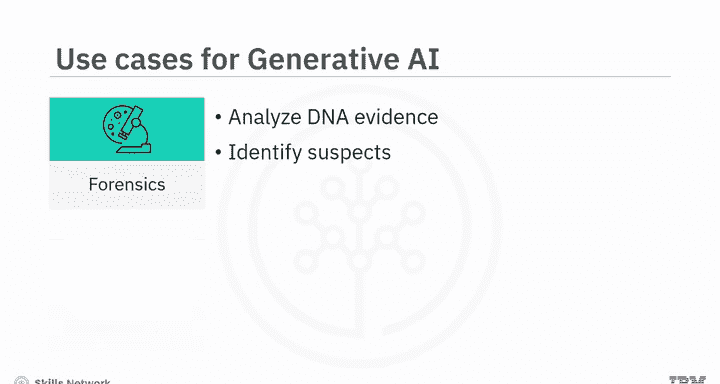

In environmental conservation， generative AI can support the protection of endangered species by analyzing their genetic data and suggesting breeding and conservation strategies。

6， in creative fields， generative AI can produce unique digital art。

 music and video content for advertising and marketing campaigns and generate soundtracks for films or video games 7 in gaming。

 generative AI can create interactive game worlds by generating new levels。

 characters and objects that adapt to player behavior，8 in fashion。

 generative AI can design and produce virtual tryon experiences for customers and recommend personalized fashion choices based on customer behavior and preferences。

9 in robotics， generative AI can design new robot movements and adapt them to changing environments。

 enabling them to perform complex tasks1。

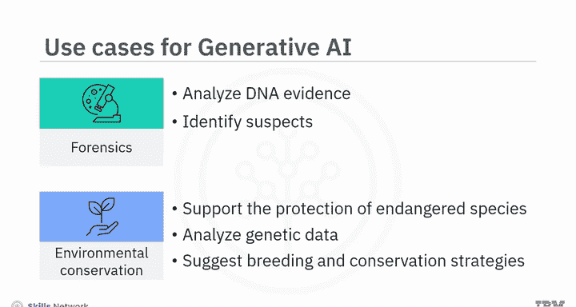

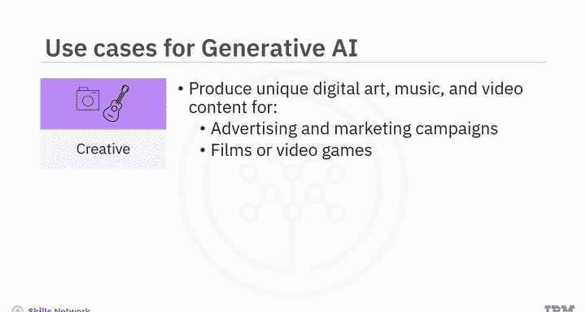

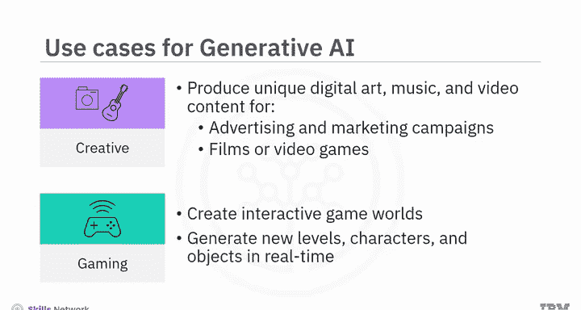

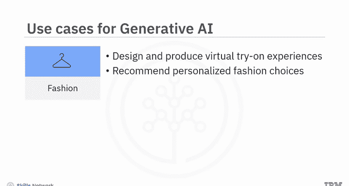

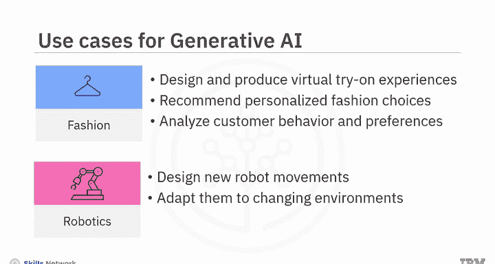

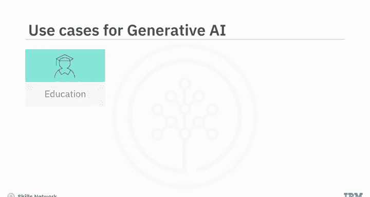

Grative AI can create customized learning materials and interactive learning environments that adjust to students learning styles and paces11 in data augmentation。

 generative AI can produce new training data for machine learning models。

 enhancing their accuracy and performance。

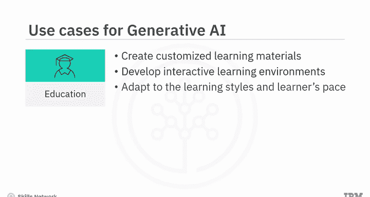

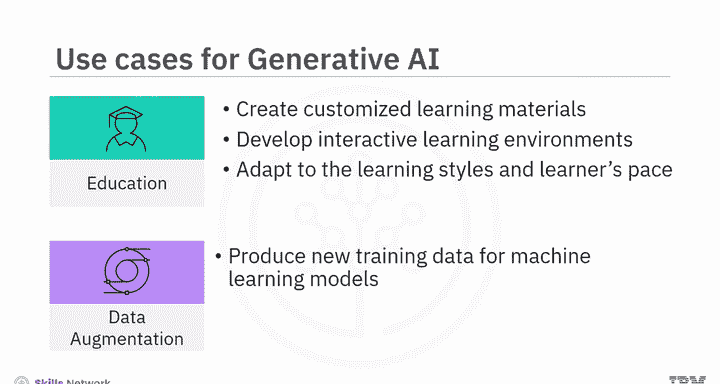

In this video， you learned that generative AI is an AI technique capable of creating new and unique data。

It outperforms traditional AI models in terms of creativity， cost and time savings， personalization。

 scalability， robustness and exploration of new possibilities。

 Generative AI has the potential to transform various industries and improve people's lives and generate newer and impossible data and experiences。

 It can be used for anything to perform a wide range of tasks similar to the flexibility and adaptability of human intelligence。

😊。

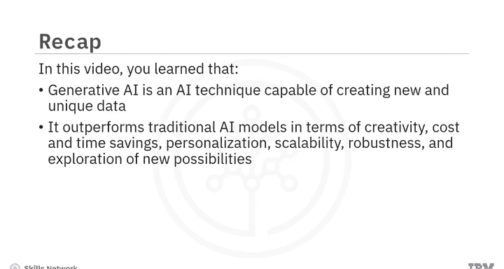