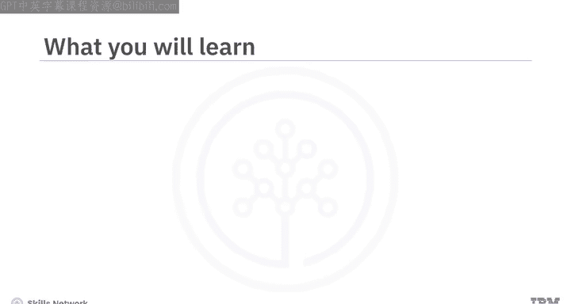
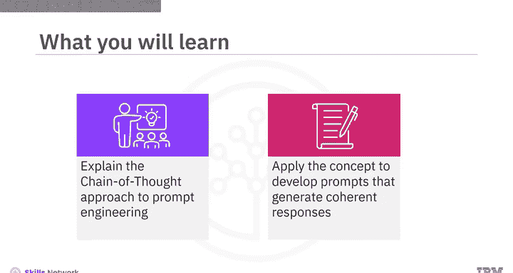
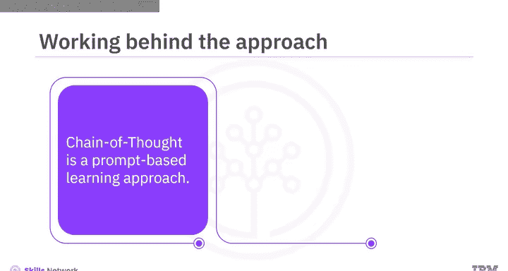
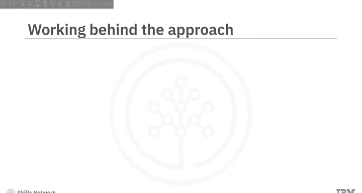
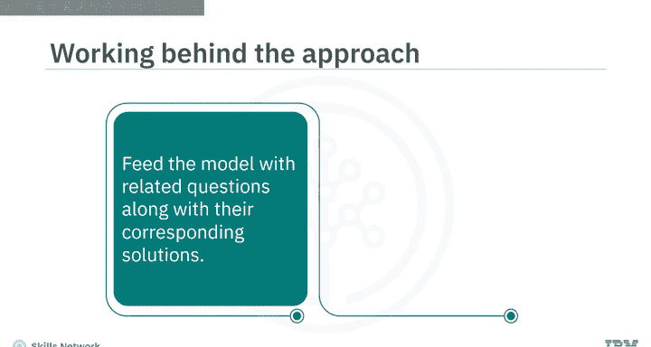
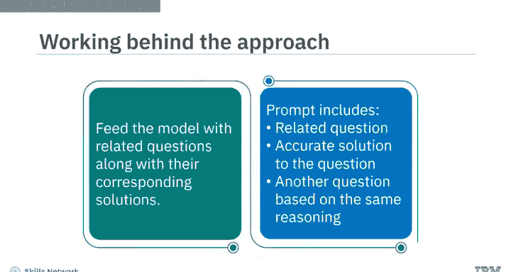
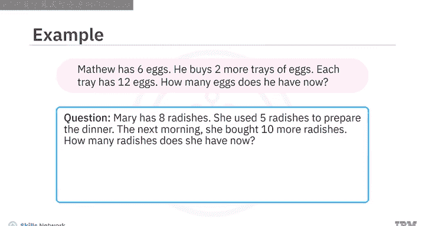
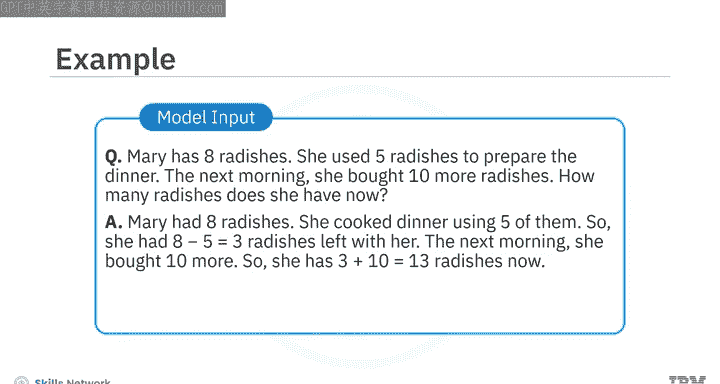
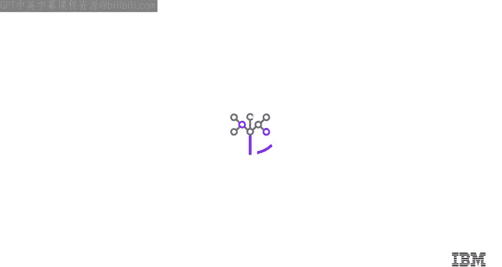

# IBM《生成式人工智能工程（AI入门、生成式AI入门、提示工程、Python）｜IBM Generative AI Engineering》中英字幕 - P51：7_思维链方法.zh_en - GPT中英字幕课程资源 - BV1MfqzY4Eyg

Welcome to Chain of Though approachach After watching this video。

 you'll be able to explain the chain of thought approach to prompt engineering。

 you'll also learn to apply this concept to develop prompts with compelling and diverse examples。

 allowing generative AI models to understand the context and generate coherent responses with ongoing conversation。

Chain of thought is a prompt based learning approach that involves constructing a series of prompts or questions to guide the model to generate a desired response。

 Using this approach， you can demonstrate the cognitive abilities of the generative AI models and better explain their reasoning process。

It involves breaking down a complex task into smaller and easier ones through a sequence of more straightforward prompts。

 with each prompt building upon the previous one to guide the model toward the intended outcome。

Before posing a question directly to the model， you feed it with related questions。

 along with their corresponding solutions。 This chain of prompts helps the model think about the problem and use the same strategy to answer more such questions correctly。

 In simpler words， the prompt includes a question and an accurate answer to the question to provide the required context and step by step reasoning for the model。

 Then it poses a different question to be answered using the same line of reasoning。

You'll understand this better with the help of an example。

 If you pose a mathematical problem to the model， like Matthew has six eggs。

 he buys two more trays of eggs。 Each tray has 12 eggs。 How many eggs does he have now。

 Its logic can go off the rails， especially for a complex problem to train the model with the appropriate reasoning involved in solving such questions You compose pose a similar question like this one。

 Mary has8 radishes。 She used  five radishes to prepare the dinner， The next morning。

 she bought 10 more radishes。 How many radishes does she have now。

Along with the questions， you must provide the correct logical solution as well。 Mary had 8 radishes。

 She cooked dinner using five of them， So she had 8-5 equals 3 radishes left with her。

 The next morning， she bought 10 more。 So she has 3 plus 10 equals 13 radishes。 Now。

 This will help the model understand the logic involved and come up with the right solution。

 So your final prompt should include the following。

 A related question with the appropriate solution and then another question that can be solved using the same logic or reasoning。

 And this prompt， you can see there's a question， a logical solution to the question。

 And another question that can be solved using the same logic。

In this video you learned that the chain of thought approach strengthens the cognitive abilities for generative AI models and solicits a step by step thinking process。

 This approach involves providing the model with related questions and their corresponding solutions to train the model with the logic behind solving these questions so that the same logic can be applied to solve more such questions。

