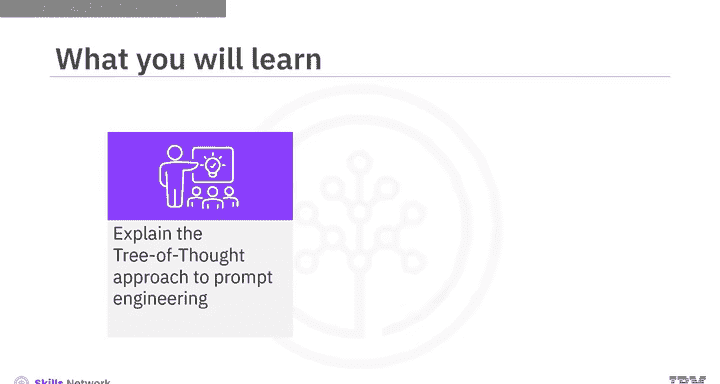
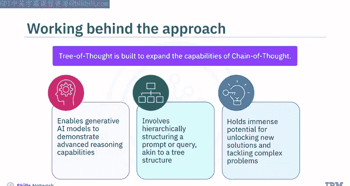
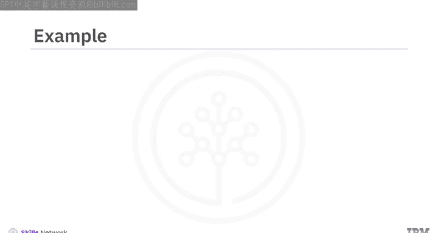

# IBM《生成式人工智能工程（AI入门、生成式AI入门、提示工程、Python）｜IBM Generative AI Engineering》中英字幕 - P52：8_思维树方法.zh_en - GPT中英字幕课程资源 - BV1MfqzY4Eyg

Welcome to tree of thought approach。 After watching this video。

 you'll be able to explain the tree of thought approach to prompt engineering。

 You'll also learn to apply this approach to draft prompts for generating tailored responses。

 The tree of thought is an innovative technique built to expand the capabilities of the chain of thought prompting approach。

 It enables the generative AI models to demonstrate advanced reasoning capabilities。

 It involves highererarchically structuring a prompt or query akin to a tree structure to specify the desired line of thinking or reasoning for the model。

 This approach is particularly useful when you want to provide explicit instructions or constraints to the model to ensure it generates the desired output。

 This method holds immense potential for unlocking new solutions and tackling complex problems。

 Let's understand how the tree of thought approach works。

 It involves generating multiple lines of thought， resembling a decision tree to explore different possibilities and ideas。

 Unlike traditional linear approaches。 This technique allows the model to evaluate and pursue multiple paths simultaneously。

 Each thought。😊。

Iea branches out creating a tree like structure of interconnected thoughts The model proceeds by assessing every possible route。

 assigning numerical values according to its predictions of outcomes and eliminating lesser promising lines of thought。

 ultimately pinpointing the most favorable choices。

You will understand this better with the help of an example。

 Suppose you want the model to design recruitment and retention strategies for attracting skilled remote employees for an e-commerce business。

 You want the model to employ the tree of thought approach to do that。

 You can give the following prompt instructions to the model。

 Imagine three different experts answering this question。

 All experts will write down one step of their thinking and then share it with the group。

 Then all experts will go on to the next step， et cetera。

 If any expert realizes their wrong at any point， then they leave。

Along with the prompt instruction， you will also give the original question for the prompt。

 Act as a human resource specialist， design a recruitment and retention strategy for an e-commerce business。

 focusing on attracting and retaining skilled， remote employees。

 Building such prompt instruction will allow the generative AI model to consider a step by step process and think logically。

 It will also make it consider intermediate thoughts。

 building upon them and exploring branches that may or may not lead somewhere。

 This practice will maximize the use and capabilities of the model， rendering more useful results。

 In this video， you learn that the tree of thought approach is an innovative technique that builds upon the chain of thought approach and involves structuring prompts hierarchically akin to a tree like structure to guide the model's reasoning and generation of output。

 This approach is particularly valuable when explicit instructions or constraints are necessary for desired outputs。

 It enables the model to explore various possibilities and idea simultaneously。

 branching out like a decision tree。😊。

