# IBM《生成式人工智能工程（AI入门、生成式AI入门、提示工程、Python）｜IBM Generative AI Engineering》中英字幕 - P53：9_文本到图像的提示技术.zh_en - GPT中英字幕课程资源 - BV1MfqzY4Eyg

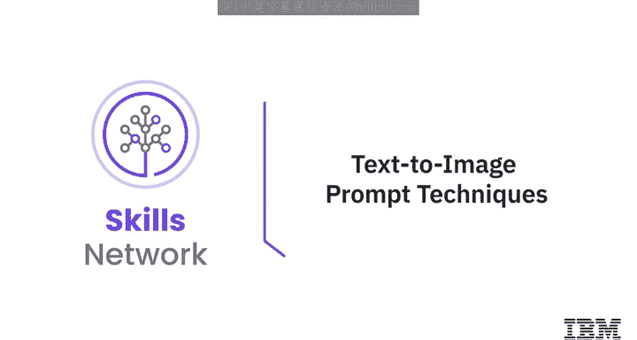

Welcome to text to image prompt techniques。 After watching this video。

 you'll be able to explain common image prompting techniques used to improve the quality and impact of images and apply these techniques to write better prompts for image generation。

 Images are an essential part of communication and are used in various fields such as marketing。

 advertising。 education， journalism and many others。Nonetheless。

 certain images excel in their ability to convey emotions more effectively than others。

 An image prompt is a text description of an image that you want to generate。

 It can be as simple as a single word or phrase， or can be more detailed describing the composition。

 colors and mood of the image。 to increase the impact of images obtained through generative AI models and make them more convincing and compelling。

 you can use image prompting techniques。 These techniques aim to improve the quality。

 diversity and relevance of images produced by generative AI models。

 There are different image prompting techniques that can be used to improve the impact of images。

 Let's learn about these techniques， one by one。 Style modifiers are descriptors used to influence the artistic style。

😊。

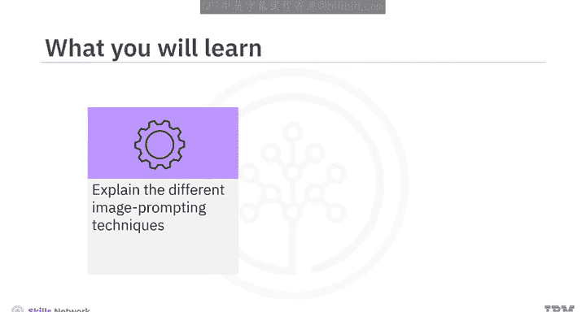

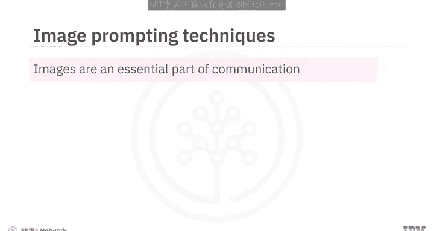

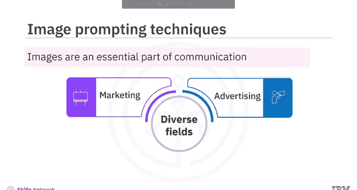

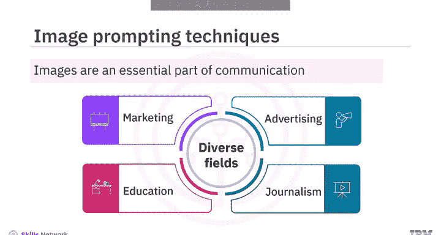

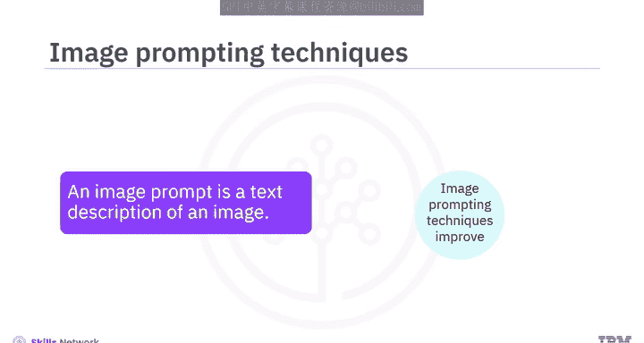

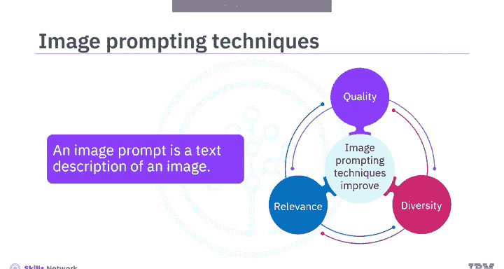

Or visual attributes of images produced by generative AI models。

 These descriptors can help the model produce graphics with innovative style while conforming to the structure and content of the input prompt。

 you can modify the various visual elements of an image like color， contrast， texture。

 shape and size and generate output that is aesthetically appealing and visually pleasing your prompt can include information about miscellaneous art styles。

 His art periods， Photoography techniques。 types of art materials used and even traits of wellknown brands or artists you want the model to emulate All this information can help the generative model understand the desired appearance or style of the output image。

 Here are a few examples of style modifiers used in image prompts。

 the style modifiers used in these prompts have been highlighted。

 Moving on to the next image prompting technique that is quality boosters。

 High quality images are more convincing and reliable as compared to low quality ones。

 I with low resolution， frequently exhibit blurrrriiness and pixelation。

 making it difficult for viewers to discern the finer details within the。

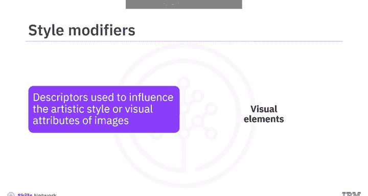

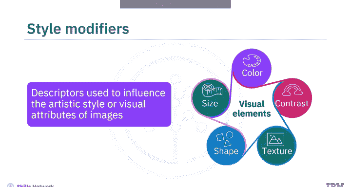

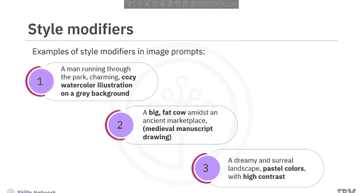

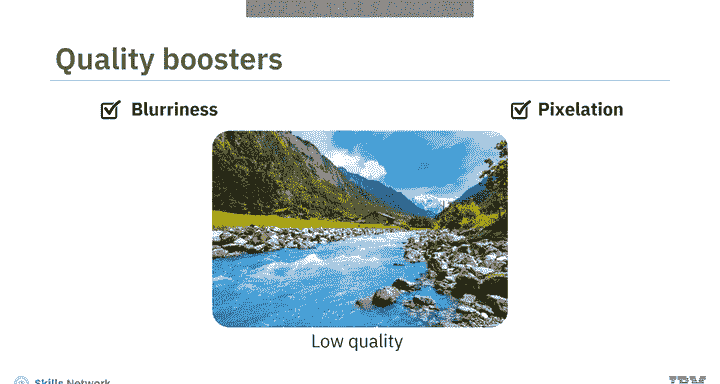

ImageOn the other hand， images with high resolution guarantee essential visibility and readability。

 The perceived worth of an image can be raised by using high quality graphic design。

 quality boosters are terms used in an image prompt to enhance the visual appeal and improve the overall fidelity and sharpness of the output。

 These are specific terms that can direct the generative AI model to perform steps like noise reduction。

 sharpening color， correction and resolution enhancement。

 You can use terms like high resolution 24 hyper detailedtail sharprp focus。

 complementaryary colors and many others in your image prompts as quality boosters。

 They can enhance specific features of the image resulting in more coherent output。

 Let's look at some examples to understand how quality boosters can be used in image prompts。

 terms such as highlights the texture，4 resolution， Shar， Cri De and fine lines。

 complementaryary colors， blurred background and stand out are quality boosters used in the given image prompts。

 The third image prompting technique as repetition。 This technique leverages the。😊。

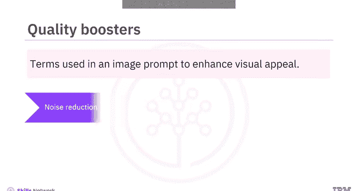

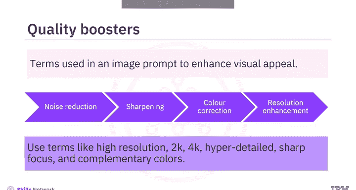

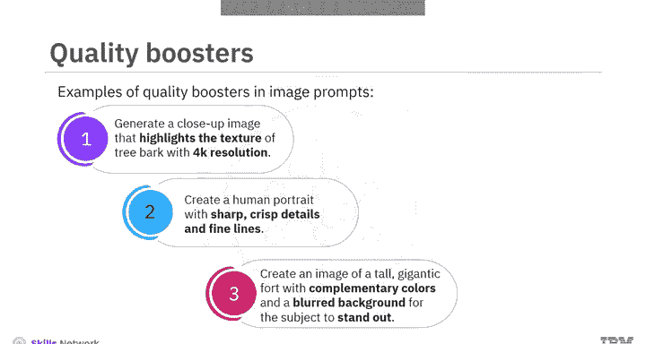

Of iterative sampling to enhance the diversity of images generated by the model。

 Reetition involves emphasizing a particular visual element within an image to create a sense of familiarity for the model。

 allowing it to focus on a specific idea or concept you want to highlight。

 This can be accomplished by repeating the same word or similar phrase within the image prompt。

 repetition helps reinforce the message conveyed through the image and increase the memorability of the model。

Rather than producing just one image based on a prompt。

 the model generates multiple images with subtle differences。

 resulting in a diverse set of potential outputs。 This technique is particularly valuable when generative models are confronted with abstract or ambiguous prompts to which numerous valid interpretations are possible。

 Let's look at some examples of repetitive words used in an image prompt。 Word such as tiny， dense。

 enormous， vast， serene， clear and lush have been repeated many times to focus on a specific idea。

 The fourth image prompting technique is weighted terms。

 weighted terms refer to the use of words or phrases that can have a powerful。

 emotional or psychological impact。 For example， words such as free。

 limited time offer and guaranteed are often used in advertising to elicit a sense of urgency。

 security and trust。 Similarlyly， words such as luxury。

 premium and exc are used to create a sense of exclusivity and sophistication。

 generative AI models allow you to give positive or negative weights to such terms to emphasize or deemphasize a certain emotion using weighted terms。

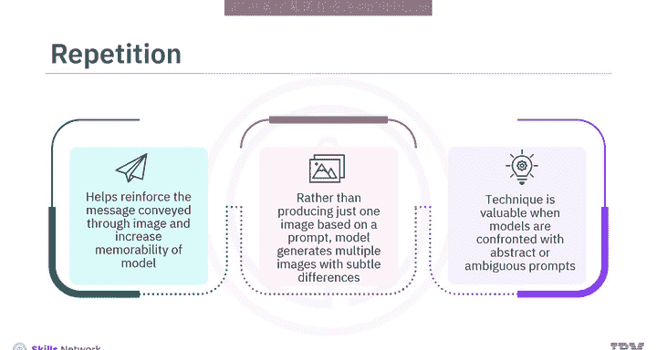

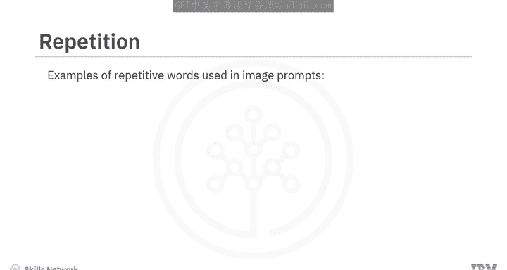

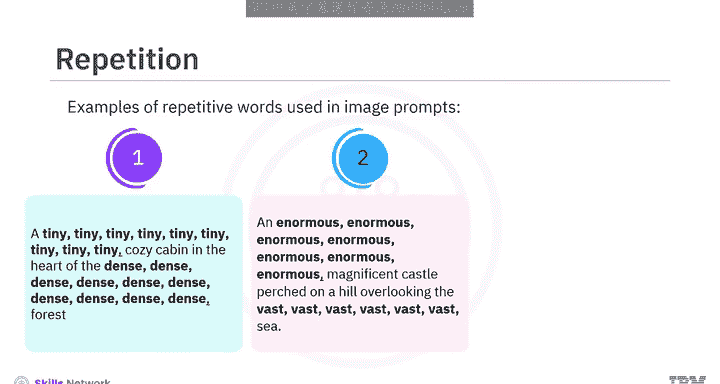

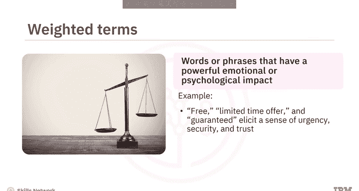

An image prompt can help create images that are memorable and convincing and can draw emotional responses from the audience。

 Here are some examples of weighted terms used in an image prompt。

 As you can see in the first example， a weight of positive 10 is given to the word warm。

 whereas the weight of crackling is positive8。 This means the generative model must focus more on the word warm and a little less on the word crackling。

 Similarlyly in the second example， a positive6 weight is given to the word shimmering。

 and the weight of neon lit is positive 8。 So the model should focus more on neon lit。

 whereas in the last example， negative weight of 6 is given to the word color。

 and a positive weight of 10 is given to exotic。 This means the model must emphasize the word exotic and deemphasize the word color。

 The fifth image prompting technique is fixed to form generations。

 This technique is used to modify any deformities or anomalies that may impact the effectiveness of the image。

 Theformities in an image can include conditions like distortion。

 particularly on human body parts like hands or feet。

 Pation or other image quality issues that can detract from the visual appeal and。😊。

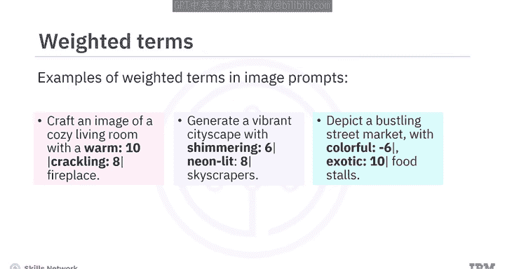

the image this can be mitigated to some extent by using good negative prompts Here are some examples of deformed generation prompting techniques used in image prompts You can see that in all these examples good negative words have been used to mitigate the issues of deformed images。

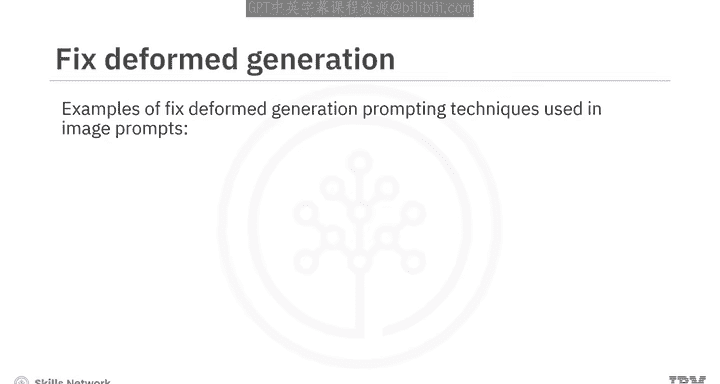

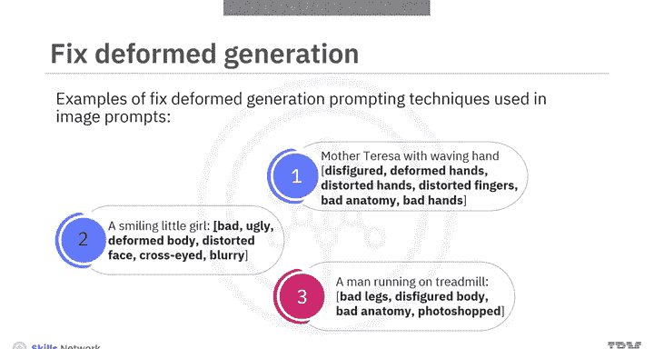

In this video， you learned that image prompting techniques play a vital role in advancing the image generation capabilities of generative AI models。

 St modifiers， quality boosters， repetition， weighted terms and fixed toform generations are five techniques that can be used to improve the impact of images produced by incorporating these techniques。

 One can create more memorable， engaging and persuasive visuals that can effectively communicate the intended message。

😊。

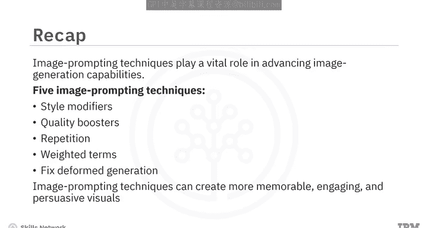

