# IBM《生成式人工智能工程（AI入门、生成式AI入门、提示工程、Python）｜IBM Generative AI Engineering》中英字幕 - P58：4_字典.zh_en - GPT中英字幕课程资源 - BV1MfqzY4Eyg

Let's cover dictionaries in Python。 Dictionaries are a type of collection in Python。 If you recall。

 a list has integer indexes。 These are like addresses addresses。 A list also has elements。

 A dictionary has keys and values。 The key is analogous to the index。 They are like add dress。

 but they don't have to be integers。 They are usually characters。

 The values are similar to the element in a list and contain information。 to create a dictionary。

 We use curly brackets。 The keys are the first elements。 They must be immutable and unique。

 Each key is followed by a values separated by a colon。 The values can be immutable。

 mutable and duplicates。 Each key in value pair is separated by a comma。

 Consider the following example of a dictionary。 The album title is the key。

 and the value is the release data。 We can use yellow to highlight the keys and leave the values in white。

 It is helpful to use the table to visualize a dictionary， where the first column。😊。

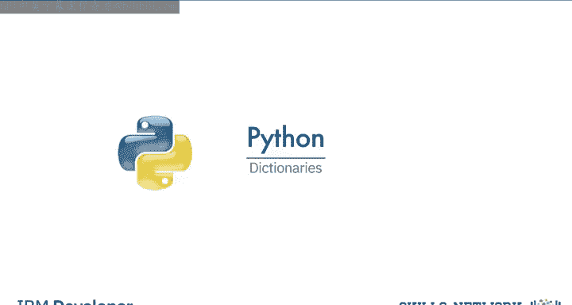

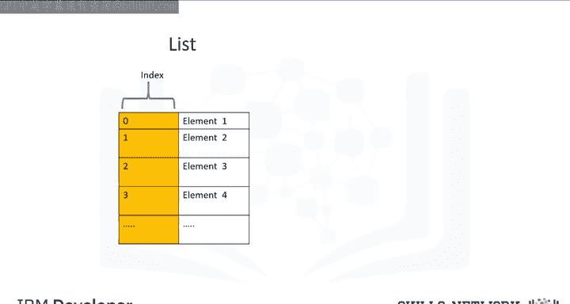

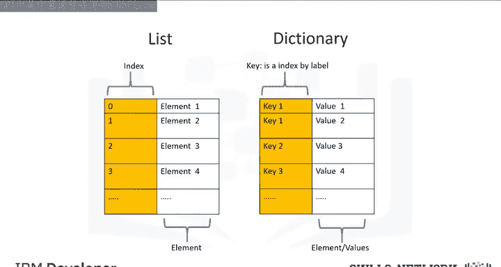

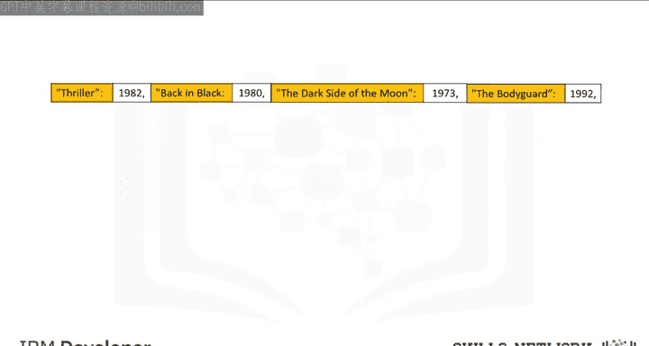

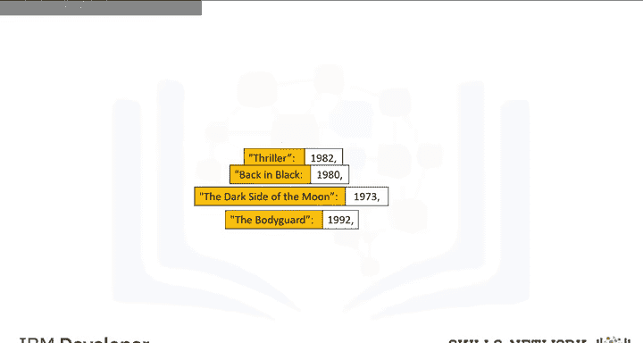

Represents the keys， and the second column represents the values。

 We can add a few more examples to the dictionary。 We can also assign the dictionary to a variable。

 The key is used to look at the value。 We use square brackets。 The argument is the key。

 This outputs the value。 using the key of back in black。 This returns the value of 1980。 The key。

 the dark side of the moon gives us the value of 1973。 using the key。

 The bodyguard gives us the value 1992， and so on。 We can add a new entry to the dictionary as follows。

 This will add the value 2007 with a new key called graduation。 We can delete an entry as follows。

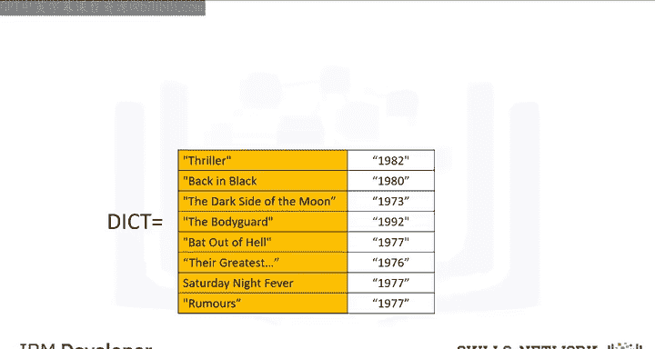

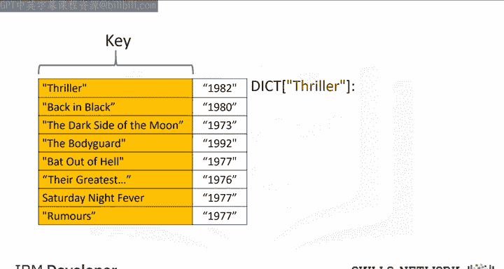

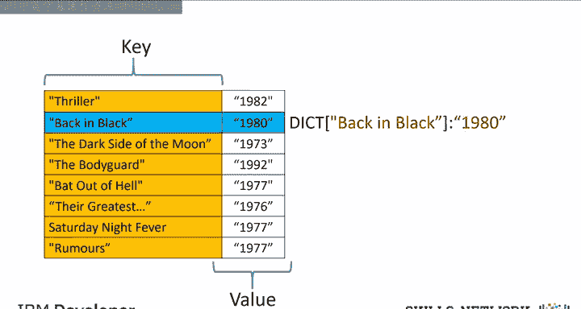

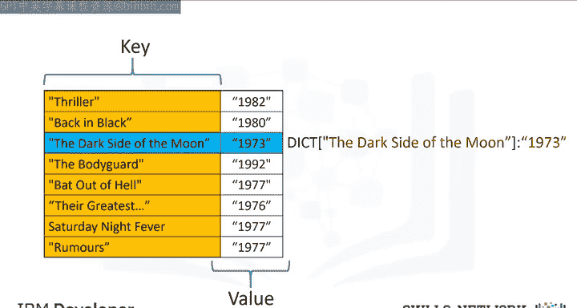

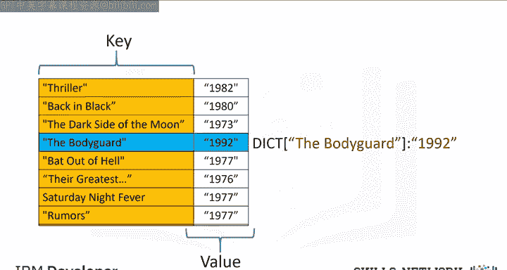

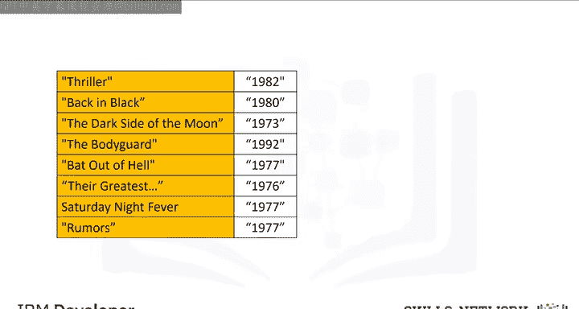

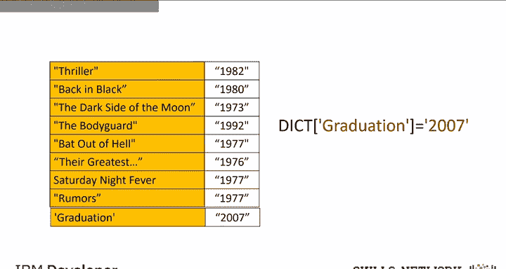

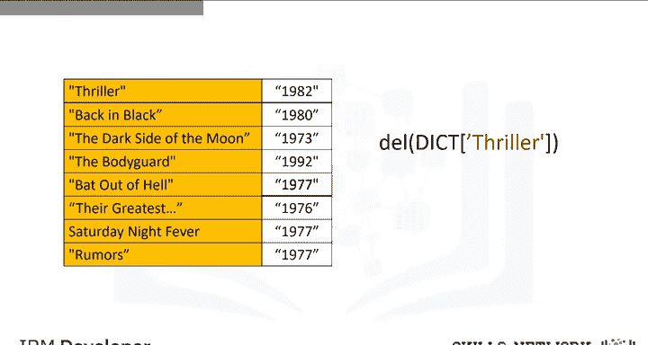

This gets rid of the key thriller and its value。 We can verify if an element is in the dictionary using the in command As follows。

 The command checks the keys。 If they are in the dictionary， they return a true。

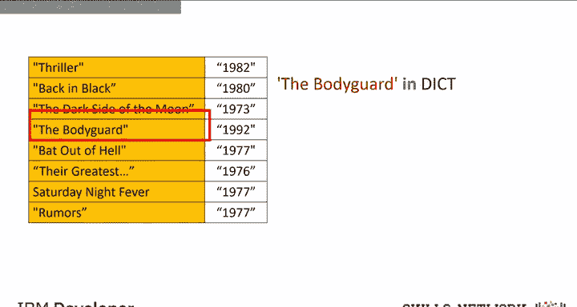

If we try the same command with a key that is not in the dictionary。

 we get a false in order to see all the keys in a dictionary。

 we can use the method keys to get the keys。 The output is a list like object with all the keys。

 In the same way， we can obtain the values using the method values。

 Check out the labs for more examples and info on dictionaries。

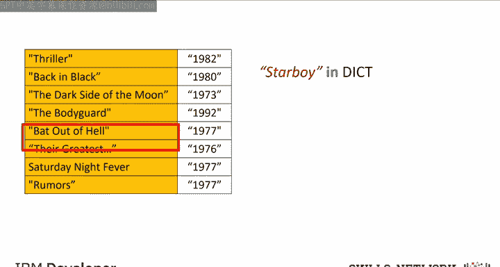

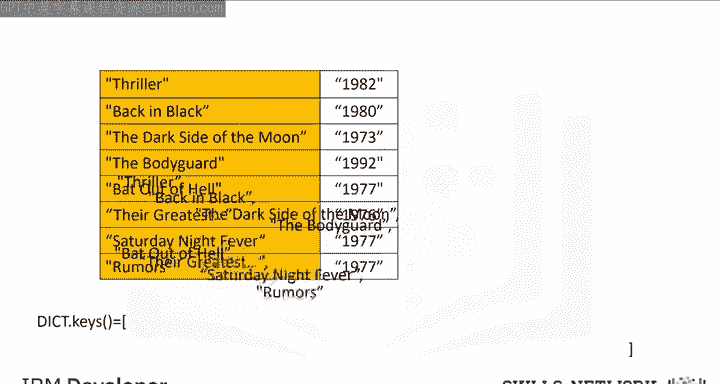

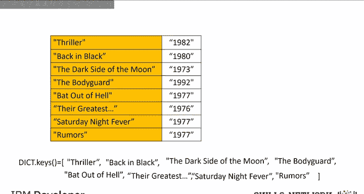

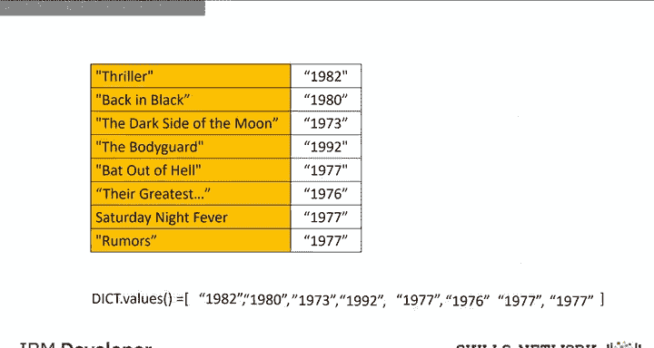