# IBM《生成式人工智能工程（AI入门、生成式AI入门、提示工程、Python）｜IBM Generative AI Engineering》中英字幕 - P59：5_集合.zh_en - GPT中英字幕课程资源 - BV1MfqzY4Eyg

。Let's cover sets。 They are also a type of collection。Seets are a type of collection。

 This means that like lists and tuples， you can input different python types。

 Unlike lists and tuples， they are unordered。 This means sets do not record element position。

 Se only have unique elements。 This means there is only one of a particular element in a set。

To define a set， you use curly brackets。 You place the elements of a set within the curly brackets。

 You notice there are duplicate items。 When the actual set is created。

 duplicate items will not be present。

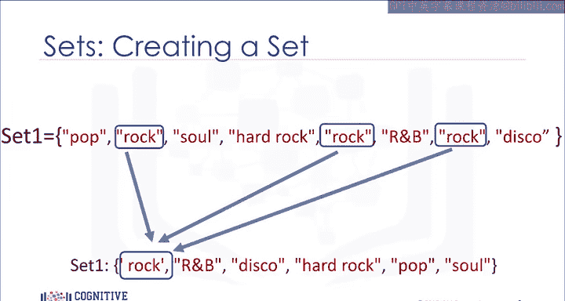

You can convert a list to a set by using the function set。 This is called typecasting。

 You simply use the list as the input to the function set。

 The result will be a list converted to a set。

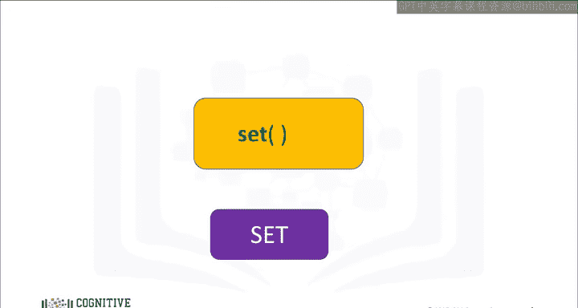

Let's go over an example。We start off with a list。 We input the list to the function set。

 The function set returns a set。Notice how there are no duplicate elements。

Let's go over set operations。 These can be used to change the set。 Consider the set a。

 let's represent this set with a circle。 If you are familiar with sets。

 this can be part of a Venn diagram。

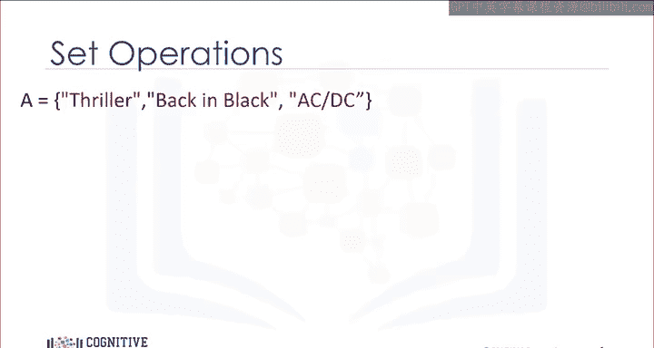

A Venn diagram is a tool that uses shapes， usually to represent sets。

We can add an item to a set using the add method。 We just put the set name followed by a dot。

 then the add method。The argument is the new element of the set we would like to add in this case。

 in sync。The set A now has in sync as an item。If we add the same item twice。

 nothing will happen as there can be no duplicates in a set。

 Let's say we would like to remove in sync from set A。

We can also remove an item from a set using the remove method。

We just put the set name followed by a dot， then the remove method。

The argument is the element of the set we would like to remove。 in this case， in sync。

After the remove method is applied to the set， set A does not contain the item in sync。

 You can use this method for any item in the set。We can verify if an element is in the set using the in command。

 as follows。 the command checks of the item， in this case， ADC is in the set。

 If the item is in the set， it returns true。If we look for an item that is not in the set。

 in this case， for the item， who， as the item is not in the set， we will get a false。

 These are types of mathematical set operations。 There are other operations we can do。

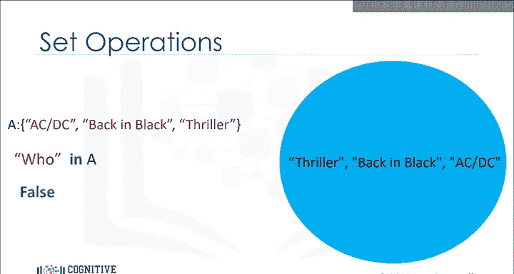

There are lots of useful mathematical operations we can do between sets。

 Let's define the set album set 1。 We can represent it using a red circle， or Venn diagram。

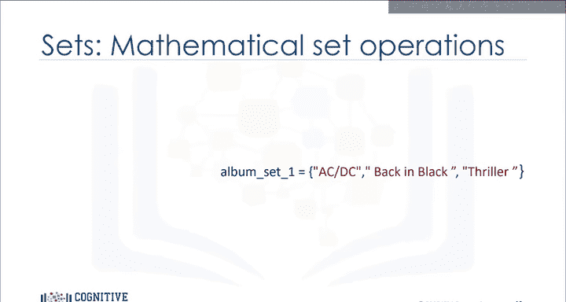

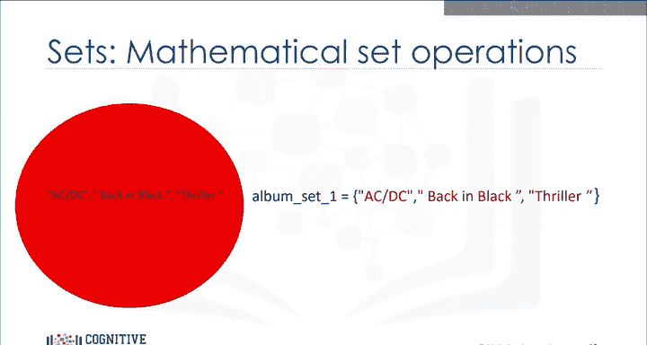

Similarly， we can define the set album set2。 We can also represent it using a blue circle or Venn diagram。

 The intersection of two sets is a new set containing elements， which are in both of those sets。

 It's helpful to use Venn diagrams。 The two circles that represent the sets combine。

 The overlap represents the new set。 As the overlap is comprised of the red circle and blue circle。

 we define the intersection in terms of and。

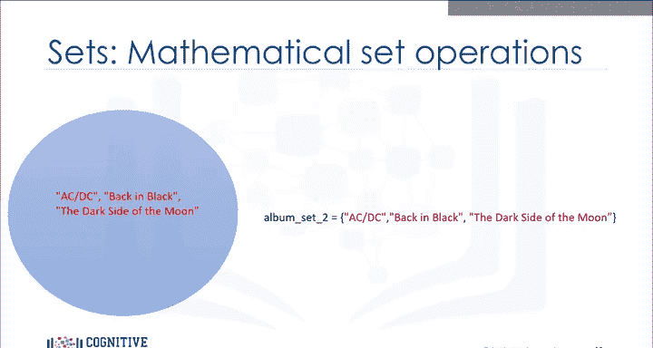

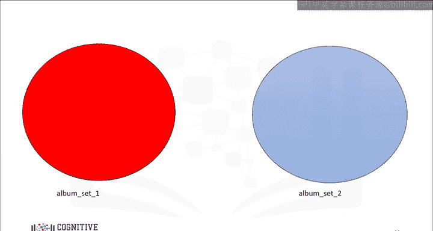

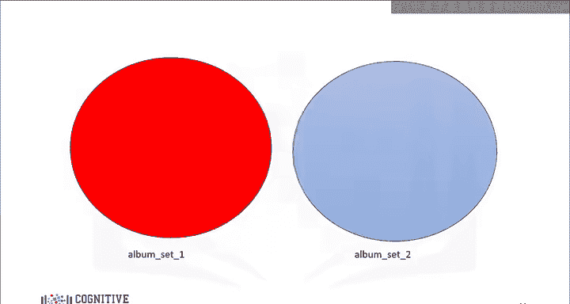

In Python， we use an ampersand to find the union of two sets。

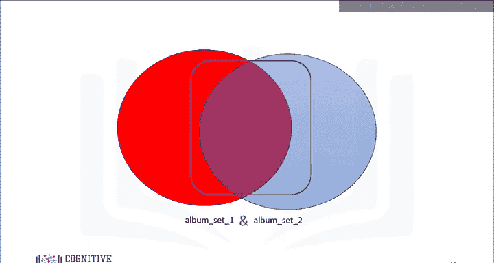

If we overlay the values of the set over the circle。

 placing the common elements in the overlapping area。

 we see the correspondence After applying the intersection operation。

 all the items that are not in both sets disappear。

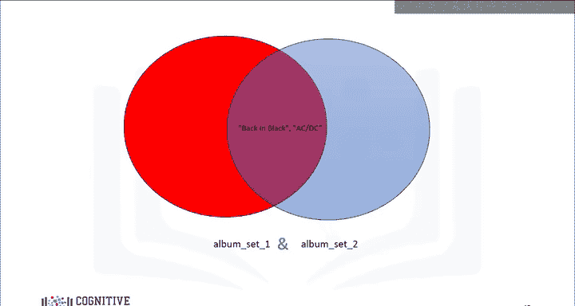

In Python， we simply just place the ampersand between the two sets。

 We see that both A DC and back in black are in both sets。 The result is a new set album， set 3。

 containing all the elements in both album set  one and album set 2。

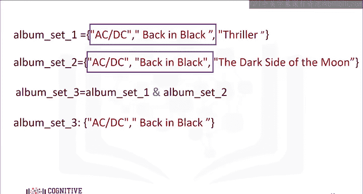

The union of two sets is the new set of elements which contain all the items in both sets。

 We can find the union of the sets， album set 1， and album set two as follows。

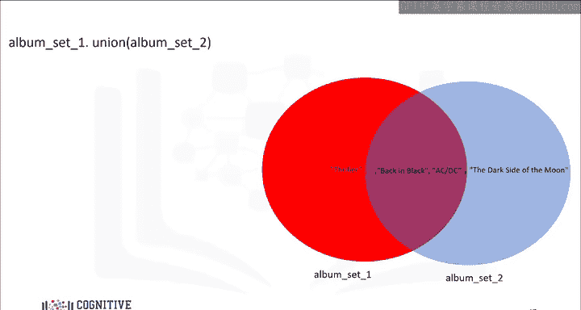

The result is a new set that has all the elements of album set 1 and album set 2。

 This new set is represented in green。

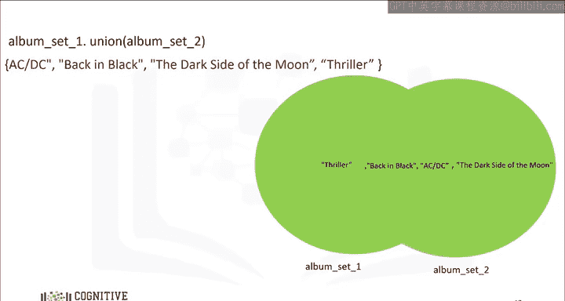

Consider the new album set album set 3。 The set contains the elements， A， DC and back in black。

 We can represent this with a Venn diagram， as all the elements in album set 3 are in album set 1。

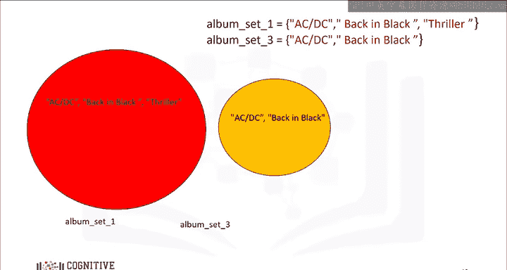

The circle representing album set  one encapsulates the circle representing album set three。

We can check if a set is a subset using the is subset method。

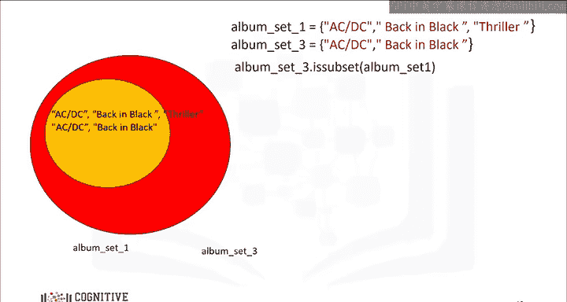

As album set 3 is a subset of the album set 1， the result is true。

There is a lot more you can do with sets。 Check out the lab for more examples。

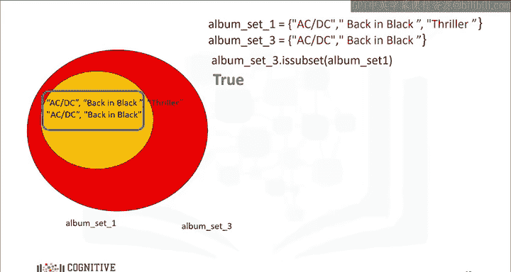