# IBM《生成式人工智能工程（AI入门、生成式AI入门、提示工程、Python）｜IBM Generative AI Engineering》中英字幕 - P67：13_使用Pandas加载数据.zh_en - GPT中英字幕课程资源 - BV1MfqzY4Eyg

Depenencies or libraries are pre written code to help solve problems。 In this video。

 we will introduce Padas， a popular library for data analysis。

We can import the library or a dependency like pandas using the following command。

 We start with the import command。 followed by the name of the library。

 We now have access to a large number of prebuilt classes and functions。

 This assumes the library is installed。 in our lab environment。

 All the necessary libraries are installed。 Let's say we would like to load a CV file using the pandas built in function。

 Read CV。 A CV is a typical file type used to store data。 We simply type the word pandas。

 Then a dot and the name of the function with all the inputs。

 typing pandas all the time may get tedious。 We can use the as statement to shorten the name of the library。

 In this case， we use the standard abbreviation P D。 Now。

 we type P D and a dot followed by the name of the function we would like to use。 In this case， read。

 underscore CV。

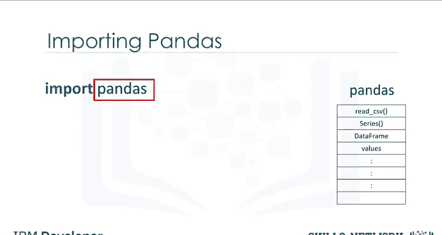

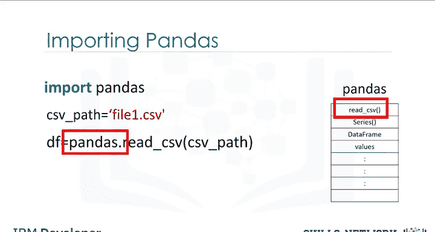

We are not limited to the abbreviation。 P D。 In this case， we use the term banana。

 We will stick with P D for the rest of this video。 Let's examine this code more in depth。

 One way pandas allows you to work with data is with a data frame。

 Let's go over the process to go from a CV file to a data frame。

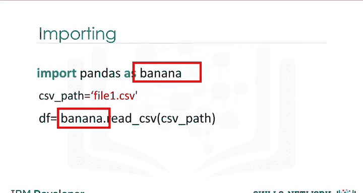

This variable stores the path of the C SV。 It is used as an argument to the read。

 underscore CV function。 The result is stored to the variable D F。 This is short for data frame。

Now that we have the data in a data frame， we can work with it。

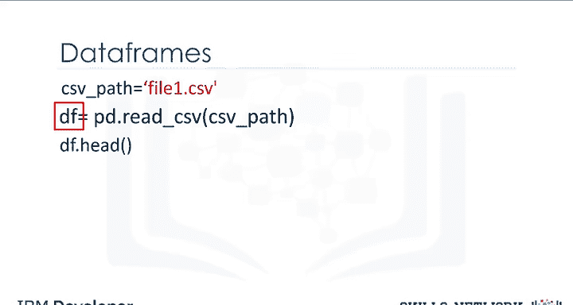

We can use the method head to examine the first five rows of a data frame。

 The process for loading an Excel file is similar。 We use the path of the Excel file。

 The function reads Excel。 The result is a data frame。

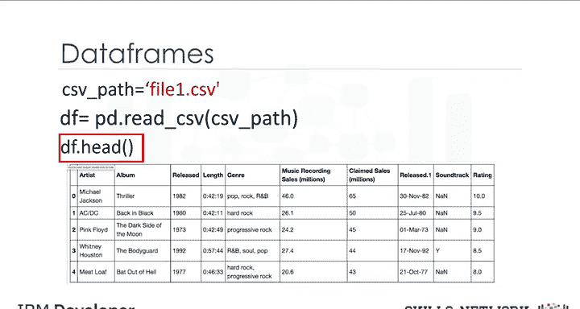

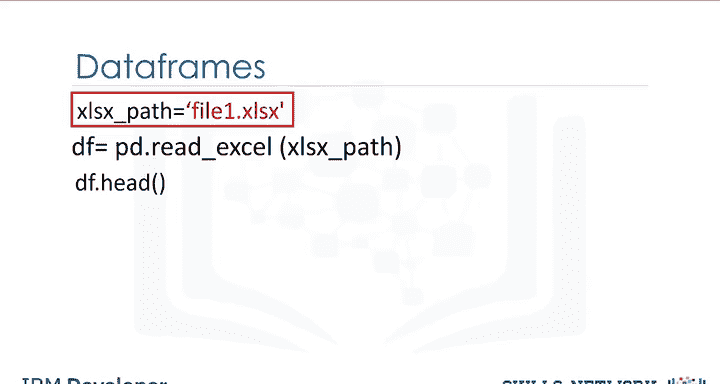

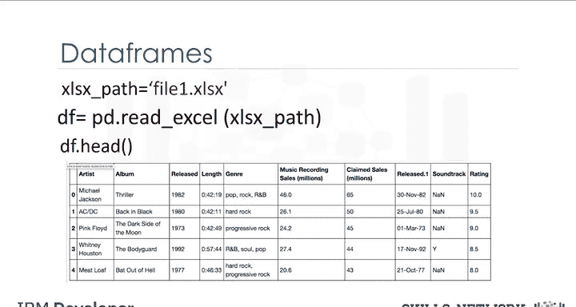

A data frame is comprised of rows and columns。 We can create a data frame out of a dictionary。

 The keys correspond to the column labels。 The values are lists corresponding to the rows。

 We then cast the dictionary to a data frame using the function data frame。

 We can see the direct correspondence between the table。 The keys correspond to the table headers。

 The values are lists corresponding to the rows。😊。

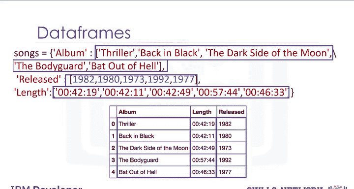

We can create a new data frame consisting of one column。 We just put the data frame name。

 in this case， D F and the name of the column header enclosed in double brackets。

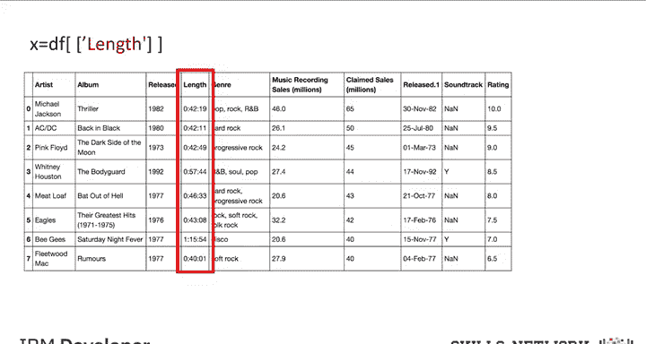

The result is a new data frame comprised of the original column。

You can do the same thing for multiple columns。 We just put the data frame name， in this case。

 D F and the name of the multiple column headers enclosed in double brackets。

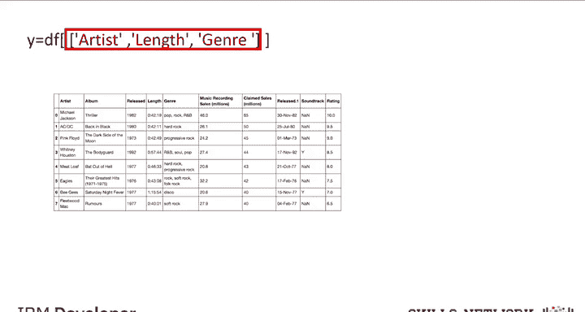

The result is a new data frame comprised of the specified columns。

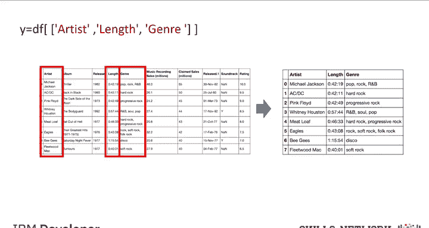