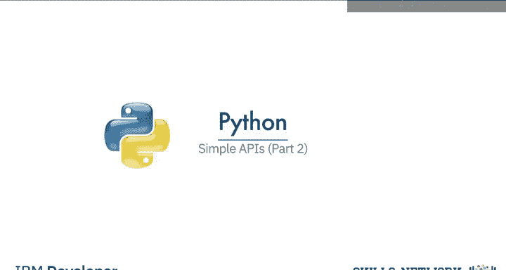
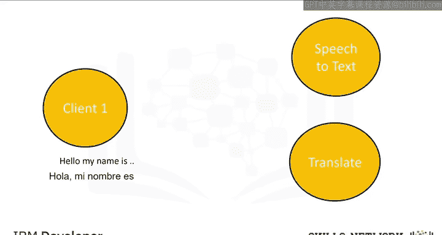
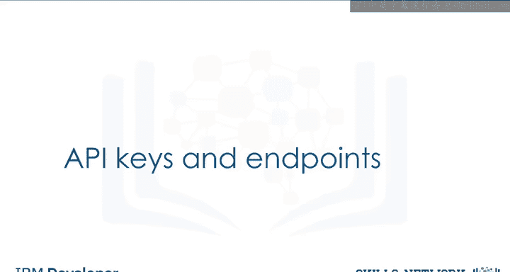
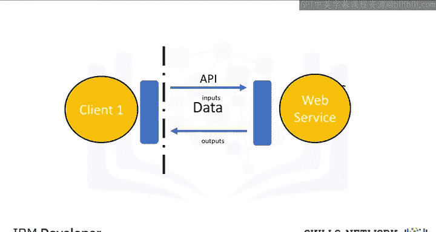
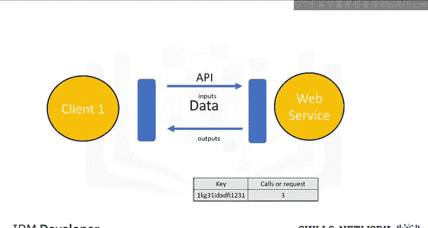
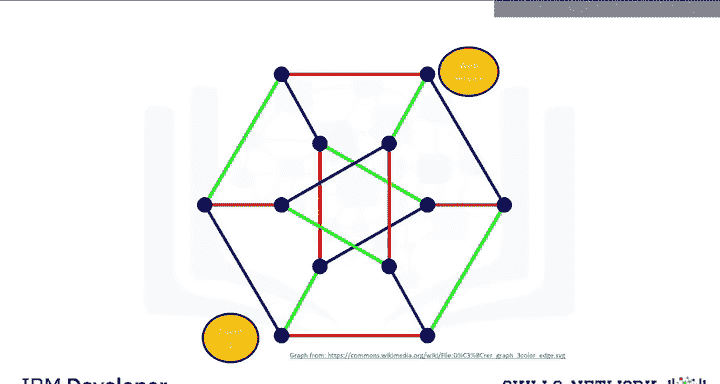

# IBM《生成式人工智能工程（AI入门、生成式AI入门、提示工程、Python）｜IBM Generative AI Engineering》中英字幕 - P72：18_简单API（第2部分）.zh_en - GPT中英字幕课程资源 - BV1MfqzY4Eyg

In this video， we will discuss application program interfaces that use some kind of artificial intelligence。

We will transcribe an audio file using the Watson text to speech API。

 We will then translate the text to a new language using the Watson languagen Translator API in the API call。

 you will send a copy of the audio file to the API。 This is sometimes called a post request。

Then the API will send the text transcription of what the individual is saying under the hood。

 the API is making a get request。 We then send the text we would like to translate into a second language to a second API。

The API will translate the text and send the translation back to you。 In this case。

 we translate English to Spanish。 We then provide an overview of API keys and endpoints。

 Watson's speech to text and Watson translate。 First， we will review API keys and endpoints。

 They will give you access to the API。

An API key is a way to access the API。 It's a unique set of characters that the API uses to identify you and authorize you。

 Usually your first call to the API includes the API key。 This will allow you access to the API。

In many APIs， you may get charged for each call， so like your password。

 you should keep your API key a secret。 An end point is simply the location of the service。

 It's used to find the API on the Internet， just like a web address。

