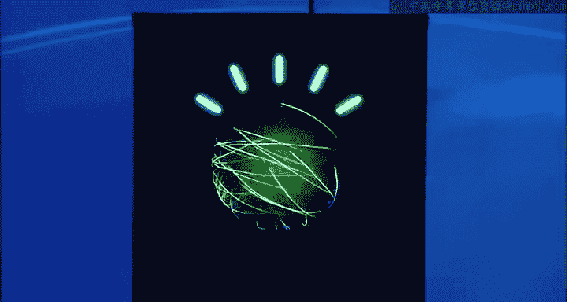
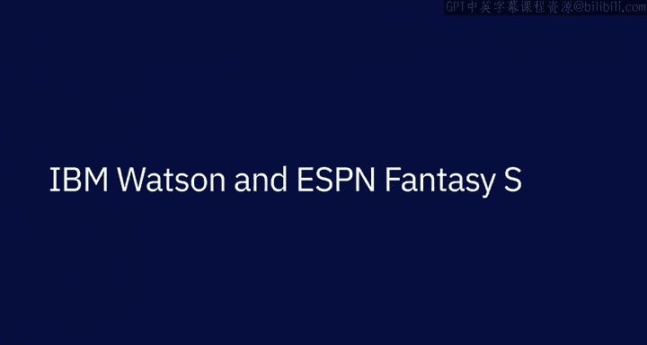

# IBM《生成式人工智能工程（AI入门、生成式AI入门、提示工程、Python）｜IBM Generative AI Engineering》中英字幕 - P9：8_IBM的著名AI应用.zh_en - GPT中英字幕课程资源 - BV1MfqzY4Eyg

I remember that morning going to the lab and I was thinking。This is it。

 This is the last jeopardy game。It became real to me when the music played and Johnny Gilbert said from IBM research in Yorktown Heights。

 New York， this is jeopardy and I just。🎼And here it is。 One day。

 this is the culmination of all this work。 to be honest with you。 I was emotional。 Watson。

 what is you， You are right， We actually took the lead， We were ahead of them。

 but then we started getting some questions wrong。 Watson， What is leg， No， I'm sorry。

 I can't accept that。 What is 1920s。 No， what is cheek。 No， sorry， Brad， what is class class。

 you got it， Watson， what is Soren， Saran is right。

 And that puts you into a tie for the lead with Brad。

🎼Double jeopardy round of the first game I thought was phenomena Watson France right is violin who is the church lady Watson what is you are right and with that you move to 366。

81。Now we come to Watson， who is Brown？17，973 and a two day total。77。47。We won jeopardy。

They're very justifiably proud of what they've done I would have thought that technology like this was years away。

 but it's here now I have the bruise ego go to prove it I think we saw something important today Wow wait a second this is history。

The 60th annual Grammy Awards powered by IBM Watson。

 there's a tremendous amount of unstructured data that we process on Grammy Sunday。

Our partnership with the Recording Academy really is focused on helping them with some of their workflows for their digital production。

My content team is responsible not only for taking all of this raw stuff that's coming in。

 but curating it and publishing it， you're talking about five hours of red carpet coverage with 5。

000 artists making that trip down the carpet with 100。

000 photos being shot for the last five hours Watson has been using AI to analyze the colors。

 patterns and silhouettes of every single outfit that has passed through so we've been able to see all the dominantmin foul compare them to Grammy shows in that and Watson's also analyzing the emotions of Grammy nominated song lyrics over the last 60 years get this it can actually identify the emotional themes in music and categorize them as joy。

 sadness and everything else in between it's very cool。

Fantasy sports are an incredibly important and fun way that we serve sports fans。

 our fantasy games drive tremendous consumption across ESPN digital properties。

 and they drive tune in to our events and studio shows。

But our users have a lot of different ways they can spend their time so we have to continuously improve our game so they choose to spend that time with us This year。

 ESPN teamed up with IBM to add a powerful new feature to their fantasy football platform。

Fantasy football generates a huge volume of content， articles， blogs， videos， podcasts。

 we call it unstructured data， data that doesn't fit neatly into spreadsheets or databases。

 Watson was built to analyze that kind of information and turn it into usable insights。

We train Watson on millions of fantasy football stories， blog posts and videos。

 we taught up to develop a scoring range for thousands of players， their upsides and their downsides。

 and we taught it to estimate the chances a player will exceed their upside or fall below the downside。

Watson even assesses a players media buzz and their likelihood to play。

This is a big win for our fantasy football players。

 it's one more tool to help them decide which running back or Q be to start each resort and it's a great compliment to the award winning analysts our fans rely on。

As with any machine learning， the system gets smarter all the time。

 that means the insights are better， which means our users can make better decisions and have a better chance to win their matchup every week。

 the more successful our fantasy players are， the more time they'll spend with us。

The ESPN IBM Part is a great vehicle to demonstrate the power of enterprise grade AI to millions of people。

 and it's not hard to see how the same technology applies to real life。

 There are thousands of business scenarios where you're assessing value and making tradeoffs This is what the future of decision making is going to look like man and machine working together。

 assessing risk and reward working through difficult decisions This is the same technology IBM uses to help doctors mine millions of pages of medical research and investment banks find market moving insights。

