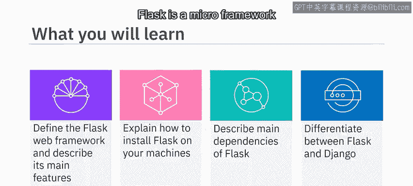
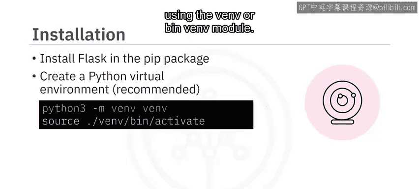
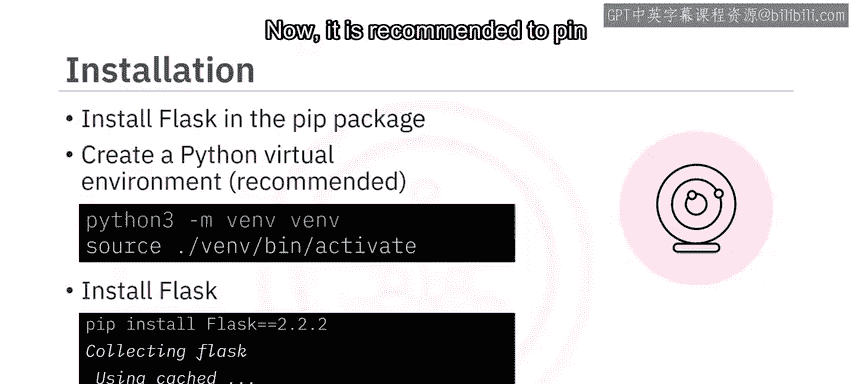
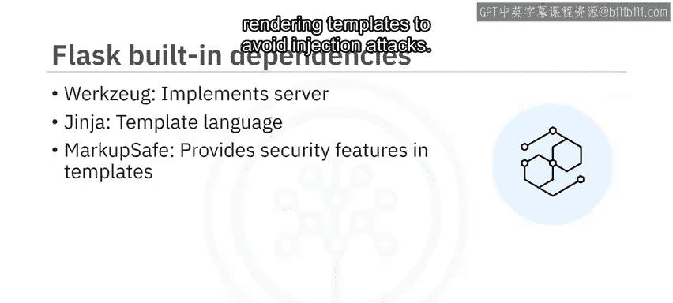
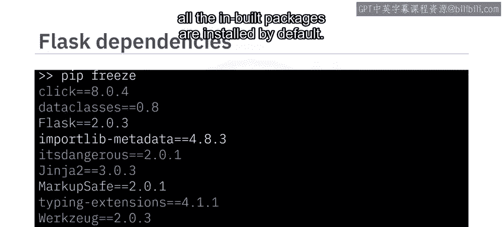
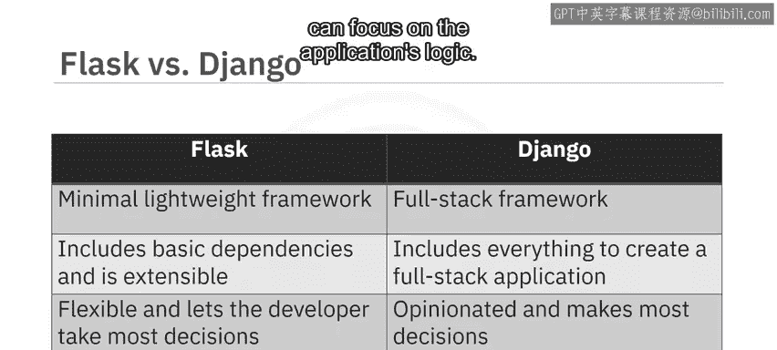

# IBM应用人工智能（从0开始搭建AI机器人）｜IBM Applied AI （中英字幕） - P101：11_Flask简介.zh_en - GPT中英字幕课程资源 - BV1p64y1H7LM

Welcome to In to Flask After watching this video， you will be able to define the Flask web framework and describe its main features。

 explain how to install flask on your machines， describe main dependencies of flask。

 and explain the main differences between flask and another Python web framework called Django。

Flaask is a micro framework that can create web applications。

 it is not opinionated like some other larger frameworks and does not bind the user to a specific set of tools。

One of the complex dependencies of flask is Python you will run flask 2。2。2。

 which requires a minimum Python version of 3。7。In 2004。

 Arman Roachsure created the framework as an April Fool's joke。

 it quickly gained popularity for its ease of use and extensibility Flask provides minimal dependencies you might need to create a web application。

 however it is extensible and many community extensions add additional features to flask。

The main features of Flask include the following Flask has a web server that runs applications in development mode Flask also comes with a debugger to help debug applications the debugger shows interactive traceback and stack trace in the browser FlLask uses standard Python logging for application logs。

 and you can use the same logger to log custom messages about your application。

FLask provides a way to test different parts of your application。

 the testing feature enables developers to follow a test driven approach。

 and you can use frameworks like PT and coverage to ensure your code works as desired。Finally。

 developers can access the request and response objects to pull arguments and customize responses。

Now additional features of flask are the following the framework supports static assets like CSS files。

 JavaScript files and images Flask provides tags to load static files in the templates。

You can also develop dynamic pages using Ginja Templating framework。

 and these dynamic pages can display information that may change for each request or may check if the user is logged in。

Flaask provides routing and supports dynamic URLs that are extremely useful for restful services。

 you can create routes for different HTTP methods and provide redirection in your application you can write global error handlers in flask that work on the application level and finally it supports user session management。

Some of the popular community extensions that can be added to your application are the following Flask SQL Alchemy adds support for ORM called SQL Alchemy to Flask。

 giving developers a way to work with database objects in Python。

FLask Ma provides the ability to set up an SMTP mail server FlaskAdmin lets you add admin interfaces to Flask applications easily。

 and Flask uploads allow you to add customized file uploading to your application。

Here are some other extensions。Fask Cose allows your application to handle crossorig resource sharing。

 making crossorig JavaScriptscript requests possible Flask migraterate adds database migrations to SQL alchemy orRM Flask user adds user authentication。

 authorization and other user management activities Marshmallow adds extensive object serialialization and desialization support to your code Finally。

 Clery is a powerful task queue that can be used for simple background tasks and complex multistorage programs and schedules。

FLask is available on the Python Pack manager called PIP and PIP is available in the lab environment。

 however， if installing on your machines， it is recommended that you first create a virtual environment using the VENV or PPENV module。

You can install Flask version 2。2。2。Now it is recommended to pin the version number of the dependencies in your application This ensures that the application can be reproduced from scratch in different environments like development。

 staging and production it also ensures new issues and bugs are not introduced by mistake when packages are updated automatically without a version number。

Faskask comes with some built in dependencies that enable the various features Worksg implements WSGI or the Web server gateway interface。

 This is the standard Python interface between applications and servers。

 Ginja is a template language that renders the pages in your application Markupafe comes with Ginja。

 It escapes untrusted input when rendering templates to avoid injection attacks。

 Its dangerous is used to sign data securely This helps determine if data has been tampered with and is used to protect flask's session cookie。

And finally， Click is a framework for writing command line applications。

 it provides the flask command and allows adding custom management commands。

To see the built Inencies， you can use the PIP freezeze command in the virtual environment。

 and you can see that all the unbuilt packages are installed by default。

Now another Python  developer framework is Django， here are some key differences between Flask and Django。

Fask aims to be a very light framework Django， on the other hand。

 is a full stack framework As a result， Flask only provides the basic dependencies needed to create a web application。

 However， the developer can choose other extensions that provide additional features Djaengo。

 on the other hand includes everything you need to create a full stack application。

 Also flask is very flexible。 you can add and remove pieces in a plug and plain manner。

 On the other hand， Django is opinionated and makes most decisions for the developer so they can focus on the applications's logic。

In this video you learned that Flask is a micro framework that ships with minimal dependencies to build websites。

 flask has features like debugging servers， routing， templates， and error handling。

Flaask can be extended by using community extensions Flask can be installed as a Python package。

 and Django is a full stack framework compared to flask。

