# IBM应用人工智能（从0开始搭建AI机器人）｜IBM Applied AI （中英字幕） - P108：1_构建AI应用程序.zh_en - GPT中英字幕课程资源 - BV1p64y1H7LM

🎼。Welcome to Building AI applications This course was created by Antonio Kanggano and Tanmei Bkhi。

 developers and AI advocateocs at IBM。

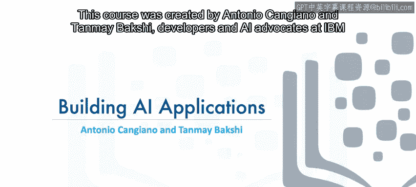

It also features contributions from their colleagues。

 Sophia Chai and Y Yao In this course you will learn how to integrate several artificial intelligence services to build smarter and more useful applications。

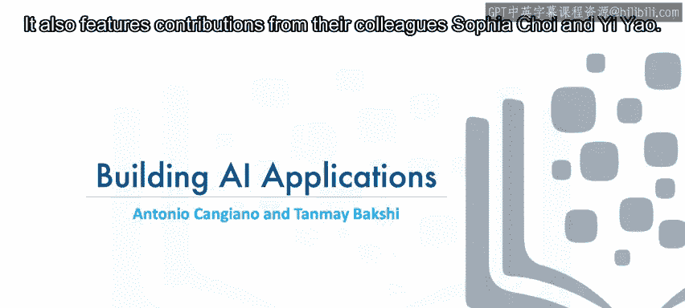

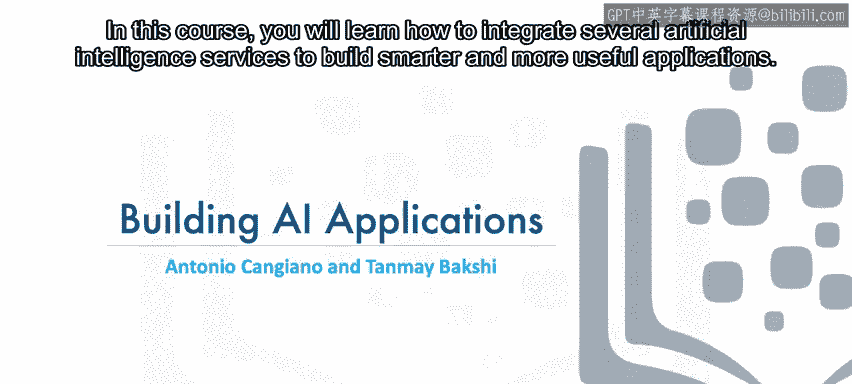

We'll do so by using IBM Watson services， but the fundamental principles apply regardless of which services you decide to use。

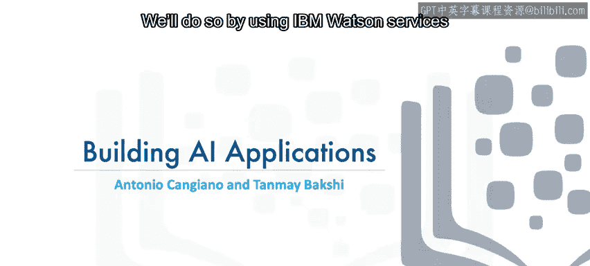

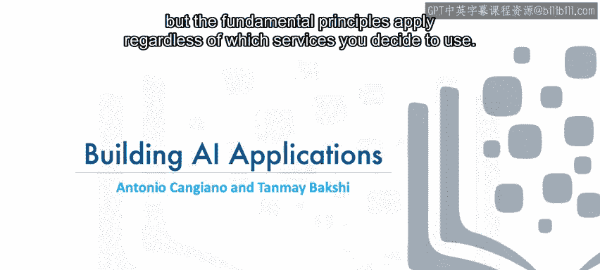

This course is part of our Coursera AI specialization。

 so having taken Antonio's building AI powered chatbots without programming course is a prerequisite。

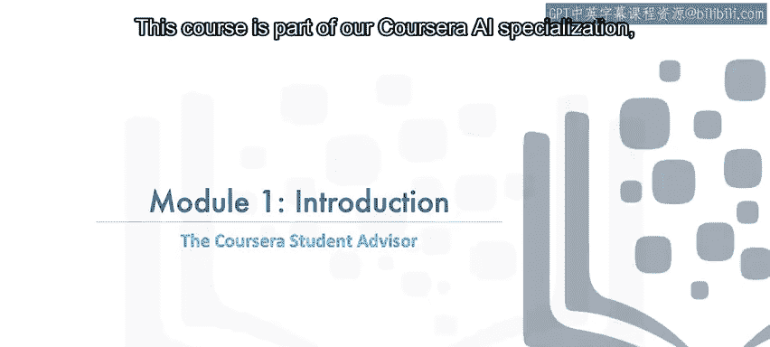

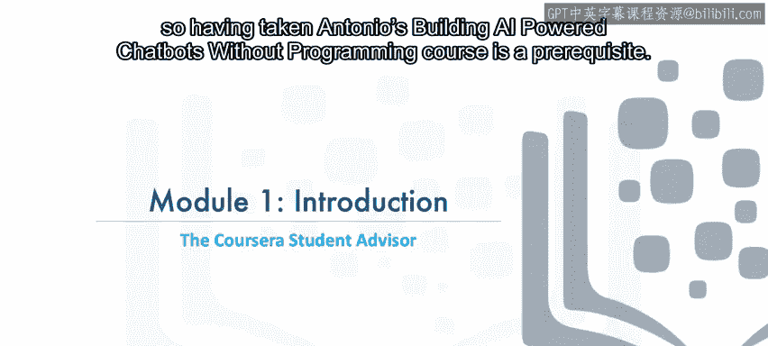

This course builds on top of the Watson As skills you acquired in that course。

 so if you haven't taken it already， consider pausing this one and enrolling in that prerequisite course first in this course we'll build a chatbot as well。

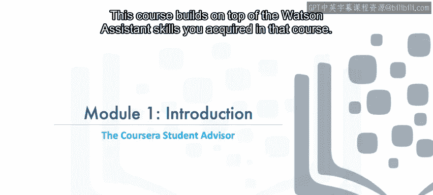

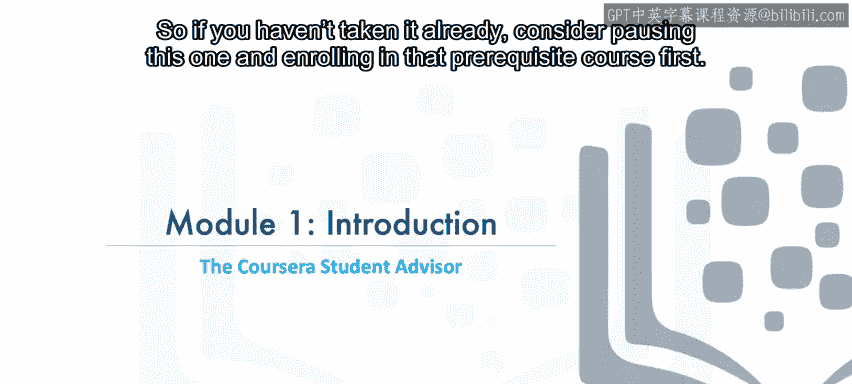

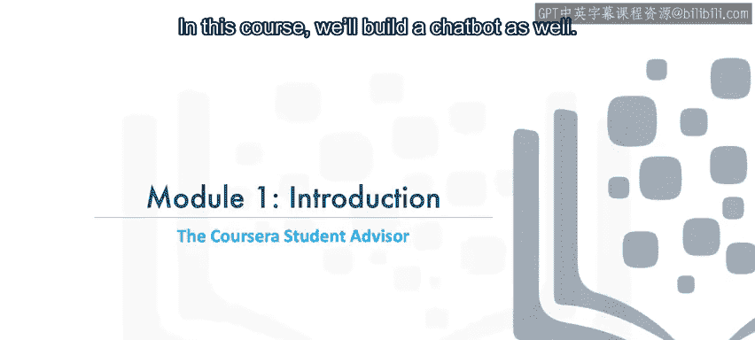

Only this time you'll learn how to create more useful and complex chatbots by integrating Watson Assant with other services available in the IBM Cloud catalog。

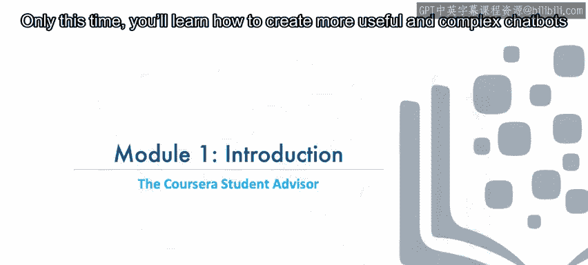

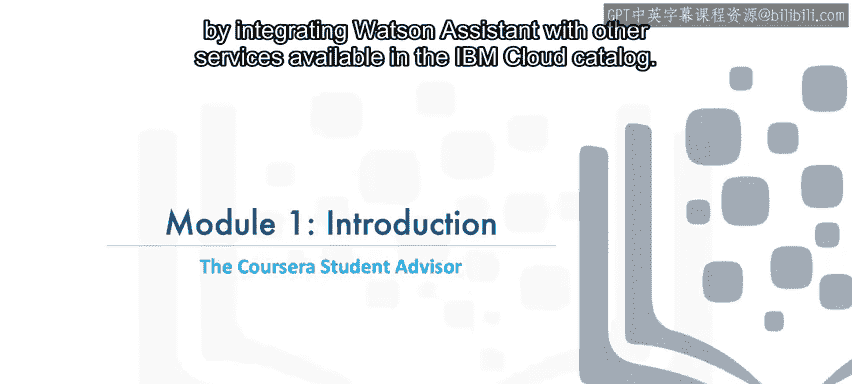

Specifically， we are going to teach you how to develop a student advisor that not only responds to the user with preset answers。

 but can use an existing knowledge base to fetch answers for the many possible questions students may have。

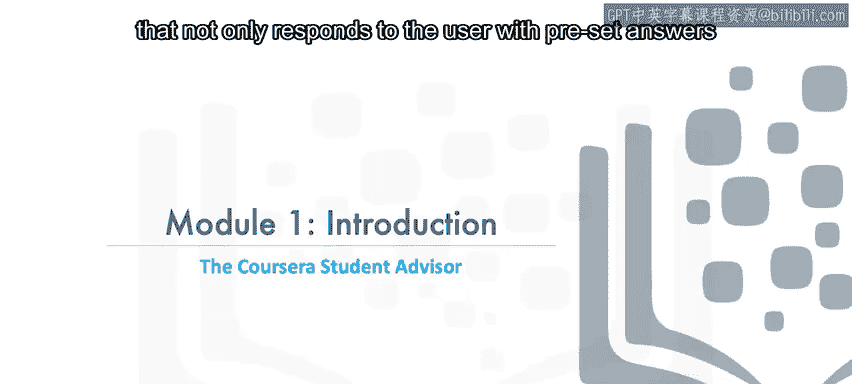

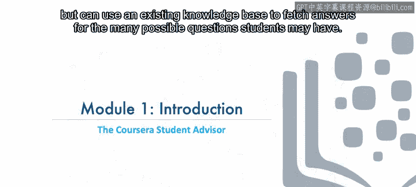

In the final project in moduleule 6， you will impress us with your newly acquired skills by developing a student advisor for Coursera itself。

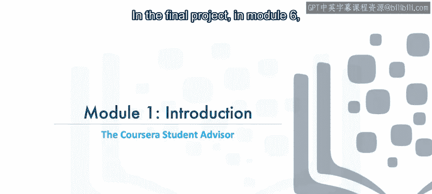

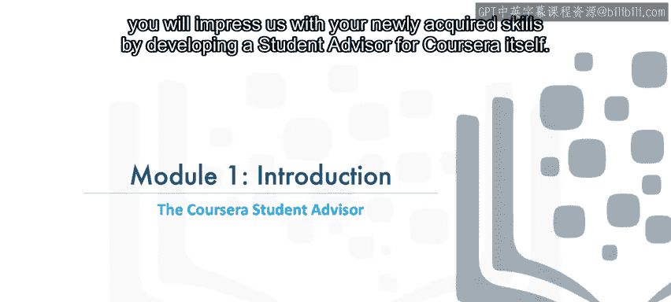

You may be wondering what the point of a student advisor chatbot is。

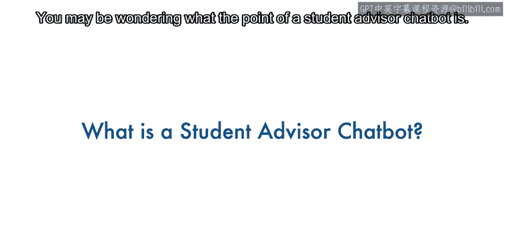

Successful mock platforms such as Coursera receive a lot of support questions from online learners like yourself。

A student advisor chatbot can provide answers to most questions。

 while still allowing escalation to a human customer care team for more complex inquiries that require manual intervention or extra care。

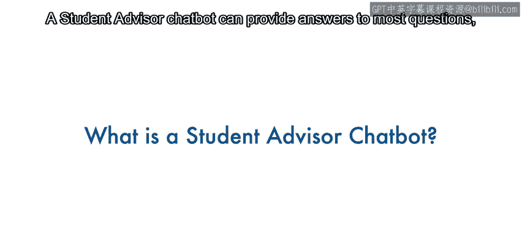

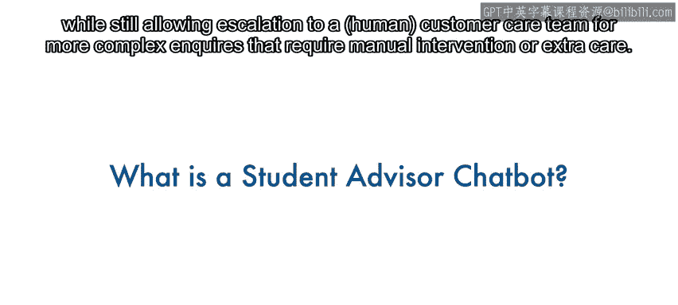

Students might have questions about the platform itself and its usage， for example。

 they might ask what's the difference between auditing a course and paying for it。

 online learners might also ask the chatbot for recommendations to improve their careers。

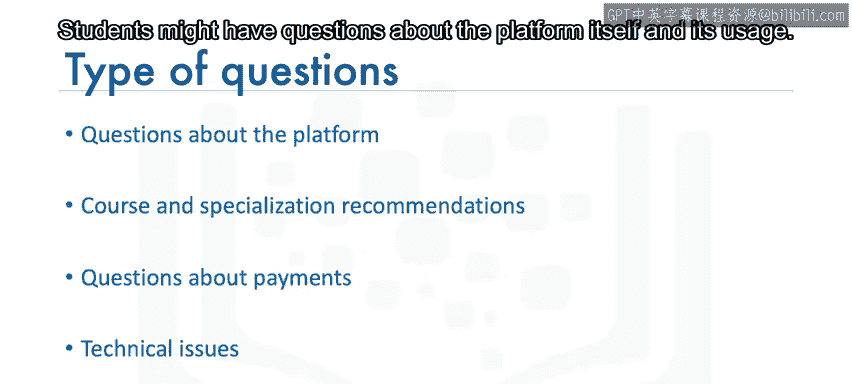

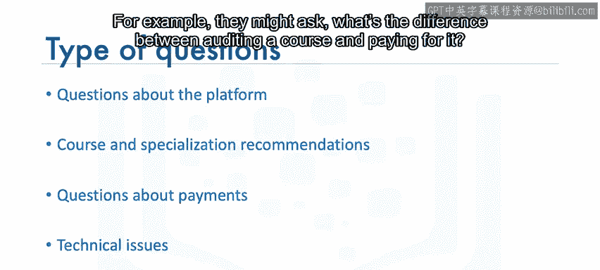

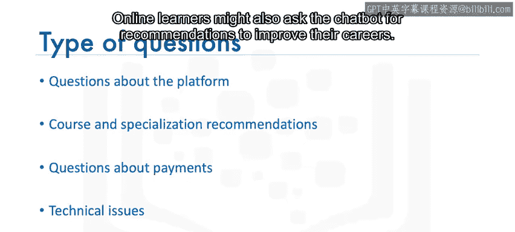

They might ask which course should I take to learn about chatbots or say I want to become a data scientist。

 it would be great if the chatbot was able to provide some guidance here。

 users might also be experiencing some technical issues and the chatbot can really cut down on the number of tickets that the human support team needs to handle。

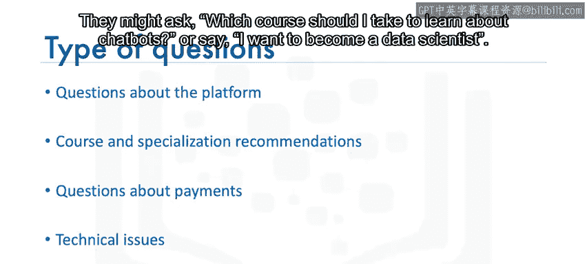

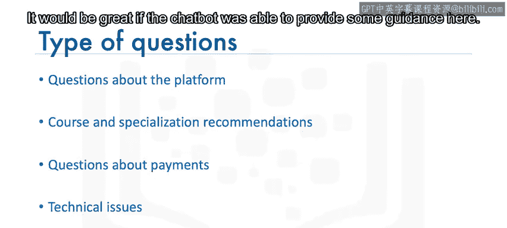

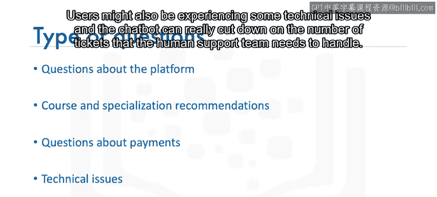

This allows us to scale customer care inexpensively while providing 24/7 answers to students。

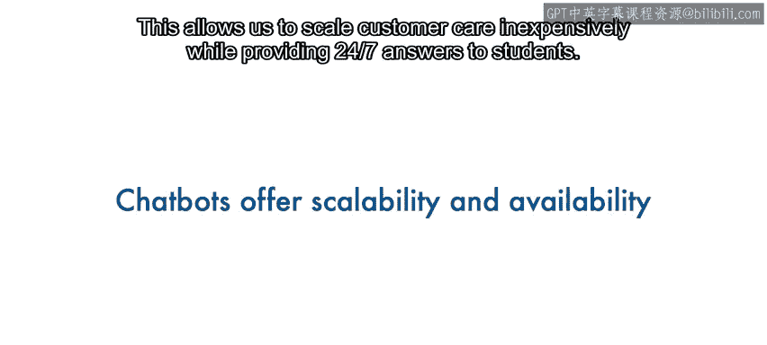

More importantly， the same skills can be applied to create chatbots for all sorts of businesses。

 not just mock platforms like Coursera。

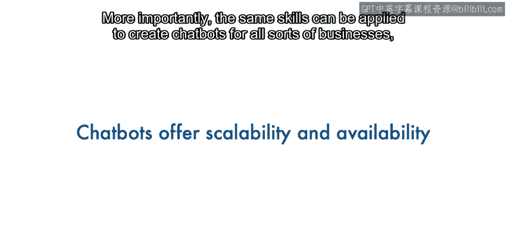

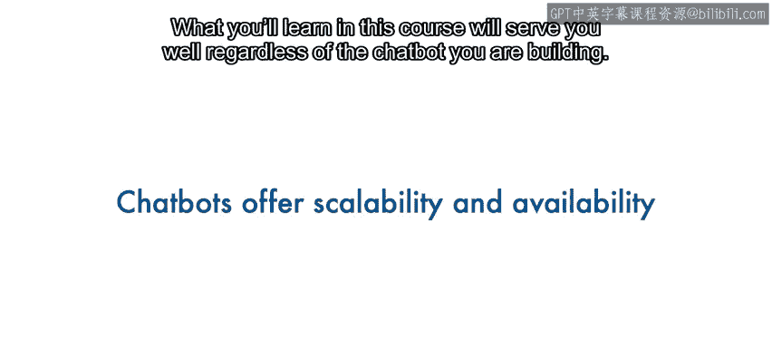

What you'll learn in this course will serve you well regardless of the chatbot you are building further。

 learning how to integrate various AI services will even pay off if you end up building applications that don't include a chatbot at all in the next video we'll discuss which AI technologies we are going to employ in this course。

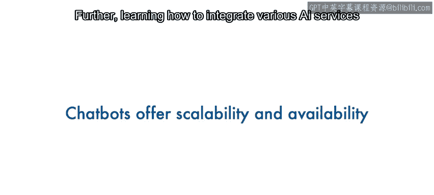

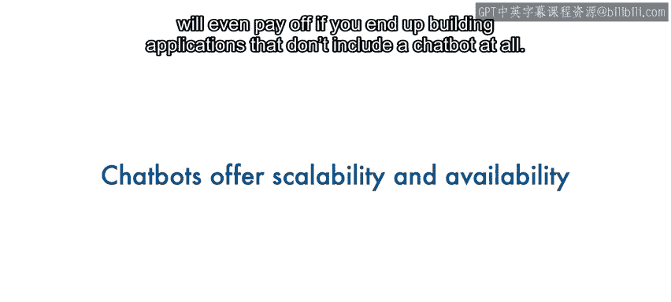

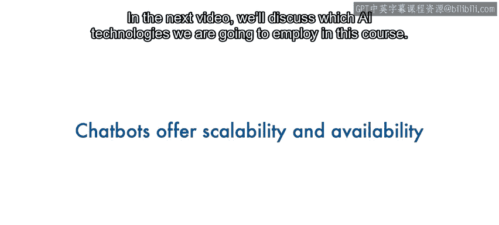