# IBM应用人工智能（从0开始搭建AI机器人）｜IBM Applied AI （中英字幕） - P109：2_使用Watson Assistant创建聊天机器人.zh_en - GPT中英字幕课程资源 - BV1p64y1H7LM

🎼。This module has two labs， one in which we'll create the basic chatbot for our student advisor。

 and one in which we'll add Watson Discovery responses to the chatbot。In this video。

 I'll show you what you'll do in the first of these two labs。As always。

 don't worry about following the steps right now， just focus on the video as you'll perform the same steps while taking the actual labs。

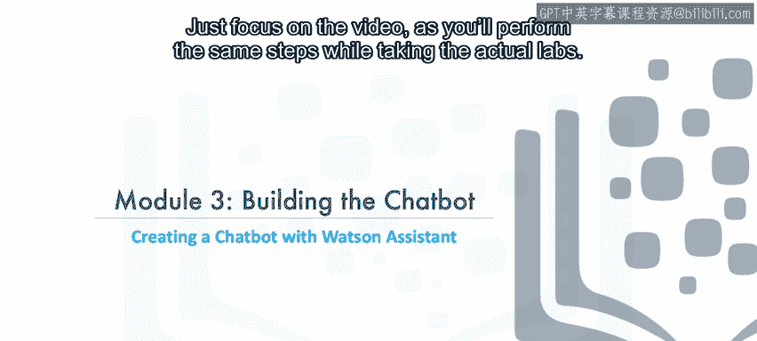

We'll start off by launching our Watson Assant instance。

Here we'll create a new assistant for our student advisor。

We'll give it the name Student Advisor Chabot， and we'll leave the preview link enabled so that we can quickly share the chatbot for testing purposes with friends and colleagues。

Now that we have an assistant， we'll add a dialogue skill to it。We'll simply call it student Advisor。

 and since our chatbot will be in English we'll ensure that the English language is selected。

With the dialogue skill created， we'll select the contenttent catalog。

Here we'll see a list of premade intents that are common to most chatbots and for various industries will add general to our skill so that our chatbot is capable of handling Chitchat。

A series of intents will be added to our list of intents。 They are all prefixed by general。

 making them easy to distinguish from the intents that we'll create ourselves。 On that note。

 let's create an intent。

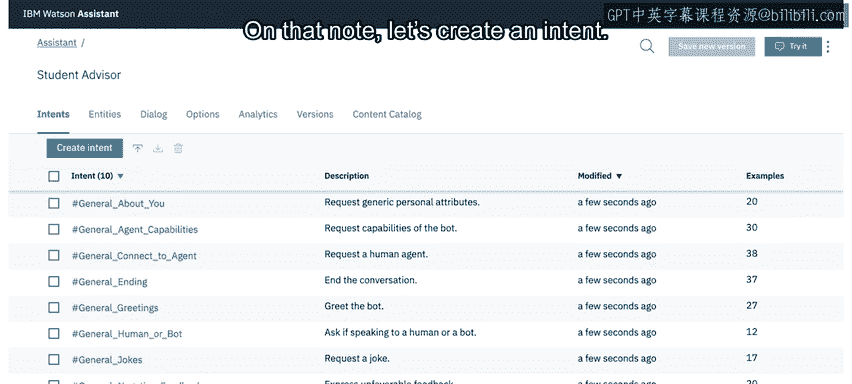

We'll call it enrollment cost and add a few examples of queries our students might have in relation to the cost of our courses。

Next， we'll create an intent to handle people who ask questions about Coursera's professional certificates。

As always， we'll add a few examples of the questions users might have， for example。

 which data Science certificateer？

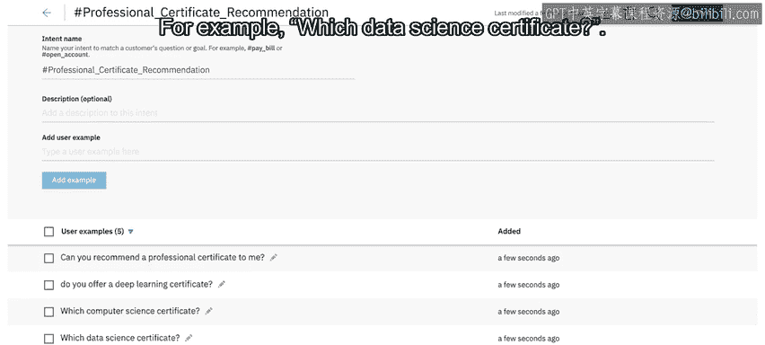

With the intents taken care of， we can now focus on adding some entities to capture specifics about the user input we'll create a professional certificate entity After all。

 there are only so many professional certificates available so it's okay for us to detect them all through an entity will add a value to the entity for each professional certificate as well as some synonyms so that data analysis and data engineering for instance。

 are also detected as examples of people inquiring about the data science certificate by the way。

 this very course is part of a new AI professional certificate that will be live by the time you watch this video make sure you check it out。

 we have our Chitchat Ins an intent for questions about costs and one about professional certificates along with an entity to distinguish between the various certificates available。

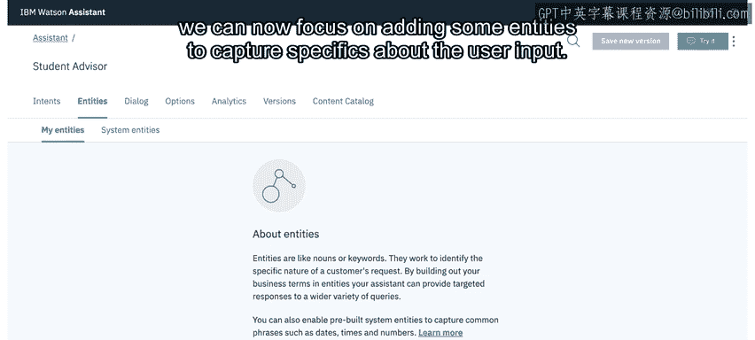

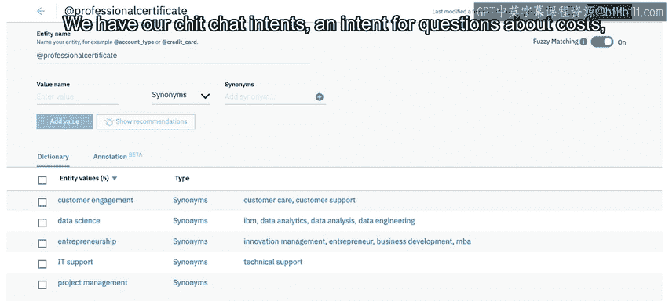

What we don't have yet is an intent for course recommendations， let's create that intent。

 we'll call itC recommendation and add some examples such as I want to learn Python。

 or recommend me a course on nutrition。

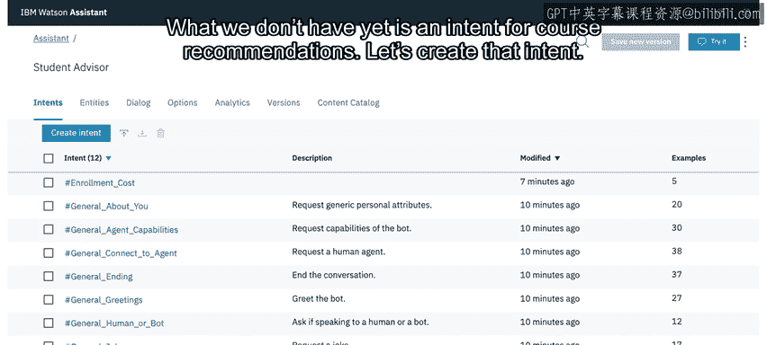

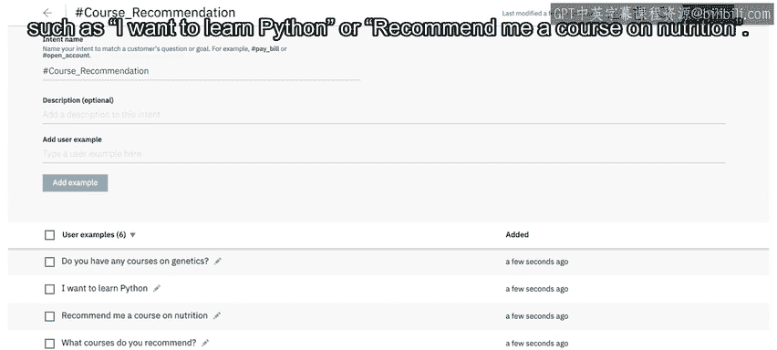

Now that we are done with our basic intents and entities， it's time to create the dialogue。

The Wecome and Anything else node will be created by default for us。

We'll edit the welcome node to improve the chatbot prompt。In the response we'll add， hello。

 I'm a student advisor chatbot， I can help you with your questions about our site and give your course recommendations。

 now we'll need to handle at least some basic Chit chat interactions and to keep the chat bot nice and organized。

 we'll add a folder just for Chit chat nodes。This folder is a container to keep us more organized so we don't need to specify a condition。

Next we'll add a node to the folder， we'll start off with a greetings node which uses our general greetings intent。

 we'll repeat the process for another child node。This one is for thank yous from the user。

 we'll use the general positive feedback intent as a condition for the node and provide some typical responses to be selected randomly each time by the chat bot。

 for example， you're very welcome or no problem。Finally。

 we'll add our third child node to the Chitchat folder。This node will handle goodbyes。

 the condition will be the intent general ending， and the responses will be a series of goodbye variations。

 such as see you have a great day。The chatbot can now greet the user， handle basic Chitcha。

 and thanks to the Anything else node can inform the user when it fails to understand them；

 It's not much， but our chatbot is clearly starting to take shape。

After collapsing the Chit chat folder， we'll be able to select the welcomee node and add a node below it。

This node will handle enrollment cost inquiries and will therefore have an enrollment cost intent as its condition。

 and an appropriate explanation in its response。Next we'll select the enrollment Cost node we just created to create another node below it。

This node you guessed it， will handle professional certificate recommendations and requests；

 the conditions for the node to be executed is the professional certificate recommendation intent。

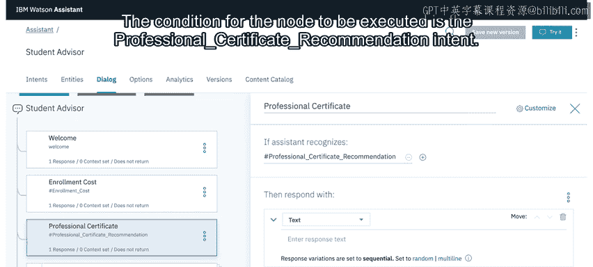

The response will depend on the type of professional certificate the user asked us about。

 so we'll need to customize the node to switch from a regular text response to a conditional multiple response。

 with multiple responses enabled， we'll be able to provide a specific response for each professional certificate entity value available。

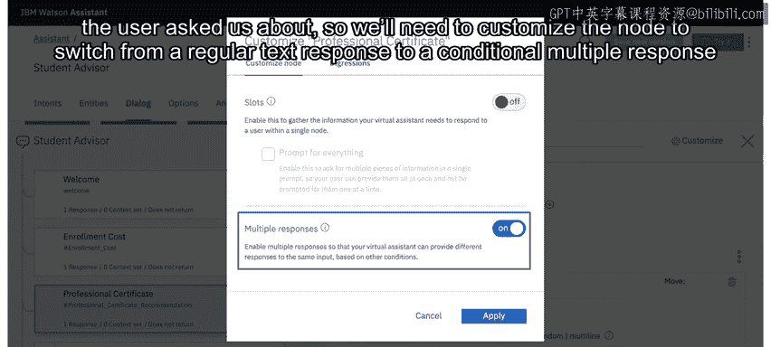

Finally， we'll have a response whose condition is true and it will act as our fallback case this response will provide a link to the page on the Coursera site。

 which lists all professional certificates。We'll repeat the process for our third and last domain specific node。

 namely our courses node。For this node we' set the condition to the course recommendation intent and leave the response empty for now In fact。

 the Coursera catalog has just too many courses to hardcode in responses for each of them instead we programmatically access to a list of relevant courses by leveraging discovery in La 4 later in this module as a quick sanity test we can launch the try itout panel and verify that the chatbot responds correctly to a sample query such as can you recommend a professional certificate Now it's your turn in the next lab you'll repeat these steps yourself by the end of the lab you'll have the same barebone chatbot as the one you saw in this video Good luck。

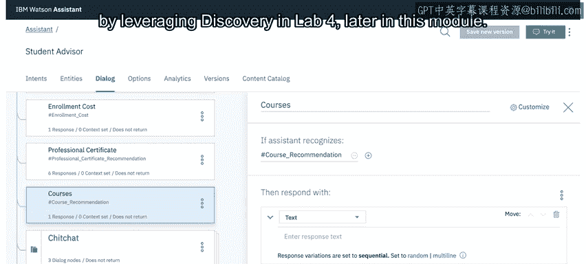

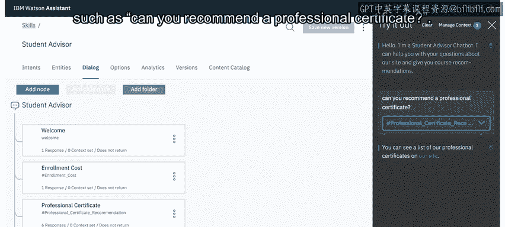

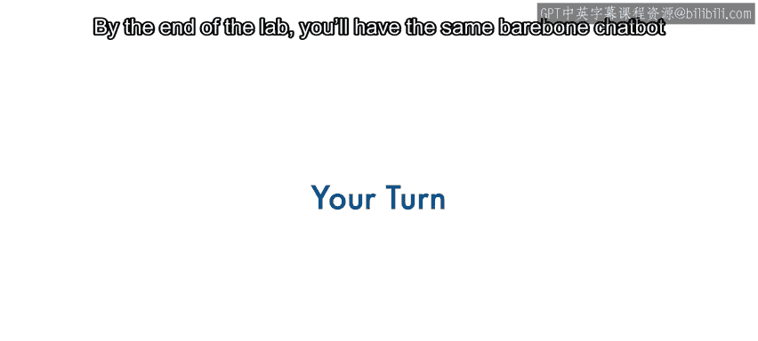