# IBM应用人工智能（从0开始搭建AI机器人）｜IBM Applied AI （中英字幕） - P111：4_添加Watson语音服务.zh_en - GPT中英字幕课程资源 - BV1p64y1H7LM

🎼。In this video we'll discuss the steps you'll take in the lab within this module for now。

 just focus on understanding the concepts and don't worry about actually reproducing the steps。

 you'll do so next in the lab。

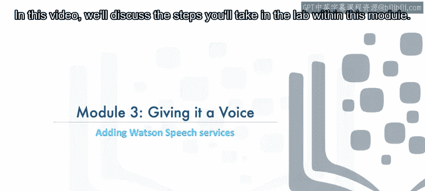

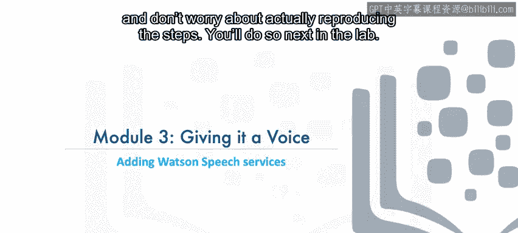

The goal of Lab 5 is to help you integrate Watson's speech services with the assistant you've created。

 The architecture here is very simple。 You need user input via audio to get it。

 the Watson speech text service will transcribe an audio recording from the user then this text can be passed to the assistant to figure out what Watson's response Finally。

 Watson's response can be synthesized with the text to speech service together the user input you're going to have a while loop with an empty body that will only break once the user records some audio and stores it in the current working directory then it'll send the audio to Watson get a response and return it。

 the implementation of this function is simple Python will conduct a while loop with a pass which will only exit once the user records their voice then Watson's JO will be parshed to return the transcript that Watson's most confident in This text is then passed to the assistant service。

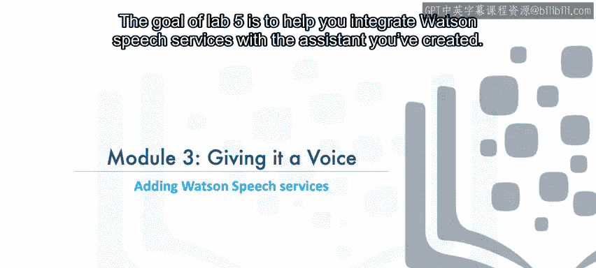

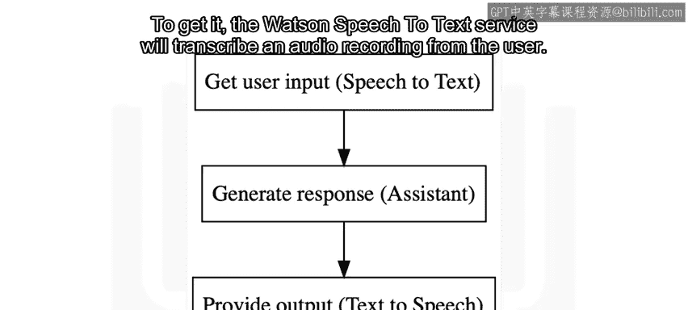

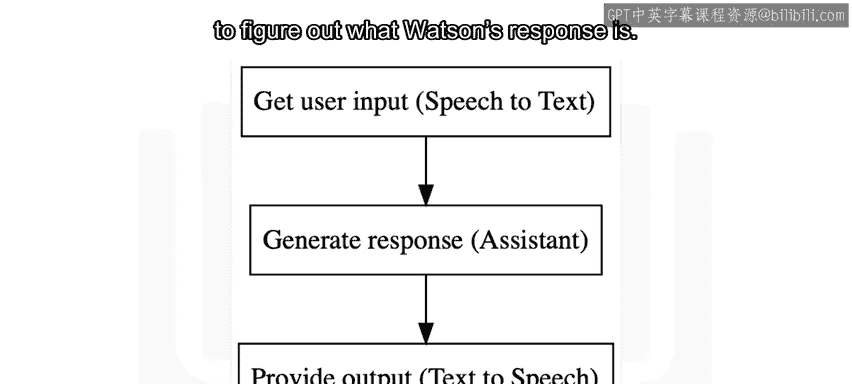

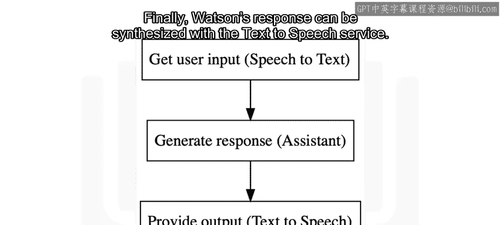

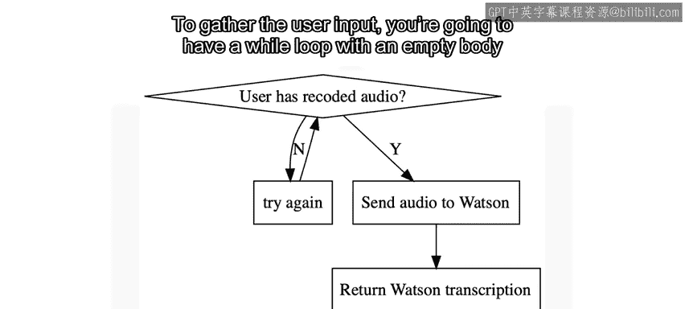

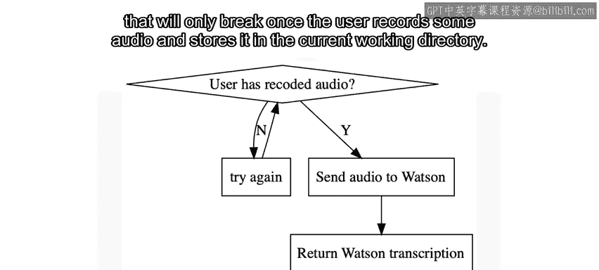

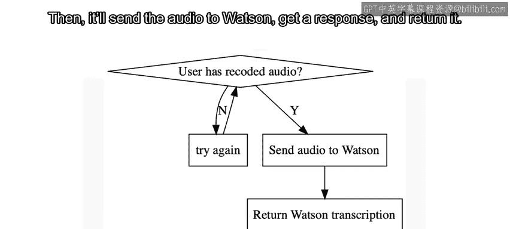

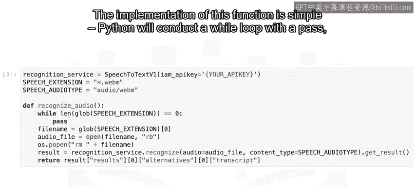

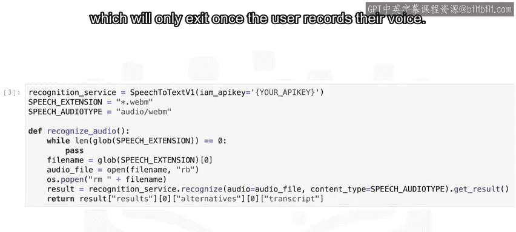

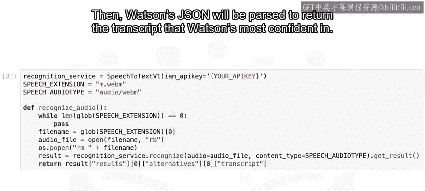

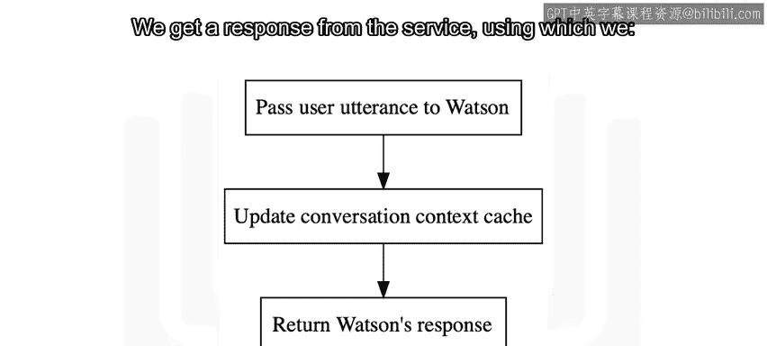

We get a response from the service， using which we one update the conversation's context to make sure we can keep track of what's happening。

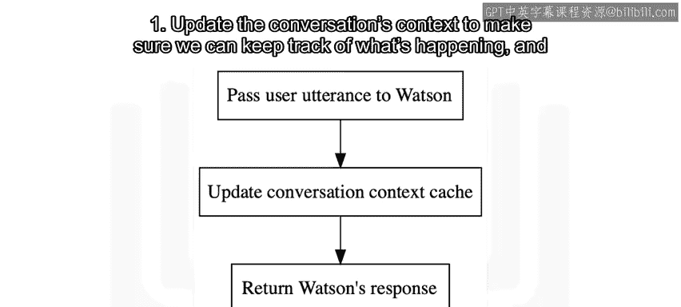

And2， we get a response for the user。 The current context is kept as a global variable and will always be the latest context。

 It's updated from Watson's Json response Every time the user sends a message and gets a response。

 The response is fed into the text to speech service and the synthesized audio is played for the user Since this is running on a Jupyter notebook the way this audio is run is through the ipyython dot display do audio module it's set to autoplay That way the user doesn't need to play the audio file explicitly。

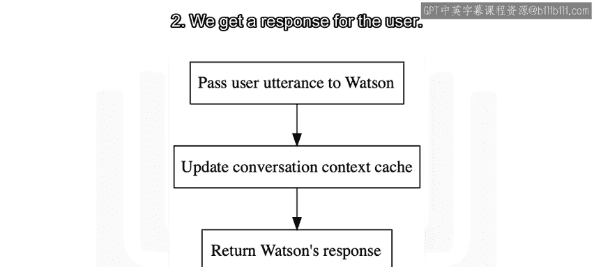

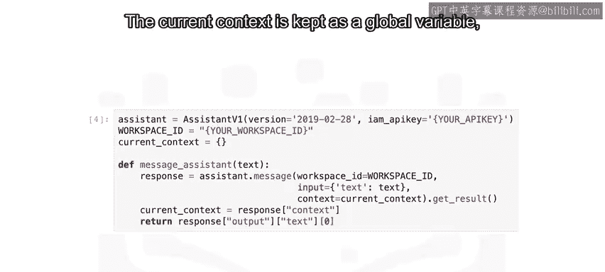

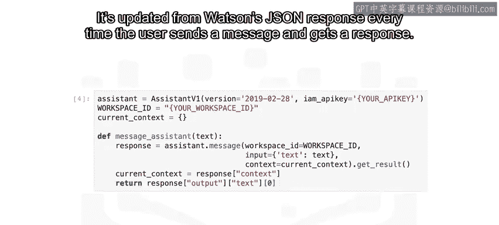

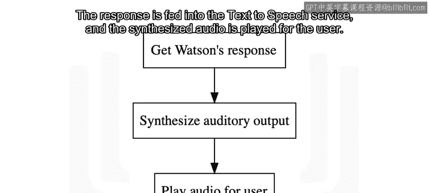

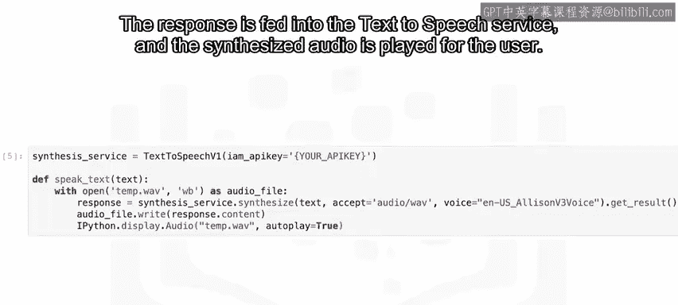

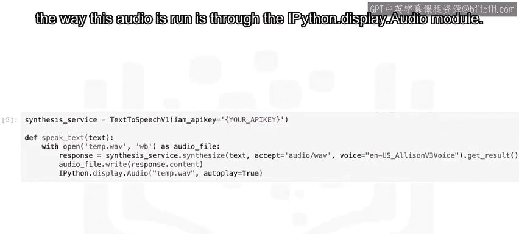

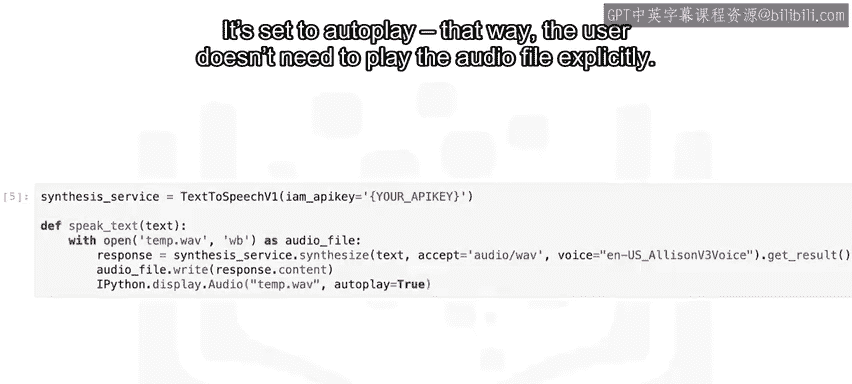

Finally， you will run the main loop， this main loop will wait for the user to record their audio。

 then get the transcript， feed it into assistant， log the context。

 feed the response to text to speech and finally speak Watson's response to record your voice through Jupiter Lab you'll click the palette tab on the left of your screen and select Record audio This will pop up a new window with a microphone icon once you click the button。

 your audio will start being recorded when you're done click the stop button。

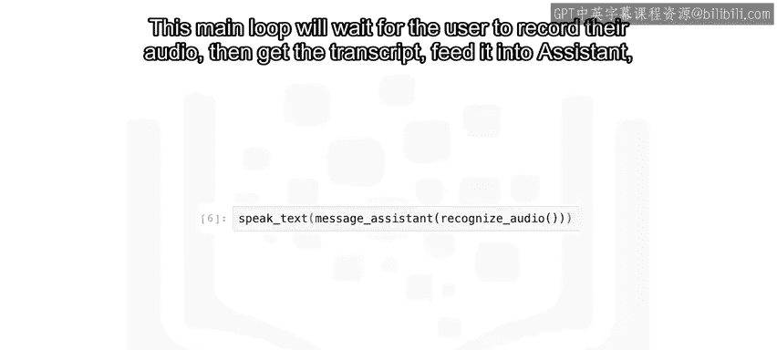

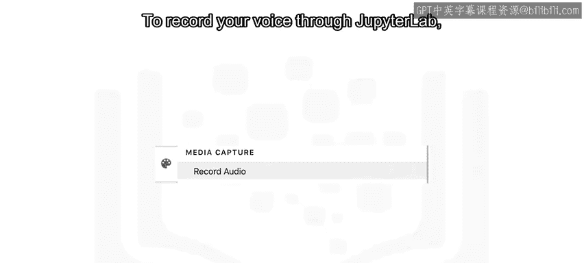

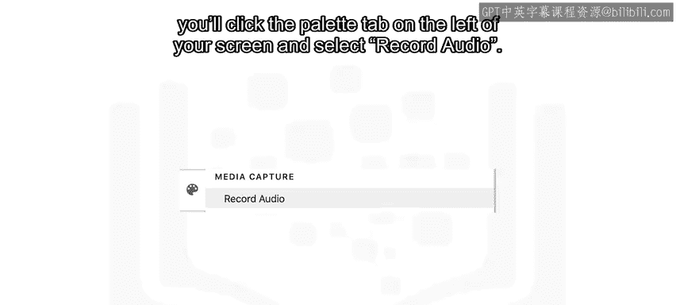

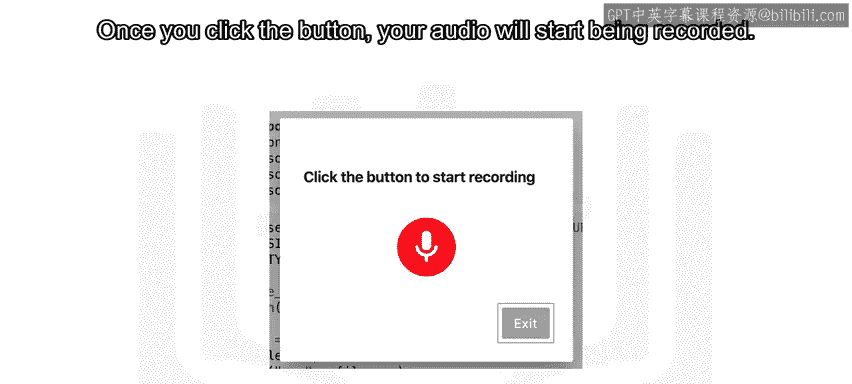

There should be a webM file in the current working directory。 Now it's your turn。

 Remember the code you're about to see is simple， which is great。

 but this is really a trivialization of an extremely difficult concept。

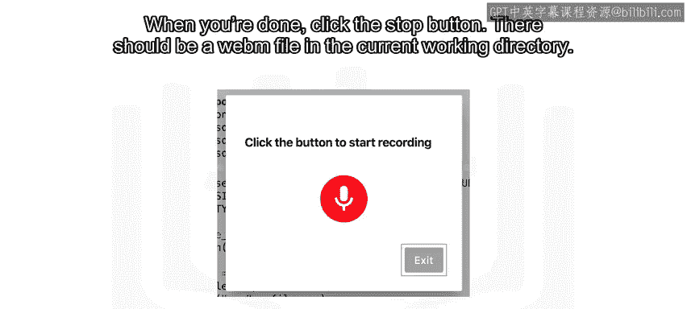

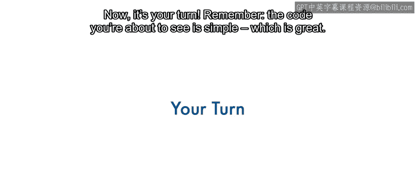

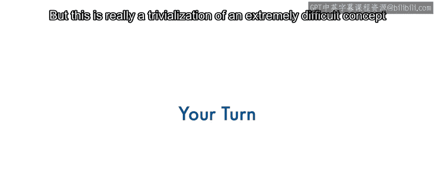

End to end， speech based communication with a computer。 Let's get started。

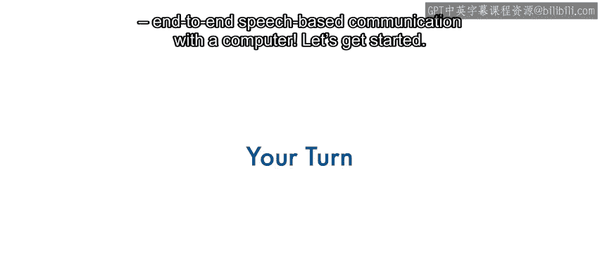