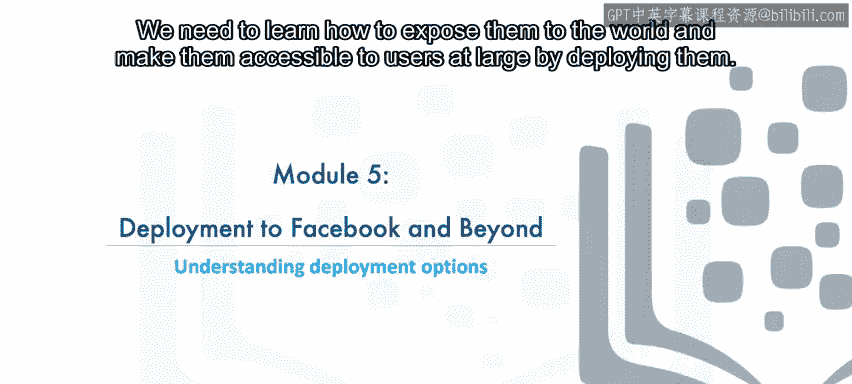
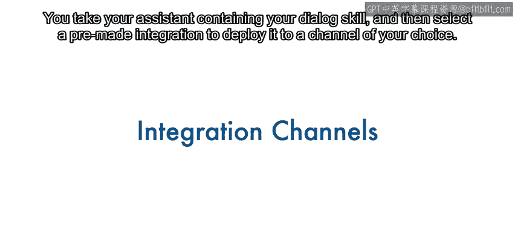
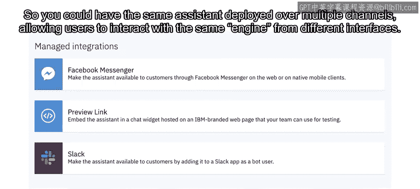
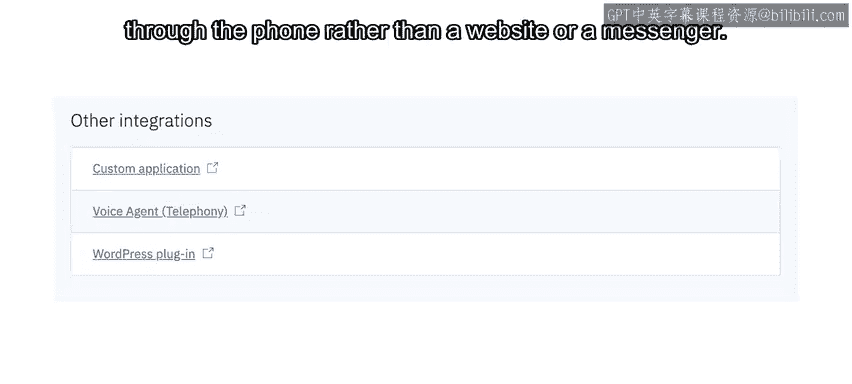
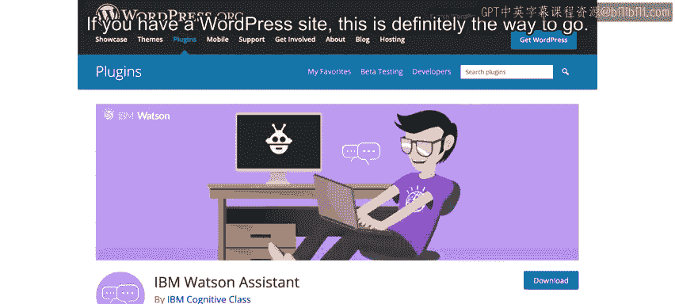
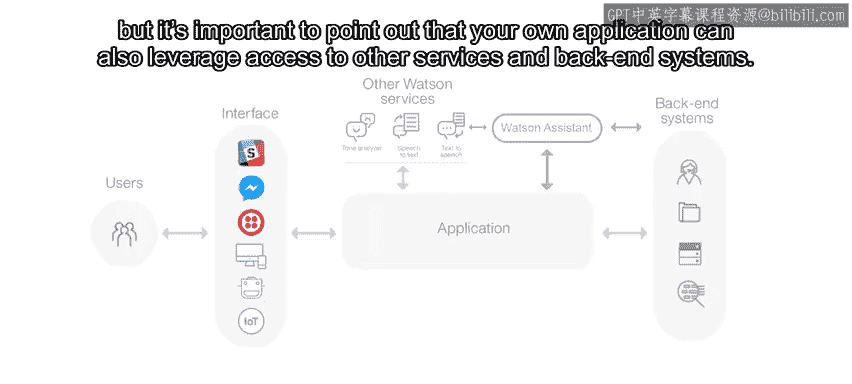
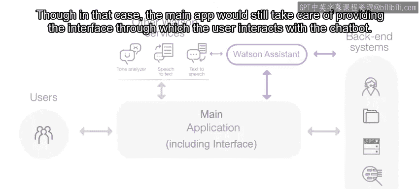
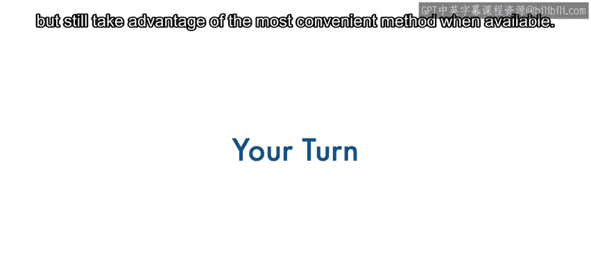

# IBM应用人工智能（从0开始搭建AI机器人）｜IBM Applied AI （中英字幕） - P112：5_了解部署选项.zh_en - GPT中英字幕课程资源 - BV1p64y1H7LM

🎼。Welcome to moduleule 5 of this course， We are in the home stretchch。By now。

 you should know significantly more about how to integrate different services to build AI powered chatbots。

 The same principles apply if you are not building a chatbot but a more general application。

 so the skills you're learning will serve you well no matter what you decide to implement next。

What is left to do is discuss deployment options。It's great that you can create Watsson Assant chatbots that integrate with other services。

But it won't do you or your business any good if they are locked within your account。

 we need to learn how to expose them to the world and make them accessible to users at large by deploying them。

Intigrationations are one of the easiest way to deploy your Watson Assistant chatbot。

You take your assistant containing your dialogue skill and then select a premade integration to deploy it to a channel of your choice。

You've already seen one prem integration in this course when we discussed preview links。

 there are several other integration channels available， including Facebook Messenger。

 Slack and Intercom。Though it's worth noting that intercom is only available to plus and premium users。

 so you won't see it as an option within your light instance of Watson Systems。

These integrations greatly simplify the process of connecting Watson assistantsant to interfaces like Facebook Messenger and Slack。

It's important to think of Watson assistantsant as the conversation engine as opposed to the interface itself。

 the user will be able to type in their message in say， Facebook Mesenger。

 and that input will be sent to Watson assistantant who will provide a response and send it back where Messenger will ultimately display it to the user。

 so you could have the same assistant deployed over multiple channels。

 allowing users to interact with the same engine from different interfaces。

Along with managed integration channels， we also have a few more options to deploy assistance。

We've already discussed voice agentging in the previous module。

This deployment method enables your customers to talk about your chatbot through the phone rather than a website or a messenger。

Wordpress is another popular one thanks to our fully equipped plugin it's dead simple to deploy your chatbot on Word sites you install the plugin with one click。

 activate it with another click and copy over your Watson assistant credentials done you have a nice chat box pop up on your Word site it's arguably the easiest way to deploy a Watson assistant chatbot to a website today the pluginin is also full of options so you can customize virtually everything about the chat box interface through which your users interact with the chatbot if you have a Word site this is definitely the way to go okay but what happens if you want to deploy your chatbot to an interface or messenger for which no managed integration or plugin exists conceptually this is quite simple Watson assistant is available through an API。

So you just need a proxy application that acts as an intermediary。

This application will collect input from the interface， say a messaging app。

 and send it to Watsson assistantant through an API call。Once a response is obtained。

 the proxy app will send it to the interface to display it back to the user。

This approach can even be taken with channels for which integration exists， like Facebook and Slack。

 it's just that using the prem integration is much more convenient。

 understanding how to roll your own is important， however。

 so as to ensure that you can always integrate Watson assistant with whichever channel you prefer。

As you know by now， Watson assistantsant can make calls to other services directly from dialogue nodes。

 but it's important to point out that your own application can also leverage access to other services and backend systems。

This can give you a great degree of flexibility。In some cases。

 there might not be a distinction between the interface and your application。

Because you are simply adding a chatbot to your own web or mobile app。

 rather than deploying the chatbot to a third party channel。For complex scenarios。

 it's also possible to have your application communicate with a proxy application anyway to keep concerns separate this way。

 your proxy app is solely focused on communicating with Watson assistantant。

 while the main app concerns itself with the actual features the app is supposed to provide to the user。

 though in that case the main app would still take care of providing the interface through which the user interacts with the chatbot in the labs for this module will show you how to work with managed integrations as well as how to take the proxy app approach to deployment。

This way you'll be able to deploy your chatbots to any channel。

 but still take advantage of the most convenient method when available。

