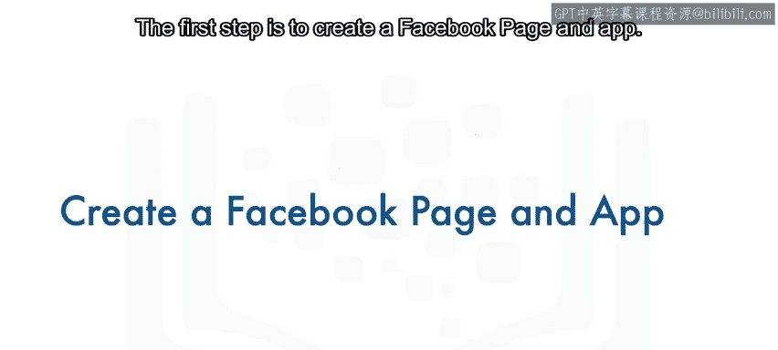
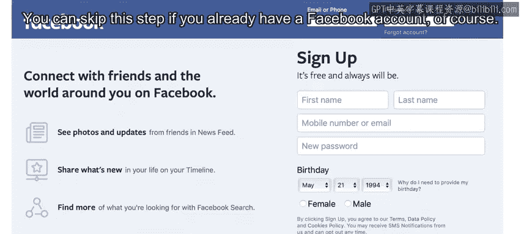
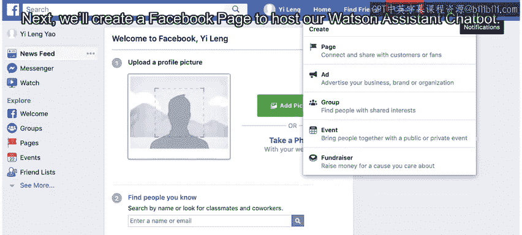
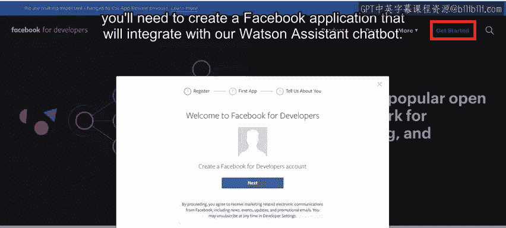
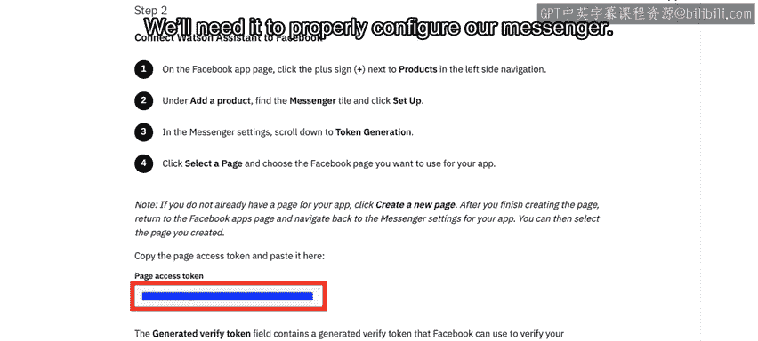
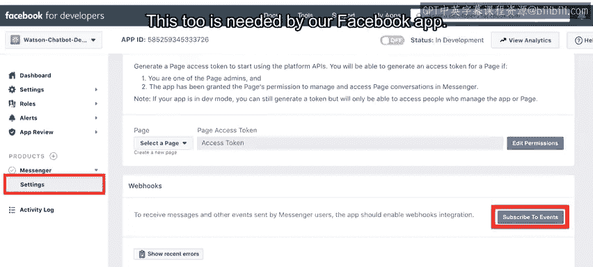
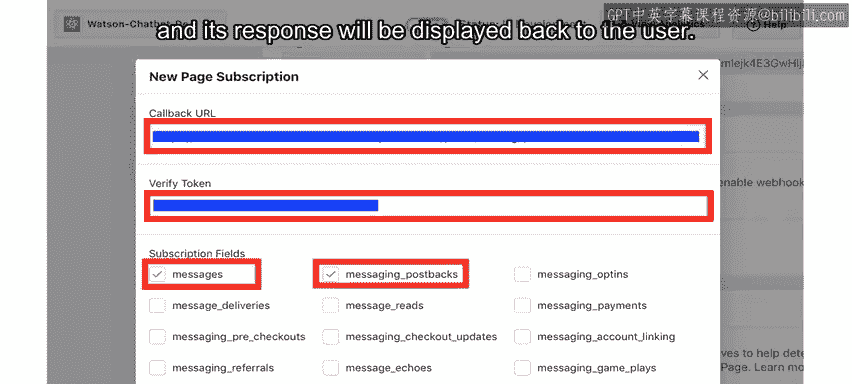
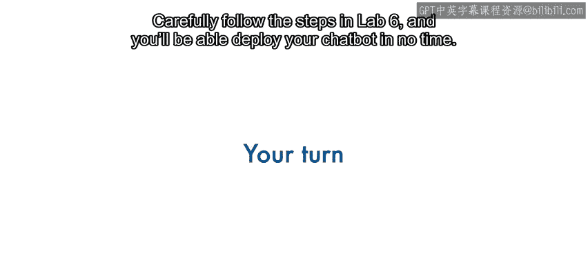

# IBM应用人工智能（从0开始搭建AI机器人）｜IBM Applied AI （中英字幕） - P113：6_将您的聊天机器人部署到Facebook Messenger.zh_en - GPT中英字幕课程资源 - BV1p64y1H7LM

🎼。For this lab， you will integrate the basic chatbot that we built in the previous modules of this course with Facebook Messenger。

 the first step is to create a Facebook page and app will need a business page in order to deploy your chatbot to Facebook。

At first， we need to sign up for a Facebook account。

 You can skip this step if you already have a Facebook account， of course Next。

 we'll create a Facebook page to host our Watson Asant chatbot。

Now that you created your Facebook page， you'll need to create a Facebook application that will integrate with our Watson Assistant chatbot。

To do so， you'll need a Facebook forDevelop account。Once you do， you can create your Facebook app。

You'll be asked to select a scenario。For our purposes， these don't apply。

 so feel free to skip this step。In order for your Watson Chabot to connect to your Facebook app。

You'll need the app secret for your Facebook app。This is found in the basic section of your app settings。

Now we need to connect Watson assistantant to our Facebook page。

 we'll do so from the products section。Specifically， we'll add Messenger to our app。

We'll edit the permission to allow Messenger to access our app。

And then select the page we want to integrate with。

Generate the page access token for your Facebook page。With these credentials。

 namely App Se and page access token， we can integrate our messsenger with Watson Assant。

Launch your Watson Assistant instances and select the Assistance section here you'll want to add an integration。

Here we'll select Facebook Messenger。Paste the app secret credentials of your Facebook app into the application Se box。

Paste the page Access token from your Facebook app in the Page Access token box。

And then make note of the generated Ver token。Well needed to properly configure our messenger。

We'll also need to generate a callback URL and make note of it。This， too。

 is needed by our Facebook app。

Back in Facebook， the settings of our Mesenger allow us to subscribe to events。

Here we'll be able to paste the callback URL and verify token we got from Watson Assistant and select Mes and messaging postbacks as subscription fields。

This ensures that user messages will be passed along to Watson Assistant。

And its response will be displayed back to the user。

We'll also want to select the page we want to monitor for such events。At this point。

 our Watson Assistant chatbot will be integrated with Facebook Messenger。

You'll be able to test your chatbot by using Messenger on your Facebook app page to do so， however。

 you'll first need to add yourself as a tester。In the lab。

 we provide you with extra steps required to make it available to general public once you're happy with the way the integration works。

Now， it's your turn to make it happen。Carefully follow the steps in La 6。

 and you'll be able to deploy your chatbot in no time。

