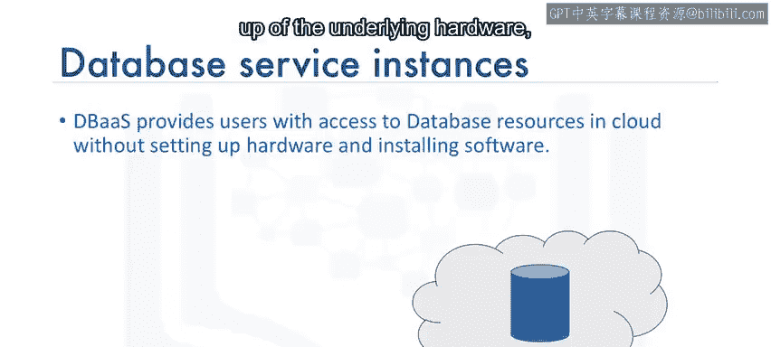
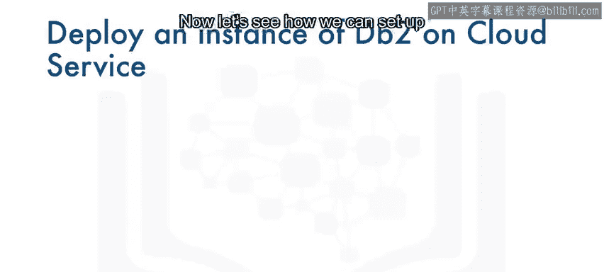
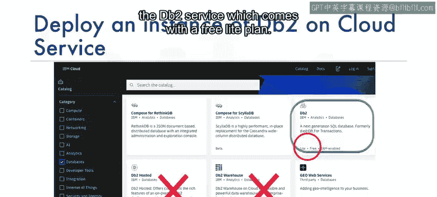
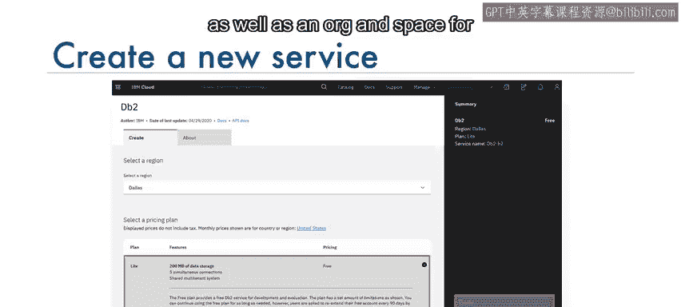
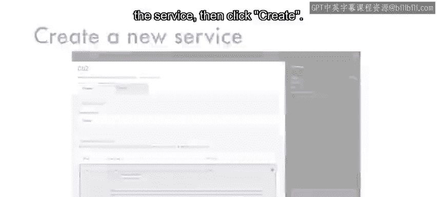
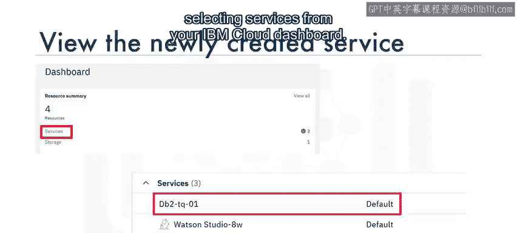
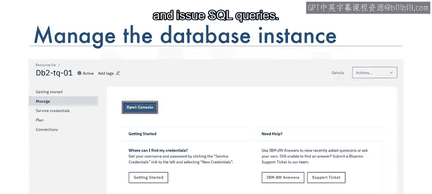
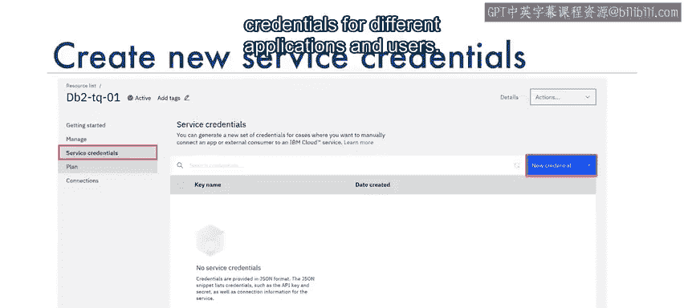
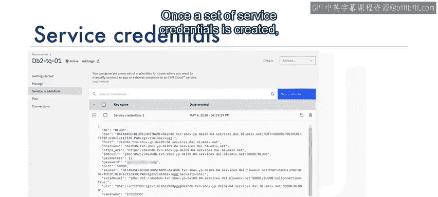
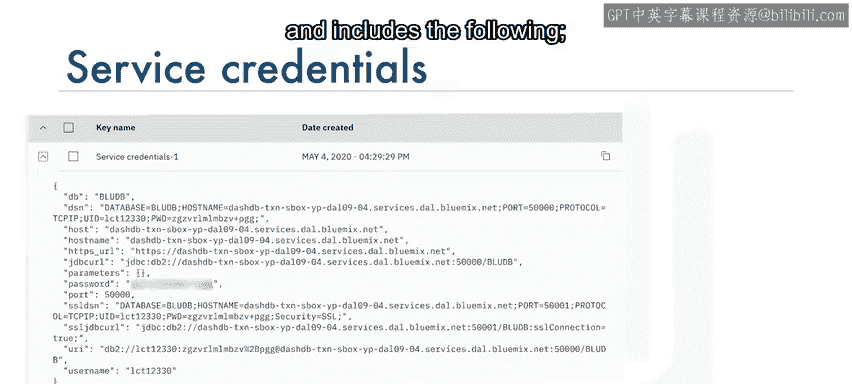

# IBM应用人工智能（从0开始搭建AI机器人）｜IBM Applied AI （中英字幕） - P115：8_如何在云上创建数据库实例.zh_en - GPT中英字幕课程资源 - BV1p64y1H7LM

。Hello and welcome This video will cover the key concepts around databases in the cloud In order to learn SQL。

 you first need to have a database available to practice your SQL queries an easy way to do so is to create an instance of a database in the cloud and use it to execute your SQL queries。

After completing this lesson， you will be able to understand basic concepts related to cloud databases。

 list a few cloud databases， describe database service instances。

 as well as demonstrate how to create a service instance on an IBM DB2 on cloud。

A cloud database is a database service built and accessed through a cloud platform。

 It serves many of the same functions as traditional databases with the added flexibility of cloud computing。

Some advantages of using cloud databases include ease of use users can access cloud databases from virtually anywhere using a vendor's API or web interface or your own applications。

 whether on cloud or remote scalability。Cloud databases can expand and shrink their storage and compute capacities during runtime to accommodate changing needs and usage demands。

 so organizations only pay for what they actually use disaster recovery in the event of a natural disaster or equipment failure or power outage。

 data is kept secure through backups on remote servers on cloud in geographically distributed regions。

A few examples of relational databases on cloud include IBM DB2 on cloud databases for PostgresqL on IBM Cloud。

 Oracle database cloud service， Microsoft Azure SQL database and Amazon relationlational database services。

 these cloud databases can run in the cloud， either as a virtual machine which you can manage or delivered as a managed service depending on the vendor。

 The database services can either be single or multitenant depending on the service plan。

To run a database in cloud， you must first provision an instance of the database service on the cloud platform of your choice。

 an instance of a database as a service or DBAA provides users with access to database resources in cloud without the need for setting up of the underlying hardware。

 installing the database software and administering the database。

 the database service instance will hold your data in related tables。

 Once your data is loaded into the database instance。

 you can connect to the database instance using a web interface or APIs in your applications。

Once connected your application can send SQL queries across the database instance。

 the database instance then resolves the SQL statements into operations against the data and objects in the database。

Any data retrieved is returned to the application as a result set。

Now let's see how a database instance is created for DB2 on Cloud。

IBM DB2 on Cloud is a SQL database provision for you in the cloud。

You can use DB2 on cloud just as you would use any database software。

 but without the overhead and expensive hardware setup or software installation and maintenance。

Now let's see how we can set up a service instance of DB2。

Navigate to IBM Cloud catalog and select the DB2 service Note。

 there are several variations of the DB2 service， including DB2 hosted and DB2 warehouse。

 For our purposes， we will choose the DB2 service， which comes with a free light plan。

Select the light plan if need to change the defaults， you can type a service instance name。

 choose the region to deploy to， as well as an org and space for the service， then click createate。

You can view the IBM DB2 service that you created by selecting services from your IBM Cloud dashboard。

From this dashboard， you can manage your database instance， for example。

 you can click on the open console button to launch the web console for your database instance。

 The web console allows you to create tables， load data， explore data in your tables。

 and issue SQL queries。

In order to access your database instance from your applications。

 you will need the service credentials for the first time around。

 you'll need to create a set of new credentials， you can also choose to create multiple sets of credentials for different applications and users。

Once a set of service credentials is created， you can view it as a J snippet。

 The credentials include the necessary details to establish a connection to the database and includes the following。

 A database name and port number， a host name， which is the name of the server on the cloud on which your database instance resides。

 a user name， which is the user I D you'll use to connect along with the password。

 Note that your username is also the schema name in which your tables will be created by default。

Now that you know how to create a database instance on cloud。

 the next step is to actually go and create one。 Thank you for watching this video。😊。

