# IBM应用人工智能（从0开始搭建AI机器人）｜IBM Applied AI （中英字幕） - P117：10_创建Discovery收集.zh_en - GPT中英字幕课程资源 - BV1p64y1H7LM

🎼。In this video we'll discuss the steps you'll take in the lab within this module。

 since you'll be taking these steps while taking the labs。

 you can simply focus on watching this video now rather than trying to recreate the steps as you watch。

The goal of Lab2 is getting you to become more familiar with Watson Discovery collections。

 as well as creating a collection for Coursera's course content。

 let's start with the first goal from our IBM Cloud dashboard。

 well want to click on services to show the list of services we have already instantiated。

 find your Discovery service in the list and click on its name。

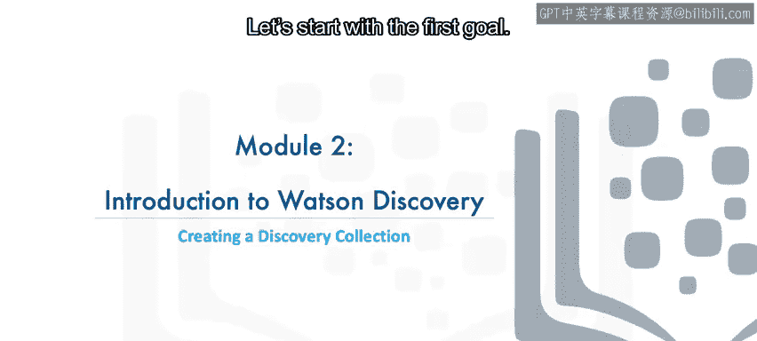

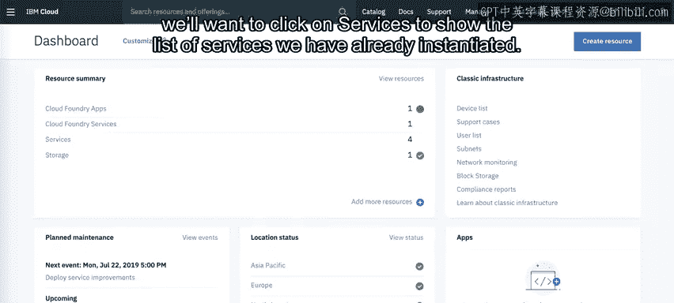

If you don't have a discovery instance in your account。

 go back to the lab1 in the first module of this course and follow the instructions to create one Next we'll need to launch the interface for the discoveryover instance by clicking on the launchun Watson Discovery button。

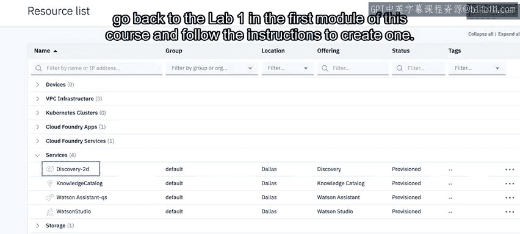

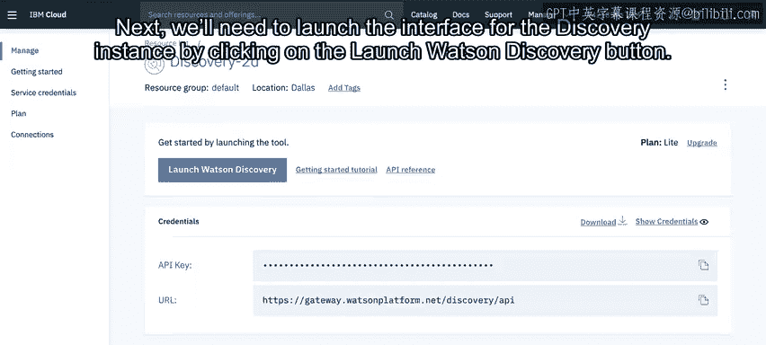

The interface will show us a default news collection that was automatically created for us。

 as well as two buttons to create collections from other sources or data we have on our local drive we can start by exploring the news collection we'll click on it the Watson Discovery New tile to open the collection。

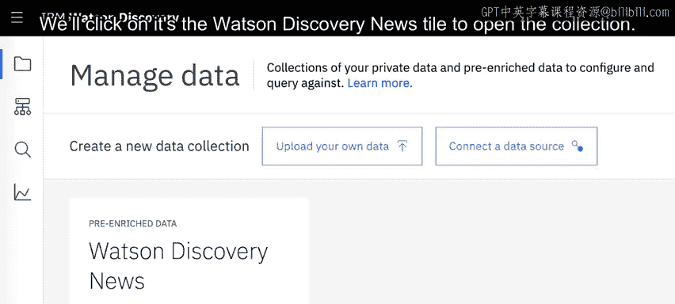

This collection is automatically added and managed for us。

 it includes millions of recent news articles from a multitude of publications in a variety of language。

 for example， my collection shows that 300，000 new articles per day are added in English alone These are articles are not just raw data Watson analyzes them and automatically adds useful metadata to classify the information within so that we can query the huge dataset。

In fact， to get started right away， we are given a few prebuilt queries on the right side of the screen。

Let's see what they look like by clicking Run under the first query about AI Company acquisitions。

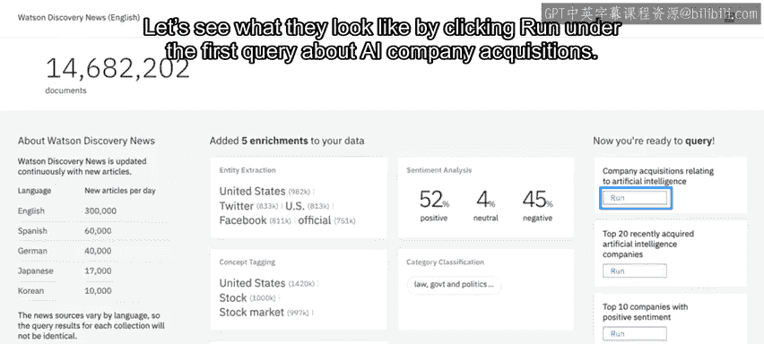

On the left side， you'll notice that this query was defined through the Discovery query language。

Other options include natural language and a handy visual mode。In rich underscore text。concepts。tt。

 artificial intelligence is the discoveryy query language way of saying that we want all the documents that Watson has identified as pertaining to the concept of artificial intelligence。

However， we don't want all the possible results。We want to filter the query down to company acquisitions。

 so you'll notice that the query filters the documents in the bottom left of the screen。

 what the discoveryovery query language used here is asking is to filter all the articles about AI we already selected to those that include the action of acquiring the particularly any entity of typepe company。

Essentially， we are filtering for AI articles that discuss acquisitions of companies。

In the results on the right， you'll notice that the first 10 out of 104 relevant matching documents are shown。

 and for each article， we get various bits of useful information， including the title， URL， text。

 the concepts and keywords， Watson used to classify the article。

 and whether the sentiment in the article was positive， negative， or neutral。

Think for a moment how much power we are getting for free。

 We get a huge collection of news classified by Watson and the ability to intelligently query it。

If you are a journalist， this would be an invaluable tool。Okay， but what if you are not a journalist。

The good news is you get to harness the same power when it comes to your own data。

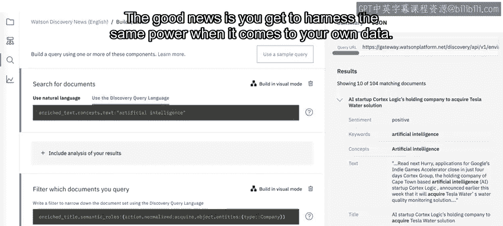

In this course we'll develop a chatbot that can assist Coursera students with their questions。

 I can tell you from experience that many will inquire about course recommendations。

 hard coding each topic in the chatbot is not feasible since Coursera has a huge variety of topics。

So well instead rely on discovery for such queries。But first。

 we'll need to create a collection that contains course data。Let's see how to accomplish this。

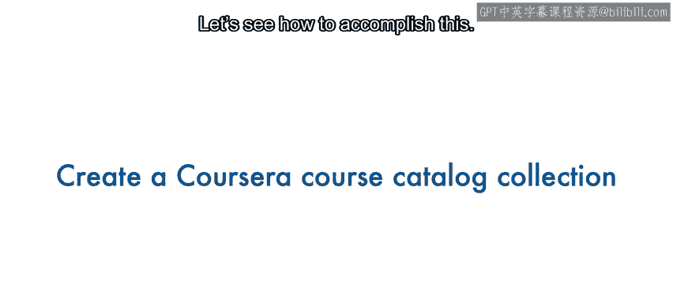

From the Man data section of your discovery， you'll notice the two buttons we've previously discussed。

In the lab for this module， you'll download a subset of Coursera courses as J files。

So here we'll click upload your own data When we do so， a popup will ask us for a collection name。

 we'll call the collection Coursera courses， leave the default to English since our courses will mostly be in English and click Create。

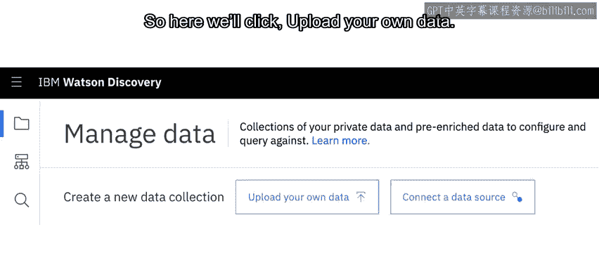

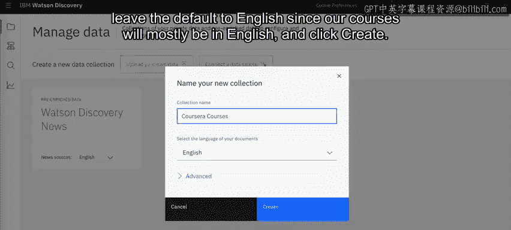

Here we'll be able to click the cloud icon or drag files to upload them in our collection During the lab exercises。

 you'll download and extract a zip file containing 500 course files。

 each file has the following JSON structure the most important bits are the name of the course the slug that will need to reconstruct the URL for the course。

 and the description which includes the text Watson will use to figure out the course content and relevancy to the user queries。

 once we click on that cloud upload icon will be prompted to select these files we download it once you selected the folder in which you extracted the zip file you'll be able to press Control A or command A on Mac to select all the files within before clicking open。

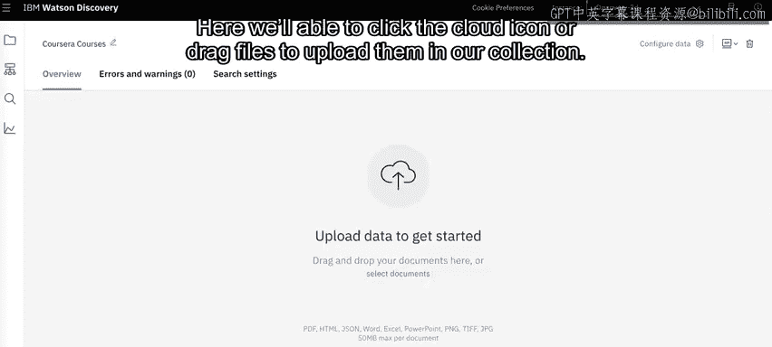

The upload process will take a moment， but you'll eventually see that 500 documents have been added to your collection。

You may receive some warnings about ID being a protected key。

 but since it doesn't contain useful information for our courses。

 you can safely ignore the fact that this particular key in our JSON files wasn't imported。

You'll also notice that there is the option to add some enrichments to our raw data。

We' do so by clicking on the link add enrichments on the right here we'll select description from the dropdown menu Since description was the field with the most data in our documents Next we'll click on add enrichment to enrich this field from the pop up that will appear We'll add keyword extraction and concept tagging There are many other options available for the purposes of our chatbot our queries will simply match the relevance of courses to the user's keywords。

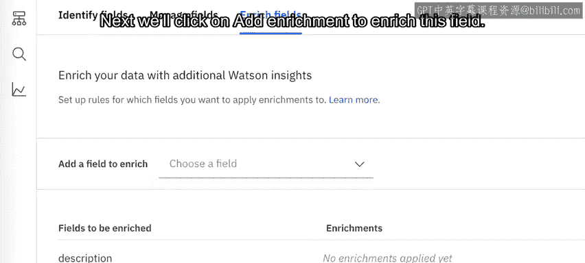

Once the two enrichments have been added， we'll click on the X in the top right to close the pop up window。

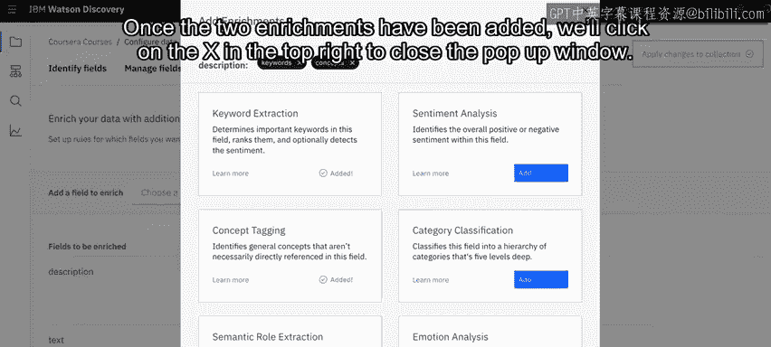

You'll notice that the description filed now has the two enrichments。

 and we can finally click on the App changes to collection button as a sanity check。

 we can click on the query section of Discovery， the magnifying glass icon on the left。

And then on search for documents。Here we could try something like Python and click RunQury at the bottom。

 we should see a series of relevant courses， confirming that our collection is in good shape and ready to be queried。

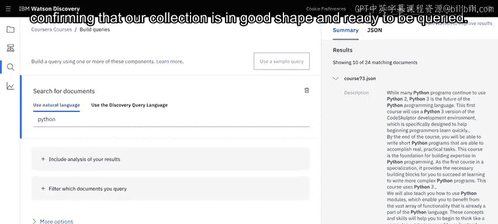

Okay， now that you have the lay of the land， it's your turn to take lab2。

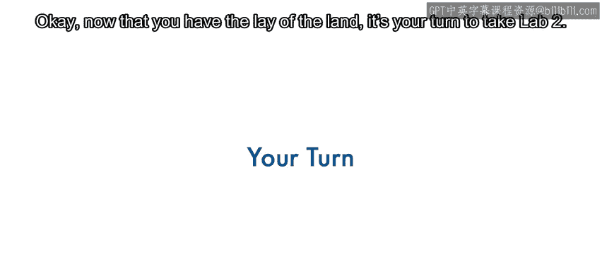