# IBM应用人工智能（从0开始搭建AI机器人）｜IBM Applied AI （中英字幕） - P120：13_结论和下一步.zh_en - GPT中英字幕课程资源 - BV1p64y1H7LM

Congratulations on completing building AI applications with Watson APIs。

 I hope you enjoyed it and learned the valuable skills when it comes to integrating different AI services。

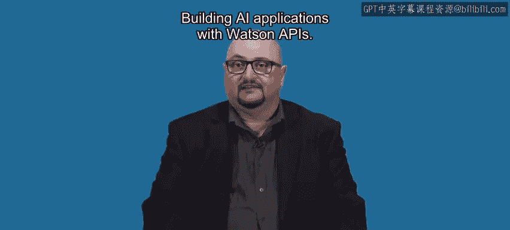

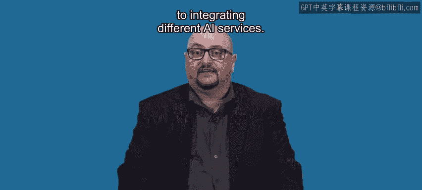

🎼We cover quite a lot of ground in this course， including Watson Discovery。

 calling APIs from dialog nodes， working with serverless functions。

 integrating speech APIs in your application， deployment or chatbots to popular channels and more it's perfectly normal if you don't feel like you have mastered any of them quite yet。

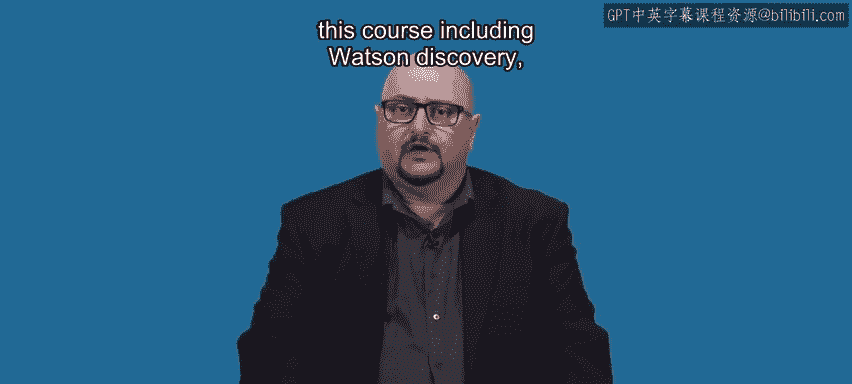

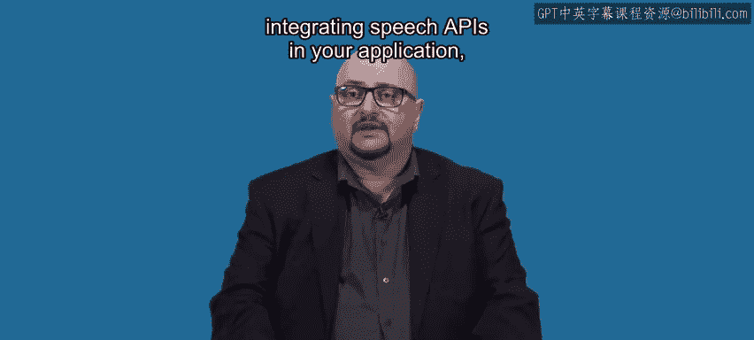

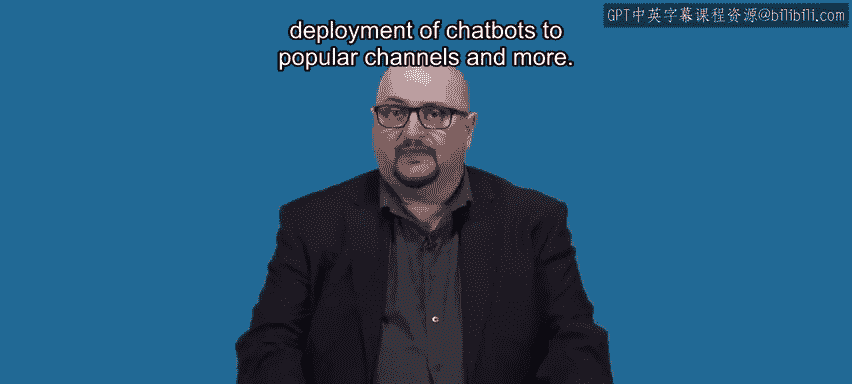

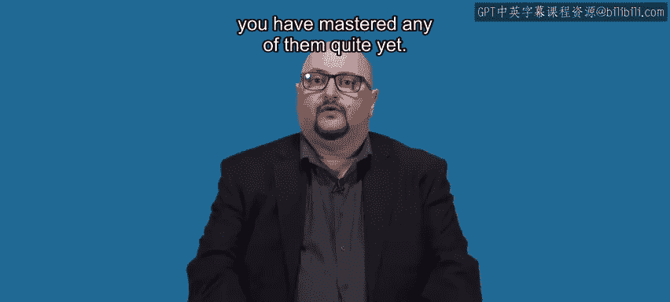

So where do you go from here， as always， my recommendation is to practice these newly acquired skills as much as possible。

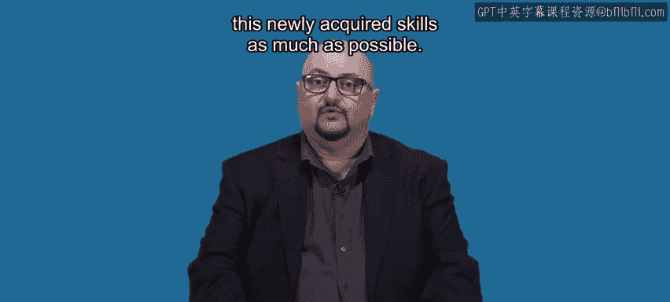

The capstone project got you started， but I suggest that you keep on going with other projects of your own。

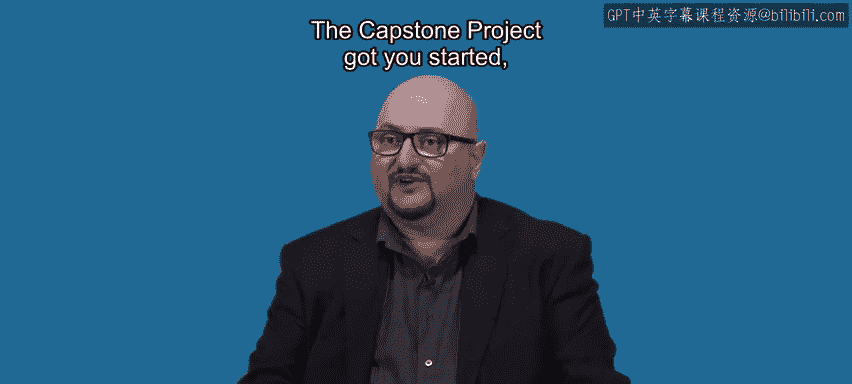

I would also encourage you to pursue further related courses that are part of the IBM AI specialization or even better complete the IBM AI Pro certificate here on Coursera。

 getting the certificate will definitely set you apart from the many people who are interested in a lucrative and interesting career in AI but lack the skills and credentials to back them up。

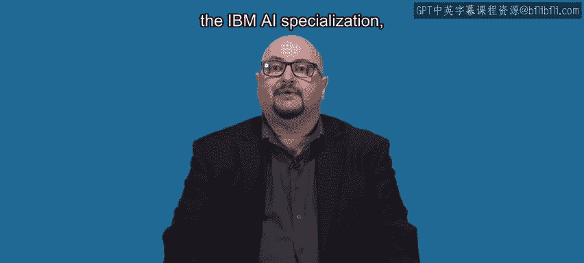

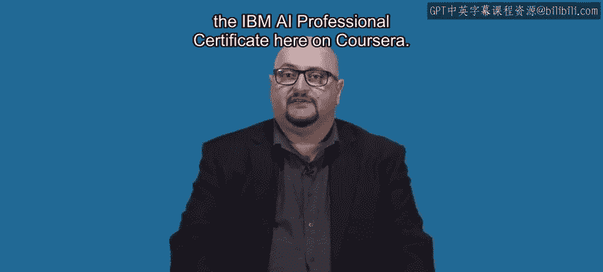

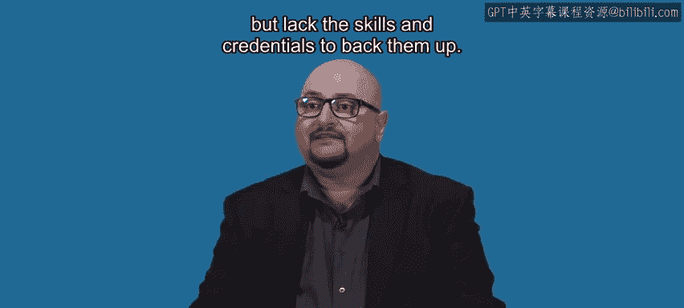

Aside from providing you with further skills， it will showcase your commitment to continued technical learning I really look forward to seeing you break into the AI industry and achieve your career goals。

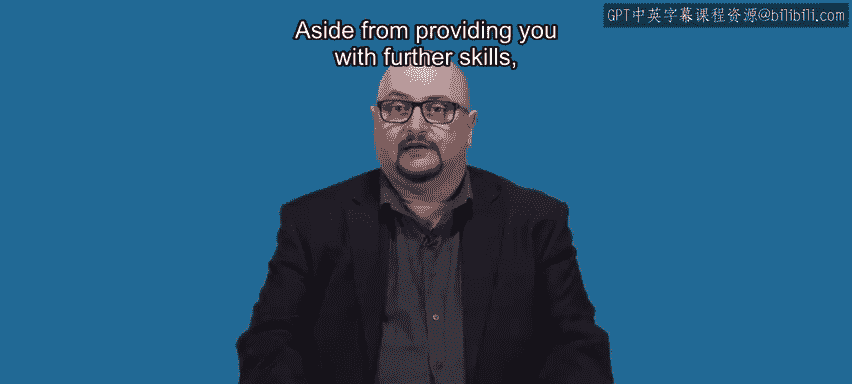

