# IBM应用人工智能（从0开始搭建AI机器人）｜IBM Applied AI （中英字幕） - P12：11_术语和相关概念.zh_en - GPT中英字幕课程资源 - BV1p64y1H7LM

。🎼Before we deep dive into how AI works and its various use cases and applications。

 let's differentiate some of the closely related terms and concepts of AI Artific intelligence。

 machine learning， deep learning and neural networks， these terms are sometimes used interchangeably。

 but they do not refer to the same thing。 Artific intelligence is a branch of computer science。

 dealing with the simulation of intelligent behavior。

 AI systems will typically demonstrate behaviors associated with human intelligence。

 such as planning， learning， reasoning， problem solving， knowledge representation， perception。

 motion and manipulation， and to a lesser extent social intelligence and creativity。

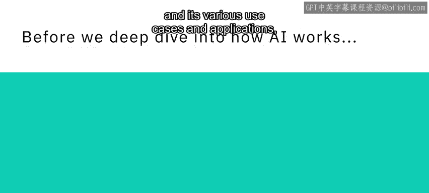

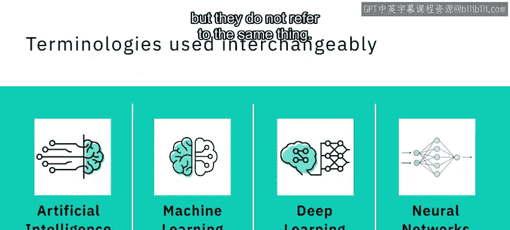

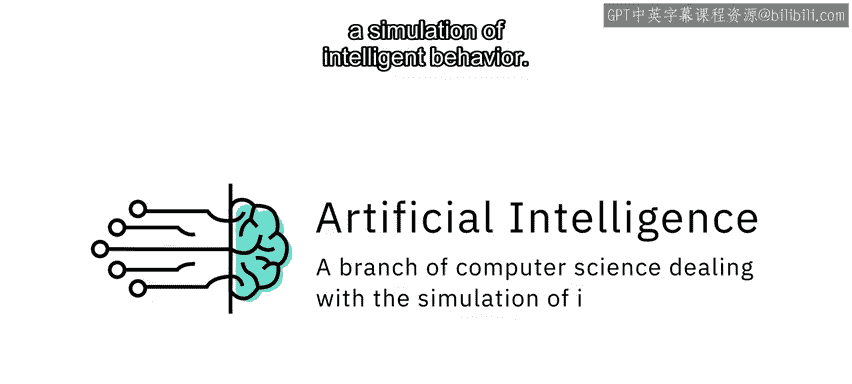

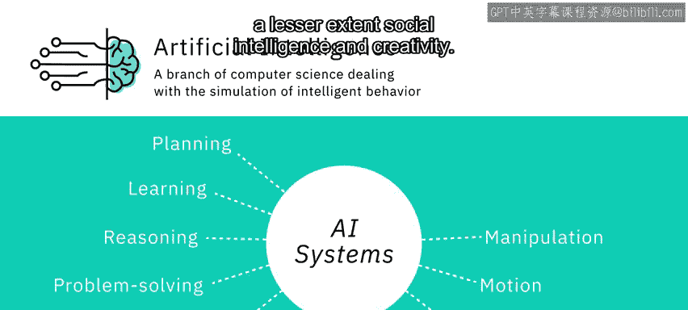

Machine learning is a subset of AI that uses computer algorithms to analyze data and make intelligent decisions based on what it is learned without being explicitly programmed Maine learning algorithms are trained with large sets of data and they learn from examples they do not follow rules-based algorithms Machine learning is what enables machines to solve problems on their own and make accurate predictions using the provided data。

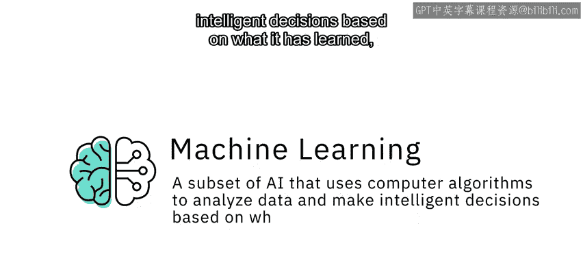

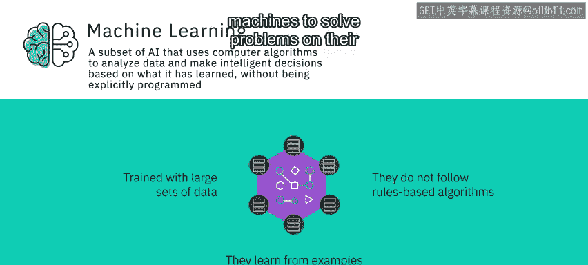

🎼Deep learning is a specialized subset of machine learning that uses layered neural networks to simulate human decision making。

 Deep learning algorithms can label and categorize information and identify patterns。

 It is what enables AI systems to continuously learn on the job and improve the quality and accuracy of results by determining whether decisions were correct。

 Art neural networks often referred simply as neural networks take inspiration from biological neural networks。

 although they work quite a bit differently。 a neural network in AI is a collection of small computing units called neurons that take incoming data and learn to make decisions over time。

 neural networks are often layered deep and are the reason deep learning algorithms become more efficient as the data sets increase in volume as opposed to other machine learning algorithms that may plateau as data increases。

 Now that you have a broad understanding of the differences between some key AI concepts There is one more differentiation that is。

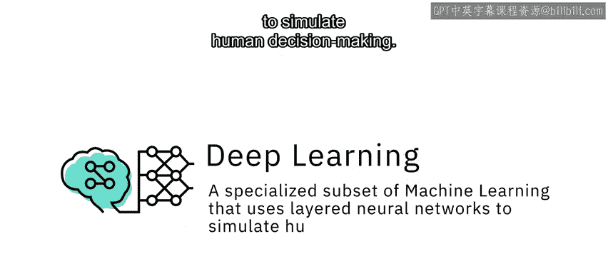

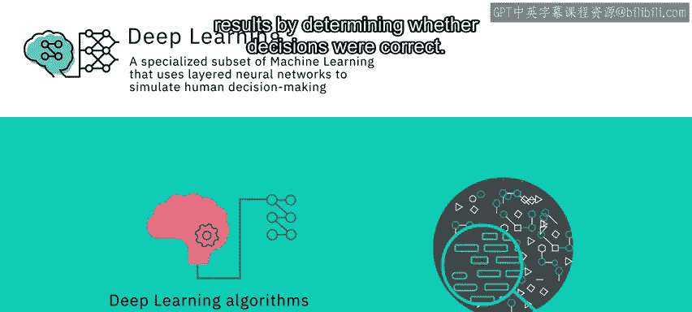

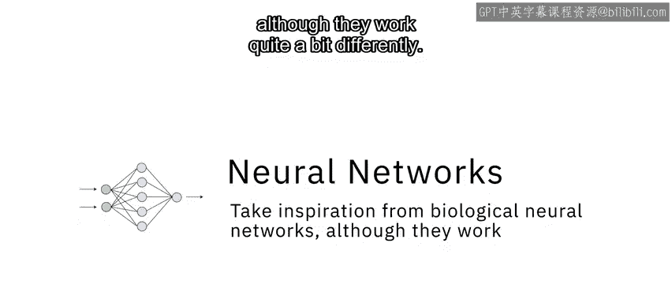

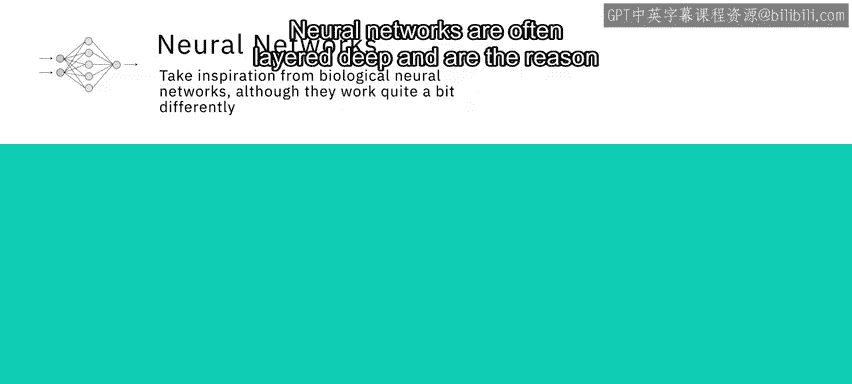

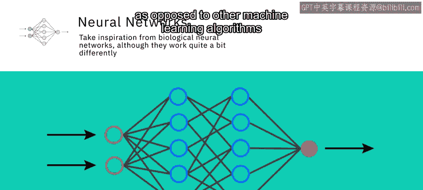

Important to understand that between artificial intelligence and data science。

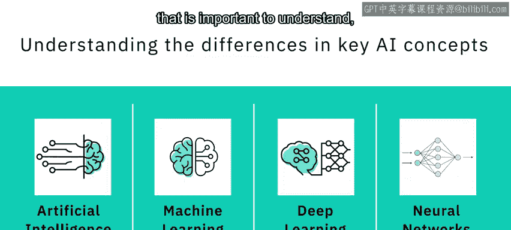

Data science is the process and method for extracting knowledge and insights from large volumes of disparate data。

 it's an interdisciplinary field involving mathematics， statistical analysis， data visualization。

 machine learning and more it's what makes it possible for us to appropriate information。

 see patterns， find meaning from large volumes of data。

 and use it to make decisions that drive business。🎼Data science can use many of the AI techniques to derive insight from data For example。

 it could use machine learning algorithms and even deep learning models to extract meaning and draw inferences from data there is some intersection between AI and data science but one is not a subset of the other rather。

 data science is a broad term that encompasses the entire data processing methodology while AI includes everything that allows computers to learn how to solve problems and make intelligent decisions and both AI and data science can involve the use of big data that is significantly large volumes of data in the next few lessons the terms machine learning。

 deep learning and neural networks will be discussed in more detail。

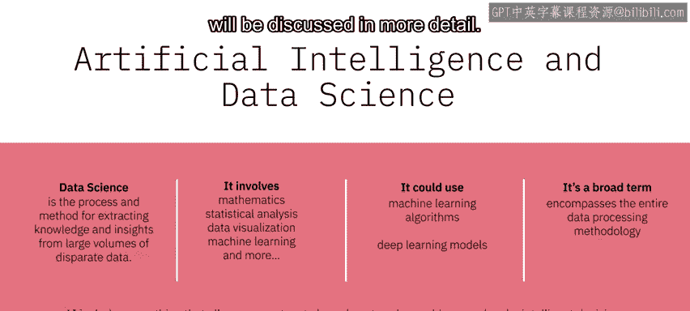