# IBM应用人工智能（从0开始搭建AI机器人）｜IBM Applied AI （中英字幕） - P14：13_机器学习技术和训练.zh_en - GPT中英字幕课程资源 - BV1p64y1H7LM

。🎼Machine learning is a broad field and we can split it up into three different categories。

 supervised learning， unsupervised learning and reinforcement learning there are many different tasks we can solve with these Supervised learning refers to when we have class labels in the data and we use these to build the classification model what this means is when we receive data it has labels that say what the data represents。

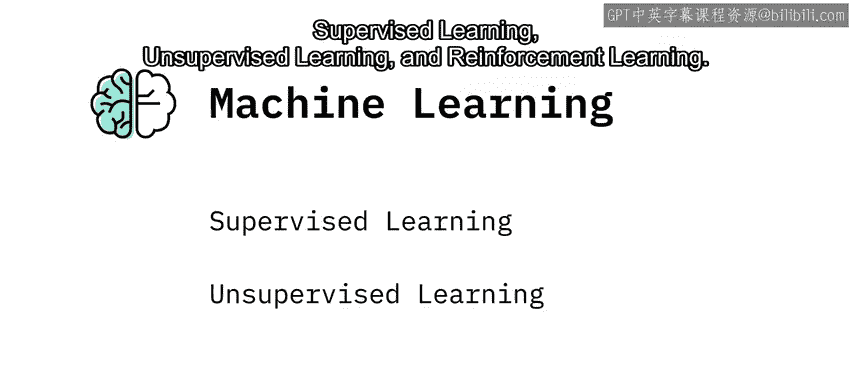

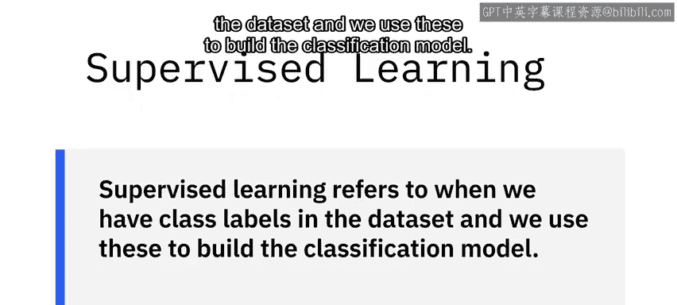

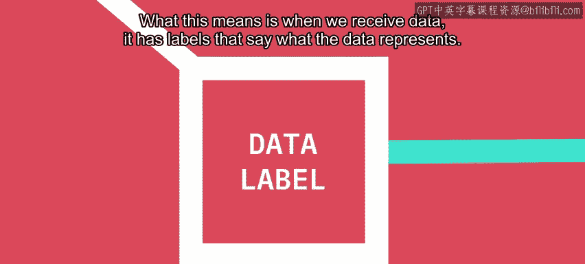

In a previous example， we had a table with labels such as age or sex with unsupervised learning。

 we don't have class labels and we must discover class labels from unstructured data This could involve things such as deep learning looking at pictures to train models。

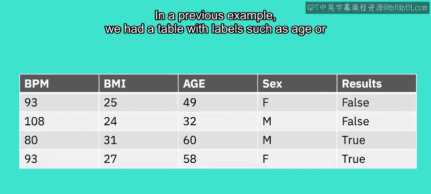

Things like this are typically done with something called clustering。

Reinforcement learning is a different subset and what this does is it uses a reward function to penalize bad actions or reward good actions。

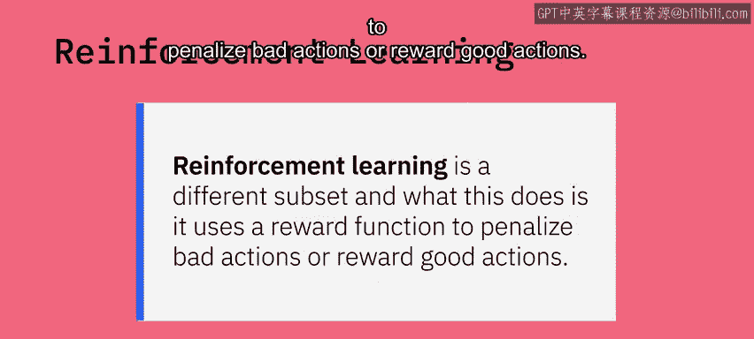

Baking down supervised learning， we can split it up into three categories， regression。

 classification and neural networks regression models are built by looking at the relationships between features X and the result Y。

 where Y is a continuous variable。

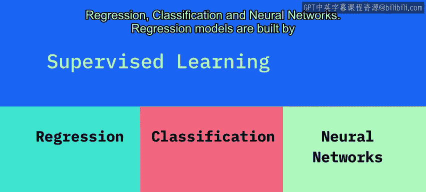

Essentially， regression estimates continuous values。

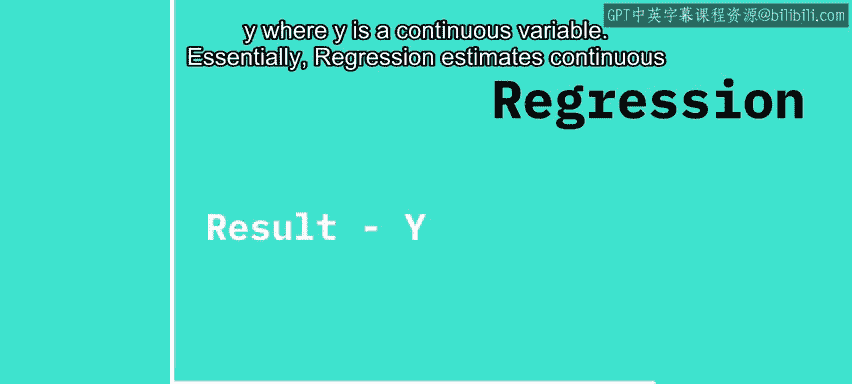

Neurural networks refer to structures that imitate the structure of the human brain。

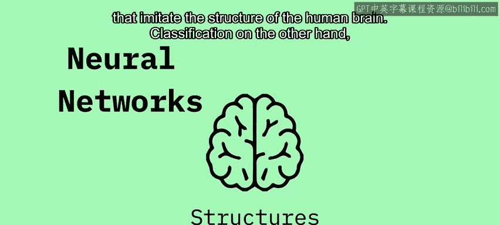

🎼Classification， on the other hand， focuses on discrete values it identifies。

 We can assign discrete class labels Y based on many input features X In a previous example。

 given a set of features X like beats per minute， body mass index， age and sex。

 the algorithm classifies the output Y as two categories true or false。

 predicting whether the heart will fail or not。 In other classification models。

 we can classify results into more than two categories。 For example。

 predicting whether a recipe is for an Indian Chinese Japanese or Thai dish。

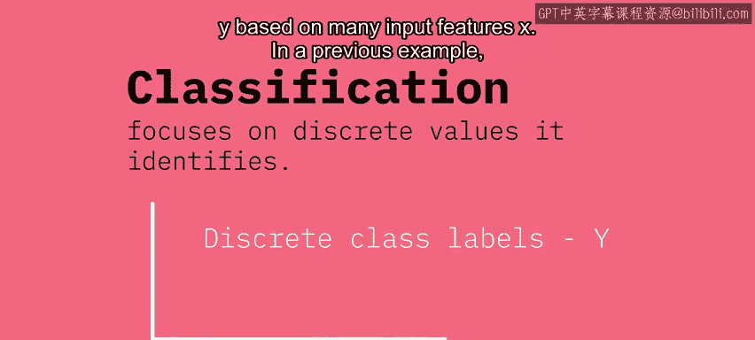

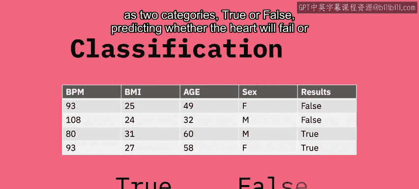

Some forms of classification include decision trees， support vector machines， logistic regression。

 and random forests。

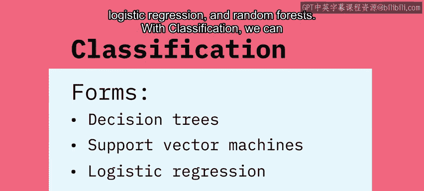

With classification， we can extract features from the data。

 the features in this example would be beats per minute or age。

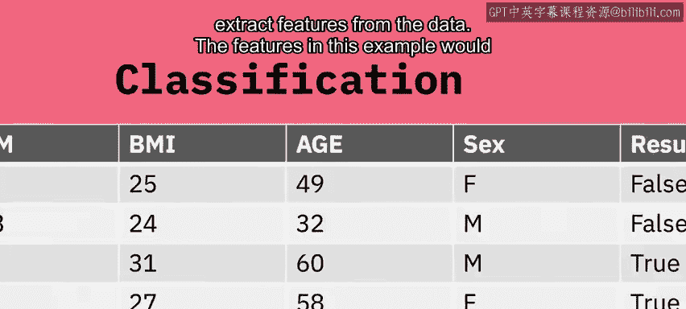

🎼Features are distinctive properties of input patterns that help in determining the output categories or classes of output Each column is a feature and each row is a data point Classification is the process of predicting the class of given data points Our classifier uses some training data to understand how given input variables relate to that class。

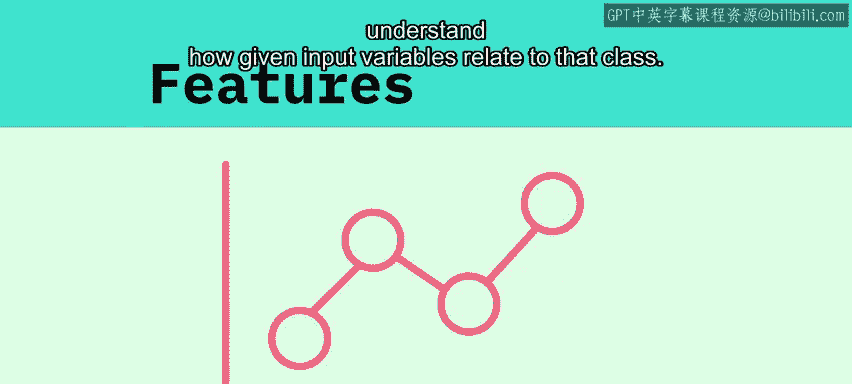

What exactly do we mean by training Training refers to using a learning algorithm to determine and develop the parameters of your model while there are many algorithms to do this in layman's terms。

 if you are training a model to predict whether the heart will fail or not。

 that is true or false values， you will be showing the algorithm some reallife data labeled true。

 then showing the algorithm again， some data labeled false and you will be repeating this process with data having true or false values。

 that is whether the heart actually fail or not。

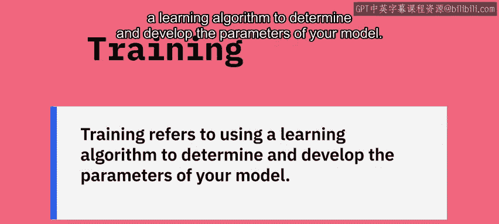

The algorithm modifies internal values until it has learned to tell from data that indicates heart failure that is true or not。

 that is false。

With machine learning， we typically take a data set and split it into three sets， training。

 validation， and test sets。

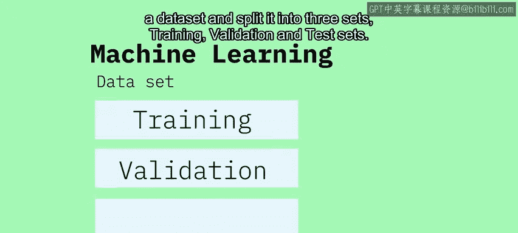

The training subset is the data used to train the algorithm。

The validation subset is used to validate our results and fine tune the algorithm's parameters。

And the testing data is the data the model has never seen before and used to evaluate how good our model is we can then indicate how good the model is using terms like accuracy。

 precision and recall。

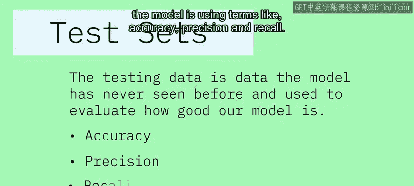