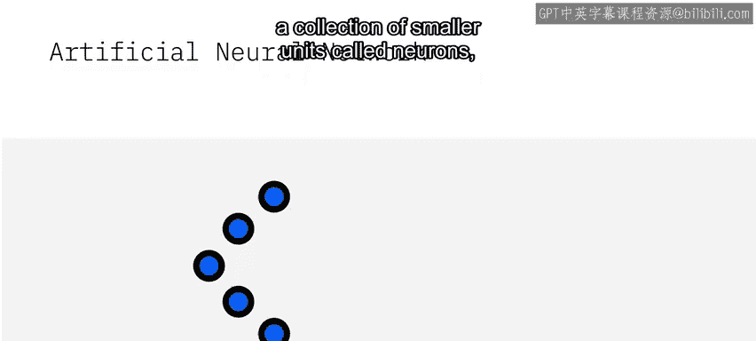
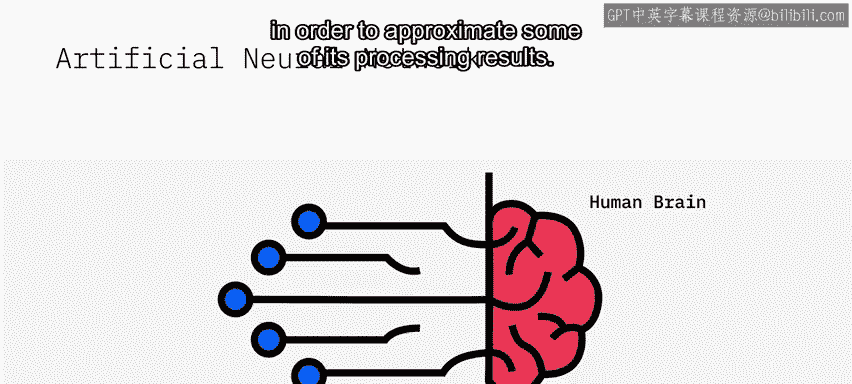
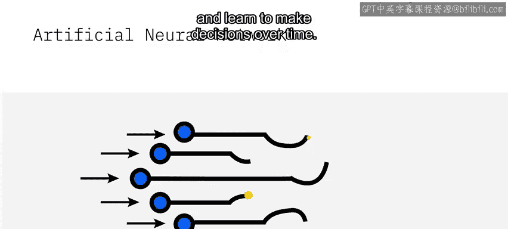
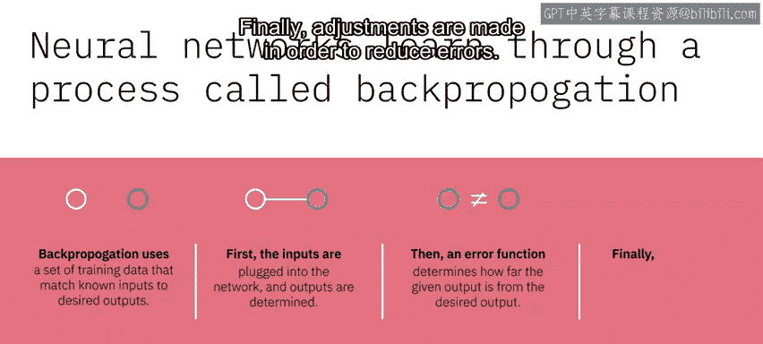
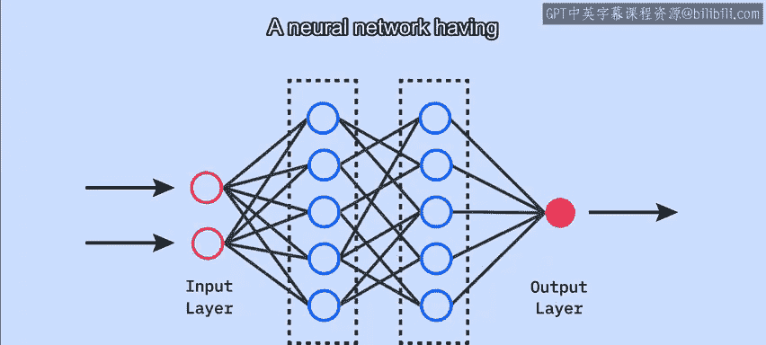
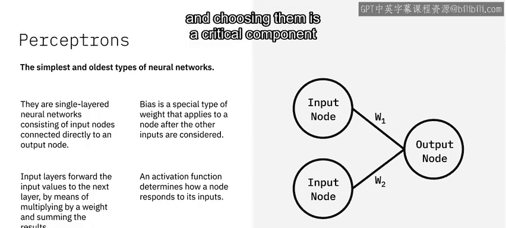
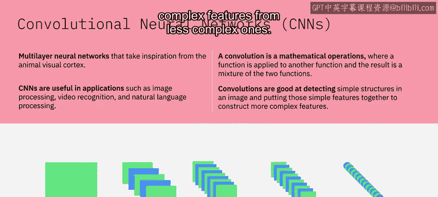
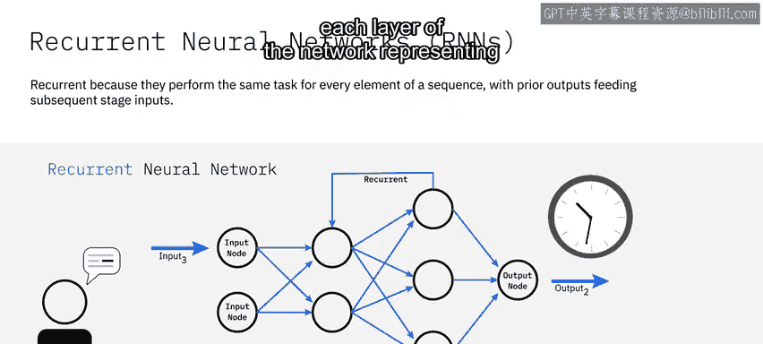

# IBM应用人工智能（从0开始搭建AI机器人）｜IBM Applied AI （中英字幕） - P16：15_神经网络.zh_en - GPT中英字幕课程资源 - BV1p64y1H7LM

。🎼An artificial neural network is a collection of small units called neurons。

 which are computing units modeled on the way the human brain processes information Artific neural networks borrow some ideas from the biological neural network of the brain in order to approximate some of its processing results These units or neurons take incoming data like the biological neural networks and learn to make decisions over time neural networks learn through a process called back propagation back propagation uses a set of training data that match known inputs to desired outputs First。

 the inputs are plugged into the network and outputs are determined then an error function determines how far the given output is from the desired output Finally。

 adjustments are made in order to reduce errors。

🎼A collection of neurons is called a layer and a layer takes in an input and provides an output。

 Any neural network will have one input layer and one output layer。

 It will also have one or more hidden layers which simulate the types of activity that goes on in the human brain Hi layers take in a set of weighted inputs and produce an output through an activation function。

 A neural network having more than one hidden layer is referred to as a deep neural network Perceptrons are the simplest and oldest types of neural networks。

 They are single layered neural networks consisting of input nodes connected directly to an output node input layers forward the input values to the next layer by means of multiplying by a weight and summing the results hidden layers receive input from other nodes and forward their output to other nodes hidden and output nodes have a property called bias which is a special type of weight that applies to a node after the other inputs are considered Finally。

 an activation function determines how a node response。

🎼To its inputs， the function is run against the sum of the inputs and bias。

 and then the result is forwarded as an output Activation functions can take different forms and choosing them is a critical component to the success of a neural network convolutional neural networks or CNNNs are multilayer neural networks that take inspiration from the animal visual cortex CNNNs are useful in application such as image processing。

 video recognition and natural language processing a convolution is a mathematical operation where a function is applied to another function。

 and the result is a mixture of the two functions。

🎼Convolutions are good at detecting simple structures in an image and putting those simple features together to construct more complex features in a convolutional network。

 This process occurs over a series of layers， each of which conducts a convolution on the output of the previous layer。

 CNs are adept at building complex features from less complex ones。

 Recurrent neural networks or RNs are recurrent because they perform the same task for every element of a sequence with prior outputs feeding subsequent stage inputs In a general neural network。

 and input is processed through a number of layers。

 and an output is produced with an assumption that the two successive inputs are independent of each other。

 but that may not hold true in certain scenarios。 For example。

 when we need to consider the context in which a word has been spoken。 In such scenarios。

 dependence on previous observations has to be considered to produce the output。

 RNs can make use of information in long sequences。 Each layer of the network represents。

The observation at a certain time。