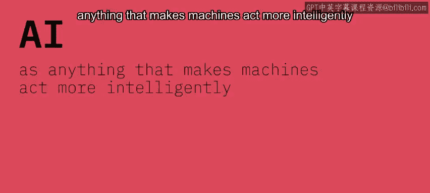
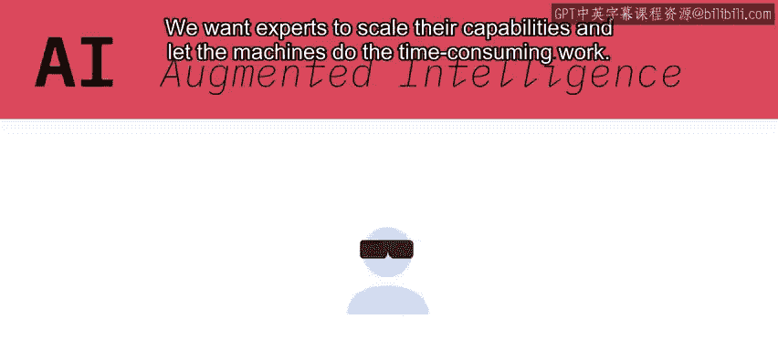
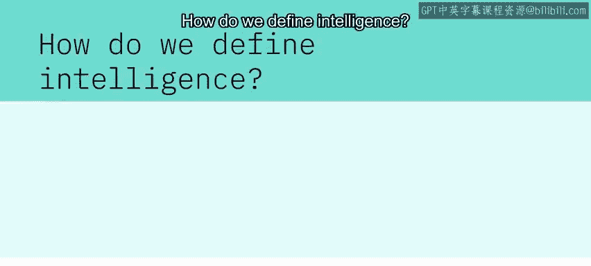
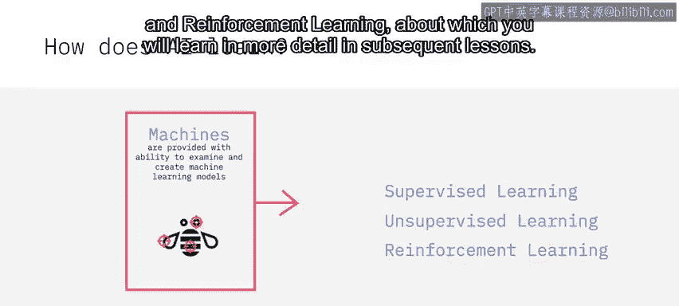
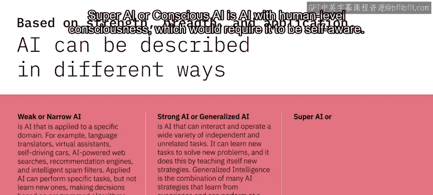
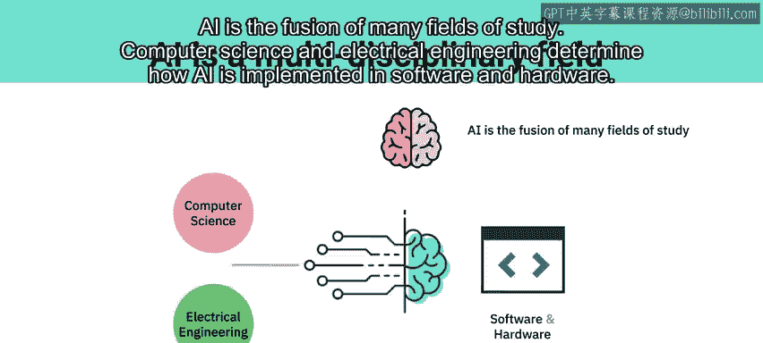
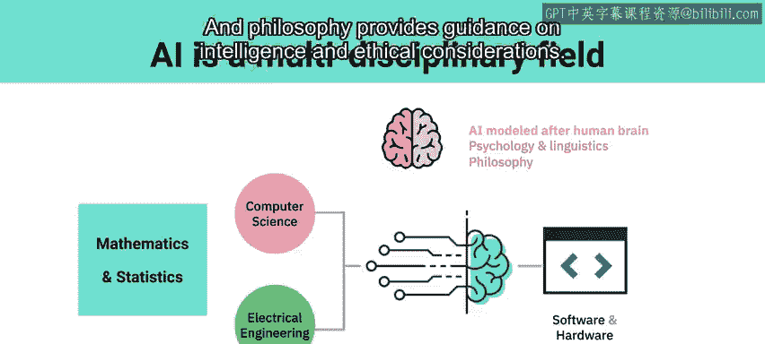
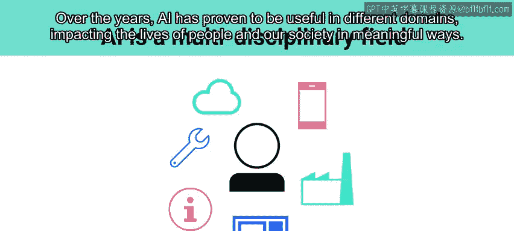

# IBM应用人工智能（从0开始搭建AI机器人）｜IBM Applied AI （中英字幕） - P1：0_AI简介.zh_en - GPT中英字幕课程资源 - BV1p64y1H7LM

。🎼At IBM， we define AI as anything that makes machines act more intelligently。

 We like to think of AI as augmented intelligence。 We believe that AI should not attempt to replace human experts but rather extend human capabilities and accomplish tasks that neither humans nor machines could do on their own。

 The Internet has given us access to more information faster。

 Disbut computing and Io have led to massive amounts of data and social networking has encouraged most of that data to be unstructured with augmented intelligence。

 We are putting information that subject matter experts need at their fingertips and backing it with evidence so they can make informed decisions。

 We want experts to scale their capabilities and let the machines do the time consuming work。

How do we define intelligence？

Human beings have innate intelligence， defined as the intelligence that governs every activity in our body。

 this intelligence is what causes an oak tree to grow out of a little seed and an elephant to form from a single celled organism。

How does AI learn？🎼The only innate intelligence machines have is what we give them。

 We provide machines the ability to examine examples and create machine learning models based on the inputs and desired outputs。

 and we do this in different ways such as supervised learning。

 unsupervised learning and reinforcement learning about which you will learn in more detail and subsequent lessons。

 based on strength， breadth and application， AI can be described in different ways。

 weak or narrow AI is AI that is applied to a specific domain For example， language translators。

 virtual assistance， self-driving cars， AI powered web searches。

 recommendation engines and intelligent spam filters appliedlied AI can perform specific tasks but not learn new ones。

 making decisions based on programmed algorithms and training data。

🎼Strong AI or generalized AI is AI that can interact and operate a wide variety of independent and unrelated tasks。

 It can learn new tasks to solve new problems， and it does this by teaching itself new strategies。

 Generalralized intelligence is the combination of many AI strategies that learn from experience and can perform at a human level of intelligence。

Super AI or consciouscious AI is AI with humanlel consciousness。

 which would require it to be selfaware because we are not yet able to adequately define what consciousness is it's unlikely that we will be able to create a conscious AI in the near future AI is the fusion of many fields of study。

🎼Computer science and electrical engineering determine how AI is implemented in software and hardware maththematics and statistics determine viable models and measure performance because AI is modeled on how we believe the brain works。

 psychology and linguistics play an essential role in understanding how AI might work and philosophy provides guidance on intelligence and ethical considerations。

 While the science fiction version of AI may be a distant possibility。

 we already see more and more AI involved in the decisions we make every day over the years AI has proven to be useful in different domains。

 impacting the lives of people and our society in meaningful ways。

